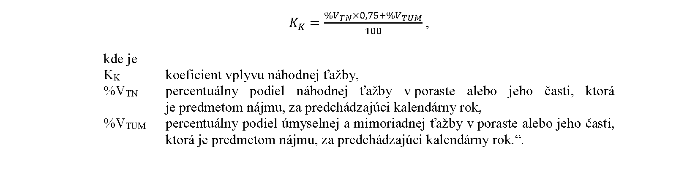

# Čl. I

Vyhláška Ministerstva pôdohospodárstva a rozvoja vidieka Slovenskej republiky č. 207/2019 Z. z., ktorou sa ustanovuje spôsob určenia výšky nájomného k lesným pozemkom za hospodárenie v lesoch sa mení a dopĺňa takto:

- 1. V prílohe časti 1. Definícia základných pojmov prvom odseku sa vypúšťajú slová „(alebo strata)“.

- 2. V prílohe časť 2. Výpočet výšky ročného nájomného pre porast znie:

- „[Priloha časť 2 - v pdf](assets/10a117b0b62743e4cf8a0ce628c649da1a08b90aa3a3a264628478a5b98bf28a.pdf)“.

- 3. V prílohe časti Výstup č. 1 tabuľková časť Dosiahnuteľný ročný výnos (ANNA,R) pre topoľ šľachtený (suma.ha-1.rok-1) vrátane nadpisu znie:

- „[Výstup č. 1 tabuľková časť - pdf](assets/dd1f87d49a9e966d890c5f1b0af3294ad2bba40c57979cf490e1a6f93fffe589.pdf)“.

- 4. V prílohe časť Výstup č. 3: Koeficienty zakmenenia (KZ) pre prepočet dosiahnuteľného výnosu podľa zakmenenia vrátane nadpisu znie:

- „[Výstup č. 3 - priloha v pdf](assets/fce220bfe436ddc6e1782d16e5fa15c6ba7f5f2bc0af30e913cd4f41a8069231.pdf)“.

- 5. V prílohe časť Výstup č. 5: Koeficienty obmedzení v dôsledku osobitného režimu hospodárenia (KO) vrátane nadpisu znie:

- „[Výstup č. 5 - príloha v pdf](assets/a53379e42a79ceb47ca3b61f00f15f31c9075ea82bc2e06d04f389fd2f45365e.pdf)“.

- 6. V prílohe časť Výstup č. 7: Koeficient vývoja priemerných cien a nákladov (KC) vrátane nadpisu znie:

- „[Výstup č. 7 - príloha v pdf](assets/4e3f24dde833e118342163e270d81f48f0ce2deca4791729c0a3010158f3d40f.pdf)“.

- 7. Príloha sa dopĺňa Výstupom č. 8, ktorý vrátane nadpisu znie:

- „Výstup č. 8: Koeficient vplyvu náhodnej ťažby na výnosovosť hospodárenia (KK)

- Koeficient vyjadruje nepriaznivý vplyv náhodnej ťažby na výnos hospodárenia. Vypočíta sa na základe podielu náhodnej ťažby na celkovej ťažbe v poraste alebo jeho časti, ktorá je predmetom nájmu, podľa lesnej hospodárskej evidencie za kalendárny rok predchádzajúci roku, za ktorý sa nájomné vypočítava. Zníženie výnosovosti je určené na základe analýzy výnosovosti náhodných ťažieb v porovnaní s úmyselnými ťažbami za roky 2014, 2015 a 2016, pričom výnosovosť náhodných ťažieb je v priemere na úrovni 75 % výnosovosti úmyselných ťažieb.

- Pre porast alebo jeho časť, ktorá je predmetom nájmu, sa KK vypočíta podľa vzorca“.

- 
