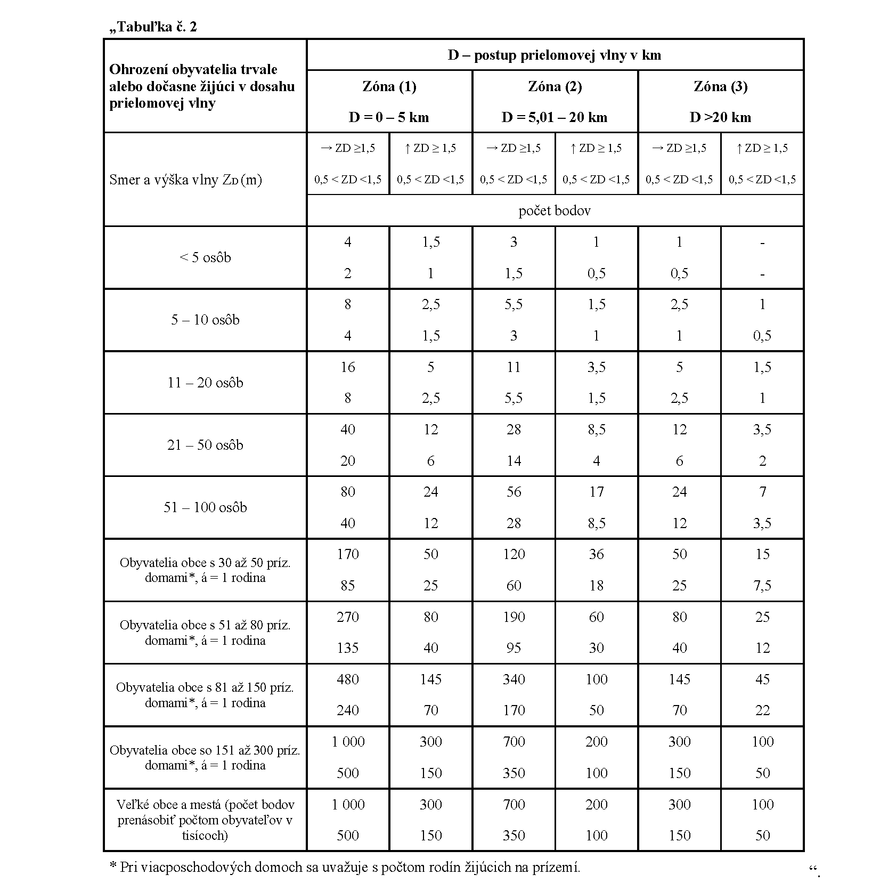
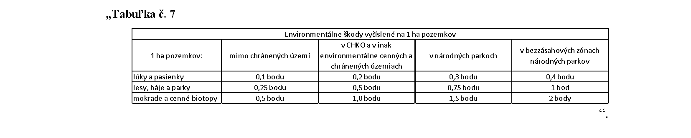

# Čl. I

Vyhláška Ministerstva životného prostredia Slovenskej republiky č. 119/2016 Z. z., ktorou sa ustanovujú podrobnosti o výkone odborného technicko-bezpečnostného dohľadu nad vodnými stavbami a o výkone technicko-bezpečnostného dozoru sa mení a dopĺňa takto:

- 1. V § 2 ods. 2 sa slová „po získaní potrebných informácií od orgánu štátnej vodnej správy na základe projektovej dokumentácie, poznatkov z obchôdzky“ nahrádzajú slovami „po získaní potrebných informácií z projektovej dokumentácie vodnej stavby, z manipulačného poriadku vodnej stavby, informácií od orgánu štátnej vodnej správy, vlastníka, správcu a užívateľa vodnej stavby, poznatkov z obchôdzky“.

- 2. V § 3 ods. 1 písm. c) sa slová „rozhodnutia orgánu štátnej vodnej správy“ nahrádzajú slovami „vyjadrenia hlavného zamestnanca dohľadu“ a za slová „počas overovacej prevádzky“ sa vkladajú slová „na základe súhlasného stanoviska orgánu štátnej vodnej správy“.

- 3. V § 3 ods. 2 sa slová „Na účely dohľadu sa pri odkaliskách“ nahrádzajú slovami „Pri odkaliskách sa na účely dohľadu“.

- 4. V § 4 sa odsek 1 dopĺňa písmenom m), ktoré znie:

- „m)

- aktuálnosť hydrologických podkladov z hľadiska bezpečnosti vodnej stavby počas jej povodňového zaťaženia podľa § 9 ods. 7 písm. h).“.

- 5. V § 4 ods. 2 písm. b) sa slovo „uskutočnenia“ nahrádza slovami „výstavby alebo zmeny“.

- 6. V § 4 ods. 3 sa slová „prehliadok dohľadu“ nahrádzajú slovami „technicko-bezpečnostných prehliadok“.

- 7. V § 4 ods. 4 sa slovo „uskutočnenia“ nahrádza slovom „výstavby“.

- 8. V § 4 ods. 5 písm. e) sa vypúšťa slovo „prípravy“.

- 9. V § 4 ods. 9 sa slová „odseku 1 písm. l)“ nahrádzajú slovami „odseku 5 písm. e)“.

- 10. V § 5 úvodnej vete sa slová „hlavný zamestnanec dohľadu, obsahuje“ nahrádzajú slovami „odborne spôsobilá osoba na výkon dohľadu nad vodnou stavbou príslušnej kategórie a primerane ku kategórii vodnej stavby obsahuje“.

- 11. V § 5 písm. b) sa vypúšťajú slová „nad rámec technických noriem a“.

- 12. V § 6 ods. 1 sa slová „na výkon dohľadu“ nahrádzajú slovami „na výkon dohľadu nad vodnou stavbou príslušnej kategórie“, slovo „odsúhlasiť“ sa nahrádza slovom „pripomienkovať“ a na konci sa pripájajú tieto slová: „a z pripomienok hlavného zamestnanca dohľadu“.

- 13. V § 7 ods. 1 sa za slovom „zaťaženia“ vypúšťa čiarka a slová „ktorá sa určuje na všetky merania a sledované javy alebo skutočnosti“.

- 14. V § 7 ods. 2 sa vypúšťa druhá veta.

- 15. V § 7 sa za odsek 2 vkladajú nové odseky 3 a 4, ktoré znejú:

- „(3)

- Kritickým javom sa rozumie jav, ktorého vznik spôsobuje obavy o bezpečnosť vodnej stavby.

- (4)

- Výber merných zariadení a sledovaných javov, na ktorých je potrebné určiť medzné hodnoty, kritické hodnoty a kritické javy, určuje hlavný zamestnanec dohľadu pre konkrétnu vodnú stavbu vždy individuálne.“.

  - Doterajšie odseky 3 až 7 sa označujú ako odseky 5 až 9.

- 16. V § 7 odsek 5 znie:

- „(5)

- Určenie medzných hodnôt a kritických hodnôt pre merania na merných zariadeniach sa vykoná primerane ku kategórii vodnej stavby I. a II. kategórie na základe výpočtov a matematického modelovania, ktoré musia byť vypracované prehľadne, jednoznačne a musia umožňovať spätnú kontrolu, pre vodné stavby III. a IV. kategórie na základe analýzy typu a stavu vodnej stavby a jej objektov. Pri prevádzkovanej vodnej stavbe sa využijú výsledky predchádzajúcich meraní a pozorovaní v závislosti od ich dostupnosti. Primerane ku kategórii vodnej stavby sa výpočty vykonávajú v profiloch telesa vodnej stavby, ktoré majú reprezentatívny charakter, pričom sa zohľadňujú geologické a geotechnické charakteristiky podložia vodnej stavby a jej blízkeho okolia. Zohľadní sa aj geometrické usporiadanie profilu telesa vodnej stavby a vonkajšie a vnútorné zaťaženia, ktoré pôsobia na vodnú stavbu, a taktiež sa zohľadnia pripomienky hlavného zamestnanca dohľadu. Pri líniových stavbách, akými sú ochranné hrádze a hrádze kanálov, sa zohľadnia zmeny geologického prostredia a zmeny tvaru telesa vodnej stavby.“.

- 17. V § 7 ods. 6 sa slová „odseku 3“ nahrádzajú slovami „odseku 5“ a za slová „prevádzkovaní podľa“ sa vkladá slovo „platného“.

- 18. V § 7 odsek 8 znie:

- „(8)

- Medzné hodnoty, kritické hodnoty a kritické javy určuje odborne spôsobilá osoba na výkon dohľadu alebo projektant. Ak medzné hodnoty, kritické hodnoty a kritické javy určuje projektant alebo odborne spôsobilá osoba, ktorá nie je hlavným zamestnancom dohľadu, hlavný zamestnanec dohľadu pripomienkuje navrhnuté medzné hodnoty, kritické hodnoty a kritické javy.“.

- 19. V § 8 ods. 1 a § 9 ods. 5 a 7 sa za slovo „obsahuje“ vkladajú slová „primerane ku kategórii vodnej stavby“

- 20. V § 8 ods. 1 písm. a) sa slovo „uskutočnenia“ nahrádza slovom „výstavby“.

- 21. V § 9 ods. 7 písmeno h) znie:

- „h)

- zhodnotenie bezpečnosti vodnej stavby na základe aktualizácie hydrologických podkladov a aktualizácie hladín pri povodňových stavoch zaťaženia, pričom sa vyžaduje na technicko-bezpečnostný dohľad aktualizácia hydrologických podkladov pri stavbách I. a II. kategórie aspoň raz za 10 rokov a pri stavbách III. a IV. kategórie aspoň raz za 20 rokov,“.

- 22. V § 10 sa za odsek 7 vkladá nový odsek 8, ktorý znie:

- „(8)

- Pri odkaliskách v etape trvalej existencie je minimálna početnosť ohliadok určená v Programe technicko-bezpečnostného dohľadu, najmenej však

- a)

- raz týždenne, ak ide o vodné stavby I. kategórie,

- b)

- raz mesačne, ak ide o vodné stavby II. kategórie,

- c)

- raz za štvrťrok, ak ide o vodné stavby III. kategórie.“.

  - Doterajšie odseky 8 až 14 sa označujú ako odseky 9 až 15.

- 23. V § 10 ods. 10 sa slová „odsekov 5 a 8“ nahrádzajú slovami „odsekov 5 a 9“.

- 24. V § 10 ods. 12 sa slová „okamžite a vlastníkovi vodnej stavby zasiela najneskôr“ nahrádzajú slovami „bezodkladne po doručení a vlastníkovi vodnej stavby zasiela vyhodnotenie najneskôr“.

- 25. V § 10 odsek 13 znie:

- „(13)

- Ak vodná stavba pozostáva z viacerých objektov, ktoré majú viacerých vlastníkov, hlavný zamestnanec dohľadu zasiela spoločné vyhodnotenie mesačných hlásení všetkým vlastníkom objektov vodnej stavby.“.

- 26. V § 11 ods. 1 sa slová „obsluhy stavby“ nahrádzajú slovami „vykonávaných podľa Programu dohľadu“.

- 27. V § 11 ods. 3 sa slová „podľa § 10 ods. 11“ nahrádzajú slovami „podľa § 10 ods. 12“.

- 28. V § 12 odsek 7 znie:

- „(7)

- Pri vodných stavbách I. a II. kategórie sa k technicko-bezpečnostnej prehliadke predkladá písomné vyjadrenie hlavného zamestnanca dohľadu poverenej organizácie, ktoré tvorí prílohu záznamu z technicko-bezpečnostnej prehliadky. Hlavný zamestnanec dohľadu poverenej organizácie zašle svoje vyjadrenie vlastníkovi vodnej stavby do troch pracovných dní od vykonania technicko-bezpečnostnej prehliadky.“.

- 29. V § 14 ods. 2 písm. d) sa slovo „manipulačný“ nahrádza slovami „platný manipulačný“.

- 30. V § 14 sa za odsek 2 vkladá nový odsek 3, ktorý znie:

- „(3)

- Súčasťou výkonu dozoru je aj

- a)

- účasť na obhliadke vodnej stavby alebo lokality výstavby v súvislosti s vypracovaním odborného posudku a návrhu na zaradenie vodnej stavby, návrhu na preradenie vodnej stavby, návrhu na nezaradenie vodnej stavby do príslušnej kategórie alebo návrhu na vyradenie vodnej stavby z príslušnej kategórie,

- b)

- poskytnutie informácií odborne spôsobilým osobám na výkon technicko-bezpečnostného dohľadu,

- c)

- vydanie stanoviska k možnosti nahradenia dohľadu počas overovacej prevádzky dohľadom počas výstavby vodnej stavby alebo zmeny vodnej stavby,

- d)

- vydanie stanoviska k možnosti vyradenia vodnej stavby zo zoznamu kategorizovaných vodných stavieb, ak nespĺňa kritériá pre kategorizáciu vodných stavieb podľa predpisov účinných od 15. januára 2015,

- e)

- vydanie stanoviska k možnosti vyradenia vodnej stavby zo zoznamu kategorizovaných vodných stavieb, ak je pre ňu určený faktor rizika škôd menší ako tri body,

- f)

- účasť na technicko-bezpečnostnej prehliadke.“.

  - Doterajšie odseky 3 až 6 sa označujú ako odseky 4 až 7.

- 31. Za § 15 sa vkladá § 15a, ktorý vrátane nadpisu znie:

- 㤠15a

- Prechodné ustanovenie k úpravám účinným od 1. októbra 2020

- Vlastník vodnej stavby, ktorá je kategorizovaná podľa predpisov účinných do 30. septembra 2020, môže požiadať ministerstvo o vyradenie vodnej stavby zo zoznamu kategorizovaných vodných stavieb, ak

- a)

- pre jeho vodnú stavbu nie je určený faktor rizika škôd väčší ako päť bodov, pričom faktor rizika je výlučne súčtom faktora rizika priamych škôd na vodnej stavbe a faktora rizika škôd na úžitku z prerušenia prevádzky vodnej stavby, a k žiadosti doloží aktualizovaný posudok,

- b)

- vodná stavba nespĺňa kritériá pre kategorizáciu vodných stavieb podľa predpisov účinných od 15. januára 2015 a k žiadosti doloží súhlasné stanovisko príslušného orgánu štátnej vodnej správy,

- c)

- pre jeho vodnú stavbu je určený faktor rizika škôd menší ako tri body a k žiadosti doloží súhlasné stanovisko príslušného orgánu štátnej vodnej správy.“.

- 32. V prílohe č. 1 sa v bodoch 3.1 a 5. slovo „rekonštrukciu“ nahrádza slovom „opravu“.

- 33. V prílohe č. 1 tabuľka č. 2 znie:

- 

- 34. V prílohe č. 1 druhom bode poslednej vete sa na konci pripájajú tieto slová: „a zohľadniť sa môžu aj výsledky iných výpočtov rozsahu zaplavenia alebo rozsah vyhlásených inundačných území“.

- 35. V prílohe č. 1 bod 4.3 znie:

- „4.3

- Environmentálne škody

- Hodnotia sa individuálne a určujú sa v eurách. Ich sumu je možné určiť podľa tabuľky č. 7.

- 120 000, – eur = 1 bod“.

  - Vypúšťa sa odkaz 2 vrátane poznámky pod čiarou.

- 36. V prílohe č. 1 sa na konci bodu 4.3 pripája tabuľka č. 7, ktorá znie:

- 

- 37. V prílohe č. 1 piatom bode sa za slová „b) ak neexistujú rezervy, zhodnotí sa individuálne odhadom strát v priemyselnej výrobe za obdobie pol roka...................................................................... 120 000,– eur = 1 bod.“ vkladajú slová „Protipožiarne nádrže

- Straty spôsobené nemožnosťou použiť zásobu vody na hasenie sa hodnotia individuálne v eurách s prihliadnutím na hodnotu požiarom ohrozeného majetku a so zreteľom na náklady na zabezpečenie náhradného zdroja vody na hasenie....... 120 000,– eur = 1 bod.

- Ak nie je možné individuálne hodnotenie škôd alebo ak je individuálne hodnotenie neefektívne, je možné uvažovať s hodnotou 0,1 bodu za každých 10 000 m3 zásobného objemu protipožiarnej vody, najviac však 2 body.“.

- 38. V prílohe č. 1 siedmom bode sa slová „1 ≤ F < 15“ nahrádzajú slovami „3 ≤ F < 15“ a slová „*Ak je F ≤ 3“ sa nahrádzajú slovami „* Ak je 3 ≤ F ≤ 5“.

- 39. V prílohách č. 2 až 5 sa za slová „Bezpečnostné zariadenie vodnej stavby“ vkladá čiarka a slová „ak ide o ochranné hrádze výška bezpečnostného prevýšenia koruny (v m)“.

- 40. V prílohách č. 2 až 5 sa slová „opravy – rekonštrukcie“ nahrádzajú slovom „opravy“.

- 41. Slovo „rekonštrukcia“ vo všetkých tvaroch sa v celom texte vyhlášky vrátane príloh nahrádza slovom „zmena“ v príslušnom tvare.
