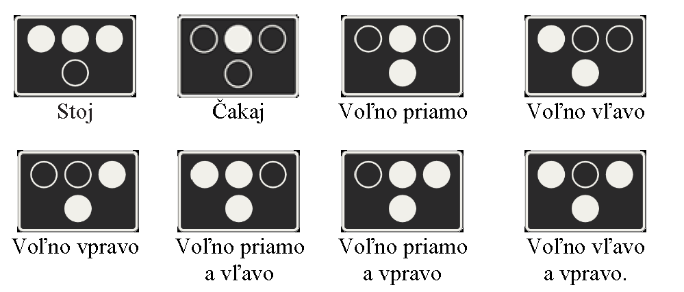

# § 18 Signály pre vozidlá verejnej hromadnej dopravy

(1) Cestná premávka dráhových vozidiel môže byť riadená zvláštnymi signálmi; týmito signálmi môže byť tiež riadená premávka vo vyhradených pruhoch pre verejnú dopravu.

(2) Vyobrazenie a význam zvláštnych signálov podľa odseku 1 je

(3) Na význam zvláštnych signálov „Stoj“, „Čakaj“ a „Voľno“ sa vzťahuje § 15 ods. 2.
