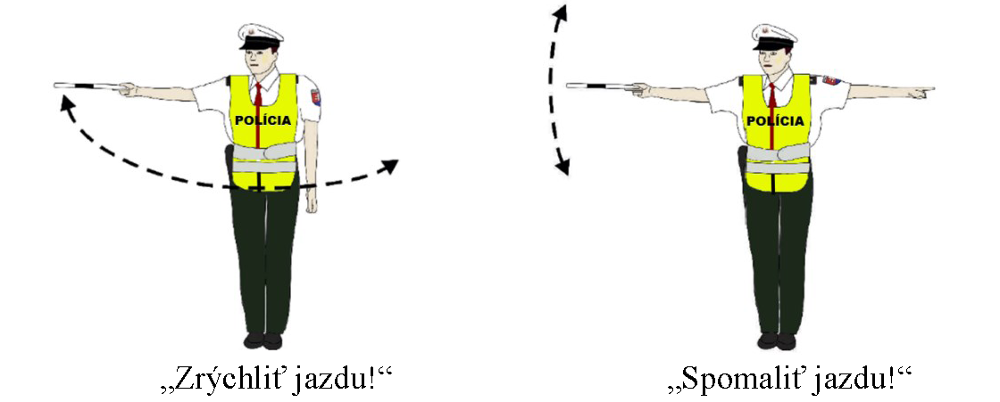

# § 22 Pokyny

(1) Cestnú premávku v križovatke riadi príslušník Policajného zboru (ďalej len „policajt“) v rovnošate zmenou postoja a pokynmi rúk, pričom používa smerovku, ktorú drží v pravej ruke. Pokyny policajta znamenajú pre účastníkov cestnej premávky

- a) „Stoj“ pre smer, ku ktorému stojí policajt čelom alebo chrbtom s upaženou rukou alebo upaženými rukami; policajt môže obe ruky pripažiť, ak na riadenie cestnej premávky stačí postoj,

- 

- b) „Čakaj“, ak má policajt zdvihnutú pravú ruku alebo predlaktie pravej ruky nahor; pre účastníkov cestnej premávky už sa nachádzajúcich v križovatke znamená tento pokyn „Opustite križovatku“,

- 

- c) „Voľno“ pre smer, ku ktorému stojí policajt bokom s upaženou rukou alebo upaženými rukami; policajt môže obe ruky pripažiť, ak na riadenie cestnej premávky stačí postoj,

- 

- d) „Stoj“ pre vodiča prichádzajúceho smerom k chrbtu alebo k pravému boku policajta, ak má policajt pravú ruku predpaženú a ľavú ruku upaženú a „Voľno“ pre vodiča prichádzajúceho smerom k ľavému boku policajta; vodič vozidla prichádzajúceho smerom k čelu policajta môže odbočiť vpravo a chodci smú prechádzať cez vozovku za chrbtom policajta.

- 

(2) Na význam pokynov „Stoj“, „Čakaj“ a „Voľno“ sa vzťahuje § 15 ods. 2.

(3) Policajt môže pri riadení cestnej premávky dávať okrem pokynov uvedených v odseku 1 aj iné pokyny, najmä pokyn „Zrýchliť jazdu!“ vodorovným kývaním ruky cez stred tela alebo pokyn „Spomaliť jazdu!“ kývaním ruky hore a dolu. Na zdôraznenie pokynu môže policajt použiť píšťalku.

(4) Odseky 1 až 3 sa vzťahujú aj na riadenie cestnej premávky na inom mieste, ako je križovatka a na riadenie cestnej premávky inou oprávnenou osobou podľa § 62 ods. 2 zákona.
