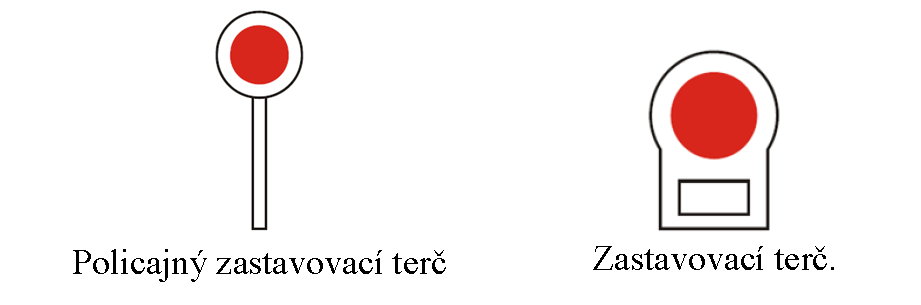

# § 23 Zastavovanie vozidiel

(1) Pokyn na zastavenie vozidla sa musí dávať včas, zreteľne a s ohľadom na okolnosti cestnej premávky, aby vodič mohol bezpečne zastaviť vozidlo a aby sa neohrozila bezpečnosť cestnej premávky.

(2) Policajt dáva pokyn na zastavenie vozidla zdvihnutím ruky s otvorenou dlaňou smerujúcou k zastavovanému vozidlu, zdvihnutým policajným zastavovacím terčom alebo svietidlom vyžarujúcim svetlo červenej farby, ktorým pohybuje v hornom polkruhu. Z idúceho vozidla označeného príslušnosťou k Policajnému zboru a vozidla neoznačeného príslušnosťou k Policajnému zboru môže dávať policajt pokyn na zastavenie vozidla kývaním ruky zvisle hore a dolu, vysunutým policajným zastavovacím terčom alebo rozsvietením nápisu „STOP“. Z idúceho vozidla možno pokyn na zastavenie vozidla zdôrazniť zvláštnym výstražným svetlom, prípadne aj typickým zvukovým znamením podľa § 6a písm. j) zákona. Pokyn na zastavenie vozidla možno dávať z vozidla idúceho pred zastavovaným vozidlom, ako aj z vozidla idúceho za zastavovaným vozidlom. Pri zastavovaní vozidla idúceho pred vozidlom, z ktorého policajt dáva pokyn na zastavenie vozidla, sa zvláštne výstražné svetlo a typické zvukové znamenie použije vždy. Pokyn na zastavenie vozidla dávaný z idúceho vozidla môže byť doplnený rozsvietením nápisu, ktorým sa usmerňuje vozidlo na miesto zastavenia.

(3) Odsek 2 sa vzťahuje aj na zastavovanie vozidla inou oprávnenou osobou podľa § 63 ods. 1 zákona.

(4) Osoby uvedené v § 63 ods. 2 písm. a) až c) zákona dávajú pokyn na zastavenie vozidla zdvihnutou rukou alebo zastavovacím terčom. Pri trhacích prácach v lomoch, pri údržbe cesty a pri iných podobných právach sa pri pokyne na zastavenie vozidla používa spravidla červená zástavka.

(5) Poverená osoba podľa § 63 ods. 2 písm. e) zákona musí mať na sebe reflexný bezpečnostný odev a môže dávať pokyny na zastavenie vozidla len na priechode pre chodcov; kde priechod nie je alebo je neschodný, smie dávať pokyny na zastavenie vozidla aj na inom mieste na vozovke. Poverená osoba nemôže dávať pokyny na zastavenie vozidla v blízkosti križovatky s riadenou premávkou, a to ani na priechode pre chodcov.

(6) Poverená osoba používa pri zastavovaní vozidiel zastavovací terč; za zníženej viditeľnosti poverená osoba dáva pokyny na zastavenie vozidla červeným svetlom, ktorým pohybuje v hornom polkruhu.

(7) Vyobrazenie zastavovacích terčov je

