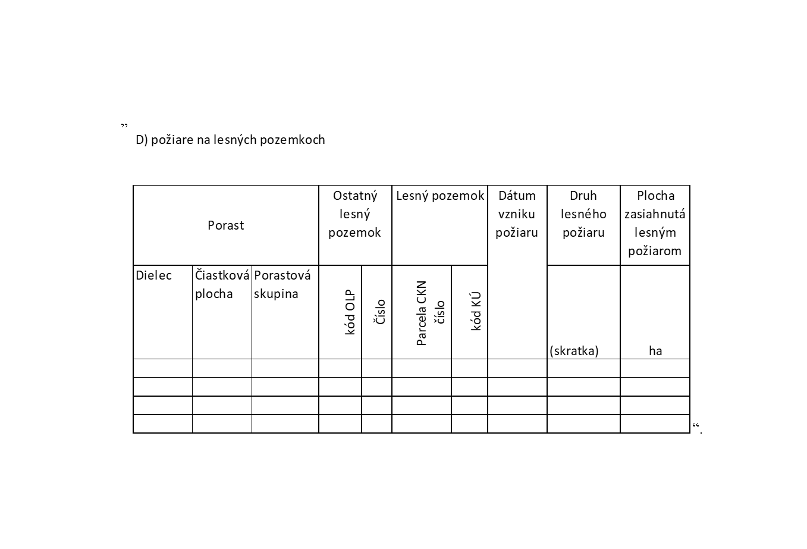

# Čl. I

Vyhláška Ministerstva pôdohospodárstva a rozvoja vidieka Slovenskej republiky č. 297/2011 Z. z. o lesnej hospodárskej evidencii sa mení a dopĺňa takto:

- 1. V § 1 odsek 2 znie:

- „(2)

- Evidencia sa vedie úplne a pravdivo podľa jednotiek priestorového rozdelenia lesa1) alebo lesných pozemkov, ktoré nie sú jednotkami priestorového rozdelenia lesa vytvorenými v programe starostlivosti o lesy (ďalej len „program starostlivosti“) alebo v projekte starostlivosti o lesný pozemok (ďalej len „projekt starostlivosti“).“.

- 2. V § 1 ods. 3 písmená a) a b) znejú:

- „a)

- ťažby podľa § 22 zákona a ťažby podľa § 23 ods. 1 štvrtej vety zákona,

- b)

- plochy na obnovu lesa podľa § 20 ods. 3 zákona,“.

- 3. V § 2 ods. 1 sa za slovo „podľa“ vkladajú slová „kategórie lesa,“.

- 4. V § 2 ods. 2 písm. a) sa slovo „a“ nahrádza čiarkou a za slovo „forma“ sa vkladajú slová „a uplatňovanie prírode blízkeho hospodárenia v lesoch“.

- 5. V § 2 ods. 2 písmeno c) znie:

- „c)

- mimoriadnej ťažbe číslo rozhodnutia, súhlasu alebo záväzného stanoviska orgánu štátnej správy lesného hospodárstva, ktorým je povolená, alebo dôvod jej vykonania podľa § 26, § 31 ods. 3 alebo ods. 6, § 32 alebo § 33 zákona.“.

- 6. V § 2 sa za odsek 3 vkladá nový odsek 4, ktorý znie:

- „(4)

- Do celkového objemu dreva predpísaného na ťažbu programom starostlivosti pre lesný celok, vlastnícky celok a kategóriu lesa sa nezapočítava objem dreva

- a)

- vyťaženého na lesných pozemkoch, pre ktoré nie je v programe starostlivosti vyhotovený opis porastov,

- b)

- z ťažby ležaniny; ležaninou sa rozumie drevo

- 1.

- takto uvedené v opise porastov programu starostlivosti,

- 2.

- evidované počas platnosti programu starostlivosti alebo projektu starostlivosti ako náhodná ťažba nevykonaná alebo objem dreva ponechaný v poraste po vykonaní ťažby.“.

  - Doterajšie odseky 4 a 5 sa označujú ako odseky 5 a 6.

- 7. V § 2 ods. 5 sa za slovo „rozhodnutia“ vkladajú slová „alebo záväzného stanoviska“ a vypúšťajú sa slová „o lesy (ďalej len „program starostlivosti“).“.

- 8. V § 2 odsek 6 znie:

- „(6)

- Spôsob označenia druhu ťažby dreva, hospodárskeho spôsobu, jeho formy pri obnovnej ťažbe a uplatňovania prírode blízkeho hospodárenia v lesoch sú uvedené v prílohe č. 1.“.

- 9. § 2 sa dopĺňa odsekom 7, ktorý znie:

- „(7)

- Vznik dôvodu na náhodnú ťažbu a príčina náhodnej ťažby sa uvádzajú skratkou škodlivého činiteľa podľa prílohy č. 2.“.

- 10. § 3 vrátane nadpisu znie:

- 㤠3

- Evidencia plochy na obnovu lesa

- (1)

- V evidencii plochy na obnovu lesa sa eviduje plocha určená na obnovu lesa podľa príčiny jej vzniku a plocha holiny.

- (2)

- Plocha na obnovu lesa podľa príčiny jej vzniku sa eviduje ako plocha, ktorá vznikla

- a)

- z ťažby evidovanej podľa § 2,

- b)

- pôsobením škodlivého činiteľa alebo

- c)

- zo zmeny druhu pozemku a zmeny využitia lesného pozemku.

- (3)

- Plocha na obnovu lesa podľa odseku 2 písm. b) sa eviduje, ak vznikla pôsobením škodlivého činiteľa v lesných porastoch

- a)

- po ich zabezpečení,

- b)

- pred ich zabezpečením

- 1.

- v dôsledku mimoriadnej udalosti2) alebo

- 2.

- na základe posúdenia okresným úradom o miere a intenzite pôsobenia škodlivého činiteľa a vzniku holiny vykonanom do dvoch mesiacov od prejavenia sa dôsledkov pôsobenia škodlivého činiteľa.

- (4)

- Plocha na obnovu lesa sa určuje jej zmeraním,

- a)

- ak ide o plochu podľa odseku 2 písm. a) a b),

- b)

- alebo prevzatím údaju o ploche uvedenej v rozhodnutí okresného úradu, ak ide o plochu podľa odseku 2 písm. c).3)

- (5)

- Plocha holiny sa určuje

- a)

- prevzatím plochy na obnovu lesa podľa odseku 4,

- b)

- ak ide o plochu na obnovu lesa podľa odseku 2 písm. a) a b), so zohľadnením kritérií zabezpečeného lesného porastu primeraným zmenšením plochy podľa odseku 4 o

- 1.

- etáž4) uvedenú v opise porastov programu starostlivosti alebo projektu starostlivosti,

- 2.

- umelú obnovu z podsadby alebo podsejby evidovanej podľa § 4 alebo

- 3.

- porast jedincov lesných drevín,5) pri ktorých je predpoklad, že budú súčasťou následného porastu, okrem prirodzeného zmladenia podľa § 4 ods. 4 písm. a).

- (6)

- Plocha na obnovu lesa podľa odseku 2 a plocha holiny podľa odseku 5 sa eviduje, ak ide o súvislú plochu väčšiu ako 0,03 ha a nie je predpoklad, že počas nasledujúcich desiatich rokov vývoja lesného porastu sama prirodzene zanikne zapojením sa okolitého lesného porastu.“.

  - Poznámky pod čiarou k odkazom 3 a 5 znejú:

  - „3) Napríklad § 9 a 10 zákona č. 220/2004 Z. z. o ochrane a využívaní poľnohospodárskej pôdy a o zmene zákona č. 245/2003 Z. z. o integrovanej prevencii a kontrole znečisťovania životného prostredia a o zmene a doplnení niektorých zákonov v znení neskorších predpisov.

  - 5) Príloha č. 1 k zákonu č. 138/2010 Z. z. o lesnom reprodukčnom materiáli v znení zákona č. 73/2013 Z. z.“.

- 11. V § 4 odsek 1 znie:

- „(1)

- V evidencii obnovy lesa sa eviduje plocha podľa spôsobu obnovy lesa a drevín, druhu zalesnenia a množstvo použitého osiva drevín v kilogramoch, počet semenáčikov alebo sadeníc v kusoch podľa drevín.“.

- 12. V § 4 ods. 2 úvodnej vete sa slovo „zalesnenia“ nahrádza slovami „obnovy lesa“.

- 13. V § 4 odsek 4 znie:

- „(4)

- Prirodzené zmladenie sa eviduje, ak je predpoklad, že bude tvoriť následný porast

- a)

- po vzniku holiny podľa § 3 ods. 5,

- b)

- v lesných porastoch, ktorých vek dosiahol vek začatia obnovy, alebo

- c)

- pri prebudove na prírode blízke hospodárenie v lesoch.“.

- 14. V § 5 sa odsek 2 dopĺňa písmenom d), ktoré znie:

- „d)

- výsek krov a nežiadúcich drevín.“.

- 15. V § 5 ods. 3 písm. a) sa slová „proti burine“ nahrádzajú slovami „pred burinou“.

- 16. V § 5 ods. 3 písm. b) sa slová „proti zveri“ nahrádzajú slovami „pred zverou“.

- 17. V § 9 ods. 1 písmeno a) znie:

- „a)

- porastová karta, ktorú tvorí evidencia

- 1.

- ťažby dreva a plochy na obnovu v porastoch [§ 39 ods. 1 písm. d) zákona] podľa prílohy č. 4 a na ostatných lesných pozemkoch [§ 39 ods. 1 písm. e) zákona] a lesných pozemkoch, ktoré nie sú porastom, podľa prílohy č. 4a,

- 2.

- obnovy lesa v porastoch podľa prílohy č. 5 a na ostatných lesných pozemkoch a lesných pozemkoch, ktoré nie sú porastom, podľa prílohy č. 5a,

- 3.

- pestovnej činnosti a ostatných výkonov v porastoch podľa prílohy č. 6 a na ostatných lesných pozemkoch a lesných pozemkoch, ktoré nie sú porastom, podľa prílohy č. 6a,“.

- 18. V § 9 ods. 1 písm. b) sa vypúšťajú slová „v lesných porastoch“.

- 19. V § 9 ods. 2 sa na konci pripájajú tieto slová: „a pre lesné pozemky“.

- 20. V § 9 ods. 3 sa na konci pripája táto veta: „Ak ide o porast, v ktorom vedenie a predkladanie evidencie zabezpečuje odborný lesný hospodár (§ 36 ods. 3 zákona), evidencia za tento porast a obhospodarovateľa lesa sa predkladá len za toho obhospodarovateľa lesa, ktorý evidenciu za tento porast nezahrnul do evidenčných výkazov podľa prvej vety.“.

- 21. V § 9 sa za odsek 3 vkladá nový odsek 4, ktorý znie:

- „(4)

- Do evidenčných výkazov podľa odseku 1 pre lesný celok sa evidujú aj činnosti na lesnom pozemku, ktorý nie je súčasťou lesného celku, ale je predpoklad, že po vyhlásení nového lesného celku sa stane jeho súčasťou.“.

  - Doterajší odsek 4 sa označuje ako odsek 5.

- 22. V § 10 odsek 1 znie:

- „(1)

- V grafickej evidencii sa v obrysovej mape zakresľuje veľkosť a tvar plochy, na

- a)

- ktorej sa vykonala

- 1.

- obnovná ťažba,

- 2.

- mimoriadna ťažba na ploche väčšej ako 0,03 ha s výnimkou plochy, ktorá sa eviduje podľa písmena b), alebo

- b)

- obnovu lesa podľa § 3 ods. 4.“.

- 23. V § 10 ods. 2 sa slová „holinách podľa odseku 1 písm. b)“ nahrádzajú slovami „ploche na obnovu lesa, ktorá vznikla z náhodnej ťažby alebo podľa § 3 ods. 2 písm. b)“.

- 24. § 10 sa dopĺňa odsekom 3, ktorý znie:

- „(3)

- Pri prírode blízkom hospodárení v lesoch uplatňovaním podrastového hospodárskeho spôsobu maloplošnou formou, pri ktorej plocha jedného obnovného prvku nepresahuje 0,2 ha, sa grafická evidencia vedie mapovými značkami podľa prílohy č. 10 zodpovedajúcimi účelovému hospodárskemu spôsobu.“.

- 25. V § 11 odsek 3 znie:

- „(3)

- Ak sa počas platnosti programu starostlivosti alebo projektu starostlivosti zmení obhospodarovateľ lesa k jednotke priestorového rozdelenia lesa, jej časti alebo lesnému pozemku, odovzdá osoba zodpovedná za zabezpečenie vedenia evidencie a jej predkladanie podľa § 36 ods. 3 a § 44 zákona (ďalej len „držiteľ evidenčných výkazov“) novému držiteľovi evidenčných výkazov evidenčné výkazy za obdobie platnosti programu starostlivosti alebo projektu starostlivosti.“.

- 26. V § 11 ods. 4 sa vypúšťa prvá veta a za slovo „na“ sa vkladajú slová „zmene hraníc dielca rozdelením (§ 39 ods. 7 a 8 zákona) alebo na“.

  - Poznámky pod čiarou k odkazom 9 a 10 sa vypúšťajú.

- 27. V § 11 ods. 4 písm. a) sa za slovo „spoluvlastníctva“ vkladajú slová „vrátane spôsobu ich vyznačenia v teréne“.

- 28. V § 11 ods. 5 sa za slovo „Po“ vkladajú slová „zmene hraníc dielca rozdelením alebo po“ a slová „každý obhospodarovateľ lesa“ sa nahrádzajú slovami „držiteľ evidenčných výkazov“.

- 29. V § 11 ods. 6 a § 12 ods. 4, 6 a 9 sa slová „obhospodarovateľ lesa“ nahrádzajú slovami „držiteľ evidenčných výkazov“.

- 30. V § 12 ods. 4 sa slová „obvodnému lesnému“ nahrádzajú slovom „okresnému“.

- 31. V § 12 ods. 5 sa slová „obvodný lesný“ nahrádzajú slovom „okresný“.

- 32. V § 13 ods. 1 sa odkaz 12 nahrádza odkazom 5.

  - Poznámka pod čiarou k odkazu 12 sa vypúšťa.

- 33. Za § 14 sa vkladá § 14a, ktorý vrátane nadpisu znie:

- 㤠14a

- Prechodné ustanovenie k úpravám účinným od 1. januára 2021

- (1)

- Ročná evidencia za rok 2020 sa predkladá podľa tejto vyhlášky v znení účinnom do 31. decembra 2020.

- (2)

- Údaje o stave lesa, realizácii plánovaných hospodárskych opatrení, neplánovaných činnostiach a opatreniach vykonaných pri hospodárení v lesoch v roku 2020, ktoré sú podkladom pre ročnú evidenciu podľa odseku 1, sa evidujú podľa tejto vyhlášky v znení účinnom do 31. decembra 2020.“.

- 34. Prílohy č. 1 až 4 znejú:

- „[prílohy č. 1 až 4](assets/705723d61728459afea4ee5adcc542a4f4b754a60e3edaeafa534e0ec9f033a2.pdf)“.

- 35. Za prílohu č. 4 sa vkladá príloha č. 4a, ktorá znie:

- „[príloha](assets/ed4889a77fe93712f748e82514a0f7cb14da3889b4ff8dae142b8c98246e3a87.pdf)“.

- 36. Príloha č. 5 znie:

- „[príloha](assets/df036bbc5d071c210a296465ab1e3112791f49931f4bc99aaac87dc12e8355af.pdf)“.

- 37. Za prílohu č. 5 sa vkladá príloha č. 5a, ktorá znie:

- „[príloha](assets/62c95fc9f6509c9067cc557c63185d6969266758a59fca60f5e89dc7f8862900.pdf)“.

- 38. Príloha č. 6 znie:

- „[príloha](assets/9fd251725d0a07cac82215d341f4e1656c2d6d7d4cf6d7a308bc6e2e63971180.pdf)“.

- 39. Za prílohu č. 6 sa vkladá príloha č. 6a, ktorá znie:

- „[príloha](assets/6e2cc908737396bcb144ee1c8afa9e95ef942acc628c795fa4250a47f91e1976.pdf)“.

- 40. Príloha č. 7 znie:

- „[príloha](assets/0c573ff2f3df2234f93bffdc8ea497f94aab9f8213e0dd76bf2033f95801cfeb.pdf)“.

- 41. V prílohe č. 8 tabuľka D) požiare na lesných pozemkoch znie:

- 

- 42. Príloha č. 9 znie:

- „Príloha č. 9

- k vyhláške č. 297/2011 Z. z.

- Technický popis na vedenie evidencie v evidenčných výkazoch

- 1. Všeobecné údaje

- Obhospodarovateľ lesa – uvedie sa fyzická osoba alebo právnická osoba, ktorá hospodári na lesných pozemkoch (LP). Evidenčné výkazy predkladá obhospodarovateľ lesa samostatne za

- a)

- každý lesný celok, v ktorom obhospodaruje lesné pozemky vrátane lesných škôlok,

- b)

- pozemky, ktoré sú vyhlásené za lesné pozemky po schválení projektu starostlivosti.

- Odborný lesný hospodár (OLH) – uvedie sa odborný lesný hospodár príslušného obhospodarovateľa lesa.

- Porast – uvedie sa označenie jednotky priestorového rozdelenia lesa – dielec, čiastková plocha (ČP), porastová skupina (PS). Ak čiastková plocha alebo porastová skupina nie sú určené, údaj sa neuvádza.

- Lesný celok (LC) – uvedie sa názov lesného celku. Pri pozemkoch, ktoré sú vyhlásené za lesné pozemky, sa uvedie číslo rozhodnutia orgánu štátnej správy lesného hospodárstva, v kolónkach označujúcich dielec, čiastkovú plochu a porastovú skupinu sa uvedie ich označenie podľa návrhu uvedeného v projekte starostlivosti. Pri ostatných lesných pozemkoch sa uvedie kód druhu pozemku a mapová skratka v súlade s pracovnými postupmi hospodárskej úpravy lesov.

- Vlastnícky celok – uvedie sa názov vlastníckeho celku. Ak vlastnícky celok nie je určený, údaj sa neuvádza.

- Etáž – evidencia sa nevedie a evidenčné výkazy sa nevyhotovujú pre etáž samostatne. Údaje evidenčne prislúchajúce k jednotlivým etážam určeným v programe starostlivosti alebo projekte starostlivosti sa evidujú v najbližšej vyššej jednotke priestorového rozdelenia lesa (dielec, čiastková plocha, porastová skupina).

- Pozemok CKN – pri pozemkoch vyhlásených za lesné pozemky v dobe platnosti programu starostlivosti na lesnom celku, v ktorom sa tieto lesné pozemky nachádzajú alebo je predpoklad, že sa stanú jeho súčasťou, sa uvedie číslo parcely registra C katastra nehnuteľností a kód katastrálneho územia.

- Ostatný lesný pozemok (OLP) – uvedie sa mapová skratka ostatných lesných pozemkov v súlade s pracovnými postupmi hospodárskej úpravy lesov.

- Kód programu starostlivosti (KPSL) – uvedie sa kód programu starostlivosti.

- Kód projektu starostlivosti o lesný pozemok (KPSLP) – uvedie sa kód projektu starostlivosti o lesný pozemok.

- Platnosť PSL – uvedie sa obdobie platnosti programu starostlivosti.

- Platnosť PSLP – uvedie sa obdobie platnosti projektu starostlivosti.

- Okresný úrad (OÚ) – uvedie sa príslušný okresný úrad, v ktorého územnom obvode sa lesné pozemky alebo lesné škôlky nachádzajú. Ak sa lesné pozemky nachádzajú v pôsobnosti viacerých okresných úradov, uvedie sa ten, v ktorého územnom obvode leží najväčšia časť lesných pozemkov.

- Okresný úrad v sídle kraja (OÚsK) – uvedie sa príslušný okresný úrad v sídle kraja, v ktorého územnom obvode sa lesné pozemky alebo lesné škôlky nachádzajú. Ak sa lesné pozemky nachádzajú v pôsobnosti viacerých okresných úradov v sídle kraja, uvedie sa ten, v ktorého územnom obvode leží najväčšia časť lesných pozemkov.

- Celkový objem dreva predpísaný na ťažbu v PSL (v m3) – uvedie sa celkový objem ťažby na obdobie platnosti programu starostlivosti podľa kategórií lesov a spolu; ak údaj nie je známy, uvedie sa ,,N“.

- Zmena celkového objemu dreva predpísaného v PSL (v m3) – uvedie sa celkový objem dreva na ťažbu podľa kategórií lesov a spolu po zohľadnení zmeny programu starostlivosti schválenej okresným úradom v sídle kraja.

- Vyťažené vo vykazovanom roku okrem ležaniny (v m3) – uvedie sa celkový objem dreva vyťažený v lesnom celku vo vykazovanom roku bez objemu vyťaženej ležaniny podľa kategórií lesov a spolu; samostatne sa uvedie údaj o celkovom objeme dreva vyťaženom náhodnou ťažbou vo vykazovanom roku.

- Vyťažené od začiatku platnosti PSL okrem ležaniny (v m3) – uvedie sa celkový objem dreva vyťažený v lesnom celku od začiatku platnosti programu starostlivosti vrátane objemu dreva vyťaženého vo vykazovanom roku bez objemu vyťaženej ležaniny podľa kategórií lesov a spolu; samostatne sa uvedie údaj o celkovom objeme dreva vyťaženom náhodnou ťažbou od začiatku platnosti programu starostlivosti podľa kategórií lesov a spolu.

- Ležanina vyťažená v lesnom celku vo vykazovanom roku (v m3) – uvedie sa celkový objem vyťaženej ležaniny v lesnom celku vo vykazovanom roku podľa kategórií lesa a spolu.

- Vyťažené vo vykazovanom roku na ostatných lesných pozemkoch v lesnom celku (v m3) – uvedie sa objem dreva vyťaženého spolu na ostatných lesných pozemkoch.

- Vyťažené vo vykazovanom roku na lesnom pozemku (v m3) – uvedie sa objem dreva spolu vyťažený vo vykazovanom roku na lesnom pozemku, ktorý nie je porastom a nie je súčasťou lesného celku, ale je predpoklad, že po vyhlásení nového lesného celku sa stane jeho súčasťou, alebo sa uvedie objem dreva na lesnom pozemku, ktorý je súčasťou lesného celku, ale nie sú preň vyhotovené súčasti programu starostlivosti alebo projektu starostlivosti podľa § 40 ods. 2 zákona.

- Obdobie platnosti PSLP – uvedie sa obdobie platnosti projektu starostlivosti.

- Celkový objem dreva predpísaný na ťažbu v PSLP (v m3) – uvedie sa celkový objem ťažby na obdobie platnosti projektu starostlivosti podľa kategórií lesov a spolu.

- Zmena celkového objemu dreva predpísaného v PSLP (v m3) – uvedie sa celkový objem dreva na ťažbu podľa kategórií lesov a spolu po zohľadnení zmeny projektu starostlivosti schválenej okresným úradom v sídle kraja.

- Vyťažené od začiatku platnosti PSLP do vykazovaného roka vrátane okrem ležaniny, (v m3) – uvedie sa celkový objem dreva vyťažený od začiatku platnosti projektu starostlivosti vrátane objemu dreva vyťaženého vo vykazovanom roku bez objemu vyťaženej ležaniny podľa kategórií lesov a spolu; samostatne sa uvedie údaj o celkovom objeme dreva vyťaženom náhodnou ťažbou od začiatku platnosti projektu starostlivosti podľa kategórií lesov a spolu.

- Ležanina vyťažená na lesnom pozemku vo vykazovanom roku (v m3) – uvedie sa celkový objem vyťaženej ležaniny na lesnom pozemku, pre ktorý je projekt starostlivosti vyhotovený, vo vykazovanom roku podľa kategórií lesa a spolu.

- Rok, mesiac – uvedie sa rok a mesiac vykonania opatrení alebo vzniku evidovanej skutočnosti (napríklad holiny). Rok sa uvádza v tvare „RRRR“, mesiac v tvare „MM“; ak ide o opravu chybného alebo nesprávneho údaju, mesiac sa uvádza v tvare „00“.

- 2. Porastová karta

- 2.A. Evidencia ťažby dreva a plochy na obnovu lesa v poraste (príloha č. 4) a na ostatných lesných pozemkoch a lesných pozemkoch, ktoré nie sú lesným porastom (príloha č. 4a)

- Vznik dôvodu na náhodnú ťažbu – uvedie sa skratka označenia škodlivého činiteľa podľa prílohy č. 2, ktorý je dôvodom vzniku náhodnej ťažby. Vznik dôvodu na náhodnú ťažbu sa eviduje v mesiaci, v ktorom vznikol. Zároveň sa v príslušnom riadku eviduje odhadnutý objem poškodených alebo uhynutých stromov a krov podľa drevín. Ak po vykonaní náhodnej ťažby nie je objem vyťaženého dreva totožný s odhadnutým objemom náhodnej ťažby, eviduje sa oprava odhadnutého objemu náhodnej ťažby podľa drevín novým zápisom tak, že sa súčet odhadnutého objemu náhodnej ťažby rovná objemu vykonanej náhodnej ťažby vrátane objemu dreva trvalo ponechaného v lesnom poraste, pričom v stĺpci „mesiac“ sa uvedie údaj „00“ a v stĺpci „vznik dôvodu na náhodnú ťažbu“ sa uvedie skratka označenia škodlivého činiteľa, ktorý je dôvodom vzniku náhodnej ťažby (skratka škodlivého činiteľa sa uvedie totožná s tou, ktorou je označený pôvodný zápis odhadovaného objemu náhodnej ťažby).

- Druh ťažby – uvedie sa skratka označenia druhu ťažby podľa prílohy č. 1. V lesných porastoch, v ktorých je vykonanie náhodnej ťažby podmienené rozhodnutím alebo súhlasom podľa osobitného predpisu13) alebo všeobecne záväzného právneho predpisu vydaného na jeho vykonanie, sa náhodná ťažba eviduje

- a)

- po nadobudnutí právoplatnosti rozhodnutia o jej povolení a po vykonaní náhodnej ťažby,

- b)

- po nadobudnutí právoplatnosti rozhodnutia o jej nepovolení.

- Hospodársky spôsob a jeho forma – uvedie sa skratka označenia hospodárskeho spôsobu a jeho formy podľa prílohy č. 1; údaj sa uvádza len pri evidovaní obnovnej ťažby.

- Príčina náhodnej ťažby – pri evidovaní náhodnej ťažby sa uvedie skratka označenia škodlivého činiteľa podľa prílohy č. 2, ktorý je dôvodom vzniku náhodnej ťažby.

- Prebierková plocha – eviduje sa výmera, na ktorej sa vykonala výchovná ťažba; v porastoch s plánovanou prebierkou sa môže evidovať aj výmera, na ktorej sa vykonala náhodná ťažba (roztrúsená) spĺňajúca cieľ a účely výchovy lesa.

- Plocha na obnovu lesa – uvedie sa skratka škodlivého činiteľa, ktorého pôsobením lesný porast zanikol, výmera plochy na obnovu lesa celkom a výmera holiny. Ak plocha na obnovu lesa vznikla odstránením lesného porastu úmyselnou ťažbou alebo náhodnou ťažbou, údaj v stĺpci „príčina vzniku“ sa nevypĺňa a uvádza sa len výmera plochy na obnovu lesa celkom a výmera holiny. Plocha na obnovu lesa a plocha holiny sa neevidujú pri obnovnej úmyselnej ťažbe podrastovým hospodárskym spôsobom okrem fázy dorub a tej časti lesného porastu, na ktorej je odrubom odstránený materský porast.

- Dreviny – uvedie sa objem vyťaženého dreva alebo odhadnutý objem náhodnej ťažby podľa drevín; pri väčšom počte drevín ako je počet stĺpcov sa objem dreva ostatných drevín uvedie súčtom podľa ich druhu v stĺpci „ostatné ihličnaté“ alebo „ostatné listnaté“.

- Celkom – uvedie sa celkový objem evidovaného dreva v príslušnom riadku.

- Poznámka – uvedie sa špecifikácia vykazovanej činnosti, číslo rozhodnutia alebo záväzného stanoviska orgánu štátnej správy lesného hospodárstva, dreviny, ktorých objem dreva je zahrnutý v stĺpci „ostatné ihličnaté“ alebo „ostatné listnaté“, číslo písomného súhlasu na ťažbu, dôvod vykonania mimoriadnej ťažby podľa § 2 ods. 2 písm. c) alebo iné dôležité skutočnosti.

- Ostatný lesný pozemok (OLP) – uvedie sa kód ostatného lesného pozemku a jeho číslo podľa programu starostlivosti alebo projektu starostlivosti.

- Kód OLP – uvedie sa mapová skratka ostatných lesných pozemkov v súlade s pracovnými postupmi hospodárskej úpravy lesov takto:

- – Lesné škôlky ............................................................. Š

- – Semenné sady ........................................................... SS

- – Rozdeľovacie prieseky ............................................... RP

- – Lesné cesty ................................................................. C

- – Lesné sklady ............................................................. SK

- – Pozemky slúžiace poľovnému hospodáreniu .............. PH

- – Pozemky tvorby a ochrany prírodného prostredia ...... CH

- – Elektrovody ................................................................. E

- – Ostatné produktovody ................................................. P

- – Neúrodné lesné pozemky ............................................. N

- – Vysokohorské pozemky, hole ...................................... H

- – Iné lesné pozemky ....................................................... IP

- – Čierne plochy ............................................................. ČP.

- Lesný pozemok (LP) – uvedie sa číslo parcely lesného pozemku podľa registra C katastra nehnuteľností a kód katastrálneho územia; uvádza sa, len ak ide o lesné pozemky podľa § 9 ods. 4.

- 2.B. Evidencia obnovy lesa v poraste (príloha č. 5 ) a na ostatných lesných pozemkoch a lesných pozemkoch, ktoré nie sú porastom (príloha č. 5a)

- Spôsob obnovy lesa – eviduje sa obnova lesa prirodzeným zmladením a zalesnením.

- Prirodzené zmladenie – eviduje sa plocha, na ktorej sa obnova lesa zabezpečila prirodzeným zmladením. Prirodzené zmladenie na ploche na obnovu lesa po vykonaní poslednej fázy podrastového hospodárskeho spôsobu, teda dorubu (PZM) sa eviduje súčasne so zaevidovaním holiny. Prirodzené zmladenie pod materským porastom (PZP) sa spravidla eviduje, ak je predpoklad, že bude tvoriť následný porast, a

- a)

- zakmenenie prirodzeného zmladenia dosiahlo 1/10 plného zakmenenia, alebo

- b)

- ide o cenné druhy drevín, pri ktorých je potrebné zabezpečiť ďalšie výkony, najmä ich ochranu.

- Zalesnenie – eviduje sa zalesnenie podľa jeho druhu (prvé zalesnenie alebo opakované zalesnenie); druhy zalesnenia sa evidujú v samostatnom riadku.

- Spôsob zalesnenia – uvedie sa skratka označenia spôsobu zalesnenia podľa prílohy č. 3.

- Príčina opakovaného zalesnenia – pri opakovanom zalesnení sa uvedie skratka označenia škodlivého činiteľa podľa prílohy č. 2, ktorý je príčinou opakovaného zalesnenia; pri opakovanom zalesnení vykonanom z dôvodu plnenia kritérií zabezpečeného lesného porastu sa skratka označenia škodlivého činiteľa neuvádza.

- Plocha – uvedie sa celková výmera, na ktorej je zaevidované prvé zalesnenie alebo opakované zalesnenie.

- Dreviny – uvedie sa zalesnená plocha podľa drevín; pri väčšom počte drevín ako je počet stĺpcov sa plocha zalesnená ostatnými drevinami uvedie súčtom plôch podľa ich druhu v stĺpci „ostatné ihličnaté“ alebo „ostatné listnaté“.

- Celkom – uvedie sa celková výmera obnovy lesa evidovaná v príslušnom riadku.

- Poznámka – uvedie sa špecifikácia vykazovanej činnosti, číslo rozhodnutia orgánu štátnej správy lesného hospodárstva, dreviny, ktorých plocha zalesnenia je zahrnutá v stĺpci „ostatné ihličnaté“ alebo „ostatné listnaté“, alebo iné dôležité skutočnosti.

- Ostatný lesný pozemok (OLP) – uvedie sa kód ostatného lesného pozemku a jeho číslo podľa programu starostlivosti alebo projektu starostlivosti.

- Kód OLP – uvedie sa mapová skratka ostatných lesných pozemkov v súlade s pracovnými postupmi hospodárskej úpravy lesov takto:

- – Lesné škôlky ............................................................. Š

- – Semenné sady ........................................................... SS

- – Rozdeľovacie prieseky ................................................ RP

- – Lesné cesty ................................................................. C

- – Lesné sklady .............................................................. SK

- – Pozemky slúžiace poľovnému hospodáreniu ............... PH

- – Pozemky tvorby a ochrany prírodného prostredia ....... CH

- – Elektrovody ................................................................. E

- – Ostatné produktovody ................................................. P

- – Neúrodné lesné pozemky ............................................ N

- – Vysokohorské pozemky, hole ...................................... H

- – Iné lesné pozemky ...................................................... IP

- – Čierne plochy ............................................................. ČP.

- Lesný pozemok (LP) – uvedie sa číslo parcely lesného pozemku podľa registra C katastra nehnuteľností a kód katastrálneho územia; uvádza sa, len ak ide o lesné pozemky podľa § 9 ods. 4.

- 2.C. Evidencia pestovnej činnosti a ostatných výkonov v poraste (príloha č. 6) a na ostatných lesných pozemkoch a lesných pozemkoch, ktoré nie sú porastom (príloha č. 6a)

- Prečistky – uvedie sa výmera, na ktorej je vykonaná prerezávka, čistka, plecí rub alebo tvarový orez v mladinách.

- Príprava pôdy na obnovu lesa – uvedie sa výmera, na ktorej sa vykonala príprava pôdy na obnovu lesa (napríklad prekopaním, prekyprením, zmulčovaním, vytrhávaním pňov, orbou, smykovaním).

- Príprava plochy na obnovu lesa – uvedie sa výmera, na ktorej sa vykonala príprava plochy na zalesnenie (napríklad odstraňovanie haluziny, uhadzovanie haluziny, pálenie haluziny).

- Výsek krov a nežiadúcich drevín – uvedie sa výmera, na ktorej sa vykonal výsek krov a nežiadúcich drevín.

- Ochrana proti burine – uvedie sa výmera, na ktorej sa vykonávala ochrana proti burine (napríklad chemicky, vyžínaním, ošlapávaním).

- Ochrana proti zveri – uvedie sa výmera, na ktorej sa vykonala ochrana proti zveri (napríklad chemicky, mechanicky s výnimkou oplocovania).

- Oplocovanie – uvedie sa výmera plochy oplotenej na ochranu lesa.

- Poznámka – uvedie sa špecifikácia vykazovanej činnosti, číslo rozhodnutia orgánu štátnej správy lesného hospodárstva alebo iné dôležité skutočnosti.

- Ostatný lesný pozemok (OLP) – uvedie sa kód ostatného lesného pozemku a jeho číslo podľa programu starostlivosti alebo projektu starostlivosti.

- Kód OLP – uvedie sa mapová skratka ostatných lesných pozemkov v súlade s pracovnými postupmi hospodárskej úpravy lesov takto:

- – Lesné škôlky ............................................................. Š

- – Semenné sady ........................................................... SS

- – Rozdeľovacie prieseky ................................................ RP

- – Lesné cesty ................................................................. C

- – Lesné sklady .............................................................. SK

- – Pozemky slúžiace poľovnému hospodáreniu ............... PH

- – Pozemky tvorby a ochrany prírodného prostredia ....... CH

- – Elektrovody ................................................................. E

- – Ostatné produktovody ................................................. P

- – Neúrodné lesné pozemky ............................................ N

- – Vysokohorské pozemky, hole ...................................... H

- – Iné lesné pozemky ...................................................... IP

- – Čierne plochy ............................................................. ČP.

- Lesný pozemok – uvedie sa číslo parcely lesného pozemku podľa registra C katastra nehnuteľností a kód katastrálneho územia; uvádza sa, len ak ide o lesné pozemky podľa § 9 ods. 4.

- 3. Ročná evidencia výkonov (príloha č. 7)

- V ročnej evidencii výkonov sa uvedú sumárne údaje z porastových kariet podľa príloh č. 4, 4a, 5, 5a, 6 a 6a. Sumárne údaje sa uvedú v členení podľa jednotlivých evidovaných skutočností a v členení podľa príslušnosti k programu starostlivosti alebo projektu starostlivosti osobitne pre každú kategóriu lesa a spolu. Osobitne sa vedie ročná evidencie ležaniny vyťaženej vo vykazovanom roku podľa kategórií lesa a spolu a výkonov na ostatných lesných pozemkoch spolu. Zároveň sa vedie evidencia dreva vyťaženého vo vykazovanom roku na lesných pozemkoch podľa § 9 ods. 4.

- V evidencii ťažby dreva a plochy na obnovu lesa sa v stĺpci „Poznámka“ uvádza číslo písomného súhlasu na ťažbu alebo iné dôležité skutočnosti.

- V evidencii obnovy lesa sa okrem plochy, na ktorej je zaevidované zalesnenie, uvádza aj množstvo vysiateho osiva v kilogramoch alebo počet použitých semenáčikov a sadeníc v tisícoch kusov; údaj sa preberá z karty pôvodu porastu vedenej podľa osobitného predpisu;14) pri evidencii prirodzeného zmladenia sa počet semenáčikov neuvádza.

- 4. Ročná evidencia ochrany lesa a lesníckotechnických meliorácií (príloha č. 8)

- Tabuľka A) Vykonané ochranné a obranné opatrenia

- Škodlivý činiteľ – uvedie sa skratka škodlivého činiteľa podľa prílohy č. 2, proti ktorému sa ochranné alebo obranné opatrenia vykonali.

- Drevina – uvedie sa skratka dreviny, pre ktorú je vykonané ochranné a obranné opatrenie alebo ktorá je uvedeným škodlivým činiteľom poškodzovaná. Ak pri zásahu proti škodlivému činiteľovi nemožno drevinu špecifikovať (napríklad pri odburinení plôch pred zalesnením, ošetrenia úhorov, ciest a manipulačných plôch v škôlke), drevina sa neuvádza.

- Lapáky – uvedie sa počet lapákov podľa intenzity nalietnutia. Pri zisťovaní a hodnotení intenzity nalietnutia lapákov v triedach početnosti napadnutia podľa počtu závrtov sa postupuje podľa technickej normy15) alebo inej obdobnej technickej špecifikácie s porovnateľnými alebo prísnejšími požiadavkami. Ochrana lesa proti hlavným druhom podkôrneho hmyzu na ihličnatých drevinách. Pri lykožrútovi smrekovom a lykožrútovi lesklom sa intenzita nalietnutia hodnotí takto:

- | Intenzita nalietnutia podľa počtu závrtov/dm2 | |

- Druh lykožrúta | slabá | stredná | silná

- lykožrút smrekový | do 0,5 | 0,5 – 1,0 | nad 1,0

- lykožrút lesklý | do 1,0 | 1,0 – 2,0 | nad 2,0

- Feromónové lapače – uvedie sa počet inštalovaných feromónových lapačov podľa odchytu v triedach početnosti podľa počtu odchytených kusov. Pri zisťovaní a hodnotení odchytu vo feromónových lapačoch sa postupuje podľa technickej normy15) alebo inej obdobnej technickej špecifikácie s porovnateľnými alebo prísnejšími požiadavkami. Ochrana lesa proti hlavným druhom podkôrneho hmyzu na ihličnatých drevinách. Pri lykožrútovi smrekovom a lykožrútovi lesklom sa hodnotí celosezónny odchyt osobitne pre každý feromónový lapač takto:

- | Počet odchytených kusov – trieda početnosti | |

- Druh lykožrúta | slabá | stredná | silná

- lykožrút smrekový | do 2 000 | 2 000 – 8 000 | nad 8 000

- lykožrút lesklý | do 20 000 | 20 000 – 100 000 | nad 100 000

- Insekticídy – uvedie sa insekticídmi ošetrený objem dreva podľa dreviny na sklade alebo v lesnom poraste alebo výmera lesných porastov ošetrených insekticídmi.

- Fungicídy – uvedie sa fungicídmi ošetrený objem dreva podľa dreviny na sklade alebo v lesnom poraste alebo výmera lesných porastov ošetrených fungicídmi.

- Herbicídy – uvedie sa výmera lesných porastov ošetrených herbicídmi.

- Rodenticídy – uvedie sa výmera lesných porastov ošetrených rodenticídmi.

- Odkôrňovanie – uvedie sa objem odkôrnených stromov, kmeňov alebo výrezov.

- Pálenie – uvedie sa výmera, z ktorej sa drevná hmota vrátane tenčiny úmyselne pálila s cieľom ochrany lesa.

- Iné – v príslušných technických jednotkách a množstve sa uvedú iné vykonané ochranné a obranné opatrenia, ktoré nie sú v tabuľke uvedené v samostatných stĺpcoch.

- Tabuľka B) Poškodenie evidované v hektároch

- Škodlivý činiteľ – uvedie sa skratka škodlivého činiteľa podľa prílohy č. 2, ktorý poškodenie spôsobil, okrem škodlivého činiteľa požiar (PO), ktorý sa uvádza samostatne v tabuľke D) Požiare na lesných pozemkoch.

- Drevina – uvedie sa skratka dreviny, ktorá je uvedeným škodlivým činiteľom poškodená.

- Poškodené – podľa intenzity poškodenia sa uvedie výmera, na ktorej sú dreviny poškodené škodlivým činiteľom. Poškodením v kategórii „Stredne“ je defoliácia alebo poškodenie jedincov v rozsahu 26 – 60 % drevín na uvedenej výmere. Poškodením v kategórii „Silno“ je defoliácia alebo poškodenie jedincov v rozsahu 61 % a viac drevín na uvedenej výmere.

- Tabuľka C) Výskyt škodlivých činiteľov v lesných škôlkach a vykonané obranné opatrenia proti nim

- Škodlivý činiteľ – uvedie sa skratka škodlivého činiteľa podľa prílohy č. 2, ktorý je príčinou úhynu semenáčikov alebo sadeníc alebo proti ktorému sa ochranné a obranné opatrenia vykonali.

- Drevina – uvedie sa skratka poškodenej dreviny alebo dreviny pre ktorú je vykonané ochranné a obranné opatrenie.

- Plocha výskytu – uvedie sa výmera, na ktorej sa evidovaný škodlivý činiteľ na drevine vyskytol.

- Úhyn semenáčikov a sadeníc – uvedie sa počet uhynutých semenáčikov a sadeníc v tisícoch kusov.

- Vykonané ochranné a obranné opatrenia – uvedie sa výmera, na ktorej sa použili insekticídy, fungicídy, herbicídy alebo rodenticídy alebo na ktorej sa vykonali ostatné ochranné a obranné opatrenia.

- Poznámka – slovne sa uvedie druh ostatného ochranného alebo obranného opatrenia, použitý prípravok na ochranu lesa alebo iné dôležité skutočnosti.

- Tabuľka D) Požiare na lesných pozemkoch

- Porast – uvedie sa označenie jednotky priestorového rozdelenia lesa zasiahnutej požiarom – dielec, čiastková plocha (ČP), porastová skupina (PS). Ak čiastková plocha alebo porastová skupina nie sú určené, údaj sa nevypĺňa; pri požiari na lesných pozemkoch bez lesných porastov slúžiacich lesnému hospodárstvu sa v čísle dielca uvádza číslo parcely registra „C“ katastra nehnuteľností.

- Dátum vzniku požiaru – uvedie sa dátum vzniku požiaru.

- Druh lesného požiaru – uvedie sa skratka druhu požiaru takto:

- a)

- POP pre podzemný požiar, ktorým je horenie horľavých látok a šírenie požiaru pod pôdnym povrchom,

- b)

- POZ pre pozemný požiar, ktorým je horenie pôdneho krytu vrátane krov a drevín pod hlavným lesným porastom,

- c)

- POK pre korunový požiar, ktorým je horenie celých stromov vrátane ich korún.

- Pri kombinácii podzemného a pozemného požiaru sa uvádza skratka „POZ“. Pri ostatných kombináciách sa uvádza skratka „POK“.

- Plocha zasiahnutá lesným požiarom – uvedie sa výmera lesných pozemkov, na ktorých sa vyskytol lesný požiar.

- Tabuľka E) Lesníckotechnické meliorácie

- Druh lesníckotechnickej meliorácie – slovným popisom sa uvedie druh vykonanej lesníckotechnickej meliorácie.

- Predpokladaný účinok – uvedie sa výmera lesných pozemkov, na ktorých sa predpokladá priaznivý účinok vykonanej lesníckotechnickej meliorácie.

- Celkové náklady na realizáciu – uvedú sa celkové náklady na realizáciu evidovanej lesníckotechnickej meliorácie v tisícoch eur.“.

  - Poznámky pod čiarou k odkazom 13 až 15 znejú:

  - „13) Zákon č. 543/2002 Z. z. o ochrane prírody a krajiny v znení neskorších predpisov.

  - 14) Vyhláška č. 501/2010 Z. z.

  - 15) STN 48 2711 Ochrana lesa. Ochrana lesa proti hlavným druhom podkôrneho hmyzu na smreku (48 2711).“.
