# Čl. I

Vyhláška Úradu pre reguláciu sieťových odvetví č. 18/2017 Z. z., ktorou sa ustanovuje cenová regulácia v elektroenergetike a niektoré podmienky vykonávania regulovaných činností v elektroenergetike v znení vyhlášky č. 207/2018 Z. z., vyhlášky č. 178/2019 Z. z., vyhlášky, č. 309/2019 Z. z. a vyhlášky č. 300/2021 Z. z. sa mení a dopĺňa takto:

- 1. § 3 sa dopĺňa písmenom m), ktoré znie:

- „m)

- určením spôsobu zníženia ceny elektriny na účel predĺženia podpory so zníženou cenou elektriny.1a)“.

  - Poznámka pod čiarou k odkazu 1a znie:

  - „1a) § 3d a § 6 ods. 14 zákona č. 309/2009 Z. z. o podpore obnoviteľných zdrojov energie a vysoko účinnej kombinovanej výroby a o zmene a doplnení niektorých zákonov v znení zákona č. 296/2021 Z. z.“.

  - Doterajší odkaz 1a sa označuje ako odkaz 1b.

- 2. V § 7 sa za odsek 14 vkladá nový odsek 15, ktorý znie:

- „(15)

- Cena elektriny pre stanovenie doplatku pri predĺžení podpory doplatkom určená pre zariadenie výrobcu elektriny podľa § 8 ods. 3 až 11 musí byť nižšia ako pôvodná cena elektriny pre stanovenie doplatku.“.

  - Doterajšie odseky 15 až 19 sa označujú ako odseky 16 až 20.

- 3. § 7 sa dopĺňa odsekom 21, ktorý znie:

- „(21)

- Ak výrobca elektriny z obnoviteľných zdrojov energie žiada o predĺženie podpory doplatkom podľa osobitného predpisu,1a) súčasťou návrhu ceny alebo návrhu na zmenu cenového rozhodnutia sú

- a)

- údaje podľa prílohy č. 10,

- b)

- výpočet ceny elektriny podľa výpočtového nástroja na určenie zníženia ceny elektriny na účel predĺženia podpory so zníženou cenou elektriny zverejneného na webovom sídle úradu.“.

- 4. V § 8 sa za odsek 2 vkladajú nové odseky 3 až 11, ktoré znejú:

- „(3)

- Cena elektriny pre stanovenie hodnoty podpory v eurách za MWh za elektrinu vyrobenú z obnoviteľných zdrojov energie pri predĺžení podpory doplatkom podľa osobitného predpisu1a) sa vypočíta podľa vzorca

- 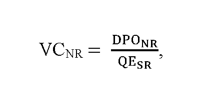

- kde

- a)

- VCNR je výkupná cena elektriny pre zariadenie výrobcu elektriny s predĺženou podporou podľa osobitného predpisu1a) v eurách za MWh,

- b)

- DPONR je plánovaný objem podpory pre zariadenie výrobcu elektriny v eurách počas prvého roka trvania predĺženej podpory podľa osobitného predpisu;1a) DPONR sa vypočíta podľa odseku 4,

- c)

- QESR je množstvo vyrobenej elektriny s nárokom na podporu doplatkom elektriny a prevzatím zodpovednosti za odchýlku v MWh za rok, ktoré sa vypočíta ako aritmetický priemer za posledných päť ucelených rokov prevádzky zariadenia na výrobu elektriny pred rokom vstupu do predĺženej podpory podľa osobitného predpisu.1a)

- (4)

- Plánovaný objem podpory doplatkom pre zariadenie výrobcu elektriny v eurách počas prvého roka trvania predĺženej podpory doplatkom podľa osobitného predpisu1a) DPONR sa vypočíta podľa vzorca

- 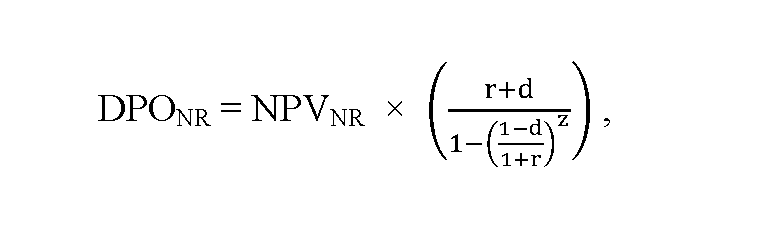

- kde

- a)

- NPVNR je čistá súčasná hodnota podpory v eurách za elektrinu vyrobenú z obnoviteľných zdrojov energie s predĺžením podpory podľa osobitného predpisu;1a) NPVNR sa vypočíta podľa odseku 5,

- b)

- r je ročná úroková miera vyjadrená v percentách, vypočíta sa podľa odseku 8,

- c)

- d je koeficient ročnej degradácie technológie zariadenia na výrobu elektriny; pre zariadenie na výrobu elektriny zo slnečnej energie je maximálna hodnota koeficientu 0,5 % a pre zariadenia na výrobu elektriny z vodnej energie, biomasy, bioplynu, skládkového plynu alebo plynu z čističiek odpadových vôd je hodnota koeficientu nula,

- d)

- z je zostávajúca doba predĺženej podpory podľa osobitného predpisu,1a) zaokrúhlená na šesť desatinných miest, pričom

- z = n + p ,

- kde

- 1.

- n je zostávajúca doba trvania súčasného režimu podpory pre zariadenie výrobcu elektriny z obnoviteľných zdrojov energie,

- 2.

- p je doba predĺženia podpory podľa osobitného predpisu1a) rovnajúca sa piatim rokom.

- (5)

- Čistá súčasná hodnota podpory doplatkom v eurách za elektrinu vyrobenú z obnoviteľných zdrojov energie s predĺžením podpory podľa osobitného predpisu1a) NPVNR sa vypočíta podľa vzorca

- NPVNR= NPVSR × k + NAKL,

- kde

- a)

- NPVSR je čistá súčasná hodnota podpory v eurách za elektrinu vyrobenú z obnoviteľných zdrojov energie v súčasnom režime podpory, ktorá sa vypočíta podľa odseku 6,

- b)

- k je koeficient zohľadňujúci rok vstupu zariadenia výrobcu elektriny do predĺženia podpory podľa osobitného predpisu,1a) ktorý sa na roky 2021 a 2022 rovná 1,02 a na rok 2023 a nasledujúce roky sa rovná 1,00,

- c)

- NAKL je suma ekonomicky oprávnených nákladov na opravu alebo úpravu technologickej časti zariadenia výrobcu elektriny na účel predĺženia jeho prevádzkyschopnosti v eurách vynaložených najneskôr v prvých piatich rokoch po roku vstupu do predĺženej podpory, ktorá sa vypočíta podľa vzorca

- 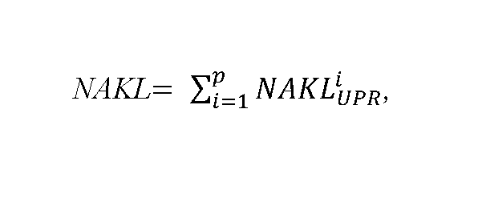

- kde

- 1.

- NAKLiUPR sú ekonomicky oprávnené náklady na nevyhnutnú opravu alebo úpravu technologickej časti zariadenia výrobcu elektriny v eurách na účel predĺženia jeho prevádzkyschopnosti počas zostávajúcej a predĺženej doby podpory vynaložené v i-tom roku nasledujúcom po roku vstupu do predĺženej podpory podľa osobitného predpisu,1a) pričom

- NAKL ≤ S × INV,

- kde

- 1.1

- S je hodnota investičných nákladov na obstaranie novej porovnateľnej technologickej časti zariadenia výrobcu elektriny najviac vo výške 15 %,

- 1.2

- INV je hodnota investičných nákladov novej porovnateľnej technológie časti zariadenia výrobcu elektriny v eurách zverejnená pre nasledujúci rok na webovom sídle úradu a aktualizovaná najneskôr do 31. augusta kalendárneho roka.

- (6)

- Čistá súčasná hodnota podpory v eurách za elektrinu vyrobenú z obnoviteľných zdrojov energie v súčasnom režime podpory NPVSR sa vypočíta podľa vzorca

- 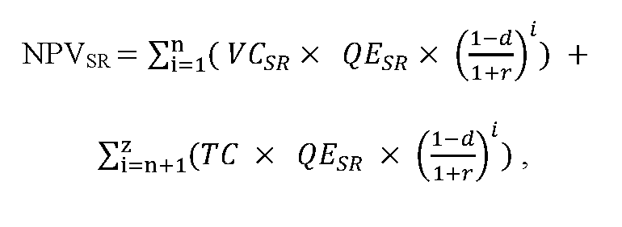

- kde

- a)

- VCSR je výkupná cena elektriny vyrobenej z obnoviteľných zdrojov energie, ktorá je určená úradom v súčasnom režime podpory v eurách za MWh,

- b)

- QESR je množstvo vyrobenej elektriny s nárokom na podporu výkupom elektriny a prevzatím zodpovednosti za odchýlku v režime prenesenej zodpovednosti za odchýlku v MWh za rok, ktoré sa vypočíta ako aritmetický priemer za posledných päť ucelených rokov prevádzky zariadenia výrobcu elektriny pred rokom vstupu do predĺženej podpory podľa osobitného predpisu,1a)

- c)

- TC je trhová cena elektriny v eurách za MWh vypočítaná ako aritmetický priemer cien ročných forwardov elektriny F PXE SK BL na najbližšie tri ucelené kalendárne roky predĺženej podpory podľa osobitného predpisu,1a) zobchodovaných na burze PXE (POWER EXCHANGE CENTRAL EUROPE) za obdobie posledných ucelených 12 kalendárnych mesiacov pred začatím cenového konania, ktorá sa zverejní pre nasledujúci rok na webovom sídle úradu do 31. augusta kalendárneho roka.

- (7)

- Cena elektriny sa zníži, ak po preverení skutočne vynaložených nákladov na nevyhnutnú opravu alebo úpravu technologickej časti zariadenia výrobcu elektriny v eurách na účel predĺženia jeho prevádzkyschopnosti počas zostávajúcej a predĺženej doby podpory, ktoré mali byť vynaložené najneskôr v prvých piatich rokoch po roku vstupu do predĺženej podpory, nedošlo k ich investovaniu vo výške podľa cenového rozhodnutia.

- (8)

- Ročná úroková miera r sa vypočíta podľa vzorca

- 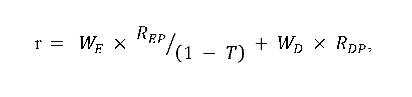

- kde

- a)

- T je sadzba dane z príjmov pre právnické osoby; T sa ustanovuje vo výške 21 % pre cenové konania v roku 2021,

- b)

- WE je podiel vlastného kapitálu na celkovej kapitalizácii regulovaného subjektu v percentách; WE sa ustanovuje vo výške 40 %,

- c)

- WD je podiel cudzieho kapitálu na celkovej kapitalizácii regulovaného subjektu v percentách; WD sa ustanovuje vo výške 60 %,

- d)

- RDP sú náklady na cudzí kapitál vyjadrené priemernou výškou úverov nad 1 000 000 eur poskytnutých nefinančným spoločnostiam za obdobie rokov 2010 až 2020; RDP sa ustanovuje vo výške 2,89 %,

- e)

- REP sú náklady na vlastný kapitál, ktoré sa vypočítajú podľa vzorca

- 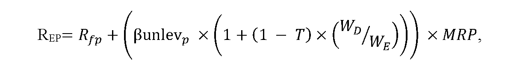

- kde

- 1.

- RfP je bezriziková výnosová miera vyjadrená ako základná sadzba pre výpočet referenčnej a diskontnej sadzby určená Európskou komisiou od 1. januára 2021 vo výške - 0,45 % zvýšená o 100 bázických bodov; RfP sa ustanovuje vo výške 0,55 %,

- 2.

- 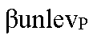 je beta koeficient vyjadrujúci systematické riziko a citlivosť odvetvia výroby elektriny z obnoviteľných zdrojov na zmenu trhu;

-  sa ustanovuje vo výške 0,69,

- 3.

- MRP je trhová riziková prirážka za trhové riziko, ktoré udáva o koľko je očakávaná výnosnosť vlastného kapitálu vyššia ako výnos z bezrizikovej investície; MRP sa ustanovuje vo výške 5,54 %.

- (9)

- Ročná úroková miera r je vo výške 6,24 %. Ak bude odchýlka v jednotlivých parametroch r vyššia ako 10 %, určí sa nová ročná úroková miera, ktorá sa zverejní pre nasledujúci rok na webovom sídle úradu do 31. augusta kalendárneho roka.

- (10)

- Pri určení ceny elektriny pre stanovenie doplatku pri predĺžení podpory doplatkom so zníženou cenou elektriny na kalendárny rok nasledujúci po kalendárnom roku, v ktorom sa rozhoduje o znížení ceny elektriny, sa zohľadnia hodnoty podľa odseku 5 písm. c) bodu 1.2, odseku 6 písm. c) a odseku 9 uverejnené na webovom sídle úradu v kalendárnom roku, v ktorom sa rozhoduje o určení ceny elektriny.

- (11)

- Pri určení ceny elektriny pre stanovenie doplatku pre výrobcu elektriny, ktorému sa skončí podpora výkupom elektriny výkupcom elektriny za cenu vykupovanej elektriny a podpora prevzatím zodpovednosti za odchýlku výkupcom elektriny pred uplynutím predĺženej podpory doplatkom so zníženou cenou elektriny sa odseky 3 až 10 použijú primerane.“.

  - Doterajšie odseky 3 až 6 sa označujú ako odseky 12 až 15.

- 5. V § 12 ods. 3 úvodná veta vrátane vzorca znie:

- „(3)

- Celkové plánované náklady na podporu elektriny vyrobenej z obnoviteľných zdrojov energie a vysoko účinnou kombinovanou výrobou v roku t sa vypočítajú podľa vzorca“.

- 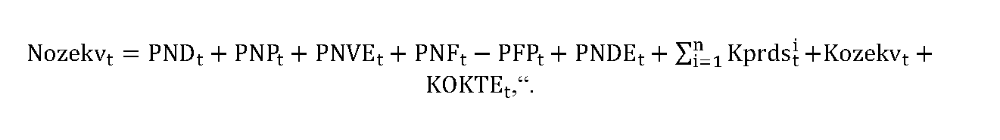

- 6. V § 12 ods. 3 písmeno f) znie:

- „f)

- Kprdsti je korekcia zostatku neuhradených nákladov vynaložených i-tým prevádzkovateľom regionálnej distribučnej sústavy na podporu elektriny vyrobenej z obnoviteľných zdrojov energie a vysoko účinnou kombinovanou výrobou doplatkom a príplatkom za rok 2019 v eurách, ktorá sa vypočíta podľa odseku 10,“.

- 7. V § 12 ods. 3 písmeno h) znie:

- „h)

- Kozekvt je korekcia nákladov a výnosov organizátora krátkodobého trhu s elektrinou v súvislosti s doplatkom, príplatkom, úhradou za činnosť výkupcu elektriny a prostriedkami poskytnutými ministerstvom hospodárstva v eurách v roku 2020, ktorá sa vypočíta podľa odseku 12,“.

- 8. V § 12 sa odsek 3 dopĺňa písmenami i) a j), ktoré znejú:

- „i)

- PNDEt sú plánované daňové náklady organizátora krátkodobého trhu s elektrinou, súvisiace s úhradou straty organizátora krátkodobého trhu s elektrinou z roku 2020 v súvislosti s doplatkom, príplatkom, úhradou za činnosť výkupcu elektriny a prostriedkami poskytnutými ministerstvom hospodárstva v roku t v eurách,

- j)

- KOKTEt je korekcia zostatku neuhradených nákladov organizátora krátkodobého trhu s elektrinou v súvislosti s doplatkom, príplatkom, úhradou za činnosť výkupcu elektriny a prostriedkami poskytnutými ministerstvom hospodárstva za rok 2020 v eurách, ktorá sa vypočíta podľa odseku 14.“.

- 9. § 12 sa dopĺňa odsekmi 10 až 16, ktoré znejú:

- „(10)

- Korekcia zostatku neuhradených nákladov vynaložených i-tým prevádzkovateľom regionálnej distribučnej sústavy na podporu elektriny vyrobenej z obnoviteľných zdrojov energie a vysoko účinnou kombinovanou výrobou doplatkom a príplatkom za rok 2019 v eurách Kprdsti sa vypočíta na

- a)

- rok 2021 podľa vzorca

- Kprdsi2021 = kzprdsi2021 × NNi2019,

- b)

- rok 2022 podľa vzorca

- Kprdsi2022 = kzprdsi2022 × (NNi2019 – Kprdsi2021) + PVtpsi2020 – SVtpsi2020,

- c)

- rok 2023 podľa vzorca

- Kprdsi2023 = kzprdsi2023 × (NNi2019 – Kprdsi2021) + PVtpsi2021 – SVtpsi2021,

- d)

- rok 2024 podľa vzorca

- Kprdsi2024 = kzprdsi2024 × (NNi2019 – Kprdsi2021) + PVtpsi2022 – SVtpsi2022,

- e)

- rok 2025 podľa vzorca

- Kprdsi2025 = kzprdsi2025 × (NNi2019 – Kprdsi2021) + PVtpsi2023 – SVtpsi2023,

- f)

- rok 2026 podľa vzorca

- Kprdsi2026 = PVtpsi2024 – SVtpsi2024,

- g)

- rok 2027 podľa vzorca

- Kprdsi2027 = PVtpsi2025 – SVtpsi2025.

- (11)

- Na účel výpočtu korekcie Kprdsti podľa odseku 10 sa veličinami vzorcov rozumejú

- a)

- kzprdsi2021 je koeficient zahrnutia zostatku neuhradených nákladov vynaložených v roku 2019 prevádzkovateľmi regionálnych distribučných sústav na podporu elektriny vyrobenej z obnoviteľných zdrojov energie a vysoko účinnou kombinovanou výrobou doplatkom a príplatkom pre rok 2021, ktorého hodnota určená v cenovom konaní pre rok 2021 je väčšia ako 0 a súčasne menšia alebo rovnajúca sa 1,

- b)

- kzprdsi2022 až kzprdsi2025 je koeficient zahrnutia zostatku neuhradených nákladov vynaložených v roku 2019 prevádzkovateľmi regionálnych distribučných sústav na podporu elektriny vyrobenej z obnoviteľných zdrojov energie a vysoko účinnou kombinovanou výrobou doplatkom a príplatkom pre roky 2022 až 2025, ktorého hodnoty určené v cenovom konaní pre roky 2022 až 2025 budú schválené alebo určené minimálne vo výške 0,25 počas obdobia najviac štyroch rokov umorovania zostatkovej hodnoty (NNi2019 - Kprdsi2021) neuhradených nákladov vynaložených v roku 2019 prevádzkovateľmi regionálnych distribučných sústav na podporu elektriny vyrobenej z obnoviteľných zdrojov energie a vysoko účinnou kombinovanou výrobou doplatkom a príplatkom; suma koeficientov zahrnutia (kzprdsi2022 až kzprdsi2025) zostatku neuhradených nákladov vynaložených v roku 2019 počas obdobia najviac štyroch rokov sa rovná 1 a koeficient kzprds môže klesnúť pod ročnú hodnotu 0,25 len z dôvodu dynamického umorovania v poslednom roku reálneho nepretržitého umorovania,

- c)

- NNi2019 sú neuhradené náklady i-tého prevádzkovateľa regionálnej distribučnej sústavy na podporu elektriny vyrobenej z obnoviteľných zdrojov energie a vysoko účinnou kombinovanou výrobou doplatkom a príplatkom v eurách v roku 2019, ktoré sa počítajú podľa vzorca

- NNi2019 = SNPi2019 – PNPi2019 + PVtpsi2019 – SVtpsi2019 ,

- kde

- 1.

- SNPi2019 sú skutočné náklady i-tého prevádzkovateľa regionálnej distribučnej sústavy na podporu elektriny vyrobenej z obnoviteľných zdrojov energie a vysoko účinnou kombinovanou výrobou doplatkom a príplatkom v eurách v roku 2019,

- 2.

- PNPi2019 sú plánované náklady i-tého prevádzkovateľa regionálnej distribučnej sústavy na podporu elektriny vyrobenej z obnoviteľných zdrojov energie a vysoko účinnou kombinovanou výrobou doplatkom a príplatkom v eurách v roku 2019,

- 3.

- PVtpsi2019 sú plánované výnosy i-tého prevádzkovateľa regionálnej distribučnej sústavy z uplatňovania tarify za prevádzkovanie systému určenej rozhodnutím pre i-tého prevádzkovateľa regionálnej distribučnej sústavy v eurách v roku 2019,

- 4.

- SVtpsi2019 sú skutočné výnosy i-tého prevádzkovateľa regionálnej distribučnej sústavy z uplatňovania tarify za prevádzkovanie systému určenej rozhodnutím pre i-tého prevádzkovateľa regionálnej distribučnej sústavy v eurách v roku 2019,

- d)

- PVtpsi2020 sú plánované výnosy i-tého prevádzkovateľa regionálnej distribučnej sústavy z uplatňovania tarify za prevádzkovanie systému určenej rozhodnutím pre i-tého prevádzkovateľa regionálnej distribučnej sústavy v eurách v roku 2020,

- e)

- SVtpsi2020 sú skutočné výnosy i-tého prevádzkovateľa regionálnej distribučnej sústavy z uplatňovania tarify za prevádzkovanie systému určenej rozhodnutím pre i-tého prevádzkovateľa regionálnej distribučnej sústavy v eurách v roku 2020,

- f)

- PVtpsi2021 až PVtpsi2025 sú plánované výnosy i-tého prevádzkovateľa regionálnej distribučnej sústavy z uplatňovania tarify za prevádzkovanie systému určenej rozhodnutím pre i-tého prevádzkovateľa regionálnej distribučnej sústavy v eurách,

- g)

- SVtpsi2021 až SVtpsi2025 sú skutočné výnosy i-tého prevádzkovateľa regionálnej distribučnej sústavy z uplatňovania tarify za prevádzkovanie systému určenej rozhodnutím pre i-tého prevádzkovateľa regionálnej distribučnej sústavy v eurách.

- (12)

- Korekcia nákladov a výnosov organizátora krátkodobého trhu s elektrinou v súvislosti s doplatkom, príplatkom, úhradou za činnosť výkupcu elektriny a prostriedkami poskytnutými ministerstvom hospodárstva v eurách Kozekvt sa vypočíta podľa vzorca na

- a)

- rok 2022

- Kozekv2022 = ONozekv2021 – OVozekv2021 ,

- b)

- rok 2023

- Kozekvt = SNozekvt-2 – ONozekvt-2 + OVozekvt-2 – SVozekvt-2 + ONozekvt-1 – PNozekvt-1 + PVozekvt-1 – OVozekvt-1 ,

- c)

- rok 2024 a ďalšie roky

- 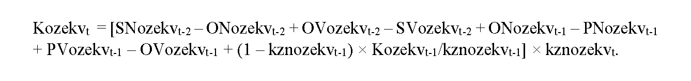

- (13)

- Na účel výpočtu korekcie Kozekvt podľa odseku 12 sa veličinami vzorcov rozumejú

- a)

- ONozekv2021 sú očakávané náklady organizátora krátkodobého trhu s elektrinou na podporu elektriny vyrobenej z obnoviteľných zdrojov energie a vysoko účinnou kombinovanou výrobou na rok 2021 v eurách, ktoré sa vypočítajú podľa odseku 15 písm. b) tretieho bodu,

- b)

- OVozekv2021 sú očakávané výnosy organizátora krátkodobého trhu s elektrinou z alikvotnej časti tarify za prevádzkovanie systému určenej na podporu elektriny vyrobenej z obnoviteľných zdrojov energie a vysoko účinnou kombinovanou výrobou na rok 2021 v eurách, ktoré sa vypočítajú podľa odseku 15 písm. b) štvrtého bodu,

- c)

- SNozekvt-2 sú skutočné náklady organizátora krátkodobého trhu s elektrinou na podporu elektriny vyrobenej z obnoviteľných zdrojov energie a vysoko účinnou kombinovanou výrobou v roku t-2 v eurách, ktoré sa vypočítajú podľa vzorca

- SNozekvt-2 = SNDt-2 + SNPt-2 + SNVEt-2 + SNFt-2 – SFPt-2 + SNDEt-2 ,

- kde

- 1.

- SNDt-2 sú skutočné náklady organizátora krátkodobého trhu s elektrinou na doplatok pre výrobcov elektriny z obnoviteľných zdrojov energie a vysoko účinnou kombinovanou výrobou v roku t-2 v eurách,

- 2.

- SNPt-2 sú skutočné náklady organizátora krátkodobého trhu s elektrinou na príplatok pre výrobcov elektriny z obnoviteľných zdrojov energie a vysoko účinnou kombinovanou výrobou v roku t-2 v eurách,

- 3.

- SNVEt-2 sú skutočné náklady organizátora krátkodobého trhu s elektrinou na úhradu za činnosť výkupcu elektriny v roku t-2 v eurách,

- 4.

- SNFt-2 sú skutočné náklady na úrok na zabezpečenie finančných prostriedkov na prevádzkové náklady súvisiace s výkonom regulovaných činností vykonávaných organizátorom krátkodobého trhu s elektrinou a ďalšie skutočné finančné náklady v roku t-2 v eurách,

- 5.

- SFPt-2 je skutočná výška finančných prostriedkov poskytnutých ministerstvom hospodárstva na financovanie nákladov vynaložených na zúčtovanie podpory v roku t-2 v eurách,

- 6.

- SNDEt-2 sú skutočné daňové náklady organizátora krátkodobého trhu s elektrinou súvisiace s úhradou straty organizátora krátkodobého trhu s elektrinou z roku 2020, v súvislosti s doplatkom, príplatkom, úhradou za činnosť výkupcu elektriny a prostriedkami poskytnutými ministerstvom hospodárstva v roku t-2 v eurách,

- d)

- ONozekvt-2 sú očakávané náklady organizátora krátkodobého trhu s elektrinou na podporu elektriny vyrobenej z obnoviteľných zdrojov energie a vysoko účinnou kombinovanou výrobou na rok t-2 v eurách, ktoré sa vypočítajú podľa vzorca

- ONozekvt-2 = ONDt-2 + ONPt-2 + ONVEt-2 + ONFt-2 – OFPt-2 + ONDEt-2 ,

- kde

- 1.

- ONDt-2 sú očakávané náklady organizátora krátkodobého trhu s elektrinou na doplatok pre výrobcov elektriny z obnoviteľných zdrojov energie a vysoko účinnou kombinovanou výrobou na rok t-2 v eurách,

- 2.

- ONPt-2 sú očakávané náklady organizátora krátkodobého trhu s elektrinou na príplatok pre výrobcov elektriny z obnoviteľných zdrojov energie a vysoko účinnou kombinovanou výrobou na rok t-2 v eurách,

- 3.

- ONVEt-2 sú očakávané náklady organizátora krátkodobého trhu s elektrinou na úhradu za činnosť výkupcu elektriny na rok t-2 v eurách,

- 4.

- ONFt-2 sú očakávané náklady na úrok na zabezpečenie finančných prostriedkov na prevádzkové náklady súvisiace s výkonom regulovaných činností vykonávaných organizátorom krátkodobého trhu s elektrinou a ďalšie očakávané finančné náklady na rok t-2 v eurách,

- 5.

- OFPt-2 je očakávaná výška finančných prostriedkov poskytnutých ministerstvom hospodárstva na financovanie nákladov vynaložených na zúčtovanie podpory na rok t-2 v eurách,

- 6.

- ONDEt-2 sú očakávané daňové náklady organizátora krátkodobého trhu s elektrinou súvisiace s úhradou straty organizátora krátkodobého trhu s elektrinou z roku 2020 v súvislosti s doplatkom, príplatkom, úhradou za činnosť výkupcu elektriny a prostriedkami poskytnutými ministerstvom hospodárstva na rok t-2 v eurách,

- e)

- OVozekvt-2 sú očakávané výnosy organizátora krátkodobého trhu s elektrinou z alikvotnej časti tarify za prevádzkovanie systému určenej na podporu elektriny vyrobenej z obnoviteľných zdrojov energie a vysoko účinnou kombinovanou výrobou na rok t-2 v eurách, ktoré sa vypočítajú podľa vzorca

- 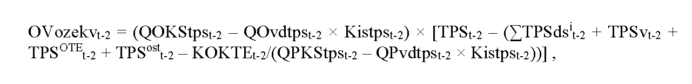

- kde

- 1.

- QOKStpst-2 je celková očakávaná koncová spotreba elektriny v MWh na vymedzenom území na rok t-2, na ktorú sa uplatňujú tarify za prevádzkovanie systému,

- 2.

- QOvdtpstt-2 je celkový očakávaný objem koncovej spotreby elektriny v MWh, na ktorý sa uplatňuje koeficient individuálnej sadzby tarify za prevádzkovanie systému na rok t-2,

- 3.

- Kistpst-2 je koeficient individuálnej sadzby tarify za prevádzkovanie systému na rok t-2,

- 4.

- TPSt-2 je tarifa za prevádzkovanie systému v eurách na jednotku množstva elektriny na rok t-2,

- 5.

- TPSdsit-2 je tarifa za prevádzkovanie systému určená rozhodnutím pre i-tého prevádzkovateľa regionálnej distribučnej sústavy v eurách na jednotku množstva elektriny na rok t-2,

- 6.

- TPSvt-2 je tarifa za prevádzkovanie systému určená rozhodnutím úradu pre výrobcu elektriny, ktorý na základe rozhodnutia ministerstva hospodárstva o uložení povinnosti vo všeobecnom hospodárskom záujme vyrába elektrinu z domáceho uhlia, v eurách na jednotku množstva elektriny na rok t-2,

- 7.

- TPSOTEt-2 je alikvotná časť tarify za prevádzkovanie systému na organizovanie a vyhodnotenie krátkodobého trhu s elektrinou organizátora krátkodobého trhu s elektrinou v eurách na jednotku množstva elektriny na rok t-2,

- 8.

- TPSostt-2 je alikvotná časť tarify za prevádzkovanie systému na zabezpečenie ostatných činností organizátora krátkodobého trhu s elektrinou v eurách na jednotku množstva elektriny na rok t-2,

- 9.

- KOKTEt-2 je korekcia zostatku neuhradených nákladov organizátora krátkodobého trhu s elektrinou v súvislosti s doplatkom, príplatkom, úhradou za činnosť výkupcu elektriny a prostriedkami poskytnutými ministerstvom hospodárstva za rok 2020 v eurách na rok t-2,

- 10.

- QPKStpst-2 je celková plánovaná koncová spotreba elektriny v MWh na vymedzenom území na rok t-2, na ktorú sa uplatňujú tarify za prevádzkovanie systému,

- 11.

- QPvdtpstt-2 je celkový plánovaný objem koncovej spotreby elektriny v MWh, na ktorý sa uplatňuje koeficient individuálnej sadzby tarify za prevádzkovanie systému na rok t-2,

- f)

- SVozekvt-2 sú skutočné výnosy organizátora krátkodobého trhu s elektrinou z alikvotnej časti tarify za prevádzkovanie systému určenej na podporu elektriny vyrobenej z obnoviteľných zdrojov energie a vysoko účinnou kombinovanou výrobou v roku t-2 v eurách, ktoré sa vypočítajú podľa vzorca

- 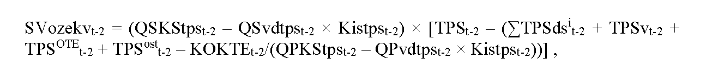

- kde

- 1.

- QSKStpst-2 je celková skutočná koncová spotreba elektriny v MWh na vymedzenom území v roku t-2, na ktorú sa uplatňujú tarify za prevádzkovanie systému,

- 2.

- QSvdtpstt-2 je celkový skutočný objem koncovej spotreby elektriny v MWh, na ktorý sa uplatňuje koeficient individuálnej sadzby tarify za prevádzkovanie systému v roku t-2,

- 3.

- Kistpst-2 je koeficient individuálnej sadzby tarify za prevádzkovanie systému v roku t-2,

- 4.

- TPSt-2 je tarifa za prevádzkovanie systému v eurách na jednotku množstva elektriny na rok t-2,

- 5.

- TPSdsit-2 je tarifa za prevádzkovanie systému určená rozhodnutím pre i-tého prevádzkovateľa regionálnej distribučnej sústavy v eurách na jednotku množstva elektriny na rok t-2,

- 6.

- TPSvt-2 je tarifa za prevádzkovanie systému určená rozhodnutím úradu pre výrobcu elektriny, ktorý na základe rozhodnutia ministerstva hospodárstva o uložení povinnosti vo všeobecnom hospodárskom záujme vyrába elektrinu z domáceho uhlia, v eurách na jednotku množstva elektriny na rok t-2,

- 7.

- TPSOTEt-2 je alikvotná časť tarify za prevádzkovanie systému na organizovanie a vyhodnotenie krátkodobého trhu s elektrinou organizátora krátkodobého trhu s elektrinou v eurách na jednotku množstva elektriny na rok t-2,

- 8.

- TPSostt-2 je alikvotná časť tarify za prevádzkovanie systému na zabezpečenie ostatných činností organizátora krátkodobého trhu s elektrinou v eurách na jednotku množstva elektriny na rok t-2,

- 9.

- KOKTEt-2 je korekcia zostatku neuhradených nákladov organizátora krátkodobého trhu s elektrinou v súvislosti s doplatkom, príplatkom, úhradou za činnosť výkupcu elektriny a prostriedkami poskytnutými ministerstvom hospodárstva za rok 2020 v eurách na rok t-2,

- 10.

- QPKStpst-2 je celková plánovaná koncová spotreba elektriny v MWh na vymedzenom území na rok t-2, na ktorú sa uplatňujú tarify za prevádzkovanie systému,

- 11.

- QPvdtpstt-2 je celkový plánovaný objem koncovej spotreby elektriny v MWh, na ktorý sa uplatňuje koeficient individuálnej sadzby tarify za prevádzkovanie systému na rok t-2,

- g)

- ONozekvt-1 sú očakávané náklady organizátora krátkodobého trhu s elektrinou na podporu elektriny vyrobenej z obnoviteľných zdrojov energie a vysoko účinnou kombinovanou výrobou na rok t-1 v eurách, ktoré sa vypočítajú podľa vzorca

- ONozekvt-1 = ONDt-1 + ONPt-1 + ONVEt-1 + ONFt-1 – OFPt-1 + ONDEt-1 ,

- kde

- 1.

- ONDt-1 sú očakávané náklady organizátora krátkodobého trhu s elektrinou na doplatok pre výrobcov elektriny z obnoviteľných zdrojov energie a vysoko účinnou kombinovanou výrobou na rok t-1 v eurách,

- 2.

- ONPt-1 sú očakávané náklady organizátora krátkodobého trhu s elektrinou na príplatok pre výrobcov elektriny z obnoviteľných zdrojov energie a vysoko účinnou kombinovanou výrobou na rok t-1 v eurách,

- 3.

- ONVEt-1 sú očakávané náklady organizátora krátkodobého trhu s elektrinou na úhradu za činnosť výkupcu elektriny na rok t-1 v eurách,

- 4.

- ONFt-1 sú očakávané náklady na úrok na zabezpečenie finančných prostriedkov na prevádzkové náklady súvisiace s výkonom regulovaných činností vykonávaných organizátorom krátkodobého trhu s elektrinou a ďalšie očakávané finančné náklady na rok t-1 v eurách,

- 5.

- OFPt-1 je očakávaná výška finančných prostriedkov poskytnutých ministerstvom hospodárstva na financovanie nákladov vynaložených na zúčtovanie podpory na rok t-1 v eurách,

- 6.

- ONDEt-1 sú očakávané daňové náklady organizátora krátkodobého trhu s elektrinou súvisiace s úhradou straty organizátora krátkodobého trhu s elektrinou z roku 2020 v súvislosti s doplatkom, príplatkom, úhradou za činnosť výkupcu elektriny a prostriedkami poskytnutými ministerstvom hospodárstva na rok t-1 v eurách,

- h)

- PNozekvt-1 sú plánované náklady organizátora krátkodobého trhu s elektrinou na podporu elektriny vyrobenej z obnoviteľných zdrojov energie a vysoko účinnou kombinovanou výrobou na rok t-1 v eurách, ktoré sa vypočítajú podľa vzorca

- PNozekvt-1 = PNDt-1 + PNPt-1 + PNVEt-1 + PNFt-1 – PFPt-1 + PNDEt-1 ,

- kde

- 1.

- PNDt-1 sú plánované náklady organizátora krátkodobého trhu s elektrinou na doplatok pre výrobcov elektriny z obnoviteľných zdrojov energie a vysoko účinnou kombinovanou výrobou na rok t-1 v eurách,

- 2.

- PNPt-1 sú plánované náklady organizátora krátkodobého trhu s elektrinou na príplatok pre výrobcov elektriny z obnoviteľných zdrojov energie a vysoko účinnou kombinovanou výrobou na rok t-1 v eurách,

- 3.

- PNVEt-1 sú plánované náklady organizátora krátkodobého trhu s elektrinou na úhradu za činnosť výkupcu elektriny na rok t-1 v eurách,

- 4.

- PNFt-1 sú plánované náklady na úrok na zabezpečenie finančných prostriedkov na prevádzkové náklady súvisiace s výkonom regulovaných činností vykonávaných organizátorom krátkodobého trhu s elektrinou a ďalšie plánované finančné náklady na rok t-1 v eurách,

- 5.

- PFPt-1 je plánovaná výška finančných prostriedkov poskytnutých ministerstvom hospodárstva na financovanie nákladov vynaložených na zúčtovanie podpory na rok t-1 v eurách,

- 6.

- PNDEt-1 sú plánované daňové náklady organizátora krátkodobého trhu s elektrinou súvisiace s úhradou straty organizátora krátkodobého trhu s elektrinou z roku 2020 v súvislosti s doplatkom, príplatkom, úhradou za činnosť výkupcu elektriny a prostriedkami poskytnutými ministerstvom hospodárstva na rok t-1 v eurách,

- i)

- PVozekvt-1 sú plánované výnosy organizátora krátkodobého trhu s elektrinou z alikvotnej časti tarify za prevádzkovanie systému určenej na podporu elektriny vyrobenej z obnoviteľných zdrojov energie a vysoko účinnou kombinovanou výrobou na rok t-1 v eurách, ktoré sa vypočítajú podľa vzorca

- 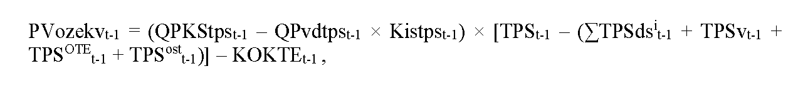

- kde

- 1.

- QPKStpst-1 je celková plánovaná koncová spotreba elektriny v MWh na vymedzenom území na rok t-1, na ktorú sa uplatňujú tarify za prevádzkovanie systému,

- 2.

- QPvdtpstt-1 je celkový plánovaný objem koncovej spotreby elektriny v MWh, na ktorý sa uplatňuje koeficient individuálnej sadzby tarify za prevádzkovanie systému na rok t-1,

- 3.

- Kistpst-1 je koeficient individuálnej sadzby tarify za prevádzkovanie systému na rok t-1,

- 4.

- TPSt-1 je tarifa za prevádzkovanie systému v eurách na jednotku množstva elektriny na rok t-1,

- 5.

- TPSdsit-1 je tarifa za prevádzkovanie systému určená rozhodnutím pre i-tého prevádzkovateľa regionálnej distribučnej sústavy v eurách na jednotku množstva elektriny na rok t-1,

- 6.

- TPSvt-1 je tarifa za prevádzkovanie systému určená rozhodnutím úradu pre výrobcu elektriny, ktorý na základe rozhodnutia ministerstva hospodárstva o uložení povinnosti vo všeobecnom hospodárskom záujme vyrába elektrinu z domáceho uhlia, v eurách na jednotku množstva elektriny na rok t-1,

- 7.

- TPSOTEt-1 je alikvotná časť tarify za prevádzkovanie systému na organizovanie a vyhodnotenie krátkodobého trhu s elektrinou organizátora krátkodobého trhu s elektrinou v eurách na jednotku množstva elektriny na rok t-1,

- 8.

- TPSostt-1 je alikvotná časť tarify za prevádzkovanie systému na zabezpečenie ostatných činností organizátora krátkodobého trhu s elektrinou v eurách na jednotku množstva elektriny na rok t-1,

- 9.

- KOKTEt-1 je korekcia zostatku neuhradených nákladov organizátora krátkodobého trhu s elektrinou v súvislosti s doplatkom, príplatkom, úhradou za činnosť výkupcu elektriny a prostriedkami poskytnutými ministerstvom hospodárstva za rok 2020 v eurách na rok t-1,

- j)

- OVozekvt-1 sú očakávané výnosy organizátora krátkodobého trhu s elektrinou z alikvotnej časti tarify za prevádzkovanie systému určenej na podporu elektriny vyrobenej z obnoviteľných zdrojov energie a vysoko účinnou kombinovanou výrobou v roku t-1 v eurách, ktoré sa vypočítajú podľa vzorca

- 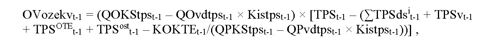

- kde

- 1.

- QOKStpst-1 je celková očakávaná koncová spotreba elektriny v MWh na vymedzenom území na rok t-1, na ktorú sa uplatňujú tarify za prevádzkovanie systému,

- 2.

- QOvdtpstt-1 je celkový očakávaný objem koncovej spotreby elektriny v MWh, na ktorý sa uplatňuje koeficient individuálnej sadzby tarify za prevádzkovanie systému na rok t-1,

- 3.

- Kistpst-1 je koeficient individuálnej sadzby tarify za prevádzkovanie systému na rok t-1,

- 4.

- TPSt-1 je tarifa za prevádzkovanie systému v eurách na jednotku množstva elektriny na rok t-1,

- 5.

- TPSdsit-1 je tarifa za prevádzkovanie systému určená rozhodnutím pre i-tého prevádzkovateľa regionálnej distribučnej sústavy v eurách na jednotku množstva elektriny na rok t-1,

- 6.

- TPSvt-1 je tarifa za prevádzkovanie systému určená rozhodnutím úradu pre výrobcu elektriny, ktorý na základe rozhodnutia ministerstva hospodárstva o uložení povinnosti vo všeobecnom hospodárskom záujme vyrába elektrinu z domáceho uhlia, v eurách na jednotku množstva elektriny na rok t-1,

- 7.

- TPSOTEt-1 je alikvotná časť tarify za prevádzkovanie systému na organizovanie a vyhodnotenie krátkodobého trhu s elektrinou organizátora krátkodobého trhu s elektrinou v eurách na jednotku množstva elektriny na rok t-1,

- 8.

- TPSostt-1 je alikvotná časť tarify za prevádzkovanie systému na zabezpečenie ostatných činností organizátora krátkodobého trhu s elektrinou v eurách na jednotku množstva elektriny na rok t-1,

- 9.

- KOKTEt-1 je korekcia zostatku neuhradených nákladov organizátora krátkodobého trhu s elektrinou v súvislosti s doplatkom, príplatkom, úhradou za činnosť výkupcu elektriny a prostriedkami poskytnutými ministerstvom hospodárstva za rok 2020 v eurách na rok t-1,

- 10.

- QPKStpst-1 je celková plánovaná koncová spotreba elektriny v MWh na vymedzenom území na rok t-1, na ktorú sa uplatňujú tarify za prevádzkovanie systému,

- 11.

- QPvdtpstt-1 je celkový plánovaný objem koncovej spotreby elektriny v MWh, na ktorý sa uplatňuje koeficient individuálnej sadzby tarify za prevádzkovanie systému na rok t-1,

- k)

- kznozekvt-1 je koeficient zahrnutia zostatku neuhradených nákladov vynaložených organizátorom krátkodobého trhu s elektrinou na podporu elektriny vyrobenej z obnoviteľných zdrojov energie a vysoko účinnou kombinovanou výrobou doplatkom a príplatkom pre rok t-1,

- l)

- Kozekvt-1 je korekcia nákladov a výnosov organizátora krátkodobého trhu s elektrinou v súvislosti s doplatkom, príplatkom, úhradou za činnosť výkupcu elektriny a prostriedkami poskytnutými ministerstvom hospodárstva v roku t-1 v eurách,

- m)

- kznozekvt je koeficient zahrnutia zostatku neuhradených nákladov vynaložených organizátorom krátkodobého trhu s elektrinou na podporu elektriny vyrobenej z obnoviteľných zdrojov energie a vysoko účinnou kombinovanou výrobou doplatkom a príplatkom pre rok t, ak ich objem presiahne hranicu 10 000 000 eur, ktorého hodnota určená v cenovom konaní pre roky 2023 až 2026 bude schválená alebo určená minimálne vo výške 0,25 a najneskôr pre rok 2027 vo výške 1.

- (14)

- Korekcia neuhradených nákladov organizátora krátkodobého trhu s elektrinou v súvislosti s doplatkom, príplatkom, úhradou za činnosť výkupcu elektriny a prostriedkami poskytnutými ministerstvom hospodárstva za rok 2020 v eurách KOKTEt sa vypočíta na

- a)

- rok 2022 podľa vzorca

- KOKTE2022 = kznnozekv2022 × NNozekv2020 – ONozekv2021 + OVozekv2021,

- b)

- rok 2023 podľa vzorca

- KOKTE2023 = kznnozekv2023 × NNozekv2020,

- c)

- rok 2024 podľa vzorca

- KOKTE2024 = kznnozekv2024 × NNozekv2020 + PVkokte2022 – SVkokte2022,

- d)

- rok 2025 podľa vzorca

- KOKTE2025 = kznnozekv2025 × NNozekv2020 + PVkokte2023 – SVkokte2023,

- e)

- rok 2026 podľa vzorca

- KOKTE2026 = PVkokte2024 – SVkokte2024,

- f)

- rok 2027 podľa vzorca

- KOKTE2027 = PVkokte2025 – SVkokte2025.

- (15)

- Na účel výpočtu korekcie KOKTEt podľa odseku 14 sa veličinami vzorcov rozumejú

- a)

- kznnozekv2022 až kznnozekv2025 sú koeficienty zahrnutia zostatku neuhradených nákladov vynaložených organizátorom krátkodobého trhu s elektrinou v súvislosti s doplatkom, príplatkom, úhradou za činnosť výkupcu elektriny a prostriedkami poskytnutými ministerstvom hospodárstva za rok 2020 pre roky 2022 až 2025, ktorých hodnoty určené v cenovom konaní pre roky 2022 až 2025 budú schválené alebo určené minimálne vo výške 0,25 počas obdobia najviac štyroch rokov umorovania zostatkovej hodnoty neuhradených nákladov vynaložených organizátorom krátkodobého trhu s elektrinou v súvislosti s doplatkom, príplatkom, úhradou za činnosť výkupcu elektriny a prostriedkami poskytnutými ministerstvom hospodárstva za obdobie roka 2020; suma koeficientov kznnozekv2022 až kznnozekv2025 sa rovná 1 a hodnoty koeficientov kznnozekv2022 až kznnozekv2025 môžu klesnúť pod ročnú hodnotu 0,25 len z dôvodu dynamického umorovania v poslednom roku reálneho nepretržitého umorovania,

- b)

- NNozekv2020 je zostatková časť neuhradených nákladov organizátora krátkodobého trhu s elektrinou v súvislosti s doplatkom, príplatkom, úhradou za činnosť výkupcu elektriny a prostriedkami poskytnutými ministerstvom hospodárstva za obdobie roka 2020 v eurách, ktoré sa počítajú podľa vzorca

- NNozekv2020 = SNozekv2020 – SVozekv2020 + ONozekv2021 – OVozekv2021,

- kde

- 1.

- SNozekv2020 sú skutočné náklady organizátora krátkodobého trhu s elektrinou na podporu elektriny vyrobenej z obnoviteľných zdrojov energie a vysoko účinnou kombinovanou výrobou v roku 2020 v eurách, ktoré sa vypočítajú podľa vzorca

- SNozekv2020 = SND2020 + SNP2020 + SNVE2020 + SNF2020 – SFP2020 ,

- kde

- 1.1.

- SND2020 sú skutočné náklady organizátora krátkodobého trhu s elektrinou na doplatok pre výrobcov elektriny z obnoviteľných zdrojov energie a vysoko účinnou kombinovanou výrobou v roku 2020 v eurách,

- 1.2.

- SNP2020 sú skutočné náklady organizátora krátkodobého trhu s elektrinou na príplatok pre výrobcov elektriny z obnoviteľných zdrojov energie a vysoko účinnou kombinovanou výrobou v roku 2020 v eurách,

- 1.3.

- SNVE2020 sú skutočné náklady organizátora krátkodobého trhu s elektrinou na úhradu za činnosť výkupcu elektriny v roku 2020 v eurách,

- 1.4.

- SNF2020 sú skutočné náklady na úrok na zabezpečenie finančných prostriedkov na prevádzkové náklady súvisiace s výkonom regulovaných činností vykonávaných organizátorom krátkodobého trhu s elektrinou a ďalšie skutočné finančné náklady v roku 2020 v eurách,

- 1.5.

- SFP2020 je skutočná výška finančných prostriedkov poskytnutých ministerstvom hospodárstva na financovanie nákladov vynaložených na zúčtovanie podpory v roku 2020 v eurách,

- 2.

- SVozekv2020 sú skutočné výnosy organizátora krátkodobého trhu s elektrinou z alikvotnej časti tarify za prevádzkovanie systému určenej na podporu elektriny vyrobenej z obnoviteľných zdrojov energie a vysoko účinnou kombinovanou výrobou v roku 2020 v eurách, ktoré sa vypočítajú podľa vzorca

- 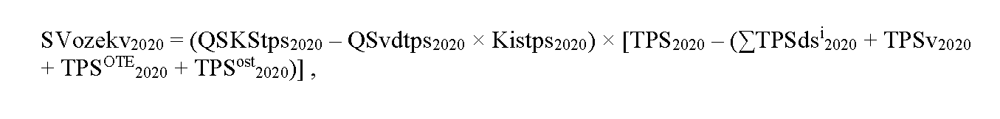

- kde

- 2.1.

- QSKStps2020 je celková skutočná koncová spotreba elektriny v MWh na vymedzenom území v roku 2020, na ktorú sa uplatňujú tarify za prevádzkovanie systému,

- 2.2.

- QSvdtpst2020 je celkový skutočný objem koncovej spotreby elektriny v MWh, na ktorý sa uplatňuje koeficient individuálnej sadzby tarify za prevádzkovanie systému v roku 2020,

- 2.3.

- Kistps2020 je koeficient individuálnej sadzby tarify za prevádzkovanie systému v roku 2020,

- 2.4.

- TPS2020 je tarifa za prevádzkovanie systému v eurách na jednotku množstva elektriny na rok 2020,

- 2.5.

- TPSdsi2020 je tarifa za prevádzkovanie systému určená rozhodnutím pre i-tého prevádzkovateľa regionálnej distribučnej sústavy v eurách na jednotku množstva elektriny na rok 2020,

- 2.4.

- TPSv2020 je tarifa za prevádzkovanie systému určená rozhodnutím úradu pre výrobcu elektriny, ktorý na základe rozhodnutia ministerstva hospodárstva o uložení povinnosti vo všeobecnom hospodárskom záujme vyrába elektrinu z domáceho uhlia, v eurách na jednotku množstva elektriny na rok 2020,

- 2.4.

- TPSOTE2020 je alikvotná časť tarify za prevádzkovanie systému na organizovanie a vyhodnotenie krátkodobého trhu s elektrinou organizátora krátkodobého trhu s elektrinou v eurách na jednotku množstva elektriny na rok 2020,

- 2.5.

- TPSost2020 je alikvotná časť tarify za prevádzkovanie systému na zabezpečenie ostatných činností organizátora krátkodobého trhu s elektrinou v eurách na jednotku množstva elektriny na rok 2020,

- 3.

- ONozekv2021 sú očakávané náklady organizátora krátkodobého trhu s elektrinou na podporu elektriny vyrobenej z obnoviteľných zdrojov energie a vysoko účinnou kombinovanou výrobou na rok 2021 v eurách, ktoré sa vypočítajú podľa vzorca

- ONozekv2021 = OND2021 + ONP2021 + ONVE2021 + ONF2021 – OFP2021 ,

- kde

- 3.1.

- OND2021 sú očakávané náklady organizátora krátkodobého trhu s elektrinou na doplatok pre výrobcov elektriny z obnoviteľných zdrojov energie a vysoko účinnou kombinovanou výrobou na rok 2021 v eurách,

- 3.2.

- ONP2021 sú očakávané náklady organizátora krátkodobého trhu s elektrinou na príplatok pre výrobcov elektriny z obnoviteľných zdrojov energie a vysoko účinnou kombinovanou výrobou na rok 2021 v eurách,

- 3.3.

- ONVE2021 sú očakávané náklady organizátora krátkodobého trhu s elektrinou na úhradu za činnosť výkupcu elektriny na rok 2021 v eurách,

- 3.4.

- ONF2021 sú očakávané náklady na úrok na zabezpečenie finančných prostriedkov na prevádzkové náklady súvisiace s výkonom regulovaných činností vykonávaných organizátorom krátkodobého trhu s elektrinou a ďalšie skutočné finančné náklady na rok 2021 v eurách,

- 3.5.

- OFP2021 je očakávaná výška finančných prostriedkov poskytnutých ministerstvom hospodárstva na financovanie nákladov vynaložených na zúčtovanie podpory na rok 2021 v eurách,

- 4.

- OVozekv2021 sú očakávané výnosy organizátora krátkodobého trhu s elektrinou z alikvotnej časti tarify za prevádzkovanie systému určenej na podporu elektriny vyrobenej z obnoviteľných zdrojov energie a vysoko účinnou kombinovanou výrobou na rok 2021 v eurách, ktoré sa vypočítajú podľa vzorca

- 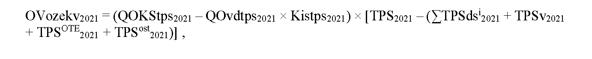

- kde

- 4.1.

- QOKStps2021 je celková očakávaná koncová spotreba elektriny v MWh na vymedzenom území na rok 2021, na ktorú sa uplatňujú tarify za prevádzkovanie systému,

- 4.2.

- QOvdtpst2021 je celkový očakávaný objem koncovej spotreby elektriny v MWh, na ktorý sa uplatňuje koeficient individuálnej sadzby tarify za prevádzkovanie systému na rok 2021,

- 4.3.

- Kistps2021 je koeficient individuálnej sadzby tarify za prevádzkovanie systému na rok 2021,

- 4.4.

- TPS2021 je tarifa za prevádzkovanie systému v eurách na jednotku množstva elektriny na rok 2021,

- 4.5.

- TPSdsi2021 je tarifa za prevádzkovanie systému určená rozhodnutím pre i-tého prevádzkovateľa regionálnej distribučnej sústavy v eurách na jednotku množstva elektriny na rok 2021,

- 4.6.

- TPSv2021 je tarifa za prevádzkovanie systému určená rozhodnutím úradu pre výrobcu elektriny, ktorý na základe rozhodnutia ministerstva hospodárstva o uložení povinnosti vo všeobecnom hospodárskom záujme vyrába elektrinu z domáceho uhlia, v eurách na jednotku množstva elektriny na rok 2021,

- 4.7.

- TPSOTE2021 je alikvotná časť tarify za prevádzkovanie systému na organizovanie a vyhodnotenie krátkodobého trhu s elektrinou organizátora krátkodobého trhu s elektrinou v eurách na jednotku množstva elektriny na rok 2021,

- 4.8.

- TPSost2021 je alikvotná časť tarify za prevádzkovanie systému na zabezpečenie ostatných činností organizátora krátkodobého trhu s elektrinou v eurách na jednotku množstva elektriny na rok 2021,

- c)

- PVkokte2022 až PVkokte2025 sú plánované výnosy organizátora krátkodobého trhu s elektrinou z alikvotnej časti tarify za prevádzkovanie systému určenej pre roky 2022 až 2025 na korekciu zostatku neuhradených nákladov organizátora krátkodobého trhu s elektrinou v súvislosti s doplatkom, príplatkom, úhradou za činnosť výkupcu elektriny a prostriedkami poskytnutými ministerstvom hospodárstva za rok 2020 v eurách,

- d)

- SVkokte2022 až SVkokte2025 sú skutočné výnosy organizátora krátkodobého trhu s elektrinou z alikvotnej časti tarify za prevádzkovanie systému určenej pre roky 2022 až 2025 na korekciu zostatku neuhradených nákladov organizátora krátkodobého trhu s elektrinou v súvislosti s doplatkom, príplatkom, úhradou za činnosť výkupcu elektriny a prostriedkami poskytnutými ministerstvom hospodárstva za rok 2020 v eurách.

- (16)

- Tarifa za prevádzkovanie systému TPSt môže byť diferencovaná na viaceré hodnoty, ktoré sa uplatňujú pre koncových odberateľov elektriny podľa množstva koncovej spotreby elektriny v odbernom mieste.“.

- 10. Za § 46d sa vkladá § 46e, ktorý vrátane nadpisu znie:

- 㤠46e

- Prechodné ustanovenie k úpravám účinným od 25. augusta 2021

- Na posúdenie zníženia ceny elektriny pre stanovenie doplatku pri predĺžení podpory doplatkom na základe návrhu ceny regulovaného subjektu predloženého úradu do 25. augusta 2021 sa použije táto vyhláška v znení účinnom od 25. augusta 2021.“.

- 11. Vyhláška sa dopĺňa prílohou č. 10, ktorá vrátane nadpisu znie:

- „[Príloha č. 10 k vyhláške č. 18/2017 Z. z.](assets/6977c63ad553b3713a9dd48cad95965b7abe5398b119034c8e91f3557578d523.pdf)“.
