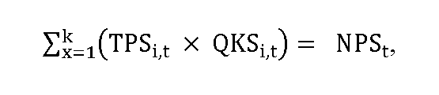
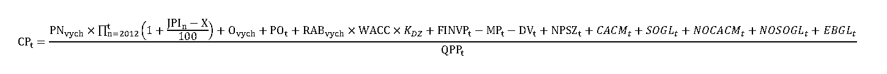
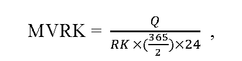
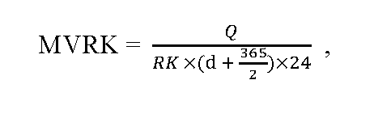
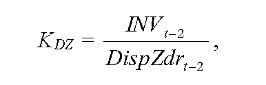
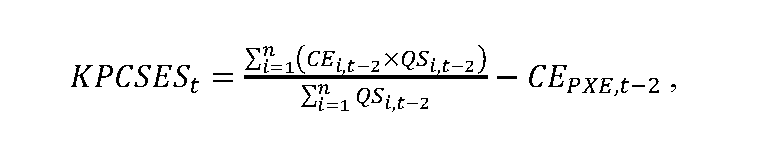
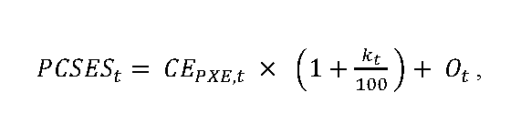
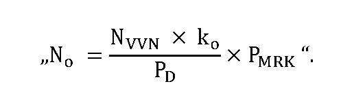
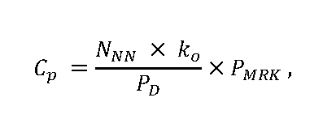

# Čl. I

Vyhláška Úradu pre reguláciu sieťových odvetví č. 18/2017 Z. z., ktorou sa ustanovuje cenová regulácia v elektroenergetike a niektoré podmienky vykonávania regulovaných činností v elektroenergetike v znení vyhlášky č. 207/2018 Z. z., vyhlášky č. 178/2019 Z. z., vyhlášky č. 309/2019 Z. z., vyhlášky č. 300/2021 Z. z. a vyhlášky č. 326/2021 Z. z. sa mení a dopĺňa takto:

- 1. V § 4 ods. 1 písm. f) sa slová „za obdobie od 1. januára roku t-1 do 30. júna roku t-1“ nahrádzajú slovami „za obdobie šiestich kalendárnych mesiacov predchádzajúcich mesiacu, v ktorom sa predkladá návrh ceny alebo návrh na zmenu rozhodnutia“.

- 2. V § 5 ods. 3 sa na konci pripája táto veta: „Odchýlka medzi doterajšou mierou výnosnosti regulačnej bázy aktív a novou mierou výnosnosti regulačnej bázy aktív nemôže byť vyššia ako 10 %.“.

- 3. V § 7 ods. 2 sa vypúšťa písmeno d).

  - Doterajšie písmeno e) sa označuje ako písmeno d).

  - Poznámka pod čiarou k odkazu 26 sa vypúšťa.

- 4. Poznámka pod čiarou k odkazu 33 znie:

- „33) Zákon č. 157/2018 o metrológii a o zmene a doplnení niektorých zákonov v znení zákona č. 198/2020 Z. z.“.

- 5. V § 7 sa vypúšťa odsek 9.

  - Doterajšie odseky 10 až 21 sa označujú ako odseky 9 až 20.

- 6. V § 8 ods. 1 písm. b) sa slová „odseku 4“ nahrádzajú slovami „odseku 13“.

- 7. V § 10 sa odsek 3 dopĺňa písmenom e), ktoré znie:

- „e)

- spaľovaním biometánu získaného z bioplynu vyrobeného anaeróbnou fermentačnou technológiou................................................. 95,95 eura/MWh.“.

- 8. V § 10 ods. 4 sa vypúšťa písmeno h).

- 9. V § 10 sa za odsek 4 vkladá nový odsek 5, ktorý znie:

- „(5)

- Cena elektriny vyrobenej vysoko účinnou kombinovanou výrobou spaľovaním biometánu v zariadení výrobcu elektriny s celkovým inštalovaným výkonom do 125 MW vrátane je vo výške 95,95 eura/MWh, pričom sa nezohľadňuje čas uvedenia zariadenia výrobcu elektriny do prevádzky.“.

  - Doterajšie odseky 5 až 8 sa označujú ako odseky 6 až 9.

- 10. § 10 sa dopĺňa odsekom 10, ktorý znie:

- „(10)

- Cena elektriny podľa odsekov 3 až 5 sa pre zariadenie výrobcu elektriny upravuje podľa roku uvedenia zariadenia výrobcu elektriny do prevádzky korekciou Pznit podľa § 8 ods. 13 až 15, ktorá zohľadňuje výrazné zvýšenie alebo zníženie ceny vstupných surovín použitých na výrobu elektriny.“.

- 11. V § 11 ods. 4 písm. b) prvý bod znie:

- „1.

- FNvych sú prevádzkové náklady určené ako priemerné ročné fixné prevádzkové náklady nevyhnutne vynaložené na regulovanú činnosť v regulačnom období za roky 2017 až 2020, najviac však do výšky 37 300 000 eur,“.

- 12. V § 12 odsek 16 znie:

- „(16)

- Tarifa za prevádzkovanie systému TPSt môže byť diferencovaná na viaceré hodnoty sadzieb TPSi,t, ktoré sa uplatnia individuálne pre jednotlivé skupiny koncových odberateľov elektriny podľa množstva koncovej spotreby elektriny v odbernom mieste, pričom platí

- 

- kde

- a)

- TPSi,t je sadzba tarify za prevádzkovanie systému uplatnená na koncovú spotrebu elektriny v i-tej skupine odberných miest odberateľov elektriny v eurách na megawatthodinu v roku t,

- b)

- QKSi,t je celková plánovaná koncová spotreba elektriny v i-tej skupine odberných miest odberateľov elektriny v megawatthodinách v roku t,

- c)

- k je celkový počet skupín odberných miest odberateľov elektriny v roku t, pričom

- 1.

- skupina 1 sú odberné miesta s očakávanou koncovou spotrebou elektriny za rok t-1 do 1 GWh vrátane,

- 2.

- skupina 2 sú odberné miesta s očakávanou koncovou spotrebou elektriny za rok t-1 nad 1 GWh do 100 GWh vrátane,

- 3.

- skupina 3 sú odberné miesta s očakávanou koncovou spotrebou elektriny za rok t-1 nad 100 GWh,

- d)

- NPSt sú plánované náklady na prevádzkovanie systému v roku t, ktoré sa vypočítajú podľa § 12 ods. 2.“.

- 13. V § 20 ods. 1 vzorec na výpočet CPt znie:

- 

- 14. V § 20 ods. 1 písm. h) sa slová „na roky 2017 a 2022“ nahrádzajú slovami „na roky 2017 až 2022“.

- 15. V § 20 sa odsek 1 dopĺňa písmenami o) až r), ktoré znejú:

- „o)

- SOGLt sú schválené náklady na projekty súvisiace s implementáciou povinností prevádzkovateľa prenosovej sústavy podľa osobitného predpisu55a) v eurách na rok t,

- p)

- NOCACMt sú schválené náklady na nápravné opatrenia použité v procese prideľovania prenosových kapacít podľa osobitného predpisu55b) v eurách na rok t,

- q)

- NOSOGLt sú schválené náklady na nápravné opatrenia použité v procese riadenia prevádzky prenosovej sústavy na zabezpečenie spoľahlivosti a bezpečnosti dodávok elektriny podľa osobitného predpisu55c) v eurách na rok t,

- r)

- EBGLt sú schválené náklady na zriadenie, zmenu a prevádzkovanie európskych platforiem podľa osobitného predpisu55d) v eurách na rok t.“.

  - Poznámky pod čiarou k odkazom 55a až 55d znejú:

  - „55a) Nariadenie Komisie (EÚ) 2017/1485 z 2. augusta 2017, ktorým sa stanovuje usmernenie pre prevádzkovanie elektrizačnej prenosovej sústavy (Ú. v. EÚ L 220, 25. 8. 2017).

  - 55b) Čl. 25 nariadenia Komisie (EÚ) 2015/1222.

  - 55c) Čl. 20 nariadenia Komisie (EÚ) 2017/1485.

  - 55d) Čl. 19 až 22 nariadenia Komisie (EÚ) 2017/2195 z 23. novembra 2017, ktorým sa stanovuje usmernenie o zabezpečovaní rovnováhy v elektrizačnej sústave (Ú. v. EÚ L 312, 28. 11. 2017).“.

- 16. V § 21 ods. 2 písm. b) prvom bode sa slová „za obdobie od. 1 januára roku t-1 do 30. júna roku t-1“ nahrádzajú slovami „za obdobie od 1. apríla roku t-1 do 30. septembra roku t-1.“.

- 17. V § 23 ods. 3 sa v celom texte vrátane vzorcov slová „GCCt-2“ nahrádzajú slovami „IGCCt-2“.

- 18. V § 26 odseky 7 a 8 znejú:

- „(7)

- Na napäťovej úrovni nízkeho napätia sa určená tarifa za prístup do distribučnej sústavy a distribúciu elektriny rozpočíta najviac do trinástich sadzieb pre odberateľov elektriny mimo domácnosti takto:

- a)

- C1 je jednopásmová sadzba s nižšou spotrebou elektriny,

- b)

- C2 je jednopásmová sadzba so strednou spotrebou elektriny,

- c)

- C3 je jednopásmová sadzba s vyššou spotrebou elektriny,

- d)

- C4 je dvojpásmová sadzba s nižšou spotrebou elektriny, pričom nízke pásmo sa poskytuje minimálne osem hodín denne; sadzba C4 sa použije aj pre odberné miesto s nabíjacou stanicou elektrických vozidiel,

- e)

- C5 je dvojpásmová sadzba so strednou spotrebou elektriny, pričom nízke pásmo sa poskytuje minimálne osem hodín denne; sadzba C5 sa použije aj pre odberné miesto s nabíjacou stanicou elektrických vozidiel,

- f)

- C6 je dvojpásmová sadzba s vyššou spotrebou elektriny, pričom nízke pásmo sa poskytuje minimálne osem hodín denne; sadzba C6 sa použije aj pre odberné miesto s nabíjacou stanicou elektrických vozidiel,

- g)

- C7 je dvojpásmová sadzba, pričom nízke pásmo sa poskytuje minimálne 20 hodín denne s blokovaním priamovýhrevných elektrických spotrebičov v čase vysokého pásma; sadzba C7 sa použije aj pre odberné miesto s nabíjacou stanicou elektrických vozidiel,

- h)

- C8 je dvojpásmová sadzba pre tepelné čerpadlo, pričom nízke pásmo sa poskytuje minimálne 22 hodín denne s blokovaním výhrevných elektrických spotrebičov v čase vysokého pásma; sadzba C8 sa použije aj pre odberné miesto s nabíjacou stanicou elektrických vozidiel,

- i)

- C9 je sadzba pre nemerané odbery elektriny,

- j)

- C10 je sadzba pre verejné osvetlenie,

- k)

- C11 je sadzba pre dočasné odbery elektriny,

- l)

- C12 je dvojpásmová sadzba pre odberné miesto výhradne s nabíjacou stanicou elektrických vozidiel vybavených blokovaním nabíjacej stanice v čase vysokého pásma, pričom sadzba vo vysokom pásme je minimálne o 30 % vyššia ako sadzba v nízkom pásme a nízke pásmo sa poskytuje minimálne 20 hodín denne,

- m)

- C13 je viacpásmová sadzba pre odberné miesto s nainštalovaným inteligentným meracím systémom, pričom sa poskytuje minimálne v štyroch časových pásmach v priebehu 24 hodín a cena v najvyššom pásme je minimálne o 30 % vyššia ako cena v najnižšom pásme.

- (8)

- Na napäťovej úrovni nízkeho napätia sa určená maximálna cena za prístup do distribučnej sústavy a distribúciu elektriny rozpočíta najviac do desiatich sadzieb pre odberateľov elektriny v domácnosti takto:

- a)

- D1 je jednopásmová sadzba s nižšou spotrebou elektriny,

- b)

- D2 je jednopásmová sadzba s vyššou spotrebou elektriny,

- c)

- D3 je dvojpásmová sadzba, pričom nízke pásmo sa poskytuje minimálne osem hodín denne s fixne určenými intervalmi času prevádzky v nízkom pásme a aspoň jeden interval sa poskytuje v nepretržitom trvaní minimálne tri hodiny, blokovanie elektrických spotrebičov sa nevyžaduje; informácia o fixnom čase trvania intervalu v nepretržitom trvaní času prevádzky v nízkom pásme minimálne tri hodiny sa zverejňuje na webovom sídle prevádzkovateľa distribučnej sústavy,

- d)

- D4 je dvojpásmová sadzba, pričom nízke pásmo sa poskytuje minimálne osem hodín denne s blokovaním akumulačných elektrických spotrebičov v čase vysokého pásma; sadzba D4 sa použije aj pre odberné miesto s nabíjacou stanicou elektrických vozidiel,

- e)

- D5 je dvojpásmová sadzba pre priamovýhrevné elektrické vykurovanie, pričom nízke pásmo sa poskytuje minimálne 20 hodín denne s blokovaním priamovýhrevných elektrických spotrebičov v čase vysokého pásma; sadzba D5 sa použije aj pre odberné miesto s nabíjacou stanicou elektrických vozidiel,

- f)

- D6 je dvojpásmová sadzba pre tepelné čerpadlo, pričom nízke pásmo sa poskytuje minimálne 22 hodín denne s blokovaním elektrických spotrebičov na vykurovanie v čase vysokého pásma; sadzba D6 sa použije aj pre odberné miesto s nabíjacou stanicou elektrických vozidiel,

- g)

- D7 je dvojpásmová sadzba, pričom nízke pásmo sa poskytuje celoročne od piatka 15:00 hodiny do pondelka 6:00 hodiny bez blokovania elektrických spotrebičov,

- h)

- D8 je dvojpásmová sadzba, pričom nízke pásmo sa poskytuje minimálne osem hodín denne s blokovaním akumulačných spotrebičov elektriny v čase vysokého pásma s určeným minimálnym inštalovaným výkonom akumulačných spotrebičov,

- i)

- D9 je dvojpásmová sadzba pre odberné miesto výhradne s nabíjacou stanicou elektrických vozidiel vybavených blokovaním nabíjacej stanice v čase vysokého pásma, pričom sadzba vo vysokom pásme je minimálne o 30 % vyššia ako sadzba v nízkom pásme a nízke pásmo sa poskytuje minimálne 20 hodín denne,

- j)

- D10 je viacpásmová sadzba pre odberné miesto s nainštalovaným inteligentným meracím systémom, pričom sa poskytuje minimálne v štyroch časových pásmach v priebehu 24 hodín a cena v najvyššom pásme je minimálne o 30 % vyššia ako cena v najnižšom pásme.“.

- 19. V § 26 ods. 17 písm. b) a c) sa vypúšťajú slová „na rovnakú hodnotu“.

- 20. V § 26 ods. 23 a 24 sa slová „30 %“ nahrádzajú slovami „15 %“.

- 21. § 26 sa dopĺňa odsekmi 40 až 43, ktoré znejú:

- „(40)

- Na napäťovej úrovni vysokého napätia sa cena za prístup do distribučnej sústavy a distribúciu elektriny pre odberateľov elektriny s odberným miestom s pripojenou nabíjacou stanicou elektrických vozidiel uplatňuje vo výške

- a)

- 25 % z tarify za dvanásťmesačnú rezervovanú kapacitu a 175 % tarify za distribúciu elektriny podľa cenového rozhodnutia na rok t, ak miera využitia rezervovanej kapacity odberného miesta vypočítaná podľa odseku 41 je nižšia alebo sa rovná 0,1,

- b)

- 75 % tarify za dvanásťmesačnú rezervovanú kapacitu a 150 % tarify za distribúciu elektriny podľa cenového rozhodnutia na rok t, ak miera využitia rezervovanej kapacity odberného miesta vypočítaná podľa odseku 41 je vyššia ako 0,1 alebo sa rovná 0,3,

- c)

- tarify za rezervovanú kapacitu a tarify za distribúciu elektriny podľa cenového rozhodnutia na rok t, ak miera využitia rezervovanej kapacity odberného miesta vypočítaná podľa odseku 41 je vyššia ako 0,3.

- (41)

- Miera využitia rezervovanej kapacity odberného miesta s pripojenou nabíjacou stanicou elektrických vozidiel MVRK sa vypočíta podľa vzorca

- 

- kde

- a)

- MVRK je miera využitia rezervovanej kapacity odberného miesta s pripojenou nabíjacou stanicou elektrických vozidiel za predchádzajúci kalendárny polrok,

- b)

- Q je celkové odobraté množstvo elektriny v odbernom mieste s nabíjacou stanicou za predchádzajúci kalendárny polrok,

- c)

- RK je dvanásťmesačná rezervovaná kapacita odberného miesta s pripojenou nabíjacou stanicou určená ako priemer zmluvne dohodnutej rezervovanej kapacity za predchádzajúci kalendárny polrok.

- (42)

- Pri uvedení nabíjacej stanice elektrických vozidiel pripojenej na napäťovej úrovni vysokého napätia do prevádzky sa postupuje podľa odseku 40 písm. a). Prvé vyhodnotenie miery využitia rezervovanej kapacity odberného miesta s pripojenou nabíjacou stanicou na napäťovej úrovni vysokého napätia sa vykoná po ukončení prvého uceleného kalendárneho polroka prevádzky, pričom MVRK sa vypočíta podľa vzorca

- 

- kde

- a)

- MVRK je miera využitia rezervovanej kapacity odberného miesta s pripojenou nabíjacou stanicou elektrických vozidiel za predchádzajúci kalendárny polrok,

- b)

- Q je celkové odobraté množstvo elektriny v odbernom mieste s nabíjacou stanicou za predchádzajúci kalendárny polrok,

- c)

- RK je dvanásťmesačná rezervovaná kapacita odberného miesta s pripojenou nabíjacou stanicou určená ako priemer zmluvne dohodnutej rezervovanej kapacity za predchádzajúci kalendárny polrok,

- d)

- d je počet dní od začiatku prevádzky nabíjacej stanice do začiatku prvého uceleného kalendárneho polroka prevádzky.

- (43)

- Rozdiel v cene za prístup do distribučnej sústavy a distribúciu elektriny zistený na základe miery využitia rezervovanej kapacity odberného miesta s pripojenou nabíjacou stanicou MVRK vyhodnotenej za predchádzajúci kalendárny polrok sa vyúčtuje odberateľovi elektriny podľa odseku 40.“.

- 22. V § 27 ods. 3 písmeno h) znie:

- „h)

- KDZ je koeficient miery využitia disponibilných zdrojov do investícií súvisiacich s regulovanou činnosťou; KDZ na roky 2017 až 2022 sa vypočíta podľa vzorca

- 

- pričom, ak je výsledok podielu

- vyšší alebo sa rovná 0,7, tak KDZ = 1,02,

- menší ako 0,7 a zároveň vyšší alebo sa rovná 0,6, tak KDZ = 1,01,

- menší ako 0,6 a zároveň vyšší alebo sa rovná 0,5, tak KDZ = 1,00,

- menší ako 0,5 a zároveň vyšší alebo sa rovná 0,4, tak KDZ = 0,98,

- menší ako 0,4 a zároveň vyšší alebo sa rovná 0,3, tak KDZ = 0,96,

- menší ako 0,3 a zároveň vyšší alebo sa rovná 0,2, tak KDZ = 0,94,

- menší ako 0,2 a zároveň vyšší alebo sa rovná 0,1, tak KDZ = 0,92, alebo

- menší ako 0,1, tak KDZ = 0,90,

- kde

- 1.

- INVt-2 je skutočná hodnota investícií na napäťovej úrovni v eurách zaradených do hodnoty regulačnej bázy aktív na napäťovej úrovni nevyhnutne využívaných pre regulovanú činnosť v roku t-2,

- 2.

- DispZdrt-2 je súčet schválených alebo určených odpisov na napäťovej úrovni v eurách súvisiacich s regulovanou činnosťou v roku t-2 a vypočítaných na základe zostatkovej doby technickej životnosti tried aktív nevyhnutne využívaných pre regulovanú činnosť podľa prílohy č. 1 tabuľky č. 2 a zisku prevádzkovateľa distribučnej sústavy v roku t-2 v eurách po zdanení daňou z príjmov, ktorý sa vypočíta RAB×WACC× (1− daň z príjmov), pričom WACC a daň z príjmov sa vzťahuje na rok t-2,“.

- 23. V § 27 ods. 3 písmeno j) znie:

- „j)

- DVHN,t sú skutočné dodatočné výnosy na napäťovej úrovni v eurách v roku t-2, ktoré sú zložené z celkových skutočných výnosov

- 1.

- z uplatnenia ceny za pripojenie do sústavy,

- 2.

- zo sankcií za prekročenie rezervovanej kapacity,

- 3.

- za neoprávnený odber elektriny,57)

- 4.

- z taríf za dodávku jalovej elektriny do distribučnej sústavy na základe cenového rozhodnutia úradu, pričom pre rok 2022 sa zohľadnia vo výške 50 % a pre rok 2023 a ďalšie roky sa zohľadnia vo výške 100 %,

- 5.

- z taríf za nedodržanie predpísanej hodnoty účinníka cos φ účtované užívateľom sústavy na základe cenového rozhodnutia úradu, pričom pre rok 2022 sa zohľadnia vo výške 50 % a pre rok 2023 a ďalšie roky sa zohľadnia vo výške 100 %.“.

- 24. V § 28 ods. 3 písm. b) prvom bode sa slová „do 30. júna roku t-1“ nahrádzajú slovami „do 31. októbra roku t-1 pre rok 2022,“.

- 25. V § 28 ods. 3 písm. b) štvrtý bod znie:

- „4.

- KPCSESt je korekcia ceny elektriny na účely pokrytia strát elektriny pri distribúcii elektriny v eurách na jednotku množstva elektriny na rok t, ktorej výška sa pre roky 2020 až 2022 rovná nule a pre roky 2023 a 2024 sa vypočíta podľa vzorca

- 

- kde

- 4.1

- CEi,t-2 je cena elektriny slovenskej obchodnej oblasti na dennom trhu organizovanom organizátorom krátkodobého trhu s elektrinou v i-tej štvrťhodine roku t-2 v eurách na jednotku množstva elektriny,

- 4.2

- QSi,t-2 je množstvo strát elektriny pri distribúcii elektriny v i-tej štvrťhodine roku t-2 v jednotkách množstva elektriny na základe údajov poskytnutých organizátorom krátkodobého trhu s elektrinou,

- 4.3

- CEPXE,t-2 je schválený alebo určený aritmetický priemer denných cien elektriny na výpočet ceny elektriny na účely pokrytia strát elektriny pri distribúcii elektriny v eurách na jednotku množstva elektriny na rok t-2.“.

- 26. V § 28 sa odsek 3 dopĺňa písmenom c), ktoré znie:

- „c)

- PCSESt je schválená alebo určená cena elektriny na účely pokrytia strát elektriny pri distribúcii elektriny v eurách na jednotku množstva elektriny na rok 2023 a nasledujúce roky vypočítaná podľa vzorca

- 

- kde

- 1.

- CEPXE,t je aritmetický priemer denných cien oficiálneho kurzového lístka, zverejneného burzou PXE (POWER EXCHANGE CENTRAL EUROPE) na jej webovom sídle, produktu F PXE SK BL Cal-t v eurách na jednotku množstva elektriny za obdobie od 1. apríla roku t-1 do 30. septembra roku t-1,

- 2.

- kt je koeficient na rok t v percentách, ktorého hodnota je najviac 7 %,

- 3.

- Ot sú schválené alebo určené plánované náklady regulovaného subjektu za podiel na nákladoch na regulačnú elektrinu a za zúčtovanie rozdielov strát elektriny podľa osobitného predpisu58) na základe údajov poskytnutých organizátorom krátkodobého trhu s elektrinou a vyrovnávacej ceny elektriny na zúčtovanie rozdielov strát elektriny; vyrovnávacia cena elektriny na zúčtovanie rozdielov strát elektriny je určená vo výške určenej ceny na nákup elektriny na krytie strát elektriny v príslušnej sústave na príslušné obdobie na rok t.“.

- 27. V § 29 ods. 5 písm. a) a b) vo vzorcoch sa slová „+ 0,090194“ nahrádzajú slovami

- „– 0,090194“.

- 28. V § 29 ods. 13 sa slová „30 %“ nahrádzajú slovami „15 %“.

- 29. § 30 sa dopĺňa odsekom 7, ktorý znie:

- „(7)

- Ak regulovaný subjekt nemá schválenú alebo určenú maximálnu cenu za prístup do miestnej distribučnej sústavy a distribúciu elektriny At v eurách na jednotku množstva elektriny na rok t podľa odseku 1, faktor vyrovnania maximálnej ceny za prístup do miestnej distribučnej sústavy a distribúciu elektriny v eurách na jednotku množstva elektriny KAt na rok t zohľadňujúci skutočnosť za rok t-2 sa rovná nule.“.

- 30. V § 31 odsek 5 znie:

- „(5)

- Za dodávku elektriny odberateľom elektriny v domácnosti sa pre jednotlivé odberné miesta uplatní najviac deväť sadzieb, a to

- a)

- DD1 je jednopásmová sadzba s nižšou spotrebou elektriny,

- b)

- DD2 je jednopásmová sadzba s vyššou spotrebou elektriny,

- c)

- DD3 je dvojpásmová sadzba, pričom nízke pásmo sa poskytuje minimálne osem hodín denne s fixne určeným časom prevádzky v nízkom pásme v nepretržitom trvaní aspoň tri hodiny a blokovanie elektrických spotrebičov sa nevyžaduje,

- d)

- DD4 je dvojpásmová sadzba, pričom nízke pásmo sa poskytuje minimálne osem hodín denne s blokovaním akumulačných elektrických spotrebičov v čase vysokého pásma; sadzba DD4 sa použije aj pre odberné miesto s nabíjacou stanicou elektrických vozidiel,

- e)

- DD5 je dvojpásmová sadzba pre priamovýhrevné elektrické vykurovanie, pričom nízke pásmo sa poskytuje minimálne 20 hodín denne s blokovaním priamovýhrevných elektrických spotrebičov v čase vysokého pásma; sadzba DD5 sa použije aj pre odberné miesto s nabíjacou stanicou elektrických vozidiel,

- f)

- DD6 je dvojpásmová sadzba pre tepelné čerpadlo, pričom nízke pásmo sa poskytuje minimálne 22 hodín denne s blokovaním elektrických spotrebičov na vykurovanie v čase vysokého pásma; sadzba DD6 sa použije aj pre odberné miesto s nabíjacou stanicou elektrických vozidiel,

- g)

- DD7 je dvojpásmová sadzba, pričom nízke pásmo sa poskytuje celoročne od piatka 15:00 hodiny do pondelka 6:00 hodiny a blokovanie elektrických spotrebičov sa nevyžaduje,

- h)

- DD8 je dvojpásmová sadzba, pričom nízke pásmo sa poskytuje minimálne osem hodín denne s blokovaním akumulačných spotrebičov elektriny v čase vysokého pásma s určeným minimálnym inštalovaným výkonom akumulačných spotrebičov,

- i)

- DD9 je viacpásmová sadzba pre odberné miesto s nainštalovaným inteligentným meracím systémom.“.

- 31. V § 32 ods. 1 písmeno a) znie:

- „a)

- CEPXE,t je aritmetický priemer denných cien oficiálneho kurzového lístka zverejneného burzou PXE (POWER EXCHANGE CENTRAL EUROPE) na jej webovom sídle, produktu F PXE SK BL Cal-t v eurách na jednotku množstva elektriny pre rok 2022 za obdobie od 1. januára roku t-1 do 30. júna roku t-1 a pre rok 2023 za obdobie od 1. apríla roku t-1 do 30. septembra roku t-1.“.

- 32. V § 32 ods. 2 písm. a) a ods. 3 písm. a) sa suma „0,75 eura“ nahrádza sumou „1,10 eura“.

- 33. V § 32 ods. 4 sa slová „pre koeficienty KVTDi a KNTDi platí, že koeficient KVTDi musí byť výrazne vyšší ako koeficient KNTDi“ nahrádzajú slovami „pre koeficienty KVTDi a KNTDi platí, že hodnota koeficientu KVTDi je vyššia o viac ako 30 % v porovnaní s hodnotou koeficientu KNTDi.“.

- 34. V § 32 odsek 6 znie:

- „(6)

- Na určenie najvyššej miery primeraného zisku pri dodávke elektriny pre odberateľov elektriny v domácnosti, ktorý je možné zahrnúť do ceny za dodávku elektriny pre odberateľov elektriny v domácnosti, sa použije nižšia z hodnôt 3 eurá/MWh alebo 8 % z ceny elektriny CEt určenej podľa odseku 1.“.

- 35. § 32 sa dopĺňa odsekom 7, ktorý znie:

- „(7)

- Ak sa preukáže neočakávaný výrazný nárast odberateľov elektriny v domácnosti, ktorým dodáva elektrinu dodávateľ elektriny, v poslednom štvrťroku roku t-1, v cenovom konaní o dodávke elektriny na rok t sa primeraným spôsobom zohľadní rozdiel nákladov na nákup elektriny prislúchajúcich k cene CEPXE,t podľa odseku 1 a preukázanými nákladmi vynaloženými dodávateľom elektriny na nákup elektriny na zabezpečenie dodávky elektriny pre nových odberateľov elektriny v domácnosti.“.

- 36. § 34 znie:

- 㤠34

- Za dodávku elektriny malým podnikom sa pre jednotlivé odberné miesta uplatní najviac dvanásť sadzieb, a to:

- a)

- DMP1 je jednopásmová sadzba s nižšou spotrebou elektriny,

- b)

- DMP2 je jednopásmová sadzba so strednou spotrebou elektriny,

- c)

- DMP3 je jednopásmová sadzba s vyššou spotrebou elektriny,

- d)

- DMP4 je dvojpásmová sadzba s nižšou spotrebou elektriny; nízke pásmo sa poskytuje minimálne osem hodín denne, sadzba DMP4 sa použije aj pre odberné miesto s nabíjacou stanicou elektrických vozidiel,

- e)

- DMP5 je dvojpásmová sadzba so strednou spotrebou elektriny; nízke pásmo sa poskytuje minimálne osem hodín denne, sadzba DMP5 sa použije aj pre odberné miesto s nabíjacou stanicou elektrických vozidiel,

- f)

- DMP6 je dvojpásmová sadzba s vyššou spotrebou elektriny; nízke pásmo sa poskytuje minimálne osem hodín denne, sadzba DMP6 sa použije aj pre odberné miesto s nabíjacou stanicou elektrických vozidiel,

- g)

- DMP7 je dvojpásmová sadzba, pričom nízke pásmo sa poskytuje minimálne 20 hodín denne s blokovaním priamovýhrevných elektrických spotrebičov v čase vysokého pásma; sadzba DMP7 sa použije aj pre odberné miesto s nabíjacou stanicou elektrických vozidiel,

- h)

- DMP8 je dvojpásmová sadzba pre tepelné čerpadlo, pričom nízke pásmo sa poskytuje minimálne 22 hodín denne s blokovaním výhrevných elektrických spotrebičov v čase vysokého pásma; sadzba DMP8 sa použije aj pre odberné miesto s nabíjacou stanicou elektrických vozidiel,

- i)

- DMP9 je sadzba pre nemerané odbery elektriny,

- j)

- DMP10 je sadzba pre verejné osvetlenie,

- k)

- DMP11 je sadzba pre dočasné odbery elektriny,

- l)

- DMP12 je viacpásmová sadzba pre odberné miesto s nainštalovaným inteligentným meracím systémom.“.

- 37. V § 35 ods. 1 písmeno a) znie:

- „a)

- CEPXE,t je aritmetický priemer denných cien oficiálneho kurzového lístka zverejneného burzou PXE (POWER EXCHANGE CENTRAL EUROPE) na jej webovom sídle, produktu F PXE SK BL Cal-t v eurách na jednotku množstva elektriny, pre rok 2022 za obdobie od 1. januára roku t-1 do 30. júna roku t-1 a pre rok 2023 za obdobie od 1. apríla roku t-1 do 30. septembra roku t-1.“.

- 38. V § 35 ods. 2 písm. a) sa suma „0,75 eura“ nahrádza sumou „1,10 eura“.

- 39. V § 35 ods. 2 písm. b) definícia veličiny PZt znie:

- „PZt je primeraný zisk v roku t v eurách na jednotku množstva elektriny malému podniku; na určenie PZt sa použije nižšia z hodnôt 8 eur/MWh alebo 16 % z určenej ceny za elektrinu CEt,“.

- 40. V § 35 ods. 3 písm. a) sa suma „0,75 eura“ nahrádza sumou „1,10 eura“.

- 41. V § 35 ods. 3 písm. b) a c) definícia veličiny PZt znie:

- „PZt je primeraný zisk v roku t v eurách na jednotku množstva elektriny malému podniku; na určenie PZt sa použije nižšia z hodnôt 8 eur/MWh alebo 16 % z určenej ceny za elektrinu CEt,“.

- 42. V § 35 ods. 4 sa slová „pre koeficienty KVTMPi a KNTMPi platí, že koeficient KVTMPi musí byť výrazne vyšší ako koeficient KNTMPi“ nahrádzajú slovami „pre koeficienty KVTMPi a KNTMPi platí, že hodnota koeficientu KVTMPi je vyššia o viac ako 30 % v porovnaní s hodnotou koeficientu KNTMPi“.

- 43. § 35 sa dopĺňa odsekom 6, ktorý znie:

- „(6)

- Ak sa preukáže neočakávaný výrazný nárast počtu odberateľov elektriny, ktorými sú malé podniky, v poslednom štvrťroku roku t-1, v cenovom konaní o dodávke elektriny na rok t sa primeraným spôsobom zohľadní rozdiel nákladov na nákup elektriny prislúchajúcich k cene CEPXE,t podľa odseku 1 a preukázanými nákladmi vynaloženými na nákup elektriny na zabezpečenie dodávky elektriny pre nových odberateľov elektriny, ktorými sú malé podniky.“.

- 44. V § 37 ods. 2 písm. a) sa suma „0,75 eura“ nahrádza sumou „1,10 eura“.

- 45. V § 39 ods. 2 sa slová „maximálnej rezervovanej kapacity existujúceho elektroenergetického zariadenia“ nahrádzajú slovami „technického dimenzovania pripojenia“.

- 46. § 40 sa dopĺňa odsekom 6, ktorý znie:

- „(6)

- Na účel cenovej regulácie pripojenia do prenosovej sústavy sa za nové pripojenie odberného miesta do prenosovej sústavy nepovažuje odpojenie odberného miesta od prenosovej sústavy a jeho opätovné pripojenie do prenosovej sústavy z dôvodu modernizácie alebo úpravy elektroenergetických zariadení používaných na prenos elektriny do tohto odberného miesta. Výpočet ceny za opätovné pripojenie odberného miesta do prenosovej sústavy sa použije primerane a môže zohľadňovať len zvýšenie technického dimenzovania pripojenia odberného miesta.“.

- 47. § 41 sa dopĺňa odsekom 12, ktorý znie:

- „(12)

- Na účel cenovej regulácie pripojenia do distribučnej sústavy sa za nové pripojenie odberného miesta do distribučnej sústavy nepovažuje odpojenie odberného miesta od distribučnej sústavy a jeho opätovné pripojenie do distribučnej sústavy z dôvodu modernizácie alebo úpravy elektroenergetických zariadení používaných na distribúciu elektriny do tohto odberného miesta. Výpočet ceny za opätovné pripojenie odberného miesta do distribučnej sústavy sa použije primerane a môže zohľadňovať len zvýšenie maximálnej rezervovanej kapacity odberného miesta.“.

- 48. V § 42 ods. 1 úvodnej vete sa za slová „do 110 kV“ vkladá slovo „vrátane“ a vzorec na výpočet No znie:

- 

- 49. V § 42 ods. 1 písmeno d) znie:

- „d)

- ko je koeficient výšky spoluúčasti žiadateľa o pripojenie, ktorý bude užívateľom sústavy, v hodnote 0,5,“.

- 50. § 42 sa dopĺňa odsekom 7, ktorý znie:

- „(7)

- Maximálna cena za pripojenie do distribučnej sústavy No určená podľa odseku 1 v eurách na kilowatt na obdobie od 1. marca roku t do posledného dňa mesiaca február roku t+1 sa oznamuje úradu najneskôr do konca februára roku t. Výpočet prevádzkovateľa distribučnej sústavy o maximálnej cene za pripojenie do distribučnej sústavy No v eurách na kilowatt na obdobie od 1. marca roku t do posledného dňa mesiaca február roku t+1 sa oznamuje úradu do konca februára roku t. Do 28. februára 2022 sa maximálna cena za pripojenie do distribučnej sústavy No určuje podľa ceny uplatňovanej v roku 2021.“.

- 51. V § 43 ods. 1 písm. a) sa za slová „súvisiace s pripojením žiadateľov“ vkladajú slová „do distribučnej sústavy“.

- 52. V § 43 ods. 1 písmeno d) znie:

- „d)

- ko je koeficient výšky spoluúčasti žiadateľa o pripojenie, ktorý bude užívateľom sústavy, v hodnote 0,5,“.

- 53. V § 43 ods. 2 sa na konci pripája táto veta: „Výpočet maximálnej ceny za pripojenie Cp v eurách na kilowatt na obdobie od 1. marca roku t do posledného dňa mesiaca február roku t+1 sa prevádzkovateľom distribučnej sústavy predkladá úradu do konca februára roku t.“.

- 54. V § 44 odsek 1 znie:

- „(1)

- Maximálna cena za pripojenie odberateľa elektriny pri pripojení do distribučnej sústavy do 1 kV alebo pri zvýšení maximálnej rezervovanej kapacity v distribučnej sústave do 1 kV zohľadňuje hodnotu príkonu odberného elektroenergetického zariadenia, výšku investičných nákladov na výstavbu požadovaného elektroenergetického zariadenia prevádzkovateľa distribučnej sústavy a všetky nevyhnutné úpravy elektroenergetických zariadení v miestnej distribučnej sústave alebo v regionálnej distribučnej sústave a je určená pre amperickú hodnotu hlavného istiaceho prvku pred elektromerom cenovým rozhodnutím. Cena za pripojenie na rok t sa zvyšuje v porovnaní s cenou za pripojenie na rok t-1 o aritmetický priemer indexov jadrovej inflácie JPIt za obdobie od júla roku t-2 do júna roku t-1. V roku t sa môžu pri pripojení do miestnej distribučnej sústavy použiť ceny za pripojenie odberateľa elektriny pri pripojení do distribučnej sústavy do 1 kV prevádzkovateľa regionálnej distribučnej sústavy, do ktorej je miestna distribučná sústava pripojená. Ak prevádzkovateľ miestnej distribučnej sústavy nepoužije ceny podľa predchádzajúcej vety, maximálna cena za pripojenie Cp odberateľa elektriny pri pripojení do distribučnej sústavy do 1 kV alebo pri zvýšení maximálnej rezervovanej kapacity v distribučnej sústave do 1 kV na rok t sa určí alebo schváli na základe vlastného návrhu ceny prevádzkovateľa miestnej distribučnej sústavy. Maximálna cena za pripojenie Cp odberateľa elektriny pri pripojení do distribučnej sústavy prevádzkovateľa miestnej distribučnej sústavy do 1 kV alebo pri zvýšení maximálnej rezervovanej kapacity v distribučnej sústave prevádzkovateľa miestnej distribučnej sústavy do 1 kV sa vypočíta podľa vzorca

- 

- kde

- a)

- NNN sú celkové investičné náklady prevádzkovateľa distribučnej sústavy v eurách súvisiace s pripojením žiadateľov na napäťovej úrovni do 1 kV vrátane, reálne vynaložené náklady súvisiace s pripojením žiadateľov ku dňu predloženia návrhu ceny,

- b)

- PD je celkový disponibilný výkon v kilowattoch vytvorený nevyhnutnými úpravami elektroenergetických zariadení v sústave prevádzkovateľa distribučnej sústavy na základe žiadostí žiadateľov o pripojenie na napäťovej úrovni do 1 kV vrátane do distribučnej sústavy,

- c)

- PMRK je maximálna rezervovaná kapacita žiadateľa o pripojenie v kilowattoch,

- d)

- ko je koeficient výšky spoluúčasti žiadateľa o pripojenie; pre žiadateľa, ktorý je odberateľom elektriny, je hodnota koeficientu ko maximálne 0,4.“.

- 55. V § 44 ods. 2 druhej vete sa číslo „5“ nahrádza číslom „1“ a číslo „4,9“ sa nahrádza číslom „1“.

- 56. V § 44 ods. 3 tretej vete sa číslo „5,0“ nahrádza číslom „1“.

- 57. V § 44 ods. 4 druhej a tretej vete sa číslo „0,49“ nahrádza číslom „0,5“ a číslo „4,9“ sa nahrádza číslom „1“.

- 58. V § 45 sa na konci pripája táto veta: „Ustanovenie prvej vety sa vzťahuje aj na bytový dom, v ktorom sa nachádzajú telekomunikačné zariadenia poskytovateľov elektronických komunikačných služieb poskytujúcich služby výlučne pre užívateľov bytového domu alebo technologické zariadenia na výrobu tepla a rozvod tepla dodávateľov tepla poskytujúcich služby výlučne pre užívateľov bytového domu.“.

- 59. Za § 46e sa vkladá § 46f, ktorý vrátane nadpisu znie:

- 㤠46f

- Prechodné ustanovenia k úpravám účinným od 15. decembra 2021

- (1)

- Podľa úprav účinných od 15. decembra 2021 sa prvýkrát postupuje pri vykonávaní cenovej regulácie na rok 2022 okrem úprav v § 26 ods. 7 písm. m), § 26 ods. 8 písm. j), § 32 ods. 7 a § 35 ods. 6, podľa ktorých sa prvýkrát postupuje pri vykonávaní cenovej regulácie na rok 2023.

- (2)

- Na posúdenie návrhu ceny alebo návrhu na zmenu cenového rozhodnutia predloženého úradu do 15. decembra 2021 sa použije táto vyhláška v znení účinnom od 15. decembra 2021.“.
