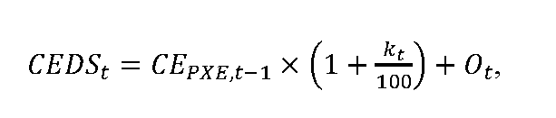

# Čl. I

Vyhláška Úradu pre reguláciu sieťových odvetví č. 18/2017 Z. z., ktorou sa ustanovuje cenová regulácia v elektroenergetike a niektoré podmienky vykonávania regulovaných činností v elektroenergetike v znení vyhlášky č. 207/2018 Z. z., vyhlášky č. 178/2019 Z. z., vyhlášky č. 309/2019 Z. z., vyhlášky č. 300/2021 Z. z., vyhlášky č. 326/2021 Z. z., vyhlášky č. 477/2021 Z. z. a vyhlášky č. 88/2022 Z. z. sa mení a dopĺňa takto:

- 1. V § 32 ods. 1 písm. a) sa slovo „júla“ nahrádza slovom „augusta“.

- 2. V § 32 ods. 1 písm. b) sa slová „v rozsahu najviac“ nahrádzajú slovami „vo výške“.

- 3. V § 32 ods. 1 písmeno c) znie:

- „c)

- Ot sú určené náklady regulovaného subjektu na odchýlku súvisiace s dodávkou elektriny odberateľom elektriny v domácnosti v eurách na jednotku množstva elektriny v roku t vo výške 5,21 eura na megawatthodinu pre prvý rok regulačného obdobia 2023.“.

- 4. V § 32 ods. 2 písm. a) a ods. 3 písm. a) sa suma „1,10 eura“ nahrádza sumou „1,50 eura“.

- 5. Nadpis nad § 33 znie:

- „Cenová regulácia dodávky elektriny iným zraniteľným odberateľom a postup a podmienky uplatňovania cien“.

- “.

- 6. V § 33 ods. 1 sa slová „malému podniku“ nahrádzajú slovami „zraniteľnému odberateľovi elektriny mimo domácnosti s celkovým ročným odberom elektriny za predchádzajúci rok najviac 30 000 kWh (ďalej len „malý podnik“)“.

- 7. V § 35 ods. 1 písm. b) sa slová „v rozsahu najviac“ nahrádzajú slovami „vo výške“.

- 8. V § 35 ods. 1 písm. a) sa slovo „júla“ nahrádza slovom „augusta“.

- 9. V § 35 ods. 1 písmeno c) znie:

- „c)

- Ot sú určené náklady regulovaného subjektu na odchýlku súvisiace s dodávkou elektriny malému podniku v eurách na jednotku množstva elektriny v roku t vo výške 5,21 eura na megawatthodinu pre prvý rok regulačného obdobia 2023.“.

- 10. V § 35 ods. 2 písm. a) sa suma „1,10 eura“ nahrádza sumou „1,50 eura“.

- 11. Za § 35 sa vkladajú § 35a a 35b, ktoré znejú:

- 㤠35a

- (1)

- Cenová regulácia podľa odsekov 2 až 6 a § 35b sa vzťahuje na regulovaný subjekt, ktorý dodáva elektrinu zraniteľnému odberateľovi elektriny mimo domácnosti podľa osobitného predpisu.58aa)

- (2)

- Súčasťou návrhu ceny sú

- a)

- návrh cien alebo sadzieb za dodávku elektriny odberateľovi elektriny podľa odseku 1 vrátane ich štruktúry na rok t, ktoré sa budú uplatňovať pre účastníkov trhu s elektrinou vrátane podmienok ich pridelenia,

- b)

- údaje potrebné na preverenie cien za rok t-2, najmä skutočný objem dodávky elektriny odberateľovi elektriny podľa odseku 1, počet odberných miest v členení po jednotlivých sadzbách podľa odseku 6,

- c)

- plán investícií a plán odpisov za regulovanú činnosť v rokoch t, t+1 a t+2,

- d)

- výpočty a údaje podľa § 35b týkajúce sa dodávky elektriny odberateľovi elektriny podľa odseku 1,

- e)

- podklady podľa prílohy č. 7a,

- f)

- ďalšie podklady potrebné na správne posúdenie návrhu ceny.

- (3)

- Návrh ceny sa predkladá v listinnej podobe alebo v elektronickej podobe elektronickým podaním do elektronickej schránky. Podklady podľa odseku 2 písm. a), b), d) a e) sa predkladajú aj v elektronickej podobe vo formáte, ktorý zachováva úplnú funkčnosť tabuľkového editora.

- (4)

- Ustanovenia o návrhu ceny sa primerane vzťahujú aj na návrh na zmenu cenového rozhodnutia.

- (5)

- Cena za dodávku elektriny odberateľovi elektriny podľa odseku 1 v jednotlivých zložkách sadzieb je určená ako maximálna cena. Maximálna cena sa skladá z dvoch zložiek, a to z mesačnej platby za jedno odberné miesto a z ceny za jednu MWh odobratej elektriny v príslušnom pásme.

- (6)

- Pri dodávke elektriny odberateľom elektriny podľa odseku 1 sa uplatňuje vhodná sadzba podľa distribučných sadzieb elektriny prevádzkovateľa distribučnej sústavy, do ktorej je odberné miesto odberateľa podľa odseku 1 pripojené.

- § 35b

- (1)

- Maximálna cena za elektrinu CEDSt na účely dodávky elektriny odberateľovi elektriny podľa § 35a ods. 1 schválená alebo určená cenovým rozhodnutím sa vypočíta podľa vzorca

- 

- kde

- a)

- CEPXE,t-1 je aritmetický priemer denných cien oficiálneho kurzového lístka zverejneného burzou PXE (POWER EXCHANGE CENTRAL EUROPE) na jej webovom sídle, produktu F PXE SK BL Cal-t v eurách na jednotku množstva elektriny pre rok t za obdobie od

- 1. augusta roku t-1 do 30. septembra roku t-1,

- b)

- kt je koeficient na rok t v percentách zohľadňujúci diagram dodávky elektriny pre odberateľov elektriny podľa § 35a ods. 1 vo výške 10 %,

- c)

- Ot sú určené náklady regulovaného subjektu na odchýlku súvisiace s dodávkou elektriny odberateľom elektriny podľa § 35a ods. 1 v eurách na jednotku množstva elektriny v roku t vo výške 5,21 eura na megawatthodinu pre prvý rok regulačného obdobia 2023.

- (2)

- Jednopásmové sadzby podľa § 35a ods. 6 sú zložené z

- a)

- mesačnej platby za jedno odberné miesto NDDSt; NDDSt sú náklady na dodávku elektriny na jedno odberné miesto za mesiac, ktoré možno zahrnúť do ceny vo výške maximálne 1,50 eura na jedno odberné miesto a mesiac pre prvý rok regulačného obdobia 2023, pričom pre jednotlivé nasledujúce roky regulačného obdobia možno túto sumu zvýšiť na rok t v porovnaní s rokom t-1 o aritmetický priemer zverejnených hodnôt ukazovateľa „jadrová inflácia“ za obdobie od 1. januára roku t-1 do 31. augusta roku t-1 uvedených na webovom sídle Štatistického úradu Slovenskej republiky (http://statdat.statistics.sk) v priečinku „Makroekonomické štatistiky“ v sekcii „Spotrebiteľské ceny a ceny produkčných štatistík“ v časti „Jadrová a čistá inflácia – oproti rovnakému obdobiu minulého roku v percentách“,

- b)

- ceny za elektrinu CEDSi v eurách na jednotku množstva elektriny, ktorá sa vypočíta podľa vzorca

- CEDSi = KJPDSi × CEDSt + PZt,

- kde

- 1.

- KJPDSi je koeficient ceny jednopásmového odberu elektriny podľa odseku 4,

- 2.

- CEDSt je cena elektriny určená podľa odseku 1,

- 3.

- PZt je primeraný zisk v roku t v eurách na jednotku množstva elektriny dodanej odberateľovi elektriny podľa § 11 ods. 1; na určenie PZt sa použije nižšia z hodnôt 8 eur/MWh alebo 16 % z určenej ceny za elektrinu CEDSt,

- 4.

- i je číselný znak jednopásmovej sadzby.

- (3)

- Dvojpásmové sadzby podľa § 35a ods. 6 sú zložené z

- a)

- mesačnej platby za jedno odberné miesto NDDSt; NDDSt sú náklady na dodávku elektriny na jedno odberné miesto za mesiac, ktoré možno zahrnúť do ceny vo výške maximálne 1,50 eura na jedno odberné miesto a mesiac pre prvý rok regulačného obdobia 2023, pričom pre jednotlivé nasledujúce roky regulačného obdobia možno túto sumu zvýšiť na rok t v porovnaní s rokom t-1 o aritmetický priemer zverejnených hodnôt ukazovateľa „jadrová inflácia“ za obdobie od 1. januára roku t-1 do 31. augusta roku t-1 uvedených na webovom sídle Štatistického úradu Slovenskej republiky (http://statdat.statistics.sk) v priečinku „Makroekonomické štatistiky“ v sekcii „Spotrebiteľské ceny a ceny produkčných štatistík“ v časti „Jadrová a čistá inflácia – oproti rovnakému obdobiu minulého roku v percentách“,

- b)

- ceny za elektrinu CEVTDSi v eurách na jednotku množstva elektriny odobranej vo vysokom pásme, ktorá sa vypočíta podľa vzorca

- CEVTDSi = KVTDSi × CEDSt + PZt,

- kde

- 1.

- KVTDSi je koeficient ceny odberu elektriny vo vysokom pásme podľa odseku 4,

- 2.

- CEDSt je cena elektriny určená podľa odseku 1,

- 3.

- PZt je primeraný zisk v roku t v eurách na jednotku množstva elektriny dodanej odberateľovi elektriny podľa § 11 ods. 1; na určenie PZt sa použije nižšia z hodnôt 8 eur/MWh alebo 16 % z určenej ceny za elektrinu CEDSt,

- 4.

- i je číselný znak dvojpásmovej sadzby,

- c)

- ceny za elektrinu CENTDSi v eurách na jednotku množstva elektriny odobranej v nízkom pásme, ktorá sa vypočíta podľa vzorca

- CENTDSi = KNTDSi × CEt + PZt,

- kde

- 1.

- KNTDSi je koeficient ceny odberu elektriny v nízkom pásme podľa odseku 4,

- 2.

- CEDSt je cena elektriny určená podľa odseku 1,

- 3.

- PZt je primeraný zisk v roku t v eurách na jednotku množstva elektriny dodanej odberateľovi elektriny podľa § 11 ods. 1; na určenie PZt sa použije nižšia z hodnôt 8 eur/MWh alebo 16 % z určenej ceny za elektrinu CEDSt,

- 4.

- i je číselný znak dvojpásmovej sadzby.

- (4)

- Koeficienty ceny jednopásmového odberu elektriny KJPDSi, koeficienty ceny odberu elektriny vo vysokom pásme KVTDSi a koeficienty ceny odberu elektriny v nízkom pásme KNTDSi sa určia v návrhu ceny regulovaného subjektu tak, aby vážený priemer cien elektriny bez primeraného zisku PZt všetkých sadzieb bol najviac vo výške rovnajúcej sa CEDSt podľa odseku 1, pričom pre koeficienty KVTDSi a KNTDSi platí, že hodnota koeficientu KVTDSi je vyššia o viac ako 30 % v porovnaní s hodnotou koeficientu KNTDSi.

- (5)

- K sadzbám podľa odsekov 2 a 3 sa dodávateľom elektriny pripočíta cena za distribúciu elektriny vrátane prenosu elektriny a strát elektriny pri prenose a cena za straty elektriny pri distribúcii elektriny, tarifa za systémové služby a tarifa za prevádzkovanie systému podľa cenového rozhodnutia, ktorým boli schválené alebo určené ceny za prístup do distribučnej sústavy a distribúciu elektriny pre prevádzkovateľa distribučnej sústavy, do ktorej je odberateľ elektriny podľa § 35a ods. 1 pripojený.“.

  - Poznámka pod čiarou k odkazu 58aa znie:

  - „58aa) § 2 písm. k) piaty bod zákona č. 250/2012 Z. z. v znení zákona č. 85/2022 Z. z.“.

- 12. V § 37 ods. 2 písm. a) sa suma „1,10 eura“ nahrádza sumou „1,50 eura“.

- 13. Za § 46g sa vkladá § 46h, ktorý vrátane nadpisu znie:

- 㤠46h

- Prechodné ustanovenie k úpravám účinným od 30. júna 2022

- Podľa úprav účinných od 30. júna 2022 sa prvýkrát postupuje pri vykonávaní cenovej regulácie na rok 2023.“.

- 14. Za prílohu č. 7 sa vkladá príloha č. 7a, ktorá vrátane nadpisu znie:

„[Príloha č. 7a k vyhláške č. 18/2017 Z. z.](assets/baae23d00c72a066caf7e2a872da1dfcf0e1dd7d4e8771947db4c7bd44724a6b.pdf)“.
