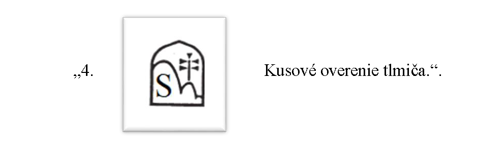

# Čl. I

Vyhláška Úradu pre normalizáciu, metrológiu a skúšobníctvo Slovenskej republiky č. 72/2019 Z. z., ktorou sa ustanovujú podrobnosti o základných požiadavkách, postupoch posudzovania zhody a spôsobe označovania strelnej zbrane a streliva na civilné použitie sa mení a dopĺňa takto:

- 1. V § 1 písmeno g) znie:

- „g)

- jednotnej overovacej značke, národnej identifikačnej značke a národnej overovacej značke strelnej zbrane, streliva a tlmiča hluku výstrelu (ďalej len „tlmič“) a o ich grafickom vyobrazení.“.

- 2. V prílohe č. 4 poznámka pod čiarou k odkazu 3 znie:

- „3) STN EN ISO 6507-1 Kovové materiály. Vickersova skúška tvrdosti. Časť 1: Skúšobná metóda (ISO 6507-1).“.

- 3. V prílohe č. 8 sa slovo „dvojčísla“ nahrádza slovom „dvojčíslia“.

- 4. Názov prílohy č. 8 znie:

- „JEDNOTNÉ OVEROVACIE ZNAČKY, NÁRODNÉ IDENTIFIKAČNÉ ZNAČKY A NÁRODNÉ OVEROVACIE ZNAČKY STRELNEJ ZBRANE, STRELIVA A TLMIČA“.

- “.

- 5. V prílohe č. 8 názov časti A znie:

- „A.

- Jednotné overovacie značky strelnej zbrane a streliva povolené pre strelné zbrane do 19. októbra 2014 a pre strelivo do 19. októbra 2016“.

- 6. V prílohe č. 8 názve časti B sa za slovo „značky“ vkladajú slová „a národné identifikačné značky“.

- 7. V prílohe č. 8 názov časti C. znie:

- „C.

- Národné overovacie značky Slovenskej republiky platné od 20. októbra 2014 pre strelné zbrane, od 20. októbra 2016 pre strelivo a od 15. októbra 2022 pre tlmič“.

- 8. V prílohe č. 8 sa časť C. dopĺňa štvrtým bodom, ktorý znie:

- 
