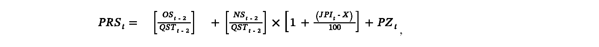
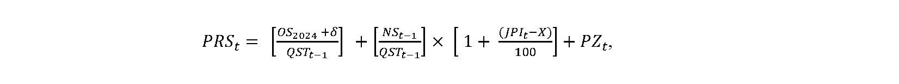
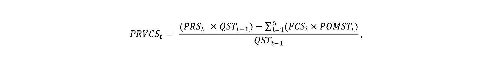

# § 11 Spôsob výpočtu maximálnej ceny za odvádzanie a čistenie odpadovej vody a výšky primeraného zisku pre regulované subjekty, ktorých odvádzanie a čistenie odpadovej vody v roku t je menej ako 2 000 000 m3

(1) Ak regulovaný subjekt odvádza odpadovú vodu do prevádzkovo súvisiacej kanalizácie23) iného regulovaného subjektu, u ktorého sa vykonáva aj jej čistenie, môže navrhnúť prevzatie jeho maximálnej ceny za odvádzanie a čistenie odpadovej vody alebo maximálnej ceny za odvádzanie a čistenie odpadovej vody pre skupinu producentov v eurách na objemovú jednotku.

(2) Ak regulovaný subjekt vykonáva odvádzanie a čistenie odpadovej vody alebo ak neprevezme maximálnu cenu za odvádzanie a čistenie odpadovej vody alebo maximálnu cenu za odvádzanie a čistenie odpadovej vody pre skupinu producentov v eurách na objemovú jednotku od regulovaného subjektu, do ktorého kanalizácie odvádza odpadovú vodu na účely jej ďalšieho odvádzania a čistenia v čistiarni odpadových vôd, maximálna cena sa navrhuje ako zložená z fixnej zložky maximálnej ceny v eurách za rok a variabilnej zložky maximálnej ceny v eurách na objemovú jednotku, pričom je maximálna v jednotlivých zložkách ceny. Maximálna cena za odvádzanie a čistenie odpadovej vody od iného regulovaného subjektu je jednozložková v eurách na objemovú jednotku a navrhuje sa podľa odseku 7, maximálna cena za čistenie odpadovej vody je jednozložková v eurách na objemovú jednotku a navrhuje sa podľa odseku 6. Pri návrhu maximálnej ceny sa prihliada na sociálne, environmentálne a ekonomické dôsledky úhrady za vodohospodárske služby, ako aj na geografické podmienky a klimatické podmienky príslušného regiónu.

(3) Priemerná cena za odvádzanie a čistenie odpadovej vody, za odvádzanie a čistenie odpadovej vody pre skupinu producentov PRStv eurách na objemovú jednotku na rok t sa vypočíta na

- a) prvý rok regulačného obdobia podľa vzorca

pričom ak (JPIt– X) < 0 alebo ak sa na výpočet použijú plánované údaje na rok t podľa odseku 8, na účely výpočtu maximálnej ceny sa hodnota rozdielu JPIta X rovná nule,

kde

- 1. PRStje priemerná cena za odvádzanie a čistenie odpadovej vody v eurách na objemovú jednotku,

- 2. OSt-2sú odpisy hmotného majetku a nehmotného majetku podľa prílohy č. 1 v eurách využívaného výhradne na odvádzanie a čistenie odpadovej vody skutočne zaradeného do účtovníctva do konca roka t-2 podľa § 4 ods. 1 písm. e) až g) a nájomné v eurách za prenájom majetku používaného výhradne na odvádzanie a čistenie odpadovej vody do konca roka t-2 podľa § 4 ods. 1 písm. h),

- 3. NSt-2sú ekonomicky oprávnené prevádzkové náklady v eurách na odvádzanie a čistenie odpadovej vody v roku t-2 uvedené v § 4 ods. 1 písm. b) až d), i) a j),

- 4. QSTt-2je skutočné množstvo odvedenej a čistenej odpadovej vody v objemových jednotkách od všetkých producentov v roku t-2 vrátane vlastnej produkcie,

- 5. JPItje aritmetický priemer hodnôt ukazovateľa „jadrová inflácia“ za posledných 12 mesiacov predchádzajúcich mesiacu, v ktorom sa návrh ceny predkladá, zverejnených na webovom sídle Štatistického úradu Slovenskej republiky v časti „Jadrová a čistá inflácia – oproti rovnakému obdobiu minulého roku v percentách“,

- 6. PZtje výška primeraného zisku, ktorá je pri odvádzaní a čistení odpadovej vody najviac 0,06 eura na 1 m3množstva odvedenej a čistenej odpadovej vody v roku t-2 vrátane vlastnej produkcie; pri výpočte ceny za čistenie odpadovej vody sa uplatní najviac polovica hodnoty PZt,

- 7. X je faktor efektivity, ktorý sa ustanovuje vo výške 3,0 %,

  - b) roky 2024 a 2025 podľa vzorca uvedeného v písmene a), pričom vo vzorci sa údaje za rok t-2 nahradia údajmi za rok t-1, ak sú známe údaje za rok t-1, rok t-1 bol účtovne uzavretý a boli predložené skutočné údaje podľa § 15 za rok t-1,

  - c) rok 2026 a nasledujúce roky podľa vzorca

pričom ak (JPIt – X) < 0, na účely výpočtu maximálnej ceny sa hodnota rozdielu JPIt a X rovná nule,

kde

- 1. OS2024 sú odpisy hmotného majetku a nehmotného majetku podľa prílohy č. 1 v eurách využívaného výhradne na odvádzanie a čistenie odpadovej vody skutočne zaradeného do účtovníctva do konca roka 2024, vychádzajúce zo zostatkovej hodnoty majetku, ktorá sa rovná všeobecnej hodnote majetku podľa stavu k 31. decembru 2024 určenej na základe znaleckého posudku vypracovaného znalcom zapísaným v zozname znalcov v odbore „Ekonomika a riadenie podnikov“ podľa osobitného predpisu;22c) ak nie je možné určiť hodnotu OS2024, tak OS2024 = OSt-1,

- 2. δ je zmena odpisov voči hodnote OS2024vzniknutá ukončením odpisovania časti majetku alebo zaradením nového majetku v rokoch 2025 a nasledujúcich, pričom ak

- OS2024 = OSt-1, potom δ = 0,

- 3. OSt-1sú odpisy hmotného majetku a nehmotného majetku podľa prílohy č. 1 v eurách využívaného výhradne na odvádzanie a čistenie odpadovej vody skutočne zaradeného do účtovníctva do konca roka t-1 podľa § 4 ods. 1 písm. e) až g) a nájomné v eurách za prenájom majetku využívaného výhradne na odvádzanie a čistenie odpadovej vody do konca roka t-1 podľa § 4 ods. 1 písm. h),

- 4. NSt-1 sú ekonomicky oprávnené prevádzkové náklady v eurách na odvádzanie a čistenie odpadovej vody v roku t-1, ktoré sú uvedené v § 4 ods. 1 písm. b) až d), i) a j),

- 5. QSTt-1 je skutočné množstvo odvedenej a čistenej odpadovej vody v objemových jednotkách pre všetkých producentov v roku t-1 vrátane vlastnej produkcie,

- 6. PZt je výška primeraného zisku, ktorá je pri odvádzaní a čistení odpadovej vody najviac 0,06 eura na 1 m3 množstva odvedenej a čistenej odpadovej vody v roku t-1 vrátane vlastnej produkcie a pri čistení odpadovej vody najviac 0,03 eura na 1 m3 množstva odvedenej a čistenej odpadovej vody v roku t-1,

- 7. X je faktor efektivity, ktorý sa ustanovuje vo výške 3,0 %.

(4) Maximálna cena za odvádzanie odpadovej vody alebo za čistenie odpadovej vody sa navrhuje najviac do výšky vypočítanej priemernej ceny.

(5) Návrh na zmenu maximálnej ceny v ďalších rokoch regulačného obdobia sa odôvodňuje analýzou zmien ekonomicky oprávnených nákladov.

(6) Ak regulovaný subjekt čistí odpadovú vodu privádzanú od iného regulovaného subjektu do čistiarne odpadových vôd, návrh maximálnej ceny za čistenie odpadovej vody sa predkladá tak, že maximálna cena za odvádzanie a čistenie odpadovej vody je cena znížená o priemerné náklady spojené s odvádzaním odpadovej vody od konečných producentov a o odpisy majetku spojeného s odvádzaním odpadovej vody.

(7) Ak regulovaný subjekt odvádza a čistí odpadovú vodu privádzanú prevádzkovo súvisiacou kanalizáciou23) od iného regulovaného subjektu, návrh maximálnej ceny za odvádzanie a čistenie odpadovej vody od iného regulovaného subjektu vychádza z celkového množstva odpadovej vody privedenej od iných regulovaných subjektov takto:

a) ak QSRt-2je menšie alebo sa rovná 0,20 × QSTt-2, potom MCStje menšia alebo sa rovná 0,65 × PRSt,

b) ak 0,20 × QSTt-2je menšie ako QSRt-2a zároveň menšie alebo sa rovná 0,6 × QSTt-2, potom MCStje menšia alebo sa rovná 0,75 × PRSt,

c) ak QSRt-2je väčšie ako 0,6 × QSTt-2, potom MCStje menšia alebo sa rovná 0,85 × PRSt, kde QSRt-2je skutočné množstvo odvádzanej a čistenej odpadovej vody od iných regulovaných subjektov v roku t-2.

(8) Ak sa návrh na určenie maximálnej ceny za odvádzanie a čistenie odpadovej vody, za odvádzanie odpadovej vody, za čistenie odpadovej vody alebo za odvádzanie a čistenie odpadovej vody pre skupinu producentov predkladá prvýkrát, vypočíta sa priemerná cena za odvádzanie a čistenie odpadovej vody v eurách na objemovú jednotku na rok t podľa odseku 3, pričom sa na výpočet použijú plánované údaje na rok t a návrh maximálnej ceny sa predkladá podľa odsekov 2 a 4 až 7.

(9) Fixná zložka maximálnej ceny za odvádzanie a čistenie odpadovej vody, za čistenie odpadovej vody alebo za odvádzanie a čistenie odpadovej vody pre skupinu producentov zohľadňuje nákladovosť odberného miesta vrátane kapacitných nárokov na odvádzanie a čistenie odpadovej vody a určuje sa v eurách za rok v príslušnej tarifnej skupine podľa zaradenia odberného miesta pitnej vody podľa § 9 ods. 8. Táto tarifa sa zvyšuje o 20 %, ak sú v danom odbernom mieste odvádzané aj vody z povrchového odtoku.

(10) Variabilná zložka maximálnej ceny za odvádzanie a čistenie odpadovej vody, za čistenie odpadovej vody alebo za odvádzanie a čistenie odpadovej vody pre skupinu producentov v eurách na objemovú jednotku sa navrhuje tak, aby vážený priemer variabilnej zložky maximálnej ceny za odvádzanie a čistenie odpadovej vody a maximálnej ceny za odvádzanie a čistenie odpadovej vody privádzanej prevádzkovo súvisiacou kanalizáciou od iného regulovaného subjektu prepočítaný na objemovú jednotku neprekročil priemernú variabilnú zložku maximálnej ceny za odvádzanie a čistenie odpadovej vody v eurách na objemovú jednotku na rok t vypočítanú podľa odseku 11.

(11) Na určenie variabilnej zložky maximálnej ceny za odvádzanie a čistenie odpadovej vody, maximálnej ceny za odvádzanie odpadovej vody, maximálnej ceny za čistenie odpadovej vody alebo maximálnej ceny za odvádzanie a čistenie odpadovej vody pre skupinu producentov v eurách na objemovú jednotku pre všetky tarifné skupiny T1 až T6 sa vypočíta priemerná variabilná zložka maximálnej ceny podľa vzorca

kde

- a) PRVCSt je priemerná variabilná zložka maximálnej ceny za odvádzanie a čistenie odpadovej vody v eurách na objemovú jednotku,

- b) FCSi je fixná zložka maximálnej ceny odpadovej vody v eurách za rok v tarifnej skupine Ti,

- c) POMSTi je počet odberných miest producentov v tarifnej skupine Ti v roku t-2 zaradených podľa odseku 9.
