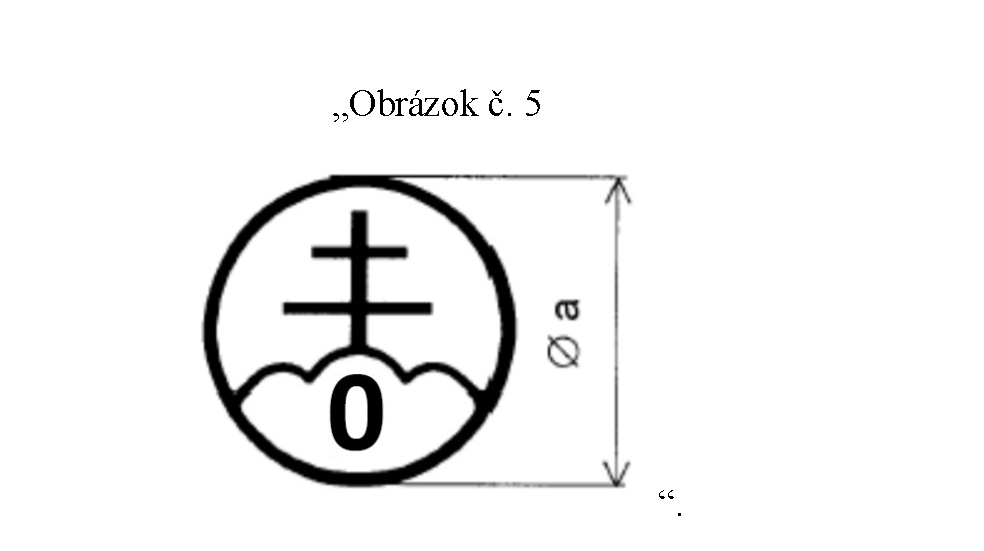
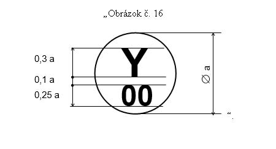
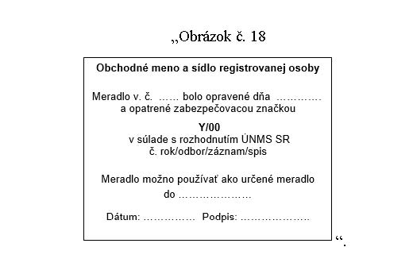
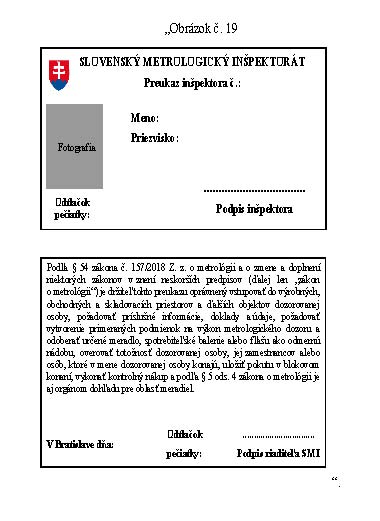
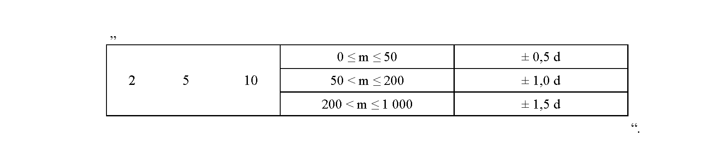
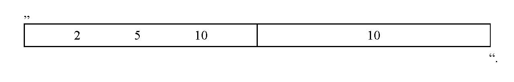

# Čl. I

Vyhláška Úradu pre normalizáciu, metrológiu a skúšobníctvo Slovenskej republiky č. 161/2019 Z. z. o meradlách a metrologickej kontrole sa mení a dopĺňa takto:

- 1. V úvodnej vete vyhlášky sa slová „§ 59 písm. b) až l) a n)“ nahrádzajú slovami „§ 59 písm. b) až l), n) a o)“ a za slovo „zákonov“ sa vkladajú slová „v znení zákona č. 58/2022 Z. z.“.

- 2. § 1 sa dopĺňa písmenami l) až t), ktoré znejú:

- „l)

- náležitosti žiadosti o vykonanie štatistickej kontroly,

- m)

- kritériá určenia základného súboru, rozsahu výberu a náhradného výberu,

- n)

- požiadavky na manipuláciu, skladovanie a prepravu určených meradiel, ktoré tvoria výber a náhradný výber,

- o)

- podrobnosti o kontrole úplnosti a stavu výberu,

- p)

- požiadavky na štatistickú výberovú skúšku a na vyhodnotenie štatistickej výberovej skúšky,

- q)

- náležitosti záznamu výsledkov štatistickej výberovej skúšky,

- r)

- podrobnosti o štatistickej výberovej skúške,

- s)

- náležitosti dokladu o predĺžení času platnosti overenia a

- t)

- náležitosti zamietacieho listu.“.

- 3. Za § 4 sa vkladajú § 4a až 4i, ktoré vrátane nadpisov znejú:

- 㤠4a

- Štatistická kontrola

- Štatistická kontrola sa môže vykonať pri druhoch určených meradiel, ktoré sú uvedené v prílohe č. 1 časti B.

- § 4b

- Žiadosť o vykonanie štatistickej kontroly

- Žiadosť o vykonanie štatistickej kontroly obsahuje

- a)

- obchodné meno a sídlo žiadateľa o štatistickú kontrolu, ktorým je právnická osoba, alebo obchodné meno a miesto podnikania žiadateľa o štatistickú kontrolu, ktorým je fyzická osoba – podnikateľ,

- b)

- typ určeného meradla a základné technické charakteristiky a metrologické charakteristiky, ktoré sa vzťahujú k danému typu určeného meradla,

- c)

- značku schváleného typu, číslo certifikátu ES (EÚ) skúšky typu alebo číslo certifikátu ES (EÚ) preskúmania návrhu,

- d)

- rok posledného overenia určených meradiel alebo rok posúdenia zhody určených meradiel zo základného súboru,

- e)

- informáciu o adrese súčasného umiestnenia určených meradiel zo základného súboru,

- f)

- počet kusov a zoznam výrobných čísel určených meradiel v základnom súbore,

- g)

- predbežný termín kontroly výberu, ak je dohodnutý,

- h)

- čestné vyhlásenie, že základný súbor ani jeho časť neboli podrobené štatistickej kontrole s negatívnym výsledkom,

- i)

- čestné vyhlásenie, že určené meradlá zo základného súboru neboli podrobené štatistickej výberovej skúške v inom základnom súbore.

- § 4c

- Kritériá určenia základného súboru, rozsahu výberu a náhradného výberu

- (1)

- Základný súbor tvoria určené meradlá od jedného výrobcu, rovnakého typu s rovnakými technickými charakteristikami a metrologickými charakteristikami.

- (2)

- Určené meradlo, ktoré je zaradené do jedného základného súboru, nie je možné zaradiť do iného základného súboru.

- (3)

- Rok posledného overenia určených meradiel alebo rok posúdenia zhody určených meradiel zo základného súboru sa môže líšiť najviac o jeden rok.

- (4)

- Základný súbor obsahuje najmenej 500 kusov určených meradiel.

- (5)

- Počet určených meradiel, ktoré tvoria výber a náhradný výber, sa určuje podľa veľkosti základného súboru.

- (6)

- Určené meradlá, ktoré tvoria výber a náhradný výber, sa určia prostredníctvom náhodných poradových čísel.

- § 4d

- Požiadavky na manipuláciu, skladovanie a prepravu určených meradiel, ktoré tvoria výber a náhradný výber

- (1)

- Pri určených meradlách, ktoré tvoria výber a náhradný výber, počas skladovania, prepravy alebo inej manipulácie

- a)

- nie je možné vykonať zásah do určených meradiel, ktorým je najmä oprava, údržba a nastavenie,

- b)

- je potrebné zamedziť preklopeniu, nárazu, pádu a neprimeraným otrasom určených meradiel.

- (2)

- Určené meradlá, ktoré tvoria výber a náhradný výber, je možné dodať na štatistickú kontrolu len spoločne.

- (3)

- Dodací list určených meradiel, ktoré tvoria výber a náhradný výber, obsahuje

- a)

- obchodné meno a sídlo žiadateľa o štatistickú kontrolu, ktorým je právnická osoba, alebo obchodné meno a miesto podnikania žiadateľa o štatistickú kontrolu, ktorým je fyzická osoba – podnikateľ,

- b)

- typ dodaného určeného meradla, základné technické charakteristiky a metrologické charakteristiky, ktoré sa vzťahujú k danému typu určeného meradla a počet určených meradiel,

- c)

- dátum expedície určených meradiel, ktoré tvoria výber a náhradný výber,

- d)

- zoznam určených meradiel, ktoré tvoria výber a náhradný výber, ktorý obsahuje najmä výrobné čísla určených meradiel, rok posledného overenia určených meradiel alebo rok posúdenia zhody určených meradiel a stav počítadla, kde posledná číslica počítadla je informatívna.

- (4)

- Výber a náhradný výber sa označujú viditeľne nápisom „určené meradlá na štatistickú kontrolu“.

  - § 4e Kontrola úplnosti a stavu výberu

  - (1) Určené meradlo sa vyradí z výberu, ak

    - a) je poškodené tak, že je predpoklad, že nemá niektorú technickú charakteristiku alebo metrologickú charakteristiku, ktorá je rozhodujúca pre overenie určeného meradla,

    - b) je zjavné, že nemá požadované technické charakteristiky alebo metrologické charakteristiky, aj keď nie je porušená overovacia značka alebo zabezpečovacia značka, alebo

    - c) má poškodenú, porušenú, nečitateľnú, sfalšovanú alebo chýbajúcu overovaciu značku alebo zabezpečovaciu značku alebo má odstránené, porušené alebo nečitateľné označenie zhody, doplnkové metrologické značenie a číslo notifikovanej osoby alebo zabezpečovaciu značku výrobcu.

  - (2) O vyradení určeného meradla z výberu podľa odseku 1 písm. c) sa vyhotoví zápis.

  - (3) Vyradené určené meradlo z výberu alebo určené meradlo, ktoré nie je dodané, sa nahradí určeným meradlom z náhradného výberu.

  - (4) Ak je celkový počet určených meradiel vo výbere, ktoré nie sú dodané alebo ktoré sú vyradené podľa odseku 1, vyšší ako počet určených meradiel v náhradnom výbere, štatistická kontrola sa ukončí ako nevyhovujúca.

  - § 4f Požiadavky na štatistickú výberovú skúšku a na vyhodnotenie štatistickej výberovej skúšky

  - (1) Štatistická výberová skúška pozostáva zo skúšky určeného meradla z výberu, potvrdenia zhody určeného meradla z výberu so schváleným typom a zhody určeného meradla z výberu s technickými požiadavkami a metrologickými požiadavkami na druh určeného meradla na základe preberacieho plánu štatistickej výberovej skúšky.

  - (2) Určené meradlá z výberu, ktoré vyhoveli štatistickej výberovej skúške, sa považujú za vyhovujúce.

  - (3) Štatistická výberová skúška je vyhovujúca, ak určené meradlá z výberu, ktoré vyhoveli, spĺňajú kritérium prijatia podľa preberacieho plánu štatistickej výberovej skúšky pre daný druh určeného meradla.

  - (4) Ak sa štatistická výberová skúška považuje za vyhovujúcu, určené meradlá zo základného súboru sa považujú za vyhovujúce okrem určených meradiel z výberu, ktoré sú na základe štatistickej výberovej skúšky nevyhovujúce alebo sú vyradené podľa § 4e ods.1.

  - § 4g Náležitosti záznamu výsledkov štatistickej výberovej skúšky

  - Výsledky štatistickej výberovej skúšky sa zaznamenajú do skúšobného protokolu, ktorý obsahuje

    - a) evidenčné číslo skúšobného protokolu a dátum jeho vystavenia,

    - b) identifikačné údaje žiadateľa o štatistickú kontrolu,

    - c) údaje o druhu a type určeného meradla,

    - d) výrobné číslo a rok výroby určeného meradla,

    - e) rok posledného overenia určených meradiel alebo rok, v ktorom je vykonané posúdenie zhody určených meradiel,

    - f) informáciu o použitom etalóne,

    - g) miesto vykonania štatistickej výberovej skúšky,

    - h) stav počítadla určeného meradla pri začiatku a pri ukončení štatistickej výberovej skúšky,

    - i) hodnotu chyby pri jednotlivých skúškach výberu,

    - j) výsledok štatistickej výberovej skúšky,

    - k) meno a priezvisko zodpovednej osoby za vykonanie štatistickej výberovej skúšky a

    - l) iný údaj, ak je potrebný.

  - § 4h Náležitosti dokladu o predĺžení času platnosti overenia

  - (1) Doklad o predĺžení času platnosti overenia obsahuje

    - a) identifikačné údaje ústavu,

    - b) evidenčné číslo dokladu o predĺžení času platnosti overenia a dátum jeho vystavenia,

    - c) údaje o druhu a type určeného meradla,

    - d) údaje o meracom rozsahu určeného meradla,

    - e) údaj o triede presnosti určeného meradla, ak je tento údaj ustanovený v prílohe č. 26 alebo v prílohe č. 49 alebo osobitným predpisom,2a)

    - f) počet určených meradiel v základnom súbore,

    - g) rok posledného overenia určených meradiel alebo rok posúdenia zhody určených meradiel,

    - h) evidenčné číslo skúšobného protokolu a dátum jeho vystavenia,

    - i) miesto vykonania štatistickej výberovej skúšky,

    - j) meno a priezvisko zodpovednej osoby za vykonanie štatistickej výberovej skúšky,

    - k) výsledok štatistickej kontroly,

    - l) čas, o ktorý sa predĺži čas platnosti overenia,

    - m) odtlačok pečiatky ústavu a meno, priezvisko a podpis povereného zástupcu ústavu,

    - n) iný údaj, ak je potrebný.

  - (2) Prílohou k dokladu o predĺžení času platnosti overenia je zoznam výrobných čísel určených meradiel, ktoré tvoria základný súbor, zoznam určených meradiel, ktoré sú vyradené podľa § 4e ods. 1 alebo ktoré nevyhovujú pri štatistickej výberovej skúške a skúšobný protokol.

  - § 4i Náležitosti zamietacieho listu

  - (1) Zamietací list obsahuje

    - a) identifikačné údaje ústavu,

    - b) evidenčné číslo zamietacieho listu a dátum jeho vystavenia,

    - c) údaje o druhu a type určeného meradla,

    - d) údaje o meracom rozsahu určeného meradla,

    - e) údaj o triede presnosti určeného meradla, ak je tento údaj ustanovený v prílohe č. 26 alebo v prílohe č. 49 alebo osobitným predpisom,2a)

    - f) počet určených meradiel v základnom súbore,

    - g) rok posledného overenia určených meradiel alebo rok posúdenia zhody určených meradiel,

    - h) evidenčné číslo skúšobného protokolu a dátum jeho vystavenia,

    - i) miesto vykonania štatistickej výberovej skúšky,

    - j) meno a priezvisko zodpovednej osoby za vykonanie štatistickej výberovej skúšky,

    - k) výsledok štatistickej kontroly,

    - l) odtlačok pečiatky ústavu a meno, priezvisko a podpis povereného zástupcu ústavu,

    - m) iný údaj, ak je potrebný.

  - (2) Prílohou k zamietaciemu listu je zoznam výrobných čísel určených meradiel, ktorých čas platnosti overenia sa nepredlžuje na základe negatívneho výsledku štatistickej výberovej skúšky, zoznam určených meradiel, ktoré sú vyradené podľa § 4e ods. 1 alebo ktoré nevyhovujú pri štatistickej výberovej skúške a skúšobný protokol.“.

  - Poznámka pod čiarou k odkazu 2a znie:

  - „2a) Nariadenie vlády Slovenskej republiky č. 145/2016 Z. z. o sprístupňovaní meradiel na trhu v znení nariadenia vlády Slovenskej republiky č. 328/2019 Z. z.“.

- 4. V § 7 odseky 1 a 2 znejú:

- „(1)

- Národnou overovacou značkou je overovacia značka ústavu alebo overovacia značka autorizovanej osoby na výkon overovania určených meradiel (ďalej len „overovacia značka autorizovanej osoby“).

- (2)

- Overovaciu značku ústavu tvoria dvojkríž a tri vrcholy umiestnené v kruhu s evidenčným číslom 0.“.

- 5. V § 7 ods. 3 a prílohe č. 2 sa vypúšťajú slová „alebo určenej organizácie“.

- 6. V § 7 ods. 6 sa za slovom „ústavu“ vypúšťa čiarka a slová „určenej organizácie“.

- 7. V § 7 ods. 8 písm. a) druhom bode sa vypúšťajú slová „a určenej organizácie“.

- 8. V prílohe č. 1 nadpis znie: „A. DRUHY URČENÝCH MERADIEL“.

- 9. V prílohe č. 1 položke 2.1.5 v druhom stĺpci sa za slovo „staticky“ vkladajú slová „triedy presnosti III a IIII“.

- 10. V prílohe č. 1 položke 2.1.7 v druhom stĺpci sa za slovo „presnosti“ vkladajú slová „III a“.

- 11. V prílohe č. 1 položke 2.1.8 druhý stĺpec znie: „Váhy s automatickou činnosťou na váženie cestných vozidiel za pohybu a na meranie nápravového zaťaženia triedy presnosti 0,2; 0,5; 1; 2; 5 a 10 pre hmotnosť vozidla a triedy presnosti A, B, C, D, E a F pre zaťaženie jednotlivej nápravy a pre zaťaženie skupiny náprav“.

- 12. V prílohe č. 1 položke 8.10 v siedmom stĺpci sa číslo „65“ nahrádza číslom „64“.

- 13. Príloha č. 1 sa dopĺňa časťou B., ktorá vrátane nadpisu znie:

- „B. DRUHY URČENÝCH MERADIEL, PRI KTORÝCH JE MOŽNÉ VYKONAŤ ŠTATISTICKÚ KONTROLU

- Položka určeného meradla podľa prílohy č. 1 časti A. | Druh určeného meradla | Predĺženie času platnosti overenia v rokoch | Príloha

- 1.3.20 | Plynomer membránový vrátane plynomeru s teplotnou korekciou a) s membránami z prírodného materiálu do veľkosti G6 vrátane, pri priemernej ročnej spotrebe do 500 m3 a b) so syntetickými membránami do veľkosti G6 vrátane | o 5 | 26

- 4.1 | Jednofázový a viacfázový elektromechanický elektromer určený na priame meranie elektrickej energie striedavého prúdu | o 5 | 49

- 4.2 | Jednofázový a viacfázový elektromechanický elektromer určený na meranie elektrickej energie v spojení s prístrojovým transformátorom prúdu | o 4 | 49

- 4.3 | Jednofázový a viacfázový elektromechanický elektromer určený na meranie elektrickej energie v spojení s prístrojovým transformátorom prúdu a napätia | o 4 | 49

- 4.4 | Jednofázový a viacfázový statický elektromer určený na priame meranie elektrickej energie alebo na meranie elektrickej energie v spojení s prístrojovým transformátorom prúdu | o 4 | 49

- “.

- 14. V prílohe č. 2 časti B. sa obrázok č. 5 nahrádza novým obrázkom č. 5:

- 

- 15. V prílohe č. 2 časti C. bod 1.1 znie:

- „1.1

- Lícna strana zabezpečovacej značky opravára alebo zabezpečovacej značky montážnika je znázornená na obrázku č. 16 a tvorí ju identifikačný znak opravára alebo montážnika, ktorý nahradí písmeno Y, a číslo, ktoré označuje číselnú hodnotu a ktoré nahradí číslo 00.“.

- 16. V prílohe č. 2 časti C. sa obrázok č. 16 nahrádza novým obrázkom č. 16:

- 

- 17. V prílohe č. 2 časti C. sa obrázok č. 18 nahrádza novým obrázkom č. 18:

- 

- 18. V prílohe č. 2 časti D. sa na konci pripája táto veta: „Na lícnej strane preukazu inšpektora je miesto pre fotografiu inšpektora a odtlačok úradnej pečiatky so štátnym znakom.“.

- 19. V prílohe č. 2 časti D. sa obrázok č. 19 nahrádza novým obrázkom č. 19:

- 

- 20. V prílohe č. 26 časti A. sa za bod 1.8 vkladajú body 1.9 až 1.13, ktoré znejú:

- „1.9

- Na predĺženie času platnosti overenia plynomeru podľa bodu 1.3 písm. a), ktorý je uvedený na trh alebo do používania podľa národného schválenia typu a národného prvotného overenia, a plynomeru podľa bodu 1.4 sa použije preberací plán štatistickej výberovej skúšky jedným výberom podľa časti B. siedmeho bodu.

- 1.10

- Pri plynomere podľa bodu 1.3 písm. a), ktorý je uvedený na trh alebo do používania podľa národného schválenia typu a národného prvotného overenia, sa štatistická výberová skúška vykoná v rozsahu skúšky pri následnom overení podľa časti B.

- 1.11

- Pri plynomere podľa bodu 1.4 sa štatistická výberová skúška vykoná v rozsahu skúšky podľa § 27 ods. 6 zákona.

- 1.12

- Pri štatistickej výberovej skúške sa vykoná meranie v dvoch bodoch meracieho rozsahu plynomera 0,1 Qmax a Qmax.

- 1.13

- Hodnota najväčšej dovolenej chyby pri štatistickej výberovej skúške pre triedu presnosti 1 je ± 1,5 % a pre triedu presnosti 1,5 je ± 2,75 %.“.

- 21. V prílohe č. 26 sa časť B. dopĺňa siedmym bodom, ktorý znie:

- „7. Preberací plán štatistickej výberovej skúšky

- 7.1

- Štatistická výberová skúška jedným výberom sa vykonáva podľa preberacieho plánu s jedným výberom podľa tabuľky č. 11a.

- 7.2

- Počet kontrolovaných určených meradiel sa musí rovnať rozsahu výberu podľa preberacieho plánu.

- 7.3

- Ak počet chybných kusov zistených vo výbere je

- a)

- menší alebo sa rovná kritériu prijatia, dávka sa považuje za vyhovujúcu,

- b)

- väčší alebo sa rovná kritériu zamietnutia, dávka sa zamietne.

- Tabuľka č. 11a

- Počet určených meradiel v základnom súbore [ks] | Počet určených meradiel vo výbere [ks] | Počet chybných určených meradiel [ks] | | Počet určených meradiel v náhradnom výbere [ks]

- | | Kritérium prijatia [ks] | Kritérium zamietnutia [ks] |

- 500 – 1 200 | 50 | 1 | 2 | 10

- 1 201 – 3 200 | 80 | 3 | 4 | 16

- 3 201 – 10 000 | 125 | 5 | 6 | 25

- 10 001 – 35 000 | 200 | 10 | 11 | 40

- “.

- 22. V prílohe č. 30 bod 1.2 znie:

- „1.2

- Váhy s neautomatickou činnosťou sa podľa spôsobu použitia členia na váhy s neautomatickou činnosťou

- a)

- triedy presnosti I, II alebo III okrem váh uvedených v písmenách b) až d),

- b)

- triedy presnosti III alebo IIII na zisťovanie hmotnosti na nápravu alebo koleso koľajového a cestného vozidla staticky,

- c)

- triedy presnosti I alebo II na váženie drahých kovov, kameňov a cenných materiálov a na váženie pri príprave liekov na predpis v lekárni a pri analýze v lekárskom laboratóriu alebo farmaceutickom laboratóriu,

- d)

- triedy presnosti III alebo IIII určené na váženie piesku, kamenia, tuhého komunálneho odpadu, stavebnej sutiny a podobných materiálov a na váženie malty a betónu.“.

- 23. V prílohe č. 31 sa bod 4.1.1 dopĺňa písmenami e) a f), ktoré znejú:

- „e)

- 5,

- f)

- 10.“.

- 24. V prílohe č. 31 sa bod 4.1.2 dopĺňa písmenami e) a f), ktoré znejú:

- „e)

- E,

- f)

- F.“.

- 25. V prílohe č. 31 bode 4.1.4 Tabuľka č. 1 znie:

- „Tabuľka č. 1

- Trieda presnosti pre zaťaženie jednotlivej nápravy a pre zaťaženie skupiny náprav | Trieda presnosti pre hmotnosť vozidla | | | | |

- | 0,2 | 0,5 | 1 | 2 | 5 | 10

- A | x | x | | | |

- B | x | x | x | | |

- C | | x | x | x | |

- D | | | x | x | x |

- E | | | | x | x | x

- F | | | | | | x

- “.

- 26. V prílohe č. 31 bode 4.2.1.1 Tabuľke č. 2 sa na konci pripájajú tieto riadky:

- „

- 5 | ± 2,5 %

- 10 | ± 5,00 %

- “.

- 27. V prílohe č. 31 bode 4.2.1.2.1 Tabuľke č. 3 sa na konci pripájajú tieto riadky:

- „

- E | ± 2,00 %

- F | ± 4,00 %

- “.

- 28. V prílohe č. 31 bode 4.2.1.2.2 Tabuľke č. 4 sa na konci pripájajú tieto riadky:

- „

- E | ± 4,00 %

- F | ± 8,00 %

- “.

- 29. V prílohe č. 31 bode 4.2.2 Tabuľke č. 5 tretí riadok znie:

- 

- 30. V prílohe č. 31 bode 4.3.1 Tabuľka č. 6 znie:

- „Tabuľka č. 6

- Trieda presnosti pre hmotnosť vozidla | d [kg] | Najmenší počet dielikov | Najväčší počet dielikov

- 0,2 | ≤ 5 | 500 | 5 000

- 0,5 | ≤ 10 | |

- 1 | ≤ 20 | |

- 2 | ≤ 50 | 50 | 1 000

- 5 | ≤ 100 | |

- 10 | ≤ 200 | |

- “.

- 31. V prílohe č. 31 bode 4.4 Tabuľke č. 7 tretí riadok znie:

- 

- 32. V prílohe č. 31 piatom bode písm. n) prvý až tretí bod znejú:

- „1.

- trieda presnosti 0,2; 0,5; 1; 2; 5 alebo 10,

- 2.

- trieda presnosti pre zaťaženie jednotlivej nápravy A, B, C, D, E alebo F, ak typ váh na váženie cestného vozidla je schválený aj na meranie zaťaženia jednotlivej nápravy,

- 3.

- trieda presnosti pre zaťaženie skupiny náprav A, B, C, D, E alebo F, ak typ váh na váženie cestného vozidla je schválený aj na meranie zaťaženia skupiny náprav,“.

- 33. V prílohe č. 31 bode 7.1 písm. d) sa na konci vypúšťajú tieto slová: „ak je to potrebné,“.

- 34. V prílohe č. 31 bod 7.6 znie:

- „7.6

- Rozsah skúšok pri schvaľovaní typu

- Špecifikácie a rozsah technických skúšok, ktoré sa vykonajú pri schvaľovaní typu, sú určené v technickej norme alebo v inej obdobnej technickej špecifikácii s porovnateľnými alebo prísnejšími požiadavkami.“.

- 35. V prílohe č. 35 bode 1.2 písm. a) sa vypúšťa slovo „mechanický“ a vypúšťa sa písmeno b).

  - Doterajšie písmeno c) sa označuje ako písmeno b).

- 36. V prílohe č. 35 sa za bod 2.2 vkladá bod 2.3, ktorý znie:

- „2.3

- Ak tachograf pri následnom overení nevyhovie požiadavkám podľa bodu 2.1, môže ústav alebo autorizovaná osoba vykonať výmenu nevyhovujúceho tachografu za tachograf rovnakého druhu s vykonaním následného overenia.“.

- 37. V prílohe č. 35 bod 3.1 znie:

- „3.1

- Následné overenie tachografu pozostáva

- a)

- z vonkajšej obhliadky tachografu, príslušenstva tachografu a vozidla, v ktorom je tachograf inštalovaný, stavu plomby a evidencie plomby podľa osobitných predpisov,43)

- b)

- z merania tlaku pneumatiky kolesa,

- c)

- z merania hĺbky dezénu pneumatiky kolesa,

- d)

- z merania skutočného obvodu pneumatiky kolesa,

- e)

- z merania charakteristického koeficientu vozidla w a nastavenia konštanty tachografu k,

- f)

- zo skúšky ubehnutej vzdialenosti,

- g)

- zo skúšky udávanej rýchlosti,

- h)

- zo skúšky uplynutého času a

- i)

- z funkčnej skúšky.“.

  - Poznámka pod čiarou k odkazu 43 znie:

  - „43) Napríklad nariadenie Európskeho parlamentu a Rady (EÚ) č. 165/2014 zo 4. februára 2014 o tachografoch v cestnej doprave, ktorým sa ruší nariadenie Rady (EHS) č. 3821/85 o záznamovom zariadení v cestnej doprave a mení nariadenie Európskeho parlamentu a Rady (ES) č. 561/2006 o harmonizácii niektorých právnych predpisov v sociálnej oblasti, ktoré sa týkajú cestnej dopravy (Ú. v. EÚ L 60, 28. 2. 2014) v platnom znení, vykonávacie nariadenie Komisie (EÚ) 2016/799 z 18. marca 2016, ktorým sa vykonáva nariadenie Európskeho parlamentu a Rady (EÚ) č. 165/2014, ktorým sa ustanovujú požiadavky na konštrukciu, skúšanie, montáž, prevádzku a opravu tachografov a ich komponentov (Ú. v. EÚ L 139, 26. 5. 2016) v platnom znení, vykonávacie nariadenie Komisie (EÚ) 2017/548 z 23. marca 2017, ktorým sa stanovuje štandardné tlačivo pre písomné vyhlásenie o odstránení alebo poručení plomby tachografu (Ú. v. EÚ L 79, 24. 3. 2017), zákon č. 461/2007 Z. z. o používaní záznamového zariadenia v cestnej doprave v znení zákona č. 177/2018 Z. z.“.

- 38. V prílohe č. 35 sa za bod 3.1 vkladajú nové body 3.2 a 3.3, ktoré znejú:

- „3.2

- Meranie tlaku pneumatiky sa vykonáva na kolesách hnacej nápravy.

- 3.3

- Meranie hĺbky dezénu sa vykonáva na kolesách hnacej nápravy.“.

  - Doterajšie body 3.2 až 3.8 sa označujú ako body 3.4 až 3.10.

- 39. V prílohe č. 35 bode 3.6.1 sa slovo „prevodovky“ nahrádza slovom „pohybu“ a za slová „0,3 %“ sa vkladajú slová „strednej hodnoty“.

- 40. V prílohe č. 35 bode 3.9 sa na konci pripája táto veta: „Najväčšia dovolená chyba uplynulého času digitálneho tachografu sa neustanovuje, ak osobitný predpis43) neustanovuje inak.“.

- 41. V prílohe č. 35 sa za bod 3.10.4 vkladá nový bod 3.10.5, ktorý znie:

- „3.10.5

- kontroly technických údajov z tachografu a karty súvisiacich s výsledkami z merania a skúšok podľa osobitných predpisov.43)“.

- 42. V prílohe č. 35 bod 4.2.1 znie:

- „4.2.1

- Pri používaní automatickej metódy merania má meracia dráha dĺžku najmenej 40 m, pričom 20 m je etalónový úsek meracej dráhy vyznačený pevne inštalovanými optickými závorami a čiarami začiatku merania 0 m a konca merania 20 m a zvyšný úsek meracej dráhy je priestor bezprostredne pred meracou dráhou a za meracou dráhou, ktorý sa používa na zabezpečenie podmienky konštantnej rýchlosti vozidla pri skúške za podmienky, že rozbeh vozidla na zabezpečenie jeho konštantnej rýchlosti je najmenej 5 m pred čiarou začiatku merania a je vyznačený čiarou.“.

- 43. V prílohe č. 35 bode 4.2.2 sa za slovo „čiaru“ vkladajú slová „v mieste kolesa hnacej nápravy zo strany vodiča“.

- 44. V prílohe č. 35 piaty bod znie:

- „5. Záznam z merania

- Výsledkom skúšok podľa bodu 3.1 je záznam z merania, ktorý sa uchováva podľa § 41 ods. 1 písm. g) zákona spolu s údajmi z tachografu a karty použitej pri overovaní podľa bodu 3.10.5, ktoré sa uchovávajú počas platnosti overenia tachografu. Ak sa pri následnom overení podľa bodu 3.1 písm. a) zistí poškodenie plomby, k záznamu merania podľa prvej vety sa prikladá tlačivo podľa osobitných predpisov.43)“.

- 45. V prílohe č. 49 sa časť A. dopĺňa bodmi 1.8 až 1.10, ktoré znejú:

- „1.8

- Na predĺženie času platnosti overenia elektromeru podľa bodu 1.2 písm. a), ktorý je uvedený na trh alebo do používania podľa národného schválenia typu a národného prvotného overenia, a elektromeru podľa bodu 1.3 sa použije preberací plán štatistickej výberovej skúšky jedným výberom podľa desiateho bodu.

- 1.9

- Pri elektromere podľa bodu 1.2 písm. a), ktorý je uvedený na trh alebo do používania podľa národného schválenia typu a národného prvotného overenia, sa štatistická výberová skúška vykoná v rozsahu skúšky pri následnom overení podľa tejto prílohy.

- 1.10

- Pri elektromere podľa bodu 1.3 sa štatistická výberová skúška vykoná v rozsahu skúšky podľa § 27 ods. 6 zákona.“.

- 46. V prílohe č. 49 sa časť B. dopĺňa desiatym bodom, ktorý znie:

- „10. Preberací plán štatistickej výberovej skúšky

- 10.1

- Štatistická výberová skúška jedným výberom sa vykonáva podľa preberacieho plánu s jedným výberom podľa tabuľky č. 21.

- 10.2

- Počet kontrolovaných určených meradiel sa musí rovnať rozsahu výberu podľa preberacieho plánu.

- 10.3

- Ak počet chybných kusov zistených vo výbere je

- a)

- menší alebo sa rovná kritériu prijatia, dávka sa považuje za vyhovujúcu,

- b)

- väčší alebo sa rovná kritériu zamietnutia, dávka sa zamietne.

- Tabuľka č. 21

- Počet určených meradiel v základnom súbore [ks] | Počet určených meradiel vo výbere [ks] | Počet chybných určených meradiel [ks] | | Počet určených meradiel v náhradnom výbere [ks]

- | | Kritérium prijatia [ks] | Kritérium zamietnutia [ks] |

- 500 – 1 200 | 50 | 1 | 2 | 10

- 1 201 – 3 200 | 80 | 3 | 4 | 16

- 3 201 – 10 000 | 125 | 5 | 6 | 25

- 10 001 – 35 000 | 200 | 10 | 11 | 40

- “.
