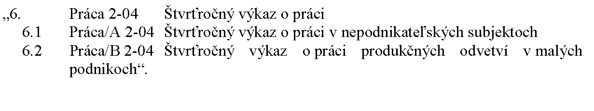
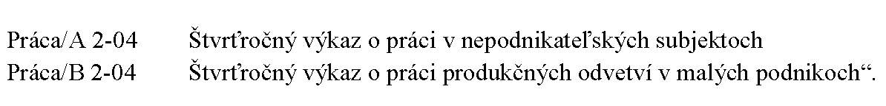
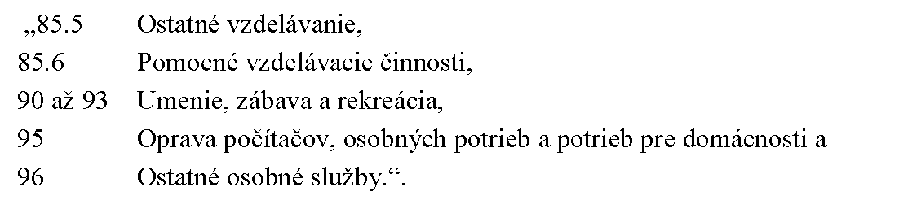

# Čl. I

Vyhláška Štatistického úradu Slovenskej republiky č. 292/2020 Z. z., ktorou sa vydáva Program štátnych štatistických zisťovaní na roky 2021 až 2023 v znení vyhlášky č. 393/2021 Z. z. sa mení takto:

- 1. V prílohe č. 1 časti Zoznam štátnych štatistických zisťovaní a štatistických formulárov šiesty bod znie:

- 

- 2. V prílohe č. 1 časti Zoznam štátnych štatistických zisťovaní a štatistických formulárov sa vypúšťajú slová „1107 Sociálna ochrana“ a trinásty bod.

- 3. V prílohe č. 1 časti Charakteristiky štátnych štatistických zisťovaní šiestom bode sa slová „Značka štátneho štatistického zisťovania a značka štatistického formulára: Práca 2-04 Názov štátneho štatistického zisťovania a názov štatistického formulára: Štvrťročný výkaz o práci“ nahrádzajú slovami „Značka štátneho štatistického zisťovania: Práca 2-04 Názov štátneho štatistického zisťovania: Štvrťročný výkaz o práci Značka štatistického formulára a názov štatistického formulára:

- 

- 4. V prílohe č. 1 časti Charakteristiky štátnych štatistických zisťovaní sa vypúšťa trinásty bod.

- 5. V prílohe č. 1 časti Charakteristiky štátnych štatistických zisťovaní tridsiatom bode písm. a) sa vypúšťajú slová „a jeho závodov“.

- 6. V prílohe č. 1 časti Charakteristiky štátnych štatistických zisťovaní tridsiatom bode písm. b) sa za slovom „mzdy“ vypúšťa čiarka a slová „vybrané ukazovatele na úrovni jednotlivých závodov a údaje o novovzniknutých závodných jednotkách“.

- 7. V prílohe č. 1 časti Charakteristiky štátnych štatistických zisťovaní šesťdesiatomšiestom bode písm. c) sa vypúšťajú slová:

- 

- 8. V prílohe č. 2 časti Zoznam štátnych štatistických zisťovaní a štatistických formulárov sa vypúšťajú štyridsiatyštvrtý až štyridsiatyšiesty bod.

- 9. V prílohe č. 2 časti Charakteristiky štátnych štatistických zisťovaní sa vypúšťajú štyridsiatyštvrtý až štyridsiatyšiesty bod.

- 10. V prílohe č. 2 časti Charakteristiky štátnych štatistických zisťovaní jednostodeviatom bode písmeno a) znie:

- „a) Účel a využitie výsledkov štátneho štatistického zisťovania

- Účelom štátneho štatistického zisťovania je získať informácie o priemerných predajných cenách pohonných látok v Slovenskej republike, ktoré slúžia na zabezpečenie potrieb informačného systému Štatistického úradu Slovenskej republiky. Výsledky štátneho štatistického zisťovania sa využijú ako podklad na zostavenie medzinárodného dotazníka o spotrebiteľských cenách vybraných ropných výrobkov pre Európsku komisiu (Eurostat).“.

- 11. V prílohe č. 2 časti Charakteristiky štátnych štatistických zisťovaní jednostodeviatom bode písmeno c) znie:

- „c) Vymedzenie spravodajských jednotiek

- Subjekty so sídlom v Slovenskej republike zapísané v obchodnom registri, ktoré vykonávajú činnosť podľa SK NACE:

- 47.30.0 – Maloobchod s pohonnými látkami v špecializovaných predajniach.

- Subjekty so sídlom v Slovenskej republike zapísané v obchodnom registri, ktoré vykonávajú predaj stlačeného zemného plynu a skvapalneného zemného plynu konečným spotrebiteľom.“.

- 12. V prílohe č. 2 časti Charakteristiky štátnych štatistických zisťovaní jednostodesiatom bode písmeno a) znie:

- „a) Účel a využitie výsledkov štátneho štatistického zisťovania

- Účelom štátneho štatistického zisťovania je získať informácie o rope, ropných výrobkoch a zemnom plyne. Výsledky štátneho štatistického zisťovania sa využijú ako podklad na zostavenie medzinárodného dotazníka o rope, ropných výrobkoch a zemnom plyne pre Medzinárodnú energetickú agentúru (IEA) a pre Európsku komisiu (Eurostat).“.

- 13. V prílohe č. 2 časti Charakteristiky štátnych štatistických zisťovaní jednostodesiatom bode písmeno c) znie:

- „c) Vymedzenie spravodajských jednotiek

- Subjekty so sídlom v Slovenskej republike zapísané v obchodnom registri, ktoré vykonávajú činnosť podľa SK NACE:

- 19.20.0

- – Výroba rafinovaných ropných produktov,

- 06.10.0

- – Ťažba ropy,

- 06.20.0

- – Ťažba zemného plynu,

- 46.71.0

- – Veľkoobchod s pevnými, kvapalnými a plynnými palivami a súvisiacimi produktmi,

- 49.50.1

- – Potrubná doprava plynu,

- 49.50.2

- – Potrubná doprava ropy a

- 52.10.0

- – Skladovanie a uskladňovanie.“.

- 14. V prílohe č. 3 časti Zoznam využívaných administratívnych zdrojov údajov VI. kapitole sa slová „1. VYBR_ODPAD Údaje o“ nahrádzajú slovami „2. VYBR_ODPAD Údaje o predchádzaní vzniku odpadov,“.

- 15. V prílohe č. 3 časti Charakteristiky využívaných administratívnych zdrojov údajov V. kapitole druhom bode písm. c) sa za slovo „mesačne“ vkladajú slová „(nevzťahuje sa na štatistiky o migrácii)“.

- 16. V prílohe č. 3 časti Charakteristiky využívaných administratívnych zdrojov údajov VI. kapitole druhom bode názov administratívneho zdroja údajov znie: „Údaje o predchádzaní vzniku odpadov, vybraných druhoch odpadov a preprave odpadu“.

- 17. V prílohe č. 3 časti Charakteristiky využívaných administratívnych zdrojov údajov VI. kapitole druhom bode písmená a) a b) znejú:

- „a) Účel a využitie údajov z administratívneho zdroja údajov

- Administratívne údaje sa využijú na zabezpečenie požiadaviek európskeho štatistického systému pri tvorbe štatistík o vzniku a nakladaní s odpadmi.

- b) Charakteristika údajov poskytovaných z administratívneho zdroja údajov

- Údaje o spotrebe ľahkých plastových tašiek, odpadoch z elektrických zariadení a elektronických zariadení, odpadoch z obalov, vozidlách po dobe životnosti, použitých batériách a akumulátoroch, stavebnom odpade a odpade z demolácií, komunálnom odpade, potravinovom odpade, odpadových olejoch a preprave odpadu.“.

- 18. V celom texte vyhlášky sa slová „v poľnohospodárskom registri“ nahrádzajú slovami „v registri fariem“.
