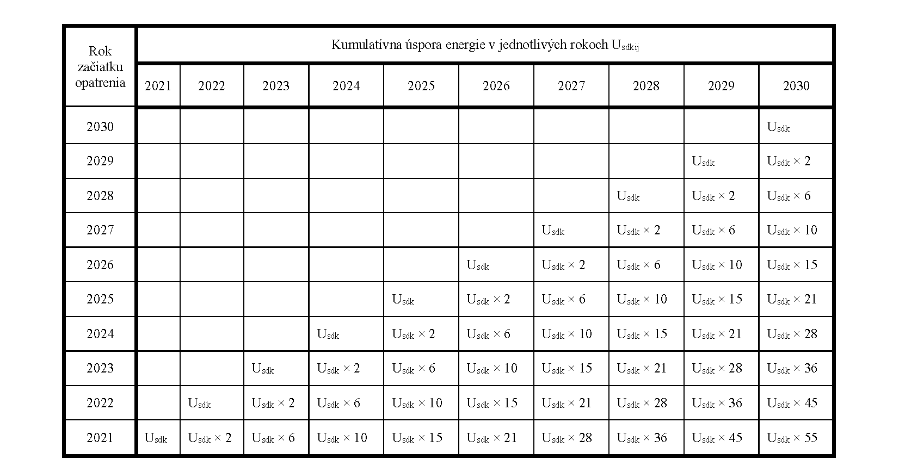

# Čl. I

Vyhláška Ministerstva hospodárstva Slovenskej republiky č. 327/2015 Z. z. o výpočte a plnení cieľov energetickej efektívnosti sa mení a dopĺňa takto:

- 1. § 1 sa dopĺňa písmenom g), ktoré znie:

- „g)

- postup pri výpočte národného príspevku, postup pri výpočte národného cieľa úspory energie u konečného spotrebiteľa a postup pri výpočte úspor energie z opatrení prispievajúcich k plneniu národného cieľa úspory energie u konečného spotrebiteľa.“.

- 2. V § 3 ods. 1 úvodnej vete sa za slová „do roku 2020“ vkladá čiarka a slová „úspora energie na plnenie národného cieľa úspory energie u konečného spotrebiteľa, úspora energie z opatrení, ktoré prispievajú k plneniu národného cieľa úspory energie u konečného spotrebiteľa,“.

- 3. V § 3 ods. 3 písm. d) sa slovo „a“ nahrádza čiarkou.

- 4. V § 3 sa odsek 3 dopĺňa písmenami f) a g), ktoré znejú:

- „f)

- spôsobom preukázania pridanej hodnoty opatrenia na zlepšenie energetickej efektívnosti podľa odseku 6 a

- g)

- cieľom energetickej efektívnosti podľa § 5 ods. 1 zákona, ku ktorému opatrenie na zlepšenie energetickej efektívnosti prispieva.“.

- 5. § 3 sa dopĺňa odsekmi 4 až 6, ktoré znejú:

- „(4)

- Súčet úspor energie na plnenie národného cieľa úspory energie u konečného spotrebiteľa dosiahnutý všetkými opatreniami na zlepšenie energetickej efektívnosti podľa odseku 3 v kalendárnom roku musí byť väčší ako národný cieľ úspory energie u konečného spotrebiteľa vypočítaný podľa prílohy č. 2a v kalendárnom roku.

- (5)

- Úspora energie pre opatrenie na zlepšenie energetickej efektívnosti, ktoré prispieva k plneniu národného cieľa úspory energie u konečného spotrebiteľa, sa vypočíta podľa prílohy k integrovanému národnému energetickému a klimatickému plánu vypracovanej podľa osobitného predpisu.1)

- (6)

- Pridaná hodnota opatrenia na zlepšenie energetickej efektívnosti sa preukáže

- a)

- znížením konečnej spotreby energie,

- b)

- zmenou trendu vývoja konečnej spotreby energie,

- c)

- zmenou správania konečných spotrebiteľov, ktorá znižuje konečnú spotrebu energie,

- d)

- zmenou v technologickom pokroku, ktorý znižuje konečnú spotrebu energie, alebo

- e)

- využitím výrobkov s vyššou triedou energetickej účinnosti.1a)“.

  - Poznámky pod čiarou k odkazom 1 a 1a znejú:

  - „1) Čl. 3 ods. 2 písm. h) nariadenia Európskeho parlamentu a Rady (EÚ) 2018/1999 z 11. decembra 2018 o riadení energetickej únie a opatrení v oblasti klímy, ktorým sa menia nariadenia Európskeho parlamentu a Rady (ES) č. 663/2009 a (ES) č. 715/2009, smernice Európskeho parlamentu a Rady 94/22/ES, 98/70/ES, 2009/31/ES, 2009/73/ES, 2010/31/EÚ, 2012/27/EÚ a 2013/30/EÚ, smernice Rady 2009/119/ES a (EÚ) 2015/652 a ktorým sa zrušuje nariadenie Európskeho parlamentu a Rady (EÚ) č. 525/2013 (Ú. v. EÚ L 328, 21. 12. 2018) v platnom znení.

  - 1a) Nariadenie Európskeho parlamentu a Rady (EÚ) 2017/1369 zo 4. júla 2017, ktorým sa stanovuje rámec pre energetické označovanie a zrušuje smernica 2010/30/EÚ (Ú. v. EÚ L 198, 28. 7. 2017) v platnom znení.“.

- 6. V § 4 písm. a) sa za slovo „porovnateľným“ vkladajú slová „a nezávisle monitorovaným“.

- 7. V § 4 písm. b) prvom bode sa za slovo „porovnateľného“ vkladajú slová „a nezávisle monitorovaného“.

- 8. V § 4 písm. b) druhom bode a § 6 ods. 1 sa slová „§ 13 ods. 1“ nahrádzajú slovami „§ 13“.

- 9. § 5 znie:

- 㤠5

- (1)

- Nameraná úspora energie sa vypočíta ako rozdiel spotreby energie nameranej určeným meradlom1b) pred zavedením opatrenia na zlepšenie energetickej efektívnosti a spotreby energie nameranej určeným meradlom po zavedení opatrenia na zlepšenie energetickej efektívnosti za porovnateľné obdobie; pri výpočte sa zohľadnia dennostupne.

- (2)

- Nameraná úspora energie sa môže započítať aj pre skupinu opatrení na zlepšenie energetickej efektívnosti.“.

  - Poznámka pod čiarou k odkazu 1b znie:

  - „1b) § 11 zákona č. 157/2018 Z. z. o metrológii a o zmene a doplnení niektorých zákonov.“.

- 10. Za § 6 sa vkladá § 6a, ktorý znie:

- 㤠6a

- (1)

- Úspora energie z využívania obnoviteľných zdrojov energie predstavuje množstvo energie z obnoviteľných zdrojov vyrobenej na mieste podľa osobitného predpisu.1c)

- (2)

- Úspora energie z využívania obnoviteľných zdrojov energie sa započíta, len ak je úspora energie určená podľa § 3 ods. 1 písm. a), b) alebo písm. c).

- (3)

- Na výpočet úspory energie z využívania obnoviteľných zdrojov energie sa použijú údaje z energetického certifikátu1d) alebo štatisticky významná vzorka podľa § 10a.“.

  - Poznámky pod čiarou k odkazom 1c a 1d znejú:

  - „1c) § 2 ods. 3 vyhlášky Ministerstva dopravy, výstavby a regionálneho rozvoja Slovenskej republiky č. 364/2012 Z. z., ktorou sa vykonáva zákon č. 555/2005 Z. z. o energetickej hospodárnosti budov a o zmene a doplnení niektorých zákonov v znení neskorších predpisov.

  - 1d) Príloha č. 4 prvý bod písm. o) vyhlášky č. 364/2012 Z. z. v znení vyhlášky č. 35/2020 Z. z.“.

- 11. V § 7 ods. 1 písmeno d) znie:

- „d)

- podpory zmeny správania konečných spotrebiteľov zameranej na dosiahnutie úspor energie s využitím najmä

- 1.

- informačnej kampane a systémov označovania podľa osobitného predpisu,1a)

- 2.

- systémov energetickej certifikácie,1e)

- 3.

- inteligentných meracích systémov.“.

  - Poznámka pod čiarou k odkazu 1e znie:

  - „1e) § 7 ods. 2 písm. d) zákona č. 555/2005 Z. z. o energetickej hospodárnosti budov a o zmene a doplnení niektorých zákonov v znení zákona č. 300/2012 Z. z.“.

- 12. § 8 znie:

- 㤠8

- Úspora energie na plnenie cieľa u konečného spotrebiteľa do roku 2016, cieľa u konečného spotrebiteľa do roku 2020 a národného cieľa úspory energie u konečného spotrebiteľa v oblasti aplikácie výkonovej emisnej normy pre nové osobné automobily,2) aplikácie výkonovej emisnej normy pre nové ľahké komerčné vozidlá,3) zákazu uvádzania energeticky významných výrobkov na trh,4) urýchlenia výmeny motorového vozidla za motorové vozidlo vyššej triedy energetickej účinnosti1a) alebo úrovne zdaňovania palív5) sa vypočíta podľa vzorca

- 

- U

- P

- =

- S

- U

- P

- -

- N

- U

- P

- ,

- kde je

- UP úspora energie na plnenie cieľa u konečného spotrebiteľa do roku 2016, cieľa u konečného spotrebiteľa do roku 2020 alebo národného cieľa úspory energie u konečného spotrebiteľa vyjadrená v MWh,

- SUP úspora energie skutočne dosiahnutá v dôsledku zavedenia opatrenia na zlepšenie energetickej efektívnosti vyjadrená v MWh,

- NUP úspora energie skutočne dosiahnutá v dôsledku zavedenia opatrenia na zlepšenie energetickej efektívnosti, ktorú nie je možné započítať do cieľa u konečného spotrebiteľa do roku 2016, cieľa u konečného spotrebiteľa do roku 2020 alebo národného cieľa úspory energie u konečného spotrebiteľa vyjadrená v MWh.“.

- 13. Doterajší text § 9 sa označuje ako odsek 1 a dopĺňa sa odsekom 2, ktorý znie:

- „(2)

- Úspora energie môže počas doby životnosti opatrenia na zlepšenie energetickej efektívnosti klesať, ak je to technicky opodstatnené.“.

- 14. Za § 10 sa vkladajú § 10a a 10b, ktoré znejú:

- 㤠10a

- (1)

- Pri výpočte úspory energie na plnenie cieľa úspor energie u konečného spotrebiteľa sa môže použiť štatisticky významná vzorka, ak sú základné podmienky na vykonanie opatrenia na zlepšenie energetickej efektívnosti rovnaké a opatrenie na zlepšenie energetickej efektívnosti sa vykoná pre

- a)

- rovnakú stavebnú sústavu budovy,

- b)

- skupinu osôb s rovnakými vlastnosťami,

- c)

- rovnakú skupinu výrobkov v systéme označovania podľa osobitného predpisu,1a)

- d)

- rovnakú technológiu výroby elektriny a tepla.

- (2)

- Porovnanie môže vykonať len osoba podľa § 13 alebo § 19 ods. 1 zákona.

- § 10b

- Do úspory energie na plnenie cieľa úspor energie u konečného spotrebiteľa dosiahnutej po 31. decembri 2020 sa nemôže započítať úspora energie dosiahnutá od 1. januára 2014 do 31. decembra 2020.“.

- 15. Za prílohu č. 2 sa vkladá príloha č. 2a, ktorá vrátane nadpisu znie:

- „Príloha č. 2a

- k vyhláške č. 327/2015 Z. z.

- Úspora energie na plnenie národného cieľa úspory energie u konečného spotrebiteľa

- A. Kumulatívna úspora energie

- Kumulatívna úspora energie sa vypočíta ako súčin úspory energie v dôsledku zavedenia opatrenia na zlepšenie energetickej efektívnosti v príslušnom kalendárnom roku a kumulatívneho počtu kalendárnych rokov, ktoré uplynuli od zavedenia opatrenia na zlepšenie energetickej efektívnosti.

- Ak je životnosť opatrenia na zlepšenie energetickej efektívnosti uvedená v prílohe č. 4 nižšia ako počet rokov od začiatku vykonávania opatrenia na zlepšenie energetickej efektívnosti zostávajúcich do roku 2030, kumulatívna úspora energie sa vypočíta len pre roky, v ktorých trvá životnosť opatrenia.

- Kumulatívna úspora energie vo forme konečnej energetickej spotreby sa pre jednotlivé roky vypočíta podľa tabuľky:

- 

- Usdk je úspora energie vo forme konečnej energetickej spotreby v dôsledku zavedenia opatrenia na zlepšenie energetickej efektívnosti vyjadrená v PJ.

- B. Výpočet dosiahnutej úspory energie

- Dosiahnutá úspora energie na plnenie cieľa úspor energie u konečného spotrebiteľa za jednotlivé roky sa vypočíta ako súčet kumulatívnych úspor energie dosiahnutých v dôsledku zavedenia všetkých opatrení na zlepšenie energetickej efektívnosti podľa vzorca

- 

- U

- s

- i

- =

- ∑

- j

- =

- 1

- n

- U

- s

- d

- k

- i

- j

- ,

- kde je

- Usi úspora energie na plnenie cieľa úspor energie u konečného spotrebiteľa dosiahnutá v kalendárnom roku vyjadrená v PJ,

- n počet všetkých opatrení na zlepšenie energetickej efektívnosti vykonaných v kalendárnom roku,

- j počet opatrení na zlepšenie energetickej efektívnosti vykonaných v kalendárnom roku,

- Usdkij kumulatívna úspora energie vo forme konečnej energetickej spotreby pre kalendárny rok dosiahnutá v dôsledku zavedenia opatrenia na zlepšenie energetickej efektívnosti vyjadrená v PJ.“.

- 16. V prílohe č. 6 sa na konci bodka nahrádza čiarkou a pripájajú sa tieto slová: „v znení smernice Európskeho parlamentu a Rady 2018/844/EÚ z 30. mája 2018 (Ú. v. EÚ L 156, 19. 6. 2018), v znení smernice Európskeho parlamentu a Rady 2018/2002/EÚ z 11. decembra 2018 (Ú. v. EÚ L 328, 21. 12. 2018), v znení nariadenia Európskeho parlamentu a Rady 2018/1999/EÚ z 11. decembra 2018 (Ú. v. EÚ L 328, 21. 12. 2018) a v znení delegovaného nariadenia Komisie 2019/826/EÚ zo 4. marca 2019 (Ú. v. EÚ L 137, 23. 5. 2019).“.
