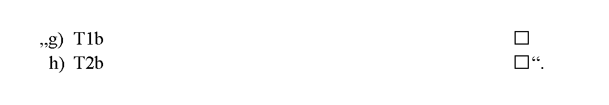
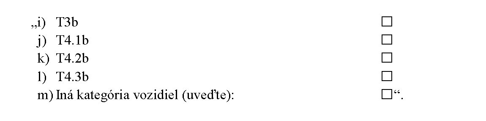

# Čl. I

Vyhláška Ministerstva dopravy a výstavby Slovenskej republiky č. 135/2018 Z. z., ktorou sa ustanovujú podrobnosti o cestnej technickej kontrole v znení vyhlášky č. 424/2019 Z. z. sa mení a dopĺňa takto:

- 1. Poznámka pod čiarou k odkazu 4 znie:

- „4) § 11 zákona č. 157/2018 Z. z. o metrológii a o zmene a doplnení niektorých zákonov.“.

- 2. V prílohe č. 2 sa odkazy 1 až 3 označujú ako odkazy 6 až 8 a poznámky pod čiarou k odkazom 1 až 3 sa označujú ako poznámky pod čiarou k odkazom 6 až 8 a znejú:

- „6) Napríklad STN EN 12195-1 Upevňovanie nákladu na cestných vozidlách. Bezpečnosť. Časť 1: Výpočet upevňovacích síl (30 0080), STN EN 12640 Zabezpečenie tovaru na cestných vozidlách. Viazacie body na úžitkových vozidlách na prepravu tovaru. Minimálne požiadavky a skúšanie (26 9331), STN EN 12642 Zabezpečovanie nákladu na cestných vozidlách. Nadstavba úžitkových vozidiel. Minimálne požiadavky (26 8650), STN EN 12195-2 Súpravy na upevňovanie bremien na cestných vozidlách. Bezpečnosť. Časť 2: Viazacie popruhy vyrobené z chemických vlákien (30 0080), STN EN 12195-3 Súpravy na upevňovanie bremena na cestných vozidlách. Bezpečnosť. Časť 3: Viazacie reťaze (30 0080), STN EN 12195-4 Súpravy na upevňovanie bremien na cestných vozidlách. Bezpečnosť. Časť 4: Oceľové viazacie laná (30 0080), ISO 1161 Kontajnery radu 1. Rohové a medziľahlé prvky. Technické požiadavky, STN ISO 1496-1 Kontajnery ISO radu 1. Technické požiadavky a skúšanie. Časť 1: Univerzálne kontajnery (26 9343), ISO 1496-3 Kontajnery radu 1. Technické požiadavky a skúšanie. Časť 3: Nádržkové kontajnery na kvapaliny, plyny a tlakom manipulované sypké materiály, STN ISO 1496-4+Amd 1 Kontajnery ISO radu 1. Technické požiadavky a skúšanie. Časť 4: Kontajnery na voľne sypané materiály (26 9343), ISO 1496-5 Kontajnery radu 1. Technické požiadavky a skúšanie. Časť 5: Plošinové kontajnery a kontajnery so zníženou plošinou, STN EN 283 Výmenné nadstavce. Skúšanie (26 9360), STN EN 12641-1 Výmenné nadstavby. Plachty. Časť 1: Minimálne požiadavky (26 9376), STN EN 12641-2 Výmenné nadstavby. Plachty. Časť 2: Minimálne požiadavky na bočné závesy (26 9376).

- 7) § 34 zákona č. 56/2012 Z. z. o cestnej doprave v znení neskorších predpisov.

- 8) § 38 a 39 zákona č. 56/2012 Z. z. v znení neskorších predpisov.“.

- 3. V prílohe č. 4 na prednej strane správy o cestnej technickej kontrole šiestom bode písmená g) a h) znejú:

- 

- 4. V prílohe č. 4 na prednej strane správy o cestnej technickej kontrole sa šiesty bod dopĺňa písmenami i) až m), ktoré znejú:

- 

- 5. Doterajší text prílohy č. 7 sa označuje ako prvý bod a dopĺňa sa druhým bodom, ktorý znie:

- „2.

- Delegovaná smernica Komisie (EÚ) 2021/1716 z 29. júna 2021, ktorou sa mení smernica Európskeho parlamentu a Rady 2014/47/EÚ, pokiaľ ide o zmeny v označení kategórií vozidiel vyplývajúce zo zmien právnych predpisov o typovom schvaľovaní (Ú. v. EÚ L 342, 27. 9. 2021).“.
