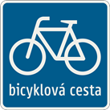
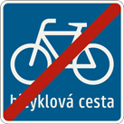
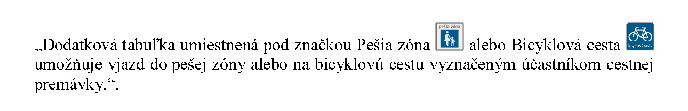

# Čl. I

Vyhláška Ministerstva vnútra Slovenskej republiky č. 30/2020 Z. z. o dopravnom značení sa mení a dopĺňa takto:

- 1. V poznámke pod čiarou k odkazu 1 sa slová „§ 4 ods. 1, 2 a 6“ nahrádzajú slovami „§ 4 ods. 1 až 3 a 7“.

- 2. V § 30 ods. 2 úvodnej vete sa slová „31. marca 2022“ nahrádzajú slovami „31. marca 2024“.

- 3. V § 30 ods. 5 sa slová „31. marca 2022“ nahrádzajú slovami „31. marca 2024“ a na konci sa pripája táto veta: „Priecestné zabezpečovacie zariadenia s červenými striedavo prerušovanými svetlami možno umiestňovať ako náhradu za takéto zariadenia do 31. marca 2024.“.

- 4. Za § 30 sa vkladá § 30a, ktorý vrátane nadpisu znie:

- 㤠30a

- Prechodné ustanovenia účinné od 30. marca 2022

- Do 31. marca 2024

- a)

- najvyššia dovolená rýchlosť vyplývajúca zo značky umiestnenej pri okraji cesty platí najďalej po miesta uvedené v § 30 ods. 2 písm. a) alebo po koniec obce,

- b)

- zasvietený doplnkový signál zelenej farby v tvare šípky alebo šípok znamená pre vodiča možnosť pri dodržaní pravidiel cestnej premávky pokračovať v jazde v smere šípky alebo šípok aj vtedy, ak svieti signál červenej alebo žltej farby v tvare plného kruhu, pritom musí dať prednosť v jazde vozidlám idúcim vo voľnom smere.“.

- 5. V prílohe č. 4 II. diele prvom bode stĺpci Význam značky, prípadne použitie prvý podbod znie:

- „1.

- Značky informujúce o názve obce alebo miestnej časti obce tvoriacej samostatný sídelný útvar v jazyku národnostnej menšiny sa umiestňujú pod značky Obec a Koniec obce.“.

- 6. V prílohe č. 4 II. diele štvrtom bode znenie stĺpca Význam značky, prípadne použitie znie:

- „Značka informuje o názve obce alebo miestnej časti obce tvoriacej samostatný sídelný útvar v jazyku národnostnej menšiny na začiatku obce alebo miestnej časti obce.

- Ak značka informuje o názve miestnej časti obce, v spodnej časti značky sa uvádza názov obce v jazyku národnostnej menšiny, ku ktorej táto miestna časť administratívne patrí.“.

- 7. V prílohe č. 4 II. diele piatom bode znenie stĺpca Význam značky, prípadne použitie znie:

- „Značka informuje o názve obce alebo miestnej časti obce tvoriacej samostatný sídelný útvar v jazyku národnostnej menšiny na konci obce alebo miestnej časti obce.“.

- 8. V prílohe č. 4 sa II. diel dopĺňa dvadsiatym prvým a dvadsiatym druhým bodom, ktoré znejú:

- „

- 21. | 323  Bicyklová cesta | Značka označuje miesto, od ktorého platia osobitné ustanovenia o cestnej premávke na bicyklovej ceste.

- 22. | 324  Koniec bicyklovej cesty | Značka označuje koniec bicyklovej cesty.

- “.

- 9. V prílohe č. 5 II. diele šiestom bode stĺpci Význam značky, prípadne použitie tretia veta znie:

- 
