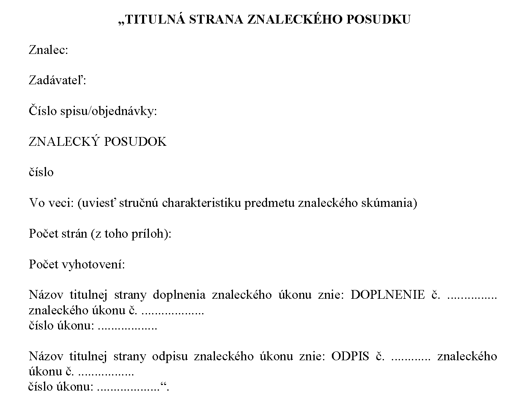
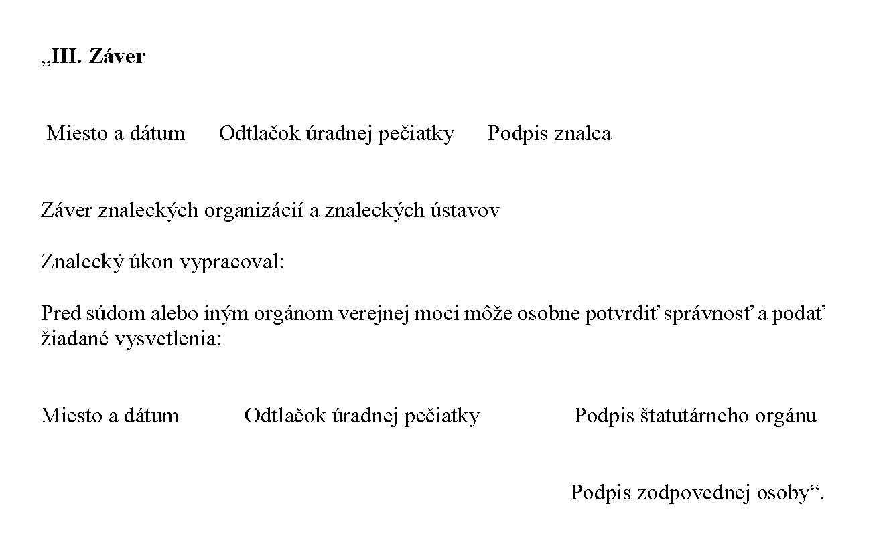
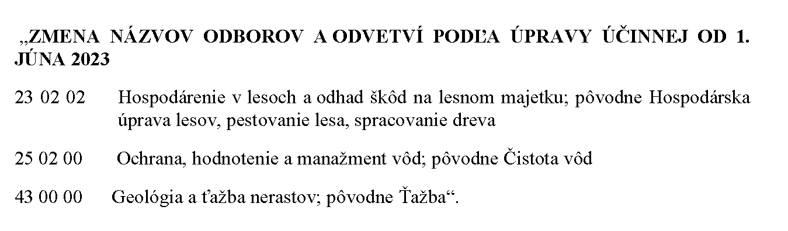

# Čl. I

Vyhláška Ministerstva spravodlivosti Slovenskej republiky č. 228/2018 Z. z., ktorou sa vykonáva zákon č. 382/2004 Z. z. o znalcoch, tlmočníkoch a prekladateľoch a o zmene a doplnení niektorých zákonov v znení neskorších predpisov sa mení a dopĺňa takto:

- 1. V § 1 odsek 3 znie:

- „(3)

- Každý odbor a odvetvie sú označené šesťmiestnym číselným kódom.“.

- 2. § 1 sa dopĺňa odsekom 9, ktorý znie:

- „(9)

- Na posudzovanie odbornej otázky sú príslušní znalci z jedného odvetvia, ak z obsahových vymedzení výslovne nevyplýva, že na posudzovanie rovnakej otázky sú príslušní znalci z viacerých odvetví.“.

- 3. § 2 vrátane nadpisu znie:

- 㤠2

- Podrobnosti o zápise do zoznamu

- (1)

- K písomnej žiadosti o zápis fyzickej osoby do zoznamu sa pripoja

- a)

- osvedčené kópie dokladov o dosiahnutom vzdelaní v odbore, ktorý je predmetom žiadosti, najmä vysokoškolského diplomu, maturitného vysvedčenia alebo iných dokladov; žiadateľ predloží len osvedčené kópie tých dokladov, ktorými sa preukazuje získanie vzdelania v odbore podľa § 5 ods. 1 písm. c) zákona; v prípade žiadateľa o zápis do oddielu tlmočníkov alebo do oddielu prekladateľov, okrem vzdelania z cudzieho jazyka, vzdelanie zo slovenského jazyka postačuje preukázať osvedčenou kópiou vysokoškolského diplomu, ak také vzdelanie neabsolvoval, je potrebné na preukázanie vzdelania zo slovenského jazyka doložiť maturitné vysvedčenie,

- b)

- životopis so zameraním na požadovanú odbornosť,

- c)

- kópia dokladu o úspešnom absolvovaní osobitného vzdelávania o spôsobe výkonu činnosti podľa zákona (ďalej len „odborné minimum“), ktoré žiadateľ absolvoval najneskôr tri roky pred podaním žiadosti; u absolventa špecializovaného vzdelávania v odbore alebo odvetví podľa písmena e) sa má za to, že absolvoval aj odborné minimum, ak je žiadosť podaná do troch rokov od jeho úspešného absolvovania,

- d)

- kópia dokladu o úspešnom absolvovaní skúšky z odboru alebo odvetvia, ktoré je predmetom žiadosti a ktorou preukazuje svoju odbornú spôsobilosť (ďalej len „odborná skúška“), ktorú žiadateľ absolvoval najneskôr tri roky pred podaním žiadosti,

- e)

- osvedčená kópia dokladu o úspešnom absolvovaní špecializovaného vzdelávania v odboroch alebo odvetviach uvedených v prílohe č. 4,

- f)

- doklady o dĺžke praxe v odbore žiadateľa, z ktorých je zrejmý právny základ jej vykonávania, doba trvania a pracovné činnosti, ktoré žiadateľ vykonáva alebo vykonával; prax v odbore sa musí vykonávať aj v čase podania žiadosti,

- g)

- doklady preukazujúce disponovanie materiálnym vybavením potrebným na výkon činnosti v zapisovanom odbore alebo odvetví, napríklad osvedčená kópia nájomnej zmluvy, inventarizačný súpis hnuteľných vecí a nehnuteľností, ktorý nesmie byť v čase podania žiadosti starší ako tri mesiace, alebo čestné vyhlásenie, že žiadateľ týmto materiálnym vybavením disponuje.

- (2)

- K písomnej žiadosti o zápis znaleckej organizácie do zoznamu sa pripoja

- a)

- zakladacia listina, štatút, stanovy alebo iná hodnoverná listina, ak nemožno zistiť zameranie činnosti znaleckej organizácie z registra právnických osôb,

- b)

- doklady, z ktorých je zrejmý pracovný pomer zamestnanca a znaleckej organizácie dohodnutý na neurčitý čas; v prípade spoločníkov, členov, štatutárneho orgánu alebo členov štatutárneho orgánu a prokuristov si ministerstvo zabezpečí výpis z registra právnických osôb,

- c)

- vyhlásenia znalcov znaleckej organizácie vrátane osoby, ktorá bola určená za osobu zodpovednú za výkon znaleckej činnosti znaleckej organizácie o tom, že nie sú spoločníkmi, členmi, štatutárnymi orgánmi alebo členmi štatutárneho orgánu, prokuristami alebo zamestnancami inej právnickej osoby zapísanej v zozname [§ 6 ods. 1 písm. b) zákona],

- d)

- doklady preukazujúce disponovanie materiálnym vybavením potrebným na výkon činnosti v zapisovanom odbore alebo odvetví, napríklad osvedčená kópia nájomnej zmluvy, inventarizačný súpis hnuteľných vecí a nehnuteľností, ktorý nesmie byť v čase podania žiadosti starší ako tri mesiace, alebo čestné vyhlásenie, že znalecká organizácia týmto materiálnym vybavením disponuje.

- (3)

- K písomnej žiadosti o zápis znaleckého ústavu do zoznamu sa okrem listín podľa odseku 2 pripoja

- a)

- potvrdenie o akreditácii vzdelávacieho programu ďalšieho vzdelávania podľa osobitného predpisu,1a)

- b)

- osvedčenie o spôsobilosti vykonávať výskum a vývoj podľa osobitného predpisu.1b)

- (4)

- Ak je fyzická osoba žiadajúca o zápis do zoznamu v čase podania žiadosti zapísaná v inom odbore alebo odvetví zoznamu, nevyžaduje sa od nej opätovné predloženie dokladu o úspešnom absolvovaní odborného minima.

- (5)

- V odbore zdravotníctvo a farmácia a v odbore psychológia odbornú skúšku nahrádza príslušná špecializačná skúška alebo certifikačná skúška v akreditovanej vzdelávacej inštitúcii Ministerstva zdravotníctva Slovenskej republiky. K žiadosti o zápis fyzickej osoby do zoznamu sa pripojí osvedčená kópia dokladu o úspešnom absolvovaní špecializačnej skúšky alebo certifikačnej skúšky.

- (6)

- Špecializácia právnickej osoby je zameranie činnosti právnickej osoby žiadajúcej o zápis do zoznamu. Ministerstvo tento údaj zisťuje z registra právnických osôb, podnikateľov a orgánov verejnej moci.

- (7)

- Sľub sa skladá verejne, slávnostným spôsobom na ministerstve. Žiadateľ sľub potvrdí svojím podpisom v knihe sľubov znalcov, tlmočníkov a prekladateľov.

- (8)

- Do osobného spisu znalca, tlmočníka alebo prekladateľa sa zakladajú listiny, ktoré sa týkajú jeho osoby a výkonu jeho činnosti.“.

  - Poznámky pod čiarou k odkazom 1a a 1b znejú:

  - „1a) § 9 ods. 2 zákona č. 568/2009 Z. z. o celoživotnom vzdelávaní a o zmene a doplnení niektorých zákonov v znení neskorších predpisov.

  - 1b) § 26a ods. 11 a 12 zákona č. 172/2005 Z. z. o organizácii štátnej podpory výskumu a vývoja a o doplnení zákona č. 575/2001 Z. z. o organizácii činnosti vlády a organizácii ústrednej štátnej správy v znení neskorších predpisov v znení neskorších predpisov.“.

- 4. V § 5 ods. 2 sa na konci bodka nahrádza bodkočiarkou a pripájajú sa tieto slová: „zmeškanie lehoty nemožno odpustiť.“.

- 5. V § 5 ods. 3 sa slová „30. septembra“ nahrádzajú slovami „31. augusta“ a na konci sa pripájajú tieto vety: „Z dôvodov hodných osobitného zreteľa sa nemusí v kalendárnom roku uskutočniť odborná skúška, na ktorú bola doručená prihláška do 31. augusta kalendárneho roka. V takom prípade sa odborná skúška z uvedeného odboru a odvetvia uskutoční v nasledujúcom kalendárnom roku.“.

- 6. V § 5 ods. 7 sa na konci pripája táto veta: „Žiadateľ si nesmie vyhotovovať fotokópie materiálov, ktoré mu poskytol organizátor skúšky.“.

- 7. V § 5 ods. 10 a § 14 ods. 4 sa slová „kópie všetkých protokolov“ nahrádzajú slovami „originály všetkých protokolov alebo ich kópie“.

- 8. V § 5 sa vypúšťa odsek 12.

  - Doterajší odsek 13 sa označuje ako odsek 12.

- 9. V § 6 ods. 2 sa za druhú vetu vkladá nová tretia veta, ktorá znie: „Ak žiadateľ počas jedného dňa vykoná odbornú skúšku z viacerých odvetví, vypracuje jeden test zameraný na znalosti všeobecne záväzných právnych predpisov o podmienkach výkonu znaleckej činnosti.“.

- 10. V § 6 ods. 4, § 7 ods. 4 a § 8 ods. 4 sa slová „každá otázka má“ nahrádzajú slovami „pod každou otázkou sú uvedené“.

- 11. V § 6 ods. 6 a § 8 ods. 6 sa na konci bodka nahrádza čiarkou a pripájajú sa tieto slová: „ak predseda skúšobnej komisie neurčí dlhší časový limit. Predseda skúšobnej komisie určí dlhší časový limit žiadateľovi, ktorému zdravotné postihnutie výrazne sťažuje písanie.“.

- 12. V § 7 ods. 5 sa na konci pripája táto veta: „Ak žiadateľ počas jedného dňa vykoná odbornú skúšku z viacerých odborov, vypracuje jeden test zameraný na znalosti všeobecne záväzných právnych predpisov o podmienkach výkonu tlmočníckej činnosti.“.

- 13. V § 8 ods. 5 sa na konci pripája táto veta: „Ak žiadateľ počas jedného dňa vykoná odbornú skúšku z viacerých odborov, vypracuje jeden test zameraný na znalosti všeobecne záväzných právnych predpisov o podmienkach výkonu prekladateľskej činnosti.“.

- 14. V § 9 sa za odsek 2 vkladá nový odsek 3, ktorý znie:

- „(3)

- Informáciu o najbližšom termíne konania odborného minima zverejní poverený znalecký ústav alebo tlmočnícky ústav na svojom webovom sídle a túto skutočnosť oznámi ministerstvu. Ministerstvo na svojom webovom sídle bezodkladne zverejní všetky termíny konania odborného minima, ktoré mu boli oznámené.“.

  - Doterajšie odseky 3 až 5 sa označujú ako odseky 4 až 6.

- 15. Za § 9 sa vkladá § 9a, ktorý vrátane nadpisu znie:

- 㤠9a

- Osobitné ustanovenia o odbornom minime pre vybrané znalecké odbory

- (1)

- Ak sa nahrádza absolvovanie odbornej skúšky znalca podľa § 2 ods. 5, úspešným skončením odborného minima sa rozumie absolvovanie písomnej skúšky zameranej na znalosti všeobecne záväzných právnych predpisov o podmienkach výkonu znaleckej činnosti.

- (2)

- Písomná skúška pozostáva z testu obsahujúceho desať otázok, pod každou otázkou sú uvedené štyri tvrdenia. Úlohou žiadateľa je označiť, či je tvrdenie pravdivé alebo nepravdivé. Správna odpoveď sa hodnotí jedným bodom, za nesprávnu odpoveď nie je udelený žiaden bod, ani nedochádza k strate bodu.

- (3)

- Pri vypracovaní testu nie je prípustné mať k dispozícii texty právnych predpisov, literatúru, poznámky ani žiadne iné materiály. Na vypracovanie testu má žiadateľ 20 minút.

- (4)

- Pre úspešné absolvovanie odborného minima musí žiadateľ z písomnej skúšky získať minimálne 30 bodov. Ak žiadateľ získa za vypracovanie testu menej ako 30 bodov, výsledok písomnej skúšky sa hodnotí klasifikačným stupňom nevyhovel a znalecký ústav určí takémuto žiadateľovi opravný termín. Ak žiadateľ ani na opravnom termíne nezíska z písomnej skúšky minimálne 30 bodov alebo sa určeného opravného termínu bez náležitého ospravedlnenia nezúčastní, žiadateľovo odborné minimum sa považuje za neabsolvované.

- (5)

- O absolvovaní odborného minima vydá znalecký ústav žiadateľovi písomný doklad.“.

- 16. V § 17 odseky 3 a 4 znejú:

- „(3)

- Znalecký ústav použije odtlačok svojej úradnej pečiatky aj na osvedčení o absolvovaní odborného minima, osvedčení o absolvovaní odbornej skúšky znalca a osvedčení o absolvovaní špecializovaného vzdelávania.

- (4)

- Znalec použije odtlačok svojej úradnej pečiatky v znaleckej doložke odpisu znaleckého úkonu a prekladateľ použije odtlačok svojej úradnej pečiatky v prekladateľskej doložke odpisu prekladateľského úkonu.“.

- 17. V § 18 ods. 1 písmeno e) znie:

- „e)

- označenie zadávateľa úkonu v rozsahu

- 1.

- meno a priezvisko, ak ide o fyzickú osobu – nepodnikateľa,

- 2.

- obchodné meno a identifikačné číslo organizácie, ak ide o fyzickú osobu – podnikateľa,

- 3.

- názov a identifikačné číslo organizácie, ak je pridelené, ak ide o právnickú osobu,“.

- 18. V § 18 ods. 1 sa vypúšťa písmeno m).

- 19. V § 18 sa vypúšťa odsek 3.

  - Doterajšie odseky 4 až 6 sa označujú ako odseky 3 až 5.

- 20. V § 18 ods. 3 sa na konci pripájajú tieto slová: „v kalendárnom roku uvedenom za lomkou“.

- 21. V § 18 odsek 5 znie:

- „(5)

- Každý odpis znaleckého úkonu alebo prekladateľského úkonu znalec alebo prekladateľ označí okrem poradového čísla aj samostatným číslom odpisu. Vyžiadaný odpis vyhotovený vo viacerých požadovaných vyhotoveniach má pridelené jedno číslo odpisu.“.

- 22. V nadpise § 19 sa slovo „rovnopisu“ nahrádza slovom „odpisu“.

- 23. V § 19 ods. 1 sa na konci pripája táto veta: „Osnova znaleckého posudku pre odbor psychológia, odvetvie poradenská psychológia je uvedená v prílohe č. 11.“.

- 24. V § 19 odsek 2 znie:

- „(2)

- Odpis znaleckého úkonu vyhotoví znalec na žiadosť zadávateľa alebo inej oprávnenej osoby. Za vyhotovenie odpisu znaleckého úkonu patrí len náhrada nákladov. Odpis znaleckého úkonu obsahuje titulnú stranu, kompletný znalecký úkon, ktorého odpis sa vyhotovuje aj s pôvodnou titulnou stranou, pôvodnou znaleckou doložkou a pridanou samostatnou znaleckou doložkou odpisu s uvedením čísla, pod ktorým je odpis zapísaný v denníku. Znalecká doložka odpisu znaleckého úkonu okrem všeobecných náležitostí uvedených v prílohe č. 6 obsahuje aj dátum a miesto vyhotovenia odpisu a odtlačok úradnej pečiatky znalca.“.

- 25. V § 19 odsek 4 znie:

- „(4)

- Odpis prekladateľského úkonu vyhotoví prekladateľ na žiadosť zadávateľa alebo inej oprávnenej osoby. Za vyhotovenie odpisu prekladateľského úkonu patrí len náhrada nákladov. Odpis prekladateľského úkonu obsahuje titulnú stranu, kompletný prekladateľský úkon, ktorého odpis sa vyhotovuje aj s pôvodnou titulnou stranou, a prekladateľskú doložku s uvedením čísla, pod ktorým je odpis prekladateľského úkonu zapísaný v denníku.“.

- 26. Za § 21 sa vkladá § 21a, ktorý vrátane nadpisu znie:

- 㤠21a

- Prechodné ustanovenia k úpravám účinným od 1. júna 2023

- (1)

- Znalci zapísaní v odvetví Odhad škôd lesných porastov sa presúvajú do odvetvia Hospodárenie v lesoch a odhad škôd na lesnom majetku. Identifikačné znaky znalcov nie sú týmto presunom dotknuté.

- (2)

- Poverenia znaleckých ústavov na zabezpečenie odborného minima vydané podľa tejto vyhlášky v znení účinnom do 31. mája 2023 zostávajú v platnosti a vzťahujú sa aj na skončenie odborného minima podľa § 9a.“.

- 27. V prílohe č. 1 sa za odvetvie 10 10 00 vkladá odvetvie 10 11 00, ktoré znie: „10 11 00 Kybernetická bezpečnosť“.

- 28. V prílohe č. 1 odvetvie 23 02 02 sa slová „Hospodárska úprava lesov, pestovanie lesov, spracovanie dreva“ nahrádzajú slovami „Hospodárenie v lesoch a odhad škôd na lesnom majetku“.

- 29. V prílohe č. 1 sa vypúšťajú slová „23 04 04 Odhad škôd lesných porastov“.

- 30. V prílohe č. 1 odvetvie 25 02 00 sa slová „Čistota vôd“ nahrádzajú slovami „Ochrana, hodnotenie a manažment vôd“.

- 31. V prílohe č. 1 odvetvie 25 03 00 sa slová „Priemyselný a komunálny odpad“ nahrádzajú slovom „Odpady“.

- 32. V prílohe č. 1 odbor 43 00 00 sa slovo „Ťažba“ nahrádza slovami „Geológia a ťažba nerastov“.

- 33. V prílohe č. 1 sa za odvetvie 48 15 00 vkladá odvetvie 48 15 01, ktoré znie: „48 15 01 Súdnolekárska toxikológia“.

- 34. V prílohe č. 1 sa odbor 48 00 00 dopĺňa odvetviami 48 28 00, 48 29 00 a 48 30 00, ktoré znejú:

- „48 28 00 Všeobecné lekárstvo

- 48 29 00 Revízne lekárstvo

- 48 30 00 Nukleárna medicína“.

- 35. V prílohe č. 2 odvetvie 03 01 00 sa na konci pripája táto veta: „Obsahom odvetvia nie je posudzovanie príčiny vzniku požiaru.“.

- 36. V prílohe č. 2 odvetvie 03 03 01 sa na konci pripája táto veta: „Obsahom odvetvia je aj posúdenie, k akému deju by pravdepodobne došlo pri inej technike jazdy vodiča alebo pri inom správaní sa ďalších účastníkov cestnej premávky; obsahom odvetvia nie je posúdenie, či účastník dopravnej nehody dodržal pravidlá cestnej premávky.“.

- 37. V prílohe č. 2 odvetvie 07 03 03 sa na konci pripája táto veta: „Obsahom odvetvia nie je posudzovanie hodín, ktoré používajú na prevádzku elektrickú energiu a ani posudzovanie historických hodín.“.

- 38. V prílohe č. 2 odvetvie 07 04 04 prvá veta znie: „V odvetví znalec stanovuje všeobecnú hodnotu klenotov, šperkov a bižutérie.“.

- 39. V prílohe č. 2 odvetvie 09 03 00 sa vypúšťa slovo „ich“ a na konci sa pripája táto veta: „Obsahom odvetvia je aj stanovenie všeobecnej hodnoty pohľadávok.“.

- 40. V prílohe č. 2 odvetvie 10 01 00 sa na konci bodka nahrádza čiarkou a pripájajú sa tieto slová: „ktoré sú uvedené v tabuľkách prílohy č. 5 časti C odseku 2.1 vyhlášky Ministerstva spravodlivosti Slovenskej republiky č. 492/2004 Z. z. o stanovení všeobecnej hodnoty majetku.“.

- 41. V prílohe č. 2 odvetvie 10 02 00 vrátane nadpisu znie:

- „10 02 00

- Elektronika

- Obsahom odvetvia je posudzovanie zariadení, ktoré sú uvedené v tabuľkách prílohy č. 5 časti C odseku 2.2 vyhlášky Ministerstva spravodlivosti Slovenskej republiky č. 492/2004 Z. z. o stanovení všeobecnej hodnoty majetku a pre svoju činnosť v súlade so sprievodnou a technickou dokumentáciou nevyhnutne využívajú elektrickú energiu v rozsahu bezpečných napätí ustanovených vyhláškou Ministerstva práce, sociálnych vecí a rodiny Slovenskej republiky č. 508/2009 Z. z., ktorou sa ustanovujú podrobnosti na zaistenie bezpečnosti a ochrany zdravia pri práci s technickými zariadeniami tlakovými, zdvíhacími, elektrickými a plynovými a ktorou sa ustanovujú technické zariadenia, ktoré sa považujú za vyhradené technické zariadenia v znení neskorších predpisov. Odvetvie sa nezaoberá skúmaním výpočtovej techniky (hardvér) a softvéru.“.

- 42. V prílohe č. 2 odvetvie 10 04 00 druhej vete sa slovo „spracovanie“ nahrádza slovami „uchovávanie, spracovanie a prenos“ a na konci sa pripája táto veta:

- „Skúmanie informačných systémov sa týka najmä

- a)

- informačných systémov na zber, udržiavanie, spracovanie a poskytovanie informácií (zahrňuje systémový softvér a aplikačný softvér),

- b)

- hardvéru z pohľadu technického vybavenia počítača, mobilných zariadení na uchovávanie, spracovanie a prenos informácií a ich komponentov a súčastí, všetkých elektronických zariadení so softvérovým vybavením, mobilných zariadení a SIM kariet, periférií (zobrazovacie jednotky, zariadenia na vstup a výstup údajov) taktiež zariadení, ktoré je možné pripojiť k počítaču (externé pamäťové médiá, tlačiarne, skenery a iné vstupno-výstupné zariadenia),

- c)

- sieťovej infraštruktúry z pohľadu hardvérových a softvérových zdrojov počítačovej siete, ktoré umožňujú sieťové pripojenie, komunikáciu, prevádzku a správu počítačovej siete poskytujúcu komunikačnú cestu a služby medzi používateľmi, procesmi, aplikáciami, službami a externými sieťami/internetom, (zahrňuje všetky technické prostriedky siete).“.

- 43. V prílohe č. 2 odvetvie 10 06 00 sa slová „v zmysle § 1 ods. 3 zákona č. 351/2011 Z. z.“ nahrádzajú slovami „podľa zákona č. 452/2021 Z. z.“.

- 44. V prílohe č. 2 odvetvie 10 06 00 druhá veta znie: „Obsahom odvetvia je posudzovanie technických a technologických aspektov elektronických komunikačných sietí a služieb z hľadiska uplatňovania transparentných, objektívnych a nediskriminačných kritérií prístupu, prepojenia a poskytovania služieb.“.

- 45. V prílohe č. 2 odvetvie 10 07 00 sa na konci pripájajú tieto slová: „a výšky škody spôsobenej na častiach alebo celkoch týchto zariadení“.

- 46. V prílohe č. 2 odvetvie 10 09 00 vrátane nadpisu znie:

- „10 09 00

- Počítačové programy (softvér)

- Obsahom odvetvia je posudzovanie splnenia požiadaviek na vyhotovenie softvéru akéhokoľvek typu a určenia, stanovenie všeobecnej hodnoty vytvoreného softvéru a posúdenie, či hodnota vytvoreného softvéru zodpovedá vynaloženým nákladom a zároveň, či vytvorený softvér je používaný na účely, na ktorý bol vytvorený. Znalec zapísaný v tomto odvetví je oprávnený skúmať aj obsahovú stránku údajov softvéru, údajov spracovávaných a uchovávaných za pomoci týchto prostriedkov a zapisovaných a ukladaných na elektronických nosičoch alebo v iných elektronických prostriedkoch.“.

- 47. V prílohe č. 2 sa odbor 10 00 00 dopĺňa odvetvím 10 11 00, ktoré vrátane nadpisu znie:

- „10 11 00

- Kybernetická bezpečnosť

- Obsahom odvetvia je posudzovanie narušenia stavu kybernetickej bezpečnosti a narušenia ochrany údajov, porušenia dôvernosti, integrity a dostupnosti údajov, identifikácia a atribúcia konania v kybernetickom priestore, analýza zdroja, cieľa a priebehu kybernetického bezpečnostného incidentu, získanie a zachovanie digitálnych stôp, odborná interpretácia získaných digitálnych stôp, odborné posúdenie dodržiavania interných predpisov alebo technických noriem v kybernetickej bezpečnosti, posudzovanie efektivity bezpečnostných opatrení a procesov, posudzovanie kybernetických bezpečnostných zraniteľností, záchrana a vyťažovanie dát, dôveryhodné zabezpečenie dát pre ďalšie použitie v dôkaznom konaní, zdokumentovanie stavu, vlastností alebo obsahu informačných a komunikačných technológií a procesov v požadovanom časovom okamihu na rôzne účely požadované zo strany zadávateľa, stanovenie škôd spôsobených kybernetickým bezpečnostným incidentom, stanovenie hodnoty kybernetického bezpečnostného rizika a určenie pravdepodobnosti kybernetických bezpečnostných hrozieb.“.

- 48. V prílohe č. 2 odvetvia 14 01 01, 14 02 02, 14 03 03 a 14 04 04 sa vypúšťajú slová „a ohodnotenie“.

- 49. V prílohe č. 2 odvetvie 14 05 05 sa vypúšťajú slová „a ohodnocovanie“.

- 50. V prílohe č. 2 sa odbor 17 00 00 dopĺňa vetou, ktorá znie: „Pod obsahové vymedzenie odboru nespadá stanovenie všeobecnej hodnoty chemických látok a výrobkov.“.

- 51. V prílohe č. 2 odvetvie 17 05 02 vrátane nadpisu znie:

- „17 05 02

- Škody v chemickom priemysle

- Venuje sa analýze bezpečnostných rizík chemických výrob a procesov využívaním postupov chemického inžinierstva a modelovania chemických procesov pri vzniknutých škodách v chemickom priemysle. Obsahom odvetvia nie je stanovenie výšky škody ani ušlého zisku.“.

- 52. V prílohe č. 2 odvetvie 17 09 00 tretia veta znie: „Znalci posudzujú riziko kontaminácie rádioaktívnym materiálom, podmienky práce s takýmito látkami a zneškodňovanie takýchto látok.“.

- 53. V prílohe č. 2 odvetvie 19 01 01 druhá veta znie: „Znalci skúmajú odborné otázky spojené napríklad s verejným prenosom diela vrátane vysielania, retransmisie, sprístupňovania diela verejnosti.“.

- 54. V prílohe č. 2 odbor 23 00 00 a odvetvia 23 01 01, 23 02 02 a 23 03 03 vrátane nadpisov znejú:

- „Odbor 23 00 00 Lesníctvo

- Znalecký odbor lesníctvo zahŕňa odvetvia v oblasti lesného hospodárstva, ktorých predmetom je znalecká činnosť zameraná na posúdenie hospodárskej činnosti v lesoch (zakladanie, ošetrovanie, výchova a ochrana lesa, ťažba, sústreďovanie, sortimentácia, manipulácia, skladovanie a ochrana dreva), odhad škôd na lesných porastoch (lesnom majetku), odhad hodnoty lesov a činností na úseku poľovníctva. Ide o znaleckú činnosť vykonávanú najmä v súvislosti so zákonom č. 326/2005 Z. z. o lesoch v znení neskorších predpisov, zákonom č. 274/2009 Z. z. o poľovníctve a o zmene a doplnení niektorých zákonov v znení neskorších predpisov a súvisiacimi všeobecne záväznými právnymi predpismi.

- 23 01 01

- Poľovníctvo

- Obsahom činnosti odvetvia je znalecká činnosť orientovaná na posudzovanie a stanovenie škody a ujmy z výkonu práva poľovníctva, stanovenie hodnoty poľovnej zveri, stanovenie hodnoty poľovníckych trofejí, poľovných zbraní, poľovníckych zariadení, poľovníckych psov a posudzovanie činnosti v sokoliarstve a poľovníckej kynológii. Znalec je oprávnený kontrolovať hranice a uznanie poľovných revírov, zverníc, bažantníc. Do činností odvetvia nepatrí posudzovanie a stanovenie poškodenia a škôd zverou na poľnohospodárskych plodinách, na lesných porastoch a poškodenia a škôd predátormi na hospodárskych zvieratách a včelstvách. Znalec je oprávnený vypočítať výšku náhrad za poľovné pozemky pre hlavné druhy lovnej zveri. Znalec je oprávnený posúdiť zaradenie poľovného revíru do kvalitatívnej triedy z hľadiska dodržania príslušných noriem, ak vzniknú pochybnosti o jeho zaradení.

- 23 02 02

- Hospodárenie v lesoch a odhad škôd na lesnom majetku

- Obsahom odvetvia je znalecká činnosť orientovaná na posúdenie hospodárskej činnosti v lesoch. Činnosti spadajúce do hospodárenia v lesoch na účely tohto odvetvia sú zakladanie, ošetrovanie, výchova a ochrana lesa, ťažba, sústreďovanie, odvoz, sortimentácia (druhovanie), manipulácia, skladovanie a ochrana dreva. Obsahom znaleckej činnosti odvetvia je aj odhad škôd na lesnom majetku, ktoré sú spôsobené pôsobením škodlivých činiteľov abiotického, biotického a antropogénneho charakteru, vrátane stanovenia škôd zverou na lesných porastoch. Taktiež je obsahom činnosti odvetia aj stanovenie výšky náhrad za stratu mimoprodukčných funkcií lesa z dôvodu vyňatia alebo za obmedzenie vlastníckych práv a hospodárenia v lese. Znalec je oprávnený kontrolovať ciele a modely hospodárenia a programy starostlivosti o lesy. Znalec vypočítava finančnú náhradu na lesnom pozemku za zmluvnú starostlivosť pri náhradách za obmedzenie bežného obhospodarovania.

- 23 03 03

- Odhad hodnoty lesov

- Obsahom odvetvia je stanovenie všeobecnej hodnoty lesných pozemkov a porastov mimo zastavaného územia obcí, ktoré nie sú stavebným pozemkom, stanovenie všeobecnej hodnoty vecných bremien viaznucich na takýchto pozemkoch a stanovenie všeobecnej hodnoty nájomného za užívanie lesných pozemkov mimo zastavaného územia obcí. Znalec stanovuje všeobecnú hodnotu lesa aj v prípadoch, ak ide o plošný výskyt lesných stromov na iných ako lesných pozemkoch (pri nesúlade údajov o druhu pozemku v katastri nehnuteľností so skutočným stavom). Obsahom odvetvia je aj stanovenie spoločenskej hodnoty stromov (drevín) na lesných pozemkoch.“.

- 55. V prílohe č. 2 sa vypúšťa odvetvie 23 04 04.

- 56. V prílohe č. 2 odvetvia 25 01 00, 25 02 00 a 25 03 00 vrátane nadpisov znejú:

- „25 01 00

- Čistota ovzdušia

- Význam, funkcie, vlastnosti a zloženie ovzdušia. Zahŕňa tieto oblasti: skleníkový efekt, skleníkové plyny, potenciál otepľovania a okysľovania ovzdušia, fytochemická oxidácia, odbúravanie stratosférického ozónu v prízemnej vrstve, žiarenie, analýzy vplyvu škodlivých látok na biotické a abiotické zložky životného prostredia, zdroje znečisťovania, bilancia emisií a imisií, vzťah a znečistenie ovzdušia, smog, príčiny, zdroje, opatrenia proti smogu, zmeny v dôsledku klimatických zmien. Obsahom odvetvia nie je posúdenie kvality a vplyvu ovzdušia vo vnútornom prostredí.

- 25 02 00

- Ochrana, hodnotenie a manažment vôd

- Zahŕňa tieto oblasti: kvalita a kvantita povrchových vôd, kvalita a kvantita podzemných vôd; ekosystémy spojené s vodou; plnenie environmentálnych cieľov; hodnotenie stavu útvarov povrchovej vody, hodnotenie stavu útvarov podzemnej vody; vplyv biotických a abiotických faktorov a klimatických zmien na vody; opatrenia na zlepšenie stavu útvarov povrchových vôd a opatrenia na zlepšenie stavu útvarov podzemných vôd; ďalšie relevantné aspekty v súlade s právnymi predpismi.

- 25 03 00

- Odpady

- Vznik a druhy odpadov, zatrieďovanie odpadov podľa Katalógu odpadov. Stav konca odpadu, spôsoby zhodnocovania, zneškodňovania, úpravy a spätné zasypávanie odpadov. Odpady z ťažby, dopravy, poľnohospodárstva, lesníctva, rádioaktívne odpady, stavebné odpady, priemyselné a komunálne odpady, nebezpečné odpady a odpady zo zariadení na úpravu odpadu. Spôsoby zneškodňovania, zhodnocovania a nakladania s odpadom.“.

- 57. V prílohe č. 2 odvetvia 25 05 01 a 25 08 02 vrátane nadpisov znejú:

- „25 05 01

- Odhad škôd v životnom prostredí

- Hodnotenie vplyvov činností na životné prostredie ako súčasť environmentálneho plánovania a environmentálnej politiky v súlade so zákonmi Slovenskej republiky. Postupy pri posudzovaní v odboroch činností: poľnohospodárstvo, priemysel, urbanizmus a územné plánovanie, vodné hospodárstvo, environmentalistika, doprava, odpadové hospodárstvo, ochrana ovzdušia, ochrana zdravia, environmentálna ekonómia, biotické aj abiotické zložky životného prostredia a hodnotenie škôd v nich. Posúdenie a odhad škody na životnom prostredí, ekologickej ujmy, majetkovej škody a spoločenskej hodnoty.

- 25 08 02

- Ochrana prírody a krajiny

- Zahŕňa oblasť ochrany prírody a krajiny v rozsahu podľa zákona o ochrane prírody a krajiny a vyhlášok, ktorými sa vykonáva, ako aj v súlade s medzinárodnými dohovormi súvisiacimi s ochranou prírody a krajiny. Posúdenie ohrozenia biodiverzity: prejavy a príčiny. Biológia ochrany prírody. Zmeny druhových populácií v procese a jeho monitorovanie. Územná ochrana z hľadiska biosozológie, možnosti, úlohy, poslanie.

- Vzácne a ohrozené biotopy/ekosystémy, dodržiavanie, obnova, tvorba. Ochrana biosféry. Ochrana biotopov (problematika ochrany národného a európskeho významu), územná ochrana (problematika chránených území prírody národného a európskeho významu, minerálov a skamenelín), odhad škôd v ochrane prírody a krajiny. Posúdenie, odhad škody a ujmy spôsobenej na chránených druhoch živočíchov a rastlín, drevinách v zmysle zákona a predpisov určujúcich ich hodnotu (v tom aj spoločenskej hodnoty).“.

- 58. V prílohe č. 2 odvetvie 29 01 01 sa na konci pripájajú tieto vety: „Bilancia skrývky ornice a humusového horizontu poľnohospodárskej pôdy. Obsahom odvetvia nie je posúdenie vodných plôch na poľnohospodárskej pôde.“.

- 59. V prílohe č. 2 odvetvia 29 02 02, 29 03 03, 29 04 04, 29 05 05, 29 06 06 a 29 07 07 vrátane nadpisov znejú:

- „29 02 02

- Rastlinná produkcia

- Produkčné procesy rastlín v nadväznosti na tvorbu biologickej a hospodárskej úrody v oblasti všeobecnej aj špeciálnej rastlinnej produkcie. Syntéza poznatkov rozličných vedných disciplín (botanika, fyziológia, pedológia, agrotechnika, výživa rastlín, všeobecná a špeciálna rastlinná výroba a podobne) pri súčasnom hodnotení národohospodárskeho významu rastlinnej produkcie. Charakteristika a hodnotenie rastlinných surovín a potravín zo všeobecných aspektov kvality. Požiadavky, význam, nové pohľady a perspektívne riešenia kvality rastlinných produktov ako potravín a hlavných potravinárskych surovín pre rôzne smery technológie potravín. Hodnotenie a odhad škôd na plodinách v dôsledku klimatických zmien, technologických postupov, rôznych zásahov, hodnotenie a odhad škôd na porastoch spôsobených zverou a zvieratami, predátormi, človekom, iným zásahom.

- 29 03 03

- Živočíšna produkcia

- Súčasný a perspektívny rozvoj všeobecnej a špeciálnej živočíšnej výroby, postavenie hospodárskych zvierat v štruktúre živočíšnej výroby. Charakteristiky najvýznamnejších plemien a úžitkových typov najmä hovädzieho dobytka, ošípaných, oviec, hydiny. Základné zootechnické podmienky odchovu, chovu a výkrmu hospodárskych a špeciálnych zvierat. Techniky a technológie chovu zvierat a ich jednotlivých kategórií, šľachtiteľské programy, zooveterinárne aspekty a zvlášť v podmienkach nestability spôsobenej v agroekosystémoch. Výroba a spotreba živočíšnych produktov. Požiadavky spracovateľov na jatočné zvieratá. Hodnotenie jatočných zvierat pri nákupe. Hodnotenie kvality a intravitálnych činiteľov ovplyvňujúcich akosť surovín a potravín živočíšneho pôvodu.

- Hodnotenie a odhad škôd na chovoch v dôsledku klimatických zmien, technologických postupov, rôznych zásahov, hodnotenie a odhad škôd na hospodárskych zvieratách spôsobených zverou a zvieratami, predátormi, človekom, iným zásahom.

- 29 04 04

- Spracovanie poľnohospodárskych produktov – ovocinárstvo

- Botanické členenie ovocných rastlín, morfológia, anatómia, opeľovacie a oplodňovacie pomery a praktické využitie ich poznania. Rast a vývin ovocných rastlín, približovanie plodnosti ako prvok intenzívneho ovocinárstva. Fenológia ovocných rastlín, podmienky ovplyvňujúce priebeh fenofáz a odporúčané pestovateľské zásahy v priebehu roka. Nároky ovocných rastlín na podmienky prostredia, rajonizácia ovocných výsadieb. Predvýsadbová príprava pôdy, výsadba ovocných rastlín, ošetrovanie pôdy v existujúcich sadoch. Zavlažovanie v ovocných výsadbách (spôsoby a druhy závlah), úprava mikroklímy, ochrana proti nízkym teplotám. Odhad úrod, príprava na zber, technológie zberu a pozberové ošetrovanie ovocia. Negatívne vplyvy na úrodu a kvalitu ovocia.

- Hodnotenie a odhad škôd na sadoch, pestovateľských plochách, jednotlivých drevinách a krovinách v dôsledku klimatických zmien, technologických postupov, rôznych zásahov, hodnotenie a odhad škôd na porastoch, drevinách a krovinách spôsobených zverou a zvieratami, predátormi, človekom, iným zásahom.

- 29 05 05

- Spracovanie poľnohospodárskych produktov – vinárstvo a vinohradníctvo

- Základná vinárska terminológia. Členenie vinárskej produkcie podľa zákona č. 313/2009 Z. z. o vinohradníctve a vinárstve v znení neskorších predpisov. Zákonom povolené technické prostriedky, technologické postupy pri výrobe vína, povolené prídavné látky, pomocné látky, povolené limity látok obsiahnutých vo víne.

- Hodnotenie a odhad škôd na pestovateľských plochách, jednotlivých porastoch v dôsledku klimatických zmien, technologických postupov, rôznych zásahov, hodnotenie a odhad škôd na porastoch spôsobených zverou a zvieratami, predátormi, človekom, iným zásahom. Hodnotenie a odhad škôd v procese spracovania a výroby, skladovania a nakladania s vínom.

- 29 06 06

- Spracovanie poľnohospodárskych produktov – včelárstvo

- Posudzovanie pozitívneho vplyvu včiel na zvyšovaní rastlinnej produkcie, odhad škôd spôsobených negatívnou poľnohospodárskou činnosťou na včelstvách.

- Včelárstvo ako samostatný vedný odbor, historický vývoj obydlia včiel v minulosti až po súčasnosť, plemená a plemenitba včiel, fyziológia, anatómia, patológia a morfológia včely medonosnej, vzťah medzi včelstvom a prostredím, správanie včiel v rôznych podmienkach a ich etológia, jednotlivé pohlavné formy včiel a ich vzájomný vzťah a funkcie, včelie produkty (med, nektár, peľ, vosk, materská kašička, propolis a včelí jed), význam a hodnotenie ich kvality.

- Hodnotenie a odhad škôd na včelstvách a včelích produktoch v dôsledku klimatických zmien, technologických postupov, rôznych zásahov, hodnotenie a odhad škôd na včelstvách a včelích produktoch spôsobených zverou a zvieratami, predátormi, človekom, iným zásahom.

- 29 07 07

- Záhradníctvo

- Hospodársky význam abiotických a biotických činiteľov záhradníckych rastlín. Identifikácia škodcov, chorôb a iných poškodení záhradníckych plodín. Zahŕňa poznatky o stave a hodnotení technológie skleníkových systémov, sadbového materiálu, pestovania v záhonoch a poľných podmienkach, produkčné technológie zeleniny, ovocia, hrozna a okrasných a liečivých rastlín, trávnych plôch a zelene, technológie zberu, skladovania, spracovania, distribúcie a predaja, ako aj škôlkarstvo sadovníckeho, okrasného a úžitkového materiálu, manažment trávnatých plôch a zelene v krajine.

- Hodnotenie a odhad škôd na záhradníckych plodinách v dôsledku klimatických zmien, technologických postupov, rôznych zásahov, hodnotenie a odhad škôd na záhradníckych plodinách spôsobených zverou a zvieratami, predátormi, človekom, iným zásahom.

- Obsahom odvetvia nie je samostatné dendrologické posúdenie stromov a krov.“.

- 60. V prílohe č. 2 odvetvie 29 08 08 sa na konci pripája táto veta: „Hodnotenie a odhad škôd na poľnohospodárskej pôde v dôsledku klimatických zmien, technologických postupov, využívania poľnohospodárskej pôdy, rôznych zásahov a havárií, spôsobených rastlinami, zvieratami, človekom, iným zásahom.“.

- 61. V prílohe č. 2 odbor 34 00 00 vrátane nadpisu znie:

- „Odbor 34 00 00 Psychológia

- Obsahom odboru je poskytovanie odpovedí pomocou psychodiagnostických metód a postupov, ktorých výsledky sa posudzujú v kontexte životných javov a väzieb na odborné otázky. Výkon znaleckej činnosti nie je poskytovaním zdravotnej starostlivosti.“.

- 62. V prílohe č. 2 odvetvie 34 01 00 vrátane nadpisu znie:

- „34 01 00

- Klinická psychológia detí

- Uplatňuje sa pri posudzovaní psychosociálneho vývinu maloletých a mladistvých, jeho prejavoch, poruchách, príčinách a vplyvoch výchovného prostredia na ich vývin podľa klinických kritérií Medzinárodnej klasifikácie chorôb, otázkach spojených s juvenilnou delikvenciou a trestnými činmi páchanými na maloletých a mladistvých, napríklad týranie, sexuálne zneužívanie, zanedbanie dieťaťa, a pri ukladaní a zmene ochrannej výchovy. Znalec skúma vierohodnosť maloletých a ich výpovedí, psychické následky trestných činov spáchaných na maloletých a rozoberá motivácie páchanej delikvencie maloletých, v tom skúma aj vplyv výchovného prostredia na juvenilnú delikvenciu. Znalec zapísaný v tomto odvetví nie je príslušný na skúmanie stability budúceho výchovného prostredia, vývinových potrieb, citových väzieb, manipulácie maloletých a rodinných konfliktov v konaniach vo veci úpravy výkonu rodičovských práv a povinností a styku s maloletými.“.

- 63. V prílohe č. 2 odvetvie 34 02 00 sa na konci pripája táto veta: „Obsahom znaleckého skúmania nie je posudzovanie duševného stavu zosnulých osôb.“.

- 64. V prílohe č. 2 odvetvie 34 03 00 vrátane nadpisu znie:

- „34 03 00

- Poradenská psychológia

- Uplatňuje sa v konaniach vo veci starostlivosti súdu o maloletých, najmä v konaniach o úprave výkonu rodičovských práv a povinností, styku s maloletým, zverení dieťaťa do náhradnej osobnej starostlivosti, pestúnskej starostlivosti, ústavnej starostlivosti a iných opatreniach. Znalec skúma vzťahy medzi maloletými a rodičmi, partnermi rodičov maloletých a osôb žijúcich v spoločnej domácnosti; výchovné štýly uvedených osôb. Znalec ďalej zisťuje, či je maloletý zo strany jedného z rodičov ovplyvňovaný proti druhému rodičovi, zisťuje vzájomné citové väzby členov rodiny, dopady rodičovského konfliktu na dieťa, či je dieťa vystavené konfliktu lojality a jeho dopady na dieťa, a či nie je dieťa zneužívané rodičmi. V konaniach o nariadení ústavnej starostlivosti znalec prispieva k riešeniu otázok o tom, či a čím je vážne ohrozená alebo vážne narušená výchova v aktuálnej rodinnej situácii. V konaniach o zverenie maloletého do náhradnej osobnej starostlivosti a pestúnskej starostlivosti skúma preferenčné výchovné štýly a schopnosti budúcich náhradných rodičov utvárať podmienky pre udržiavanie vzťahov dieťaťa s rodičmi, súrodencami a inými blízkymi osobami.“.

- 65. V prílohe č. 2 odbor 36 00 00 vrátane nadpisu znie:

- „Odbor 36 00 00 Starožitnosti

- Za starožitnosti sa považujú staré umelecké aj neumelecké diela všetkých období, odborov, techník a použití, kuriozity a účelové predmety. Prvoradým hodnotiacim hľadiskom je ich vek, zvláštnosti, umelecká a zberateľská hodnota. Pod starožitnosti nepatria výtvarné umelecké diela napríklad maľby, kresby, grafiky, ani ľudové diela.“.

- 66. V prílohe č. 2 odvetvie 36 01 01 sa pred prvú vetu vkladá nová prvá veta, ktorá znie: „Obsahom odvetvia je stanovenie všeobecnej hodnoty starožitného nábytku, výšky škody a posudzovanie veku.“.

- 67. V prílohe č. 2 odvetvie 36 02 02 sa pred prvú vetu vkladá nová prvá veta, ktorá znie: „Obsahom odvetvia je stanovenie všeobecnej hodnoty starožitného skla a porcelánu, výšky škody a posudzovanie veku.“.

- 68. V prílohe č. 2 odvetvie 36 03 03 sa pred prvú vetu vkladá nová prvá veta, ktorá znie: „Obsahom odvetvia je stanovenie všeobecnej hodnoty historických hodín, výšky škody a posudzovanie veku.“.

- 69. V prílohe č. 2 odvetvie 36 04 04 sa pred prvú vetu vkladá nová prvá veta, ktorá znie: „Obsahom odvetvia je stanovenie všeobecnej hodnoty historických zbraní.“.

- 70. V prílohe č. 2 odvetvie 36 05 05 sa pred prvú vetu vkladá nová prvá veta, ktorá znie: „Obsahom odvetvia je stanovenie všeobecnej hodnoty historických textílií a kobercov, výšky škody a posudzovanie veku.“.

- 71. V prílohe č. 2 odvetvie 36 07 07 vrátane nadpisu znie:

- „36 07 07

- Sakrálne predmety

- Obsahom odvetvia je stanovenie všeobecnej hodnoty sakrálnych predmetov, výšky škody a posudzovanie veku. Sakrálne predmety sa viažu k náboženskému kultu, vyjadrujú náboženské predstavy.“.

- 72. V prílohe č. 2 odvetvie 36 08 08 sa pred prvú vetu vkladá nová prvá veta, ktorá znie: „Obsahom odvetvia je stanovenie všeobecnej hodnoty historických písomností, výšky škody a posudzovanie veku.“.

- 73. V prílohe č. 2 odvetvie 37 04 00 prvá veta znie: „Odvetvie je zamerané na posudzovanie najmä banských stavieb a ťažobných zariadení.“.

- 74. V prílohe č. 2 odvetvie 37 09 01 tretej vete sa slová „stavebným pozemkom“ nahrádzajú slovami „určený územnoplánovacou dokumentáciou alebo územným rozhodnutím na zastavanie a pozemok zastavaný stavbou“.

- 75. V prílohe č. 2 odvetvie 37 09 01 sa za tretiu vetu vkladá nová štvrtá veta, ktorá znie: „Znalci zapísaní v tomto odvetví stanovujú všeobecnú hodnotu pozemkov v zriadených záhradkových osadách a pozemkov v pozemkových obvodoch jednoduchých pozemkových úprav na usporiadanie vlastníckych a užívacích pomerov k pozemkom, ktoré sa nachádzajú pod osídleniami marginalizovaných skupín obyvateľstva a v hospodárskych dvoroch.“.

- 76. V prílohe č. 2 odvetvie 37 13 00 sa vypúšťa slovo „interdisciplinárneho“.

- 77. V prílohe č. 2 odbor 38 00 00 štvrtej vete sa vypúšťajú slová „v zmysle zákona č. 190/2003 Z. z. o strelných zbraniach a strelive a o zmene a doplnení niektorých zákonov v znení neskorších predpisov“.

- 78. V prílohe č. 2 odvetvie 38 01 01 vrátane nadpisu znie:

- „38 01 01

- Strelné zbrane

- Posudzovanie strelných zbraní, ich technického stavu, konštrukcie, úplnosti, stanovenie ich všeobecnej hodnoty, šetrenie nehôd a havárií. Posudzovanie bezpečnosti pri používaní strelných zbraní. Posudzovanie zaradenia zbraní do jednotlivých kategórií.“.

- 79. V prílohe č. 2 odvetvie 38 02 02 posledná veta znie: „Znalci posudzujú strelivo v súvislosti s odbornými otázkami pri kategorizácii streliva.“.

- 80. V prílohe č. 2 odvetvia 39 01 00, 39 02 00, 39 03 00, 39 04 00, 39 05 00 a 39 09 01 sa slovo „vyhlášky“ nahrádza slovami „prílohy č. 4 k vyhláške“.

- 81. V prílohe č. 2 odbor 43 00 00 a odvetvia 43 01 00, 43 02 00, 43 03 00 a 43 04 00 vrátane nadpisov znejú:

- „Odbor 43 00 00 Geológia a ťažba nerastov

- 43 01 00

- Geológia

- Predmetom odvetvia je zisťovanie veku hornín, fosílií a sedimentov, fosílne záznamy, skúmanie prejavov sopečnej a tektonickej činnosti. Znalci posudzujú stavbu a vznik hornín, ich chemické zloženie a identifikujú pôvod hornín, fosílií, sedimentov, prípadne aj meteoritov. Pod obsah odvetvia patrí aj inžinierska geológia (najmä interakcie stavieb a geologického prostredia, zloženie a vlastnosti základových pôd, geodynamické javy ako napr. stabilita svahov, vzťahy k územnému plánovaniu), hydrogeológia a geológia životného prostredia. Súčasťou odvetvia je posudzovanie metodických, technických a technologických postupov geologického výskumu a prieskumu vrátane geofyzikálnych metód. Obsahom odvetvia je aj stanovenie všeobecnej hodnoty vyťažených nerastov, ktoré nie sú stavebným materiálom. Predmetom odvetvia nie je skúmanie zloženia, vzniku a pôvodu minerálov.

- 43 02 00

- Mineralógia

- Predmetom odvetvia je skúmanie zloženia, vzniku a pôvodu minerálov (kryštálov a horninotvorných minerálov) a mineraloidov, posudzujú sa aj minerály z umelej syntézy. Obsahom odvetvia je aj stanovenie všeobecnej hodnoty vyťažených (syntetizovaných) minerálov. Odvetvie sa prelína s odvetvím drahé kamene (najmä pri surových mineráloch).

- 43 03 00

- Ložisková geológia

- Predmetom odvetvia sú ložiská rúd, nerúd, stavebných surovín, uhlia, ropy a zemného plynu. Predmetom odvetvia je aj hydrogeológia ložísk. Znalci posudzujú vplyvy ložísk na stabilitu vôd a pôd. Znalci stanovujú všeobecnú hodnotu geologického diela a geologického objektu podľa § 35 ods. 14 zákona č. 569/2007 Z. z. o geologických prácach (geologický zákon) a posudzujú spôsoby likvidácie geologických diel a objektov.

- 43 04 00

- Ťažba nerastov

- Odvetvie sa zaoberá možnosťami využitia priemyselne využiteľných druhov surovín (najmä ropa, zemný plyn, hnedé uhlie a lignit), rudnými surovinami (napr. meď, ortuť, železná ruda, striebro, zlato) ako aj nerudnými surovinami (napr. azbest, baryt, bentonit, dolomit, kaolín, kamenná soľ, sadrovec, vápenec a cementárske suroviny), stavebnými surovinami (stavebný kameň, štrkopiesky a piesky, tehliarske suroviny) a stanovením všeobecnej hodnoty ložísk (napr. v dedičských konaniach, stanovení hodnoty obchodného podielu, zabezpečenie úveru), všeobecnej hodnoty nájmu za využívanie ložísk, ako aj stanovením všeobecnej hodnoty likvidácie banských diel. Znalci posudzujú výšky škôd na ložisku (napr. z nelegálnej ťažby), taktiež posudzujú škody, ktoré vznikli z ťažobnej činnosti, aj racionálne využívanie výhradných ložísk. Predmetom odvetvia je aj posudzovanie osobitných zásahov do zemskej kôry a konverzia ložísk ropy, horľavého zemného plynu a soli na podzemné zásobníky plynov alebo kvapalín, alebo trvalých úložísk oxidu uhličitého. Za ložiská nerastov sa považuje aj zakládka v hlbinnej bani, opustený odval, výsypka alebo odkalisko, ktoré vznikli banskou činnosťou a obsahujú nerasty.“.

- 82. V prílohe č. 2 odvetvie 44 02 02 prvá veta znie: „Obsahom odvetvia je posudzovanie diel folklórneho umenia, ktoré môžu byť dielami hudobnými, slovesnými, výtvarnými a podobne.“.

- 83. V prílohe č. 2 odvetvia 46 01 00 a 46 02 01 vrátane nadpisov znejú:

- „46 01 00

- Hydromeliorácie

- Hodnotenie vplyvov súvisiacich s využívaním vodných zdrojov, hospodárením s vodou, ochranou vôd, realizáciou a prevádzkou hydromelioračných a vodných stavieb. Analýza a posúdenie vplyvu technických a biotechnických opatrení na vlhkostný režim pôd. Stanovenie vplyvu hydromelioračných stavieb na vodný režim poľnohospodársky využívaných pozemkov, vidieckej krajiny, vodnú bilanciu v povodiach a hospodárenie v ochranných pásmach vodárenských zdrojov. Analýza funkčnosti hydromelioračných stavieb, posúdenie vplyvov ich pôsobenia na prírodné prostredie a stanovenie možností pre ich rekonštrukciu v súlade s environmentálnymi požiadavkami a podmienkami udržateľného využívania krajiny.

- 46 02 01

- Rybárstvo a rybnikárstvo

- Hodnotenie vysádzania rýb, chovu rýb, ochrany rýb a rybolovu v súlade s legislatívou, environmentálnymi požiadavkami a podmienkami udržateľného využívania krajiny. Hodnotenie chovu rýb v rôznych rybochovných zariadeniach, tečúcich a stojatých vodách. Hodnotenie činností založených na využívaní prirodzených alebo zámerným chovom a ochranou vytvorených zásob rýb.

- Stanovuje sa hodnota rýb v rybochovných zariadeniach, rybárskych revíroch a ostatných vodných útvaroch, škody spôsobené v rybochovných zariadeniach, rybárskych revíroch a ostatných vodných útvaroch.

- Obsahom odvetvia nie je hodnotenie vodného vtáctva, obojživelníkov, cicavcov viazaných na vodu, vodných bezstavovcov (mäkkýše, kôrovce, hmyz a pod.) vrátane vývojových štádií, ani rýb spracovaných na výrobky (filety, údenáče, šaláty a pod.), všeobecnej hodnoty rybníkov a rybných hospodárstiev, pozemkov, technických a vodných stavieb.“.

- 84. V prílohe č. 2 odbor 48 00 00 vrátane nadpisu znie:

- „Odbor 48 00 00 Zdravotníctvo a farmácia

- Odbor sa zaoberá diagnostikou chorôb podľa aktuálnej Medzinárodnej klasifikácie chorôb, analýzou biologického materiálu a iných látok, posudzovaním poskytnutej zdravotnej starostlivosti, určovaním bodového hodnotenia náhrady za sťaženie spoločenského uplatnenia a náhrady za bolesť podľa ustanovení zákona č. 437/2004 Z. z. o náhrade za bolesť a o náhrade za sťaženie spoločenského uplatnenia a o zmene a doplnení zákona Národnej rady Slovenskej republiky č. 273/1994 Z. z. o zdravotnom poistení, financovaní zdravotného poistenia, o zriadení Všeobecnej zdravotnej poisťovne a o zriaďovaní rezortných, odvetvových, podnikových a občianskych zdravotných poisťovní v znení neskorších predpisov v znení neskorších predpisov. Súčasťou odboru je problematika podávania liečiv a liečebných prípravkov. Diagnostika sa vykonáva podľa schválených diagnostických štandardov. Výkon znaleckej činnosti v tomto odbore nie je poskytovaním zdravotnej starostlivosti.“.

- 85. V prílohe č. 2 odvetvie 48 02 00 druhej vete sa slovo „onemocnení“ nahrádza slovom „ochorení“.

- 86. V prílohe č. 2 odvetvie 48 02 00 poslednej vete sa vypúšťa čiarka a slová „diagnostikou, liečbou a prevenciou“.

- 87. V prílohe č. 2 odvetvie 48 03 00 prvá veta a druhá veta znejú: „Gynekológia sa zaoberá problematikou ochorení ženských pohlavných orgánov, ochorení prsníkov, operačnými výkonmi na ženských pohlavných orgánoch, posudzovaním nálezov na genitáliách, ale aj na ostatných častiach tela v prípadoch znásilnení či zatajovaných pôrodov. Zaoberá sa klimakterickými ťažkosťami u žien, posudzovaním intersexuálnych stavov a sexuálnych odchýlok (transsexualizmus).“.

- 88. V prílohe č. 2 odvetvie 48 04 00 prvej vete sa vypúšťajú slová „ich diagnostikou, liečbou a prevenciou,“.

- 89. V prílohe č. 2 odvetvie 48 06 00 prvej vete sa slová „diagnostika a liečba (aj konzervatívna) zápalových a nádorových ochorení slinivky brušnej (pankreasu), liečba komplikácií“ nahrádzajú slovami „zápalové a nádorové ochorenia slinivky brušnej (pankreasu), komplikácie“.

- 90. V prílohe č. 2 odvetvie 48 06 01 prvá veta znie: „Ide o odvetvie zaoberajúce sa poraneniami kože a skeletu (otvorené rany, odreniny, podliatiny, zlomeniny rebier, panvy, kostí končatín, kľúčnych kostí, lopatky a tak ďalej), poškodeniami kĺbov, väzov, svalstva; v rámci znaleckého posudzovania sa zaoberá aj mechanizmom vzniku zranení a zlomenín, určovaním doby liečenia a doby práceneschopnosti pri jednotlivých úrazoch.“.

- 91. V prílohe č. 2 odvetvie 48 06 02 posledná veta znie: „Odvetvie zahŕňa aj posudzovanie pooperačnej starostlivosti a liečby komplikácií.“.

- 92. V prílohe č. 2 odvetvie 48 06 03 prvá veta znie: „Odvetvie sa zaoberá ochoreniami a úrazovými poškodeniami celého nervového systému, predovšetkým mozgu vrátane nádorových ochorení, mozgových obalov, lebečného skeletu, chrbtice a platničiek, krvácaniami do dutiny lebečnej.“.

- 93. V prílohe č. 2 odvetvie 48 07 00 prvá veta znie: „Ide o široké medicínske odvetvie, ktoré sa zaoberá vnútornými chorobami.“.

- 94. V prílohe č. 2 odvetvie 48 07 00 poslednej vete sa slová „49 07 01 až 49 07 10“ nahrádzajú slovami „48 07 01 až 48 07 10“.

- 95. V prílohe č. 2 odvetvie 48 07 01 prvej vete sa vypúšťajú slová „liečby, diagnostiky a prevencie“.

- 96. V prílohe č. 2 odvetvie 48 07 02 vrátane nadpisu znie:

- „48 07 02

- Endokrinológia

- Odvetvie sa zaoberá chorobami žliaz s vnútornou sekréciou (endokrinné žľazy), zaoberá sa ich prejavmi a možnými komplikáciami okrem postihnutia Langerhansových ostrovčekov pankreasu, čiže cukrovky, ktorú rieši diabetológia; do tohto odvetvia spadá aj obezita či chudnutie spôsobené endokrinnými poruchami, ale aj sekundárnymi prejavmi chorôb žliaz s vnútornou sekréciou, ako napríklad chýbanie ochlpenia, respektíve nadmerné ochlpenie, zmena kvality vlasov.“.

- 97. V prílohe č. 2 odvetvie 48 07 03 sa vypúšťajú slová „ich diagnostikou, liečbou, ale aj prevenciou,“.

- 98. V prílohe č. 2 odvetvie 48 07 04 sa vypúšťa čiarka a slová „ich laboratórnu a endoskopickú diagnostiku, liečbu a prevenciu“.

- 99. V prílohe č. 2 odvetvie 48 07 05 sa vypúšťajú slová „klinické obrazy, diagnostické, liečebné a preventívne postupy pri najčastejších onemocneniach,“.

- 100. V prílohe č. 2 odvetvie 48 07 06 sa slová „diagnostiku, liečbu a prevenciu vrátane očkovania“ nahrádzajú slovom „očkovaní“.

- 101. V prílohe č. 2 odvetvie 48 07 07 vrátane nadpisu znie:

- „48 07 07

- Kardiológia

- Ide o odvetvie zaoberajúce sa chorobami srdca vrátane pomocných vyšetrení (elektrokardiografia, sonografia, echografia a podobne), infarktom myokardu, nádormi srdca a zápalovými stavmi (endokarditídy, myokarditídy, perikarditídy a podobne).“.

- 102. V prílohe č. 2 odvetvie 48 07 08 sa slová „problematikou diagnostiky a liečby ochorení“ nahrádzajú slovom „ochoreniami“.

- 103. V prílohe č. 2 odvetvie 48 07 09 druhej vete sa slovo „liečba“ nahrádza slovom „posudzovanie“.

- 104. V prílohe č. 2 odvetvie 48 07 09 tretej vete sa slová „V posudkovej činnosti ide o posudzovanie“ nahrádzajú slovom „Posudzovanie“.

- 105. V prílohe č. 2 odvetvie 48 09 01 sa slová „diagnostikou chorôb“ nahrádzajú slovom „chorobami“.

- 106. V prílohe č. 2 odvetvie 48 10 00 sa vypúšťajú slová „ich diagnostikou, liečbou, prevenciou“.

- 107. V prílohe č. 2 odvetvie 48 11 00 sa slová „diagnostiku, liečbu a prevenciu chorôb“ nahrádzajú slovom „choroby“.

- 108. V prílohe č. 2 odvetvie 48 12 00 sa slová „vrátane diagnózy a liečby vývojových chýb, zaoberá sa náhradami kĺbov (endoprotéz), liečbou nádorových ochorení“ nahrádzajú slovami „vývojové chyby, zaoberá sa náhradami kĺbov (endoprotéz), nádorovými ochoreniami“.

- 109. V prílohe č. 2 odvetvie 48 12 04 sa slovo „liečbou“ nahrádza slovami „posudzovaním poskytnutej liečby“.

- 110. V prílohe č. 2 odvetvie 48 13 00 vrátane nadpisu znie:

- „48 13 00

- Otorinolaryngológia

- Odvetvie rieši problematiku ušných, nosných a krčných chorôb, nádory, polypy a úrazy daných anatomických lokalít vrátane porúch hlasu (hlasiviek) a sluchu. Odvetvie sa zaoberá aj mechanizmom vzniku úrazov daných anatomických lokalít.“.

- 111. V prílohe č. 2 sa za odvetvie 48 15 00 vkladá odvetvie 48 15 01, ktoré vrátane nadpisu znie:

- „48 15 01

- Súdnolekárska toxikológia

- Odvetvie zaoberajúce sa identifikáciou a kvantifikáciou cudzorodých látok, prípadne látok telu vlastných, ktorých koncentrácia môže byť zmenená vplyvom rôznych faktorov pôsobiacich na ľudský organizmus. Medzi cudzorodé látky patria najmä omamné a psychotropné látky, prchavé látky spolu s alkoholmi, nové syntetické psychoaktívne látky, účinné alebo prídavné látky v liekoch, jedy nachádzajúce sa v pesticídoch, rozpúšťadlá, látky kyselinovej či zásaditej povahy, látky používané v priemysle, príslušné metabolity cudzorodých látok a iné chemické látky poškodzujúce ľudský organizmus. Odvetvie sa zaoberá aj analyzovaním zaisteného dôkazného materiálu ako napríklad tabletky, prášky alebo tekutiny neznámeho pôvodu, analýzou časti rastlín, húb a živočíchov, v súvislosti s vykonanou analýzou vzoriek z ľudského tela. Objektom skúmania odvetvia sú vzorky biologického materiálu akéhokoľvek druhu odobraté z ľudského tela pri pitve, na mieste nálezu mŕtveho tela, ako aj vzorky odobraté od živých osôb. Súdnolekárska toxikológia využíva poznatky a metódy z prelínajúcich odborov biochémie, imunochémie, analytickej chémie, anorganickej a organickej chémie, fyzikálnej chémie a molekulárnej biológie pre dôkaz a zistenie koncentrácie vyššie uvedených látok. Odvetvie hodnotí použité laboratórne metódy, ich správnu aplikáciu a taktiež sa vyjadruje k distribúcii sledovaných látok v ľudskom organizme a k interakcii zistenej látky s inými prítomnými substanciami. Súdnolekárska toxikológia interpretuje výsledky toxikologických analýz v spolupráci s odvetvím súdne lekárstvo alebo s odvetvím psychiatria.“.

- 112. V prílohe č. 2 odvetvie 48 16 00 sa slová „diagnostikovaním, liečbou a prevenciou detských chorôb vrátane syndrómu týraného dieťaťa“ nahrádzajú slovami „detskými chorobami“.

- 113. V prílohe č. 2 odvetvie 48 17 00 vrátane nadpisu znie:

- „48 17 00

- Psychiatria

- Odvetvie sa zaoberá diagnostikou, prevenciou a prognózou duševných porúch a porúch správania podľa aktuálnej Medzinárodnej klasifikácie chorôb. Odvetvie zahŕňa skúmanie a posudzovanie duševných porúch a porúch správania v trestnom konaní (páchateľ, svedok, poškodený) a civilnom konaní. Odvetvie zahŕňa aj skúmanie a posudzovanie účinkov návykových a psychotropných látok alebo liečiv na psychický stav jedinca, látkových závislostí (alkohol, drogy) a nelátkových závislostí, duševných porúch a porúch správania u osôb vyššieho veku, práceneschopnosť, invaliditu a trvalé následky vyplývajúce z duševných porúch a porúch správania, taktiež skúmanie duševného stavu u zosnulých osôb a posudzovanie poskytnutej psychiatrickej zdravotnej starostlivosti.“.

- 114. V prílohe č. 2 odvetvie 48 19 00 vrátane nadpisu znie:

- „48 19 00

- Sexuológia

- Sexuológia predstavuje znalecké odvetvie, ktoré podľa charakteru a príčiny skúma poruchy ľudskej sexuality. Odvetvie sa zaoberá posudzovaním prípadov negatívnych dôsledkov sexuálneho správania v zmysle sexuálnej agresie voči obeti, posudzuje motivácie a prejavy porúch sexuálneho správania, poruchy sexuálnej identity, sexuálne dysfunkcie, všetky aberantné formy sexuálnych aktivít a trvalé následky vyplývajúce zo sexuálnych porúch. Toto znalecké odvetvie vyhodnocuje aj organické (anatomické či chorobné) príčiny porúch sexuálnej aktivity.“.

- 115. V prílohe č. 2 odvetvia 48 21 00 a 48 22 00 vrátane nadpisov znejú:

- „48 21 00

- Toxikológia

- Odvetvie skúma pôsobenie cudzorodých látok a škodlivín na ľudský organizmus so zameraním na vyšetrovanie biologického materiálu u živých osôb. Odvetvie sa nezaoberá forenznou alkohológiou a posudzovaním opitosti.

- 48 22 00

- Urológia

- Odvetvie sa zaoberá problematikou ochorení močového a pohlavného ústrojenstva (u ženskej populácie sa môže prelínať s odvetvím gynekológia), zahŕňa operačnú liečbu nádorových aj nenádorových ochorení obličiek, močovodov, močového mechúra, močovej rúry, plastikami u geriatrických pacientiek, vývojovými chybami urogenitálneho systému.“.

- 116. V prílohe č. 2 odvetvie 48 24 00 prvá veta znie: „Odvetvie sa zaoberá onkologickými ochoreniami, zahŕňa posudzovanie liečby nádorových aj nenádorových ochorení rádioaktívnymi látkami a chemoterapiou.“.

- 117. V prílohe č. 2 odvetvie 48 25 00 tretej vete sa vypúšťajú slová „ich diagnostike, diferenciálnej diagnostike a liečbe“.

- 118. V prílohe č. 2 sa odbor 48 00 00 dopĺňa odvetviami 48 28 00, 48 29 00 a 48 30 00, ktoré vrátane nadpisov znejú:

- „48 28 00

- Všeobecné lekárstvo

- Ide o odvetvie, ktoré sa zaoberá prevenciou, včasnou ambulantnou diagnostikou a ambulantnou liečbou akútnych a chronických ochorení, vrátane starostlivosti o osoby prostredníctvom návštevnej služby. Náplňou odvetvia je manažment pacienta v primárnej zdravotnej starostlivosti do času identifikácie potreby špecializovanej zdravotnej starostlivosti.

- 48 29 00

- Revízne lekárstvo

- Ide o odvetvie, ktoré sa zaoberá úhradami z verejného zdravotného poistenia na základe zdravotného stavu osoby. Odvetvie skúma vecný rozsah zdravotnej starostlivosti hradený z verejného zdravotného poistenia. Posudzuje postupy revíznej činnosti zdravotných poisťovní.

- 48 30 00

- Nukleárna medicína

- Odvetvie sa zaoberá diagnostikou a liečbou chorôb pomocou otvorených rádioaktívnych žiaričov. Jeho diagnostická časť patrí do skupiny zobrazovacích, neinvazívnych vyšetrovacích metód s použitím rádioaktívnych žiaričov.“.

- 119. V prílohe č. 2 odvetvie 49 09 00 prvej vete sa slová „národnom jazyku (slovenský jazyk)“ nahrádzajú slovami „slovenskom jazyku“.

- 120. V prílohe č. 2 odvetvie 49 11 00 prvej vete sa slovo „súdnoznaleckým“ nahrádza slovom „znaleckým“.

- 121. V prílohe č. 2 odvetvie 49 14 00 vrátane nadpisu znie:

- „49 14 00

- Kriminalistická pyrotechnika

- Kriminalistická pyrotechnika sa zaoberá kriminalistickým skúmaním výbušnín, výbušných predmetov, munície a výbušných systémov, ich konštrukcie, úplnosti, funkčnosti a účinkov. S využitím poznatkov chémie výbušnín, fyziky, náuky o fyzikálno-chemických vlastnostiach výbušnín skúma príčiny výbuchov výbušnín, výbušných predmetov, munície a výbušných systémov. Predmetom skúmania je aj analýza neznámych predmetov a látok, pri ktorých je podozrenie, že môže ísť o výbušninu, výbušný predmet, muníciu alebo výbušný systém.“.

- 122. V prílohe č. 2 odvetvie 49 15 00 druhej vete sa za slovo „streliva“ vkladajú slová „vrátane ich technickej kategorizácie“ a v tretej vete sa slová „Predmetom skúmania kriminalistickej balisticky sú“ nahrádzajú slovami „Obsahom odvetvia je“.

- 123. V prílohe č. 2 odvetvie 49 16 00 šiesta veta znie: „Objektmi skúmania sú: výbušniny a povýbuchové splodiny, povýstrelové splodiny, textílie a textilné vlákna, kovové materiály a ich úlomky a otery, sklo a jeho úlomky, náterové hmoty a ich otery, automobilové laky a tmely, plasty, lepidlá a podobne.“.

- 124. V prílohe č. 2 odvetvie 49 17 00 tretia veta znie: „Predmetom skúmania kriminalistickej toxikológie je zisťovanie koncentrácie vybraných účinných látok a chemického zloženia záchytov omamných a psychotropných látok, prekurzorov a vybraných liekov; prítomnosti omamných a psychotropných látok, vybraných liečiv a iných toxických látok v telesných tekutinách najmä krvi a moči; koncentrácie etanolu v krvi; prítomnosti slzotvorných a dráždivých látok na mieste činu a na odeve alebo na tele osôb.“.

- 125. V prílohe č. 2 odvetvie 49 18 00 štvrtej vete sa slová „kriminalistického ohniska vzniku požiaru“ nahrádzajú slovami „miesta vzniku požiaru (tzv. kriminalistické ohnisko požiaru)“.

- 126. V prílohe č. 2 odvetvie 49 19 00 druhá veta znie:

- „V rámci skúmania sa zisťuje

- – existencia a príčiny porúch rozvodov a vodičov elektrickej energie z hľadiska dodržania účelu, podmienok, použitia a dovolených zaťažení podľa príslušných noriem alebo iných obdobných špecifikácií, vodičov, ovládacích prístrojov a zdrojov prúdu,

- – či požiar vozidla, objektu, technologického zariadenia a podobne vznikol v priamej súvislosti s činnosťou elektrického zariadenia pod napätím, prípadne pri jeho poruche, preťažení a podobne,

- – výskyt a príčiny porúch elektrických strojov, spotrebičov a prístrojov vrátane regulačných zariadení a porúch osvetlenia,

- – výskyt a príčiny porúch ochrany pred nebezpečným dotykovým napätím vzhľadom na príslušné normy alebo iné obdobné špecifikácie,

- – príčiny úrazov elektrickým prúdom,

- – výskyt a príčiny porúch elektrickej inštalácie a elektrických zariadení motorových vozidiel, dopravných a zdvíhacích zariadení a akumulátorových vozíkov,

- – príčiny vzniku a pôsobenia statickej a atmosférickej elektriny,

- – stav elektrických žiaroviek a iných zdrojov svetla, hlavne dopravných prostriedkov, vrátane určenia, či žiarovky alebo iné zdroje svetla svietili, respektíve nesvietili v dobe svojho poškodenia,

- – stav elektronických zabezpečovacích systémov motorových vozidiel, budov, bytov a podobne, najmä z hľadiska spôsobu ich prekonania, respektíve ich funkčnosti,

- – identifikačné údaje motorového vozidla (VIN, sériové čísla komponentov a pod.) a prevádzkové údaje motorového vozidla metódou elektronickej identifikácie z elektronických komponentov motorového vozidla,

- – identifikačné údaje (VIN, sériové čísla, čísla transpondérov a pod.) a prevádzkové údaje vozidla z predložených elektronických komponentov motorového vozidla (riadiace jednotky, prístrojové dosky, kľúče od vozidla a pod.),

- – stav vysielacích a prijímacích zariadení z hľadiska ich funkčnosti,

- – stav, funkčnosť a údaje z pamäte zariadení používaných pri neoprávnenej manipulácii s údajmi elektronických platobných prostriedkov,

- – stav a funkčnosť iných elektronických zariadení, ktoré boli zaistené v súvislosti s vyšetrovaním trestnej činnosti.“.

- 127. V prílohe č. 2 odvetvie 51 01 01 sa na konci pripájajú tieto slová: „a stanovenie všeobecnej hodnoty pohľadávok“.

- 128. Príloha č. 3 vrátane nadpisu znie:

- „ZOZNAM TLMOČNÍCKYCH A PREKLADATEĽSKÝCH ODBOROV PODĽA JAZYKOV

- ALB | slovenský – albánsky

- ANG | slovenský – anglický

- ARA | slovenský – arabský

- ARM | slovenský – arménsky

- BEN | slovenský – bengálsky

- BIE | slovenský – bieloruský

- BOS | slovenský – bosniansky

- BUL | slovenský – bulharský

- CES | slovenský – český

- CIN | slovenský – čínsky

- DAN | slovenský – dánsky

- EST | slovenský – estónsky

- FIN | slovenský – fínsky

- FRA | slovenský – francúzsky

- GRE | slovenský – grécky

- GRU | slovenský – gruzínsky

- HEB | slovenský – hebrejský

- HIN | slovenský – hindský

- HOL | slovenský – holandský

- CHO | slovenský – chorvátsky

- IND | slovenský – indonézsky

- IRS | slovenský – írsky

- ISL | slovenský – islandský

- JAP | slovenský – japonský

- KOR | slovenský – kórejský

- LAT | slovenský – latinský

- LIT | slovenský – litovský

- LOT | slovenský – lotyšský

- LUX | slovenský – luxemburský

- MAC | slovenský – macedónsky

- MAD | slovenský – maďarský

- MAL | slovenský – maltský

- MOL | slovenský – moldavský

- MON | slovenský – mongolský

- NEM | slovenský – nemecký

- NOR | slovenský – nórsky

- PAN | slovenský – pandžábsky

- PAŠ | slovenský – paštský

- PER | slovenský – perzský

- POL | slovenský – poľský

- POR | slovenský – portugalský

- RET | slovenský – rétorománsky

- ROM | slovenský – rómsky

- RUM | slovenský – rumunský

- RUS | slovenský – ruský

- SPA | slovenský – španielsky

- SRB | slovenský – srbský

- SVE | slovenský – švédsky

- SVI | slovenský – slovinský

- TAL | slovenský – taliansky

- TUR | slovenský – turecký

- UKR | slovenský – ukrajinský

- URD | slovenský – urdský

- VIE | slovenský – vietnamský

- ART | Artikulačné tlmočenie

- TPH | Tlmočenie pre hluchoslepé osoby

- POS | Posunková reč

- “.

- 129. V prílohe č. 4 tretí bod znie:

  - „3. odvetvie kybernetická bezpečnosť“.

- 130. Príloha č. 5 vrátane nadpisu znie:

- 

- 131. V prílohe č. 6 časť I. sa dopĺňa piatym bodom, ktorý znie:

- „5.

- Použité predpisy a literatúra“.

- 132. V prílohe č. 6 časť III. vrátane nadpisu znie:

- 

- 133. V prílohe č. 6 časť V. sa na konci pripájajú tieto slová: „Podpis zodpovednej osoby“.

- 134. V prílohe č. 7 časť I. siedmy bod znie:

- „7.

- Definície dôležitých pojmov“.

- 135. Príloha č. 7 časť II. prvý bod sa dopĺňa písmenom h), ktoré znie:

- „h)

- informácia z územného plánu o záväzných regulatívoch priestorového usporiadania a funkčného využívania pozemkov, názov územného plánu k rozhodnému dátumu a identifikácia, kde je územný plán verejne prístupný (internetová stránka).“.

- 136. V prílohe č. 8 sa slovo „rovnopisu“ nahrádza slovom „odpisu“ a slovo „ROVNOPIS“ slovom „ODPIS“.

- 137. V prílohe č. 10 časť Zmena názvov odborov podľa jazykov sa slovo „Panžábsky“ nahrádza slovom „Pandžábsky“.

- 138. Príloha č. 10 sa dopĺňa vrátane nadpisu takto:

- 

- 139. Vyhláška sa dopĺňa prílohou č. 11, ktorá vrátane nadpisu znie:

- „[OSNOVA ZNALECKÉHO POSUDKU PRE ODBOR PSYCHOLÓGIA, ODVETVIE PORADENSKÁ PSYCHOLÓGIA](assets/0425f47c24d346fdd356b87c90cd33e8668937eabeefe134ea80d8362104dd52.pdf)“.
