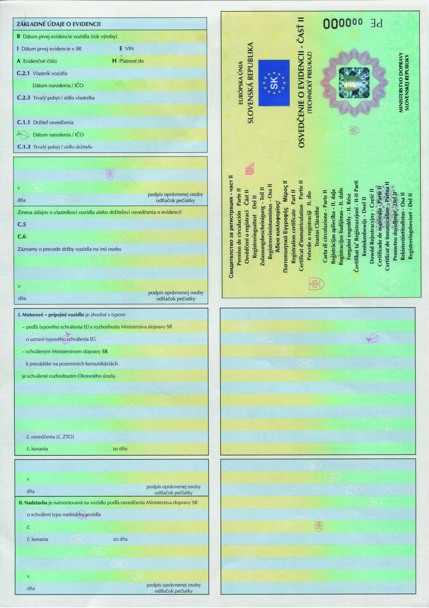
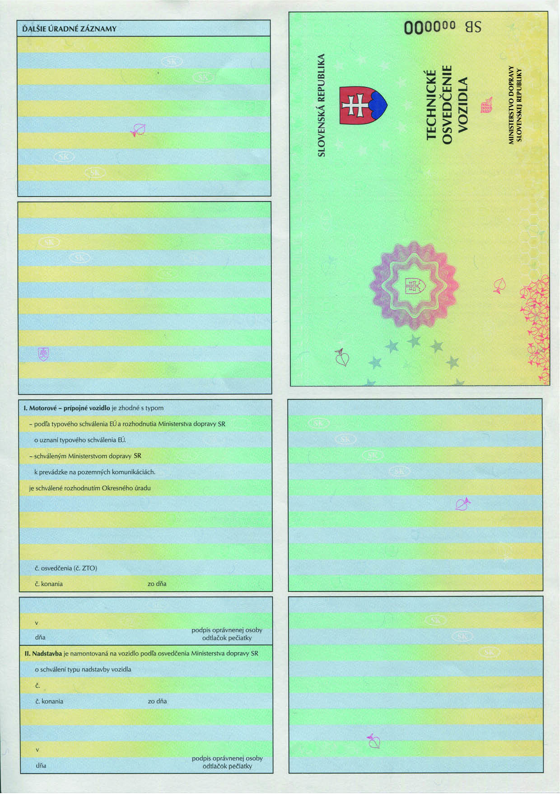

# Čl. I

Vyhláška Ministerstva dopravy a výstavby Slovenskej republiky č. 133/2018 Z. z., ktorou sa ustanovujú podrobnosti o dokladoch vozidla sa mení a dopĺňa takto:

- 1. § 6 sa dopĺňa odsekom 3, ktorý znie:

- „(3)

- Harmonizované osvedčenie o evidencii vydané zmluvným štátom obsahuje harmonizované kódy Európskej únie podľa prílohy č. 5.“.

- 2. Za § 9 sa vkladá § 9a, ktorý vrátane nadpisu znie:

- 㤠9a

- Prechodné ustanovenie k úpravám účinným od 1. júna 2023

- Tlačivá osvedčenia o evidencii časti II a tlačivá technického osvedčenia vozidla vydávané podľa predpisov účinných do 31. mája 2023 možno vydávať do vyčerpania ich skladových zásob, najdlhšie do 31. decembra 2028.“.

- 3. V prílohe č. 1 sa odsek 17 dopĺňa písmenami e) a f), ktoré znejú:

- „e)

- spájací náves (DF): náves s točnicou namontovanou vzadu tak, aby spájací náves mohol ťahať ďalší náves,

- f)

- spájací príves (DG): ojový príves s točnicou namontovanou vzadu tak, aby spájací príves mohol ťahať ďalší náves.“.

- 4. V prílohe č. 4 predná strana znie:

- 

- 5. V prílohe č. 5 časti A ods. 3 písm. m) siedmy bod znie:

- „7.

- (V.7) CO2 (g · km-1) alebo špecifické emisie CO2, ak sú uvedené u ťažkého úžitkového vozidla v bode 49.5 osvedčenia o zhode COC14a) alebo v bode 49.5 osvedčenia o schválení jednotlivého vozidla,14b)“.

  - Poznámky pod čiarou k odkazom 14a a 14b znejú:

  - „14a) Príloha VIII vykonávacieho nariadenia Komisie (EÚ) 2020/683 z 15. apríla 2020, ktorým sa vykonáva nariadenie Európskeho parlamentu a Rady (EÚ) 2018/858, pokiaľ ide o správne požiadavky na schvaľovanie motorových vozidiel a ich prípojných vozidiel, ako aj systémov, komponentov a samostatných technických jednotiek určených pre takéto vozidlá a na dohľad nad trhom s nimi (Ú. v. EÚ L 163, 26. 5. 2020) v platnom znení.

  - 14b) Príloha III doplnok 1 vykonávacieho nariadenia Komisie (EÚ) 2020/683 v platnom znení.“.

- 6. V prílohe č. 5 časti A ods. 3 sa písmeno m) dopĺňa desiatym bodom, ktorý znie:

- „10.

- (V.10) trieda emisií CO2 ťažkých úžitkových vozidiel stanovená v čase prvej evidencie pre diferencovanie poplatkov za použitie dopravnej infraštruktúry,“.

- 7. V prílohe č. 6 ods. 60 sa na konci pripájajú tieto slová: „alebo špecifické emisie CO2

- v „g · km-1““.

- 8. V prílohe č. 7 predná strana znie:

- 

- 9. Doterajší text prílohy č. 8 sa označuje ako prvý bod a dopĺňa sa druhým bodom, ktorý znie:

- „2.

- Smernica Európskeho parlamentu a Rady (EÚ) 2022/362 z 24. februára 2022, ktorou sa menia smernice 1999/62/ES, 1999/37/ES a (EÚ) 2019/520, pokiaľ ide o poplatky za používanie určitej dopravnej infraštruktúry vozidlami (Ú. v. EÚ L 69, 4. 3. 2022).“.
