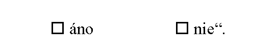

# Čl. I

Vyhláška Ministerstva zdravotníctva Slovenskej republiky č. 232/2014 Z. z., ktorou sa upravuje postup poskytovateľa zdravotnej starostlivosti, zdravotnej poisťovne a Úradu pre dohľad nad zdravotnou starostlivosťou pri poskytovaní cezhraničnej zdravotnej starostlivosti sa mení a dopĺňa takto:

- 1. V § 4 ods. 1 sa slová „ods. 1“ nahrádzajú slovami „ods. 2“.

- 2. V § 4 ods. 4 a § 10 ods. 4 sa slová „ods. 4“ nahrádzajú slovami „ods. 6“.

- 3. V § 10 ods. 1 sa slová „§ 9f ods. 1“ nahrádzajú slovami „§ 9f ods. 3“.

- 4. V § 10 odsek 2 znie:

- „(2)

- K žiadosti sa môže priložiť výpočet predpokladaných nákladov na cezhraničnú zdravotnú starostlivosť na tlačive „Výpočet predpokladaných nákladov cezhraničnej zdravotnej starostlivosti“, ktorého vzor je uvedený v prílohe č. 8. Tlačivo podľa prvej vety vypĺňa poskytovateľ z iného členského štátu Európskej únie, u ktorého sa má poskytnúť cezhraničná zdravotná starostlivosť.“.

- 5. V prílohe č. 4 bode 2.9 sa v nadpise na konci pripájajú tieto slová: „alebo poskytovateľom zdravotnej starostlivosti iného členského štátu*****)“.

- 6. V prílohe č. 4 sa vypúšťajú slová „Dávam týmto v zmysle zákona č. 122/2013 Z. z. o ochrane osobných údajov pre ....................... zdravotnú poisťovňu, a. s., súhlas na cezhraničný tok svojich osobných údajov poskytovateľovi zdravotnej starostlivosti z cudziny v rozsahu meno, rodné číslo, adresa a diagnóza. Tento súhlas môžem odvolať do odovzdania žiadosti poskytovateľovi zdravotnej starostlivosti z cudziny.“.

- 7. V prílohe č. 4 časti Vysvetlivky sa na konci pripájajú tieto slová: „*****) Pri žiadosti o udelenie súhlasu v prípade cezhraničnej zdravotnej starostlivosti sa uplatňuje jedna z dvoch alternatív podľa § 9f ods. 3 zákona.“.

- 8. V prílohe č. 6 sa slová „Detská fakultná nemocnica s poliklinikou Bratislava“ nahrádzajú slovami „Národný ústav detských chorôb“.

- 9. V prílohe č. 8 časti A sa v nadpise vypúšťajú slová „a potvrdenie o možnom prijatí poistenca“.

- 10. V prílohe č. 8 časti A sa slová „ods. 1“ nahrádzajú slovami „ods. 2“ a vypúšťajú sa slová „Potvrdzujeme, že naše pracovisko môže prijať vyššie uvedeného poistenca

- 

- 11. V prílohe č. 8 časti B sa v nadpise vypúšťajú slová „and confirmation on the possible acceptation of the policyholder“.

- 12. V prílohe č. 8 časti B sa slová „paragraph. 1“ nahrádzajú slovami „paragraph 2“ a vypúšťajú sa slová „We are confirming that our unit can accept the above policyholder for the scheduled treatment:

- 

- 13. V prílohe č. 8 časti C sa v nadpise vypúšťajú slová „und der Bestätigung der möglichen Annahme des Versicherten“.

- 14. V prílohe č. 8 časti C sa slová „Absatz. 1“ nahrádzajú slovami „Absatz 2“ a vypúšťajú sa slová „Wir bestätigen, dass unsere Arbeit kann oberhalb der Versicherten nehmen

- 
