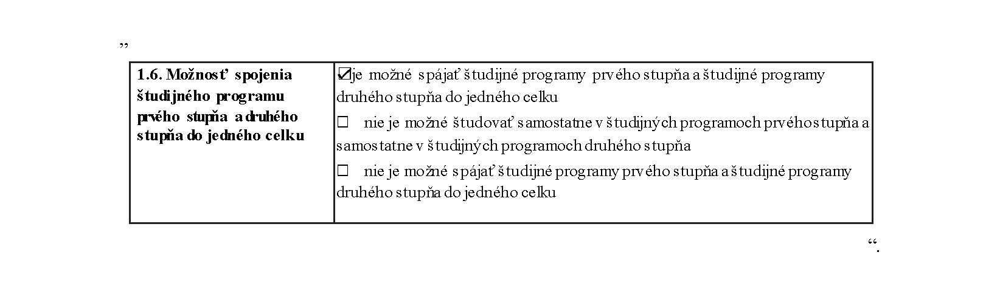

# Čl. I

Vyhláška Ministerstva školstva, vedy, výskumu a športu Slovenskej republiky č. 244/2019 Z. z. o sústave študijných odborov Slovenskej republiky sa mení a dopĺňa takto:

- 1. V § 1 sa na konci pripájajú tieto slová: „č. 1“.

- 2. Doterajší text § 1 sa označuje ako odsek 1 a dopĺňa sa odsekom 2, ktorý znie:

- „(2)

- Študijné odbory podľa odseku 1 sa zaraďujú do skupín študijných odborov, ktoré sú uvedené v prílohe č. 2“.

- 3. Za § 1 sa vkladá § 1a, ktorý vrátane nadpisu znie:

- 㤠1a

- Prechodné ustanovenie k úpravám účinným od 1. februára 2023

- Vysoká škola do 31. augusta 2025 zosúladí obsah uskutočňovaných študijných programov so sústavou študijných odborov účinnou od 1. februára 2023.“.

- 4. V prílohe častiach „Vedomosti Zručnosti Kompetencie“ celom texte okrem opisu študijného odboru Učiteľstvo a pedagogické vedy sa na konci pripája táto veta: „Absolvent má digitálne zručnosti na príslušnej úrovni pre príslušný stupeň štúdia, ktoré dokáže využívať pri výkone povolania.“.

- 5. V prílohe opise študijného odboru Fyzika časť 1.6. znie:

- 

- 6. V prílohe opis študijného odboru Učiteľstvo a pedagogické vedy znie:

- „[príloha](assets/64cb9b47fbbeec2c5527f960b749ad2971a7fdd38d11ca203d6ce4ee1c26bcd7.pdf)“.

- 7. Doterajšia príloha sa označuje ako príloha č. 1 a dopĺňa sa príloha č. 2, ktorá vrátane nadpisu znie:

- „Príloha č. 2 k vyhláške č. 244/2019 Z. z.

- Skupiny študijných odborov a zaradenie študijných odborov do nich

- a)

- Prírodné vedy, matematické vedy, informatické vedy a kybernetické vedy

- 1.

- Biológia

- 2.

- Ekologické a environmentálne vedy

- 3.

- Fyzika

- 4.

- Chémia

- 5.

- Informatika

- 6.

- Kybernetika

- 7.

- Matematika

- 8.

- Vedy o Zemi

- b)

- Technické vedy

- 1.

- Architektúra a urbanizmus

- 2.

- Biotechnológie

- 3.

- Doprava

- 4.

- Drevárstvo

- 5.

- Elektrotechnika

- 6.

- Geodézia a kartografia

- 7.

- Chemické inžinierstvo a technológie

- 8.

- Priestorové plánovanie

- 9.

- Stavebníctvo

- 10.

- Strojárstvo

- 11.

- Získavanie a spracovanie zemských zdrojov

- c)

- Lekárske vedy a zdravotnícke vedy

- 1.

- Farmácia

- 2.

- Ošetrovateľstvo

- 3.

- Pôrodná asistencia

- 4.

- Verejné zdravotníctvo

- 5.

- Všeobecné lekárstvo

- 6.

- Zdravotnícke vedy

- 7.

- Zubné lekárstvo

- d)

- Pôdohospodárske vedy, lesnícke vedy a veterinárske vedy

- 1.

- Lesníctvo

- 2.

- Poľnohospodárstvo a krajinárstvo

- 3.

- Potravinárstvo

- 4.

- Veterinárske lekárstvo

- e)

- Spoločenské vedy

- 1.

- Bezpečnostné vedy

- 2.

- Ekonómia a manažment

- 3.

- Logopédia a liečebná pedagogika

- 4.

- Mediálne a komunikačné štúdiá

- 5.

- Obrana a vojenstvo

- 6.

- Politické vedy

- 7.

- Právo

- 8.

- Psychológia

- 9.

- Sociálna práca

- 10.

- Sociológia a sociálna antropológia

- 11.

- Učiteľstvo a pedagogické vedy

- 12.

- Vedy o športe

- f)

- Humanitné vedy

- 1.

- Filológia

- 2.

- Filozofia

- 3.

- Historické vedy

- 4.

- Teológia

- 5.

- Vedy o umení a kultúre

- g)

- Umelecké vedy a vedy o umení

- 1.

- Umenie“.
