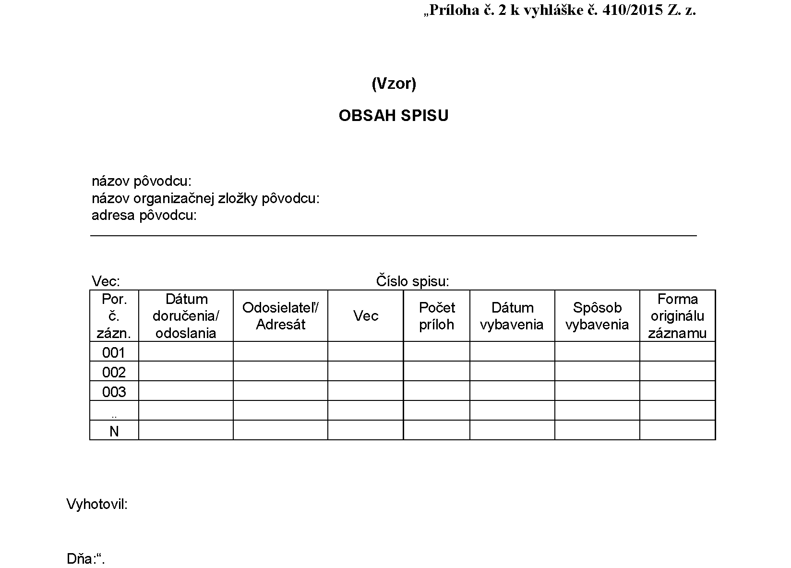
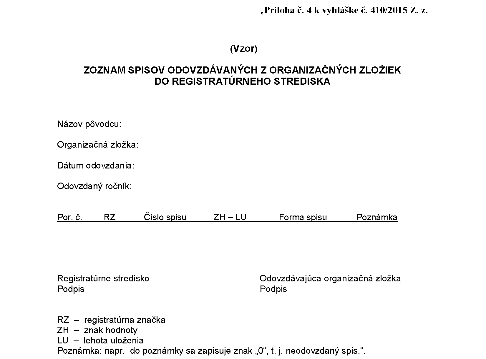
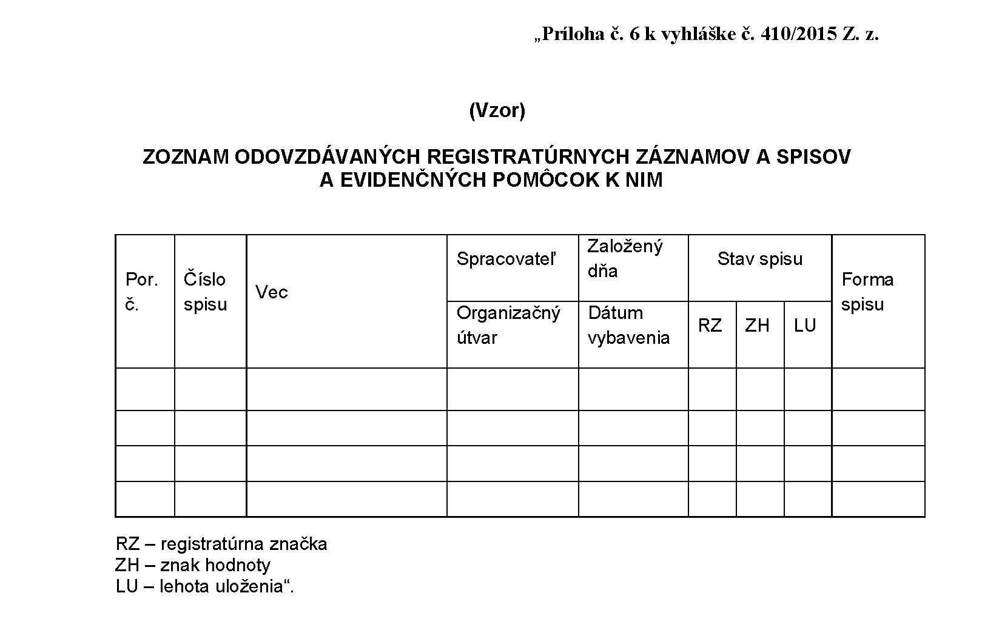

# Čl. I

Vyhláška Ministerstva vnútra Slovenskej republiky č. 410/2015 Z. z. o podrobnostiach výkonu správy registratúry orgánov verejnej moci a o tvorbe spisu v znení vyhlášky č. 49/2019 Z. z. sa mení a dopĺňa takto:

- 1. V úvodnej vete vyhlášky sa za slovo „predpisov“ vkladajú slová „(ďalej len „zákon“)“.

- 2. V § 1 ods. 1 sa na konci pripája táto veta: „Ak nie je zriadená podateľňa, na príjem neelektronických zásielok sa určí pracovisko, ktoré plní povinnosti podateľne alebo zamestnanec, ktorý plní povinnosti podateľne.“.

- 3. V § 1 ods. 2 sa za slovom „zásielok“ vypúšťa čiarka a slová „najmä adresa na prijímanie zásielok, úradné hodiny podateľne, elektronická adresa podateľne a prehľad prijímaných dátových formátov“.

- 4. V § 2 odseky 1 a 2 znejú:

- „(1)

- Elektronická zásielka sa prijíma prostredníctvom elektronickej schránky,2) centrálnej elektronickej podateľne,3) elektronickej pošty alebo elektronických služieb.

- (2)

- Elektronický systém správy registratúry je prepojený s centrálnou elektronickou podateľňou a elektronickou schránkou. Prijatý elektronický záznam sa spravidla ukladá v tvare, v akom bol doručený.“.

  - Poznámky pod čiarou k odkazom 2 a 3 znejú:

    - „2) § 11 až 16 zákona o e-Governmente.

    - 3) § 10 ods. 7 zákona o e-Governmente.“.

  - Poznámka pod čiarou k odkazu 4 sa vypúšťa.

- 5. V § 2 ods. 3 sa na konci pripájajú tieto slová: „a uvedie dátové formáty,4aa) v ktorých elektronické zásielky prijíma“.

  - Poznámka pod čiarou k odkazu 4aa znie:

  - „4aa) § 18 až 20 vyhlášky Úradu podpredsedu vlády Slovenskej republiky pre investície a informatizáciu č. 78/2020 Z. z. o štandardoch pre informačné technológie verejnej správy v znení vyhlášky č. 546/2021 Z. z.“.

- 6. V § 4 sa vypúšťa odsek 4.

- 7. V poznámke pod čiarou k odkazu 7 sa citácia „§ 2 písm. e) vyhlášky č. 135/2009 Z. z.“ nahrádza citáciou „§ 49 ods. 3 vyhlášky č. 78/2020 Z. z.“.

- 8. V § 6 odsek 5 znie:

- „(5)

- Ak sa z prijatého elektronického záznamu vytvorí neelektronická kópia, označí sa v pravom hornom rohu slovom „kópia“, dátumom prijatia a identifikátormi pôvodného prijatého elektronického záznamu z registratúrneho denníka alebo z inej evidencie; neelektronická kópia sa odtlačkom prezentačnej pečiatky neoznačí.“.

- 9. V § 7 ods. 7 sa za slovo „evidenciách“ vkladajú slová „sa považuje za riadne zaevidovaný a“.

- 10. V § 7 ods. 8 sa na konci pripájajú tieto vety: „Registratúrny denník sa uzatvára v posledný kalendárny deň alebo pracovný deň kalendárneho roka. Ak sa v registratúrnom denníku používajú skratky a rozlišovacie znaky, uvedie sa na jeho poslednej zadnej strane ich zoznam s vysvetlivkami; to neplatí pri vedení registratúrneho denníka prostredníctvom elektronického systému správy registratúry.“.

- 11. V § 7 sa vypúšťa odsek 9.

- 12. V § 8 ods. 4 sa na konci pripája táto veta: „Chybný záznam sa v registratúrnom denníku označí ako zrušený a jeho identifikátor sa nepoužije.“.

- 13. Poznámka pod čiarou k odkazu 12 znie:

- „12) Výnos č. 525/2011 Z. z. v znení opatrenia č. 203/2021 Z. z.

- Vyhláška č. 78/2020 Z. z. v znení vyhlášky č. 546/2021 Z. z.“.

- 14. V § 8 ods. 7 sa nad slovo „predpis“ umiestňuje odkaz 12a.

  - Poznámka pod čiarou k odkazu 12a znie:

  - „12a) § 9 a 10 vyhlášky č. 48/2019 Z. z.“.

- 15. § 8 sa dopĺňa odsekom 8, ktorý znie:

- „(8)

- Elektronický systém správy registratúry má spravidla tieto roly:

- a)

- podateľňa,

- b)

- vedúci,

- c)

- asistent,

- d)

- referent,

- e)

- správca adresára,

- f)

- správca príručnej registratúry,

- g)

- správca príručnej registratúry s vyradením,

- h)

- správca registratúry.“.

- 16. V § 9 ods. 6 sa nad slovo „predpisu“ umiestňuje odkaz 10a.

- 17. V § 10 ods. 3 prvá veta znie: „Ak sa obeh registratúrneho záznamu medzi jednotlivými organizačnými zložkami pôvodcu uskutočňuje prostredníctvom elektronického systému správy registratúry, registratúrny záznam sa podpisuje elektronickým podpisom alebo elektronickou parafou, opatruje kvalifikovanou elektronickou pečaťou alebo kvalifikovaným elektronickým podpisom vyhotoveným s použitím mandátneho certifikátu s pripojenou kvalifikovanou elektronickou časovou pečiatkou.“.

- 18. V § 11 odseky 1 a 2 znejú:

- „(1)

- Spis tvorí spisový obal, registratúrne záznamy a obsah spisu. Spis sa vytvára spájaním registratúrnych záznamov, ktoré sa viažu k tej istej veci v elektronickom systéme správy registratúry, v agendovom informačnom systéme, v registratúrnom denníku alebo v osobitnej systematickej evidencii. Spis sa vytvára ako elektronický spis, neelektronický spis alebo kombinovaný spis.

- (2)

- Spisový obal v neelektronickej podobe je neoddeliteľnou súčasťou neelektronického spisu alebo kombinovaného spisu, do ktorého sa zakladajú jednotlivé registratúrne záznamy spolu s prílohami a obsah spisu. Spisový obal obsahuje názov pôvodcu, názov jeho organizačnej zložky, číslo spisu, vec, registratúrnu značku, znak hodnoty a lehotu uloženia, stupeň dôvernosti,12b) dátum uzatvorenia spisu, meno a priezvisko spracovateľa a označenie „Spisový obal“. Spisový obal v neelektronickej podobe sa vytvára, ak sa do spisu zakladá prvý neelektronický registratúrny záznam. V elektronickom systéme správy registratúry sa pre elektronické spisy spisový obal a obsah spisu vyhotovuje a zobrazuje len pri znázornení spisu.“.

  - Poznámka pod čiarou k odkazu 12b znie:

  - „12b) Príloha č. 2 k vyhláške Národného bezpečnostného úradu č. 362/2018 Z. z., ktorou sa ustanovuje obsah bezpečnostných opatrení, obsah a štruktúra bezpečnostnej dokumentácie a rozsah všeobecných bezpečnostných opatrení.“.

- 19. V § 11 ods. 3 písm. b) sa slová „v predpísaných formátoch.“ nahrádzajú slovami „vo formátoch podľa osobitného predpisu.4aa)“.

- 20. V § 11 ods. 5 sa na konci pripája táto veta: „Tieto údaje sa vyznačia bez využitia elektronického systému správy registratúry pri otvorení spisu v registratúrnom denníku.“.

- 21. V § 11 ods. 6 prvej vete sa na konci pripájajú tieto slová: „a formu originálu záznamu“.

- 22. V § 11 odsek 9 znie:

- „(9)

- Číslo spisu obsahuje označenie pôvodcu alebo jeho organizačnej zložky, poradové číslo z elektronického systému správy registratúry, z agendového informačného systému, z registratúrneho denníka alebo z osobitnej systematickej evidencie a rok. Číslo spisu môže obsahovať aj iné znaky charakterizujúce skutočnosti súvisiace so spisom; vtedy sa stáva identifikátorom spisu, ktorý je nemenný až do uzatvorenia spisu. Skladbu čísla spisu upravuje registratúrny poriadok pôvodcu.“.

- 23. V § 11 odsek 12 znie:

- „(12) Ak bude nasledujúci kalendárny rok prijatý alebo vytvorený nový registratúrny záznam patriaci do spisu z predchádzajúceho kalendárneho roka, spis dostáva nové číslo. Nové číslo spisu sa vyznačí na pôvodnom spisovom obale. Pri evidovaní ďalšieho registratúrneho záznamu v novom kalendárnom roku sa v obsahu spisu pokračuje nasledujúcim poradovým číslom. V registratúrnom denníku sa vyznačí aj číslo spisu z predchádzajúceho kalendárneho roka. V registratúrnom denníku z prechádzajúceho kalendárneho roka sa vyznačí nové číslo spisu.“.

- 24. V § 11 sa odsek nasledujúci za odsekom 12 označuje ako odsek 13.

  - Doterajší odsek 13 sa označuje ako odsek 14.

- 25. V § 12 ods. 1 písmeno b) znie:

- „b)

- postúpením,“.

- 26. V § 12 ods. 2 a 4 sa slovo „odstúpi“ nahrádza slovom „postúpi“.

- 27. V § 12 ods. 6 sa nad slovo „predpisu“ umiestňuje odkaz 10b.

- 28. V § 12 ods. 8 sa za slovo „obsahovať“ vkladá slovo „dátum,“.

- 29. V § 12 sa za odsek 8 vkladá nový odsek 9, ktorý znie:

- „(9)

- Ak osobitný predpis16ea) neustanovuje inak, návrh vybavenia sa zaradí do schvaľovacieho procesu. Ak schválenie prebieha prostredníctvom elektronického systému správy registratúry, môže byť jeho súčasťou autorizácia registratúrneho záznamu a kontrola vybavenia podania.“.

  - Poznámka pod čiarou k odkazu 16ea znie:

  - „16ea) Napríklad § 33 katastrálneho zákona.“.

  - Doterajší odsek 9 sa označuje ako odsek 10.

- 30. V § 13 ods. 1 prvej vete sa slovo „a“ nahrádza čiarkou a na konci sa pripájajú tieto slová: „a spravidla prezentačná pečiatka“.

- 31. V § 14 ods. 1 druhá veta znie: „Podpisom sa rozumie vlastnoručný podpis a autorizácia podľa § 23 zákona o e-Governmente.“.

- 32. V § 14 ods. 2 druhej vete sa na konci pripájajú tieto slová: „alebo elektronická parafa“.

- 33. V § 15 ods. 1 druhá veta znie: „Na doručovanie elektronických registratúrnych záznamov pri výkone verejnej moci pôvodcom, ktorým je orgán verejnej moci, sa vzťahuje § 29 zákona o e-Governmente.“.

- 34. V § 15 odsek 2 znie:

- „(2)

- Elektronický registratúrny záznam vyhotovený pôvodcom pri výkone verejnej moci môže byť odosielaný aj v podobe listinného rovnopisu; nezakladá sa do spisu. Podmienkou automatizovaného odosielania listinného rovnopisu je vyhotovenie pôvodného elektronického registratúrneho záznamu v podobe elektronického formulára. Prílohy elektronického registratúrneho záznamu sa vyhotovujú vo formátoch podľa osobitného predpisu.4aa)“.

- 35. V § 15 sa za odsek 2 vkladá nový odsek 3, ktorý znie:

- „(3)

- Ak nejde o doručovanie pri výkone verejnej moci, registratúrny záznam vyhotovený pôvodcom môže byť odosielaný aj v podobe zaručenej konverzie pôvodného dokumentu; nezakladá sa do spisu. Z odoslaného registratúrneho záznamu môže pôvodca vyhotoviť zaručenú konverziu pôvodného dokumentu aj na žiadosť adresáta.“.

  - Doterajšie odseky 3 až 7 sa označujú ako odseky 4 až 8.

- 36. V § 15 odsek 4 znie:

- „(4)

- Ak sa vykonáva správa registratúry prostredníctvom elektronického systému správy registratúry, zabezpečí sa na odosielanie elektronického registratúrneho záznamu jeho prepojenie s centrálnou elektronickou podateľňou a s elektronickou schránkou.“.

- 37. V § 15 ods. 7 sa za slová „občianskym preukazom“ vkladá čiarka a slová „cestovným dokladom“.

- 38. § 16 sa dopĺňa odsekom 3, ktorý znie:

- „(3)

- Pôvodca, ktorého registratúrny plán obsahuje podskupiny vecných skupín, ktoré majú rovnaký znak hodnoty a rovnakú lehotu uloženia, môže po schválení podľa § 24 ods. 3 písm. c) alebo podľa § 24a písm. c) zákona tieto podskupiny zlúčiť alebo zrušiť.“.

- 39. V § 18 odsek 1 znie:

- „(1)

- Elektronický registratúrny záznam a elektronický spis sa ukladá v elektronickom systéme správy registratúry, vo vládnom cloude,16j) v module dlhodobého uchovávania17) alebo v agendovom informačnom systéme až do svojho vyradenia.“.

  - Poznámka pod čiarou k odkazu 16j znie:

  - „16j) § 24a zákona č. 95/2019 Z. z. o informačných technológiách vo verejnej správe a o zmene a doplnení niektorých zákonov v znení zákona č. 325/2022 Z. z.“.

- 40. V § 18 ods. 2 sa slová „§ 23,“ nahrádzajú slovami „osobitného predpisu,4aa)“.

- 41. V § 18 ods. 5 sa za prvú vetu vkladá nová druhá veta, ktorá znie: „Prevedenie elektronického záznamu do neelektronickej podoby sa uskutoční tak, aby sa zabezpečila hodnovernosť novovytvoreného záznamu.17a)“.

  - Poznámka pod čiarou k odkazu 17a znie:

  - „17a) § 7 vyhlášky č. 628/2002 Z. z. v znení neskorších predpisov.“.

- 42. V § 18 ods. 7 písm. a) sa na konci pripájajú tieto slová: „alebo v agendovom informačnom systéme“.

- 43. V § 18 ods. 7 písmeno c) znie:

- „c)

- kombinovaný spis tak, že jeho elektronické registratúrne záznamy sa ukladajú v elektronickej príručnej registratúre a elektronickom registratúrnom stredisku v elektronickom systéme správy registratúry, v module dlhodobého uchovávania elektronických registratúrnych záznamov alebo v agendovom informačnom systéme a jeho neelektronické registratúrne záznamy sa ukladajú v príručnej registratúre a registratúrnom stredisku.“.

- 44. V § 18 ods. 9 sa vypúšťa druhá veta.

- 45. V § 19 ods. 4 sa na konci pripája táto veta: „Uzatvorené spisy z elektronickej príručnej registratúry sa doručia do elektronického registratúrneho strediska v elektronickom systéme správy registratúry.“.

- 46. V § 19 ods. 5 sa za slovo „uloženia,“ vkladajú slová „formu spisu,“.

- 47. V § 20 ods. 3 písm. f) sa nad slovo „spisov“ umiestňuje odkaz 18a.

  - Poznámka pod čiarou k odkazu 18a znie:

  - „18a) § 11 vyhlášky č. 628/2002 Z. z. v znení neskorších predpisov.“.

- 48. V § 20 sa odsek 3 dopĺňa písmenami g) až i), ktoré znejú:

- „g)

- je vecným správcom elektronického systému správy registratúry,

- h)

- zabezpečuje školenia k registratúrnemu poriadku pôvodcu,

- i)

- preveruje plnenie povinností pri správe registratúry u pôvodcu; postup preverovania upravuje interný predpis pôvodcu.“.

- 49. V § 20 sa odsek nasledujúci za odsekom 3 označuje ako odsek 4.

  - Doterajší odsek 4 sa označuje ako odsek 5.

- 50. V § 21 odsek 1 znie:

- „(1)

- Prístup k registratúre sa uskutočňuje nazeraním, vypožičiavaním a vyhotovovaním odpisu, výpisu, potvrdenia, kópie alebo osvedčenej kópie formou zaručenej konverzie. Elektronický registratúrny záznam a elektronický spis sa nevypožičiava, sprístupňuje sa spravidla vyhotovením kópie. Vydávanie elektronického odpisu a výstupu z elektronického systému správy registratúry upravuje osobitný predpis.19a)“.

  - Poznámka pod čiarou k odkazu 19a znie:

  - „19a) § 26 zákona č. 95/2019 Z. z. v znení zákona č. 325/2022 Z.z.“.

- 51. V § 21 ods. 3 sa nad slovom „údajov“ odkaz „19a)“ nahrádza odkazom „19aa)“.

  - Poznámka pod čiarou k odkazu 19aa znie:

  - „19aa) Zákon č. 18/2018 Z. z. o ochrane osobných údajov a o zmene a doplnení niektorých zákonov v znení neskorších predpisov.“.

- 52. V § 22 ods. 4 sa na konci pripájajú tieto slová: „a vzor zoznamu odovzdávaných registratúrnych záznamov a spisov a evidenčných pomôcok k nim je uvedený v prílohe č. 6“.

- 53. V § 22 ods. 5 sa slovo „Spisy“ nahrádza slovami „Neuzatvorené spisy“.

- 54. V § 22 ods. 7 sa za slovo „spisov“ vkladajú slová „vrátane ich trvalých metadát19ab)“.

  - Poznámka pod čiarou k odkazu 19ab znie:

  - „19ab) Príloha č. 5 k výnosu č. 525/2011 Z. z. v znení opatrenia č. 203/2021 Z. z.“.

- 55. V § 23 odsek 2 znie:

- „(2)

- Výstupné formáty elektronického registratúrneho záznamu upravuje osobitný predpis.4aa)“.

  - Poznámka pod čiarou k odkazu 19b sa vypúšťa.

- 56. V § 23 sa vypúšťajú odseky 3 až 5.

  - Poznámka pod čiarou k odkazu 20 sa vypúšťa.

- 57. Za § 23 sa vkladá § 23a, ktorý vrátane nadpisu znie:

- 㤠23a

- Správa registratúry pri výkone práce mimo pracoviska

- (1)

- Jednotný postup pri správe registratúry pri výkone práce mimo pracoviska upravuje registratúrny poriadok pôvodcu alebo iný interný predpis.

- (2)

- Registratúrne záznamy vzniknuté pri výkone práce mimo pracoviska sa uchovávajú v registratúre pôvodcu.“.

- 58. V § 24 ods. 1 sa na konci pripája táto veta: „Číslo spisu evidovaného v náhradnej evidencii sa dopĺňa o skratku „MS“.“.

- 59. Za § 25a sa vkladá § 25b, ktorý vrátane nadpisu znie:

- 㤠25b

- Prechodné ustanovenie k úpravám účinným od 1. septembra 2023

- Registratúrne poriadky uvedú pôvodcovia do súladu s touto vyhláškou do 31. decembra 2023.“.

- 60. Príloha č. 2 znie:

- 

- 61. Príloha č. 4 znie:

- 

- 62. Za prílohu č. 5 sa vkladá príloha č. 6, ktorá znie:

- 
