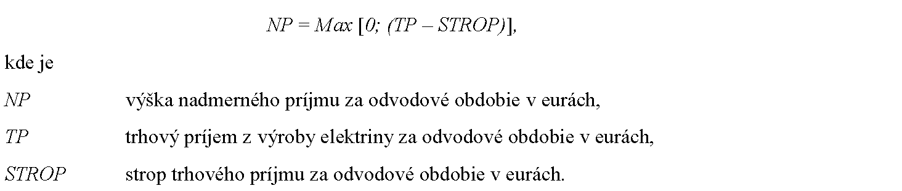
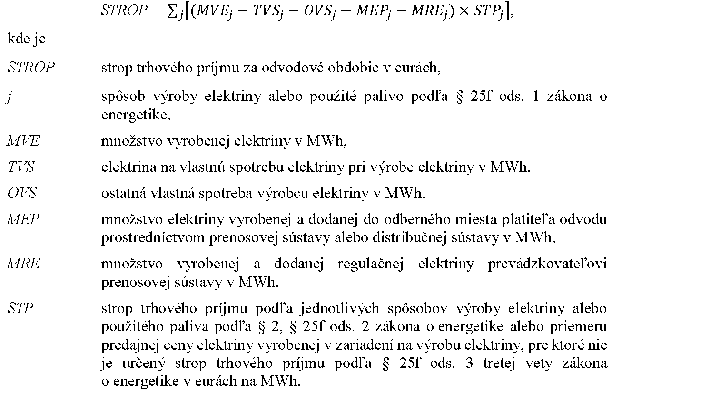

# § 1 Spôsob určenia výšky nadmerného príjmu

(1) Výška nadmerného príjmu sa určí podľa vzorca

(2) Trhový príjem z výroby elektriny za odvodové obdobie sa určí z čistých tržieb z predaja vyrobenej elektriny vrátane vplyvu zaisťovacích obchodov.

(3) Čisté tržby z predaja vyrobenej elektriny vrátane vplyvu zaisťovacích obchodov sa určia ako rozdiel tržieb a nákladov súvisiacich s vysporiadaním obchodov, ktorými sa v odvodovom období realizuje trhový príjem z predaja vyrobenej elektriny alebo zabezpečenie trhových príjmov z predaja výroby elektriny a ktoré pre každú obchodnú hodinu v technických jednotkách zaisťujú rovnosť množstva predanej elektriny a množstva vyrobenej elektriny zníženého o množstvo elektriny na vlastnú spotrebu elektriny pri výrobe elektriny a ostatnú vlastnú spotrebu elektriny výrobcu elektriny, množstvo elektriny vyrobenej a dodanej do odberného miesta alebo odovzdávacieho miesta platiteľa odvodu prostredníctvom prenosovej sústavy alebo distribučnej sústavy a množstvo vyrobenej a dodanej regulačnej elektriny prevádzkovateľovi prenosovej sústavy.

(4) Na účel určenia čistých tržieb z predaja vyrobenej elektriny platiteľ odvodu dokladá všetky údaje o tržbách, nákladoch a technických jednotkách podľa odseku 3 za všetky obchody podľa tohto nariadenia, a to pre každý obchod samostatne. Ak platiteľ odvodu vedie obchodnú evidenciu, v ktorej postupne eviduje v elektronickej podobe údaje podľa prvej vety chránené proti zmenám, použijú sa na určenie čistých tržieb z predaja vyrobenej elektriny údaje z takejto obchodnej evidencie. Ak platiteľ odvodu nevedie takúto obchodnú evidenciu, na určenie čistých tržieb z predaja vyrobenej elektriny sa použijú informácie evidované v účtovníctve platiteľa odvodu. Údaje z obchodnej evidencie alebo údaje z účtovníctva sa použijú ako vstupné údaje pre oznámenie o odvode z nadmerných príjmov.

(5) Obchody podľa odseku 3 zahŕňajú predaje a nákupy elektriny s fyzickou dodávkou elektriny aj bez fyzickej dodávky elektriny.

(6) Tržby súvisiace s vysporiadaním obchodov podľa odseku 3 zahŕňajú najmä výnosy z

- a) predaja vyrobenej elektriny na veľkoobchodnom trhu s elektrinou vrátane iného predaja elektriny a zaisťovacích obchodov bez ohľadu na to, či elektrina bola pri vyrovnaní obchodu skutočne vyrobená,

- b) predaja elektriny dodanej odberateľom elektriny, ktorých miesto odberu nie je priamo pripojené k prenosovej sústave alebo k distribučnej sústave, vrátane dodávok vyrobenej elektriny priamym vedením,

- c) zúčtovania odchýlok z obchodov v súvislosti s výrobou elektriny,

- d) nákupu elektriny na trhu, ak je namiesto dodávky elektriny zo zariadenia na výrobu elektriny predanej na obchodnú hodinu na vysporiadanie obchodu s elektrinou zo zariadenia na výrobu elektriny nakúpená elektrina na trhu.

(7) Náklady súvisiace s vysporiadaním obchodov podľa odseku 3 zahŕňajú náklady

- a) priamo súvisiace s vyrovnaním obchodov na zabezpečenie trhových príjmov z predaja výroby elektriny,

- b) na nákup elektriny na trhu, ak je namiesto dodávky elektriny zo zariadenia na výrobu elektriny predanej na obchodnú hodinu na vysporiadanie obchodu s elektrinou zo zariadenia na výrobu elektriny nakúpená elektrina na trhu,

- c) zo zúčtovania odchýlok z obchodov v súvislosti s výrobou elektriny.

(8) Strop trhového príjmu za odvodové obdobie sa určí podľa vzorca

