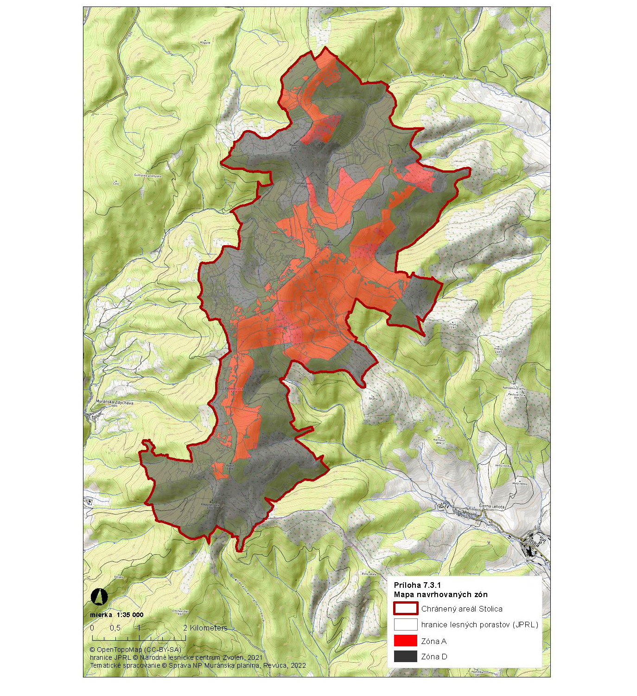

Príloha č. 1 k nariadeniu vlády č. 380/2023 Z. z.

- VYMEDZENIE HRANICE CHRÁNENÉHO AREÁLU Popis hranice chráneného areálu

  - Východiskový bod chráneného areálu Stolica sa nachádza na turistickom smerovníku Priehybka (1225 m n. m.) na hranici medzi katastrálnymi územiami Telgárt a Rejdová. Z tohto bodu pokračuje smerom na východ hranicou lesných dielcov, hospodárskymi kopcami č. 25, 24, 169, 168, kopíruje hranicu lesných dielcov, ktoré sú v obhospodarovaní štátu od súkromných vlastníkov po dielec 577b (pri hospodárskom kopci č. 167), odkiaľ sa stáča na juh. Hranica chráneného areálu Stolica ďalej vedie hospodárskymi kopcami č. 199, 202, lesnými dielcami 538a, 527b, 527a, odkiaľ kopíruje existujúcu lesnú cestu, touto cestou obchádza vrch Nad Chajnálovom (1023 m n. m.), dostáva sa do lokality Mlynná, kde sa pri hospodárskom kopci č. 251 odpája z tejto cesty a pokračuje juhozápadne hranicou lesných dielcov 481, 480, 479, 471. Odtiaľ smeruje na východ, napája sa na lesnú cestu po lesný sklad pri hospodárskom kopci č. 261, pokračuje hranicou lesných dielcov 297a, 297b, 298b, 295b na hranicu medzi katastrálnymi územiami Rejdová a Čierna Lehota. Stáča sa na severozápad hranicou lesných dielcov k hospodárskemu kopcu č. 167, hranicou lesných dielcov hospodárskymi kopcami č. 74, 76, 77, 78, 79, 80, 81, pokračuje na juh hranicou lesných dielcov 377a a 376, smeruje na východ lesnou cestou k lesnému skladu, odtiaľ cestou k hospodárskemu kopcu č. 97, kopíruje hranicu lesných dielcov 401a, 770, 771, napája sa na lesnú cestu k lesnému skladu. Stáča sa na severozápad, kopíruje lesnú cestu až po hranicu lesného dielca 631, kopíruje jeho východnú hranicu po lesný sklad v lokalite Marinčiakove skalice, kde je zároveň pomník Slovenského národného povstania odtiaľ pokračuje na juh modrou značenou turistickou trasou po lesný sklad v lokalite Haneskovo.

  - Od hospodárskeho kopca č. 143 pokračuje na juh, hranicou lesného dielca 472, odtiaľ sa napája na lesnú cestu smerom na východ, stáča sa na juh hranicou lesného dielca 470, napája sa na lesnú cestu až po hranicu lesného dielca 486 pri hospodárskom kopci č. 159. Pokračuje hranicou lesných dielcov hospodárskymi kopcami č. 167, 167/1, 161 Lazarkovou dolinou až po lesný sklad, odtiaľ na západ po hranici lesných dielcov 492, 498b, 498a na hranicu katastrálnych území Čierna Lehota a Chyžné. Obchádza vrch Dlhý diel (1122 m n. m.) po jeho pravej strane, napája sa na lesnú cestu, pokračuje hranicou lesných dielcov 465, 461 po smerovník Dlhý diel, poľovnícka chata. Od tohto miesta pokračuje na západ po západnej hranici lesného dielca 461, ďalej hranicou lesného dielca 462, hospodárskymi kopcami č. 48, 47, stáča sa na juh na hranicu medzi katastrálnymi územiami Chyžné a Mokrá Lúka a kopíruje ju po lesný sklad v lokalite Homoľa. Pokračuje smerom na východ lesnou cestou, z ktorej odbáča pri severnom cípe lesného dielca 79b a pokračuje po hranici lesných dielcov 92, 91, 90a, 89, 97, 108 a 106 na hranicu medzi katastrálnymi územiami Muránska Zdychava a Revúčka. Kopíruje hranicu lesného dielca 116, smeruje po severnej hranici lesného dielca 109, z ktorej sa napája na lesnú cestu, ktorá je zároveň žlto značenou turistickou trasou, pokračuje ňou na sever, túto turistickú trasu kopíruje až po hranicu lesného dielca 146, odtiaľ pokračuje k Falťanovmu sedlu hospodárskymi kopcami č. 33/2, 34 a 35. Následne kopíruje hranicu lesného dielca 180a, napája sa na lesnú cestu, pokračuje ňou na sever až po južný cíp lesného dielca 214, pokračuje jeho západnou hranicou až po lesnú cestu, ktorú kopíruje, odpája sa z nej pri lesnom dielci 218, pokračuje severnou hranicou tohto dielca, následne hranicou lesných dielcov 230 a 240 po hospodársky kopec č. 49. Odtiaľ pokračuje na sever západnou hranicou lesného dielca 248b, napája sa na lesnú cestu, ktorou smeruje na západ a napojí sa na červeno značenú turistickú trasu Rudná magistrála, obchádza chatu Janka z jej severnej strany, kopíruje západnú hranicu lesného dielca 254 a 252b po hospodársky kopec č. 10 na hranicu medzi katastrálnymi územiami Muránska Zdychava a Telgárt. Následne ide hranica chráneného areálu Stolica hospodárskymi kopcami č. 11 a 3/171, ktorým sa dostáva na lesnú cestu, táto lesná cesta je zároveň žlto značenou turistickou trasou a pokračuje ňou až do východiskového bodu.

  - Popis hraníc zón chráneného areálu

    - Zóna A

    - Hranica zóny A chráneného areálu Stolica sa začína vo východiskovom bode, ktorý sa nachádza na turistickom smerovníku Priehybka (1225 m n. m.) na hranici medzi katastrálnymi územiami Telgárt a Rejdová. Z tohto bodu pokračuje smerom na východ hranicou lesných dielcov, hospodárskymi kopcami č. 25, 24, 169, pokračuje na juh k lesnému skladu, odtiaľ smerom na západ kopírovaním lesnej cesty, stáča sa na sever k hospodárskemu kopcu č. 173, po vrstevnici sa dostáva k hospodárskemu kopcu č. 179. Od tohto bodu smeruje na východ hranicou medzi lesnými dielcami na lesnú cestu, ktorú kopíruje po hranicu lesného dielca 565, odtiaľ na severozápad sa dostáva k hospodárskemu kopcu č. 181, pokračuje k hospodárskemu kopcu č. 182 až na hranicu medzi katastrálnymi územiami Telgárt a Rejdová. Túto hranicu medzi katastrálnymi územiami kopíruje až po lesný dielec jednotky priestorového rozdelenia lesa č. 19 v lesnom celku Lesy Telgárt, ktorý so svojimi čiastkovými plochami zasahuje do A zóny, odtiaľ pokračuje hospodárskym kopcom č. 116, obchádza ostatný lesný pozemok z juhovýchodnej strany a vracia sa do východiskového bodu.

    - Ďalšia samostatná časť zóny A chráneného areálu Stolica sa začína z východiskového bodu hospodársky kopec č. 346 medzi katastrálnymi územiami Rejdová a Čierna Lehota, odtiaľ smeruje na juh hranicou lesného dielca k hospodárskym kopcom č. 79, 80, 81, pokračuje na juh hranicou lesných dielcov 377a a 376, hospodárskymi kopcami č. 95, 94, 93, 202, 199, 109, a juhozápadnou hranicou lesného dielca 630. Pokračuje k hospodárskym kopcom č. 194, 193, 132, ďalej pokračuje východnou hranicou lesného dielca 633b k lesnému skladu, odkiaľ kopíruje lesnú cestu po hospodársky kopec č. 133 a obchádza Faltenov vrch z jeho východnej strany. Kopíruje severnú hranicu lesného dielca 640b k hospodárskemu kopcu č. 202, ďalej pokračuje k hospodárskym kopcom č. 145 a č. 148 a južnou hranicou lesných dielcov 474 a 476 k vrchu Kohút (1409 m n. m.) na hranicu medzi katastrálnymi územiami Revúčka a Čierna Lehota. Touto hranicou medzi katastrálnymi územiami pokračuje smerom na sever a nadväzuje na hranicu medzi katastrálnymi územiami Muránska Zdychava a Čierna Lehota, ktorú kopíruje až po vrch Stolica (1476 m n. m.). Pokračuje na severozápad v lokalite Močidlá na hranici medzi katastrálnymi územiami Rejdová a Muránska Zdychava hospodárskymi kopcami č. 137, 135, 134, 184, 185, 186, 187, 209, odtiaľ smerom na severovýchod k chate Slanská k hospodárskemu kopcu č. 27, pokračuje k hospodárskym kopcom č. 28, 211 a 26. Z tohto bodu obchádza po celom svojom obvode trvalý trávny porast (parcela KN C 1344/1, katastrálne územie Rejdová) a vracia sa k hospodárskemu kopcu č. 26. Z hospodárskeho kopca č. 26 sú do zóny A zahrnuté aj časti lesných dielcov v obhospodarovaní Poľnohospodárskeho družstva Rejdová, kde sú ešte zvyšky porastov (jednotky priestorového rozdelenia lesa 175, 176 v lesnom celku Nižná Slaná a Dobšiná), následne pokračuje hranicou lesného dielca 507b a 483_1, napája sa na poľovnícky chodník porastami č. 176,175, dostáva sa na lesnú cestu, ktorú kopíruje smerom na juh po lesný sklad pri hospodárskom kopci č. 261. Z tohto bodu pokračuje na juh k hospodárskemu kopcu č. 260, obchádza lesný dielec 325 a vracia sa do východiskového bodu.

    - Do zóny A chráneného areálu Stolica sú zaradené aj zvyšky vekovo starších porastov v obhospodarovaní LESOV Slovenskej republiky š.p. (konkrétne ide o tieto jednotky priestorového rozdelenia lesa v lesnom celku Lesy Revúca I. – 111_1, 112_1, 129_1, 130_1, 147_1, 160_1, 207_1, 208_1, 225_1, 226a1, 229a1, 233_1, 234_1, 235a1, 235b1 a 236b1).

    - Zóna D

    - Hranica zóny D chráneného areálu sa začína vo východiskovom bode v lokalite Balková pri hospodárskom kopci č. 169. Pokračuje hospodárskym kopcom č. 168, kopíruje hranicu lesných dielcov, ktoré sú v obhospodarovaní štátu od súkromných vlastníkov po dielec 577b

    - (pri hospodárskom kopci č. 167), odkiaľ sa stáča na juh. Hranica chráneného areálu Stolica ďalej vedie hospodárskymi kopcami č. 199, 202, lesnými dielcami 538a, 527b, 527a, odkiaľ kopíruje existujúcu lesnú cestu, touto cestou obchádza vrch Nad Chajnálovom (1023 m n. m.), dostáva sa do lokality Mlynná, kde pri hospodárskom kopci č. 251 sa odpája z tejto cesty a pokračuje juhozápadne hranicou lesných dielcov 481, 480, 479, 471. Odtiaľ smeruje na východ, napája sa na lesnú cestu po lesný sklad pri hospodárskom kopci č. 261, pokračuje hranicou lesných dielcov 297a, 297b, 298b, 295b na hranicu medzi katastrálnymi územiami Rejdová a Čierna Lehota. Stáča sa na severozápad k hospodárskemu kopcu č. 167, hranicou lesných dielcov hospodárskymi kopcami č. 74, 76, 77, 78, 79, obchádza zónu A chráneného areálu Stolica po lesný sklad v lokalite Rovienky a smeruje cestou k hospodárskemu kopcu č. 97, kopíruje hranicu lesných dielcov 401a, 770, 771, napája sa na lesnú cestu k lesnému skladu. Stáča sa na severozápad, kopíruje lesnú cestu až po hranicu lesného dielca 631, kopíruje jeho východnú hranicu po lesný sklad v lokalite Marinčiakove skalice, kde je zároveň pomník Slovenského národného povstania, odtiaľ pokračuje na juh modrou značenou turistickou trasou po lesný sklad v lokalite Haneskovo. Od hospodárskeho kopca č. 143 pokračuje na juh hranicou lesného dielca 472, odtiaľ sa napája na lesnú cestu smerom na východ, stáča sa na juh hranicou lesného dielca 470, napája sa na lesnú cestu až po hranicu lesného dielca 486 pri hospodárskom kopci č. 159. Pokračuje hranicou lesných dielcov hospodárskymi kopcami č. 167, 167/1, 161 Lazarkovou dolinou až po lesný sklad, odtiaľ na západ po hranici lesných dielcov 492, 498b, 498a na hranicu katastrálnych území Čierna Lehota a Chyžné. Obchádza vrch Dlhý diel (1122 m n. m.) po jeho pravej strane, napája sa na lesnú cestu, pokračuje hranicou lesných dielcov 465, 461 po smerovník Dlhý diel, poľovnícka chata. Od tohto miesta pokračuje na západ po západnej hranici lesného dielca 461, ďalej hranicou lesného dielca 462, hospodárskymi kopcami č. 48, 47, stáča sa na juh na hranicu medzi katastrálnymi územiami Chyžné a Mokrá Lúka a kopíruje ju po lesný sklad v lokalite Homoľa. Pokračuje smerom na východ lesnou cestou, z ktorej odbáča pri severnom cípe lesného dielca 79b a pokračuje po hranici lesných dielcov 92, 91, 90a, 89, 97, 108 a 106 na hranicu medzi katastrálnymi územiami Muránska Zdychava a Revúčka. Kopíruje hranicu lesného dielca 116, smeruje po severnej hranici lesného dielca 109, z ktorej sa napája na lesnú cestu, ktorá je zároveň žlto značenou turistickou trasou, pokračuje ňou na sever, túto turistickú trasu kopíruje až po hranicu lesného dielca 146, odtiaľ pokračuje k Falťanovmu sedlu hospodárskymi kopcami č. 33/2, 34 a 35. Následne kopíruje hranicu lesného dielca 180a, napája sa na lesnú cestu, pokračuje ňou na sever až po južný cíp lesného dielca 214, pokračuje jeho západnou hranicou až po lesnú cestu, ktorú kopíruje, odpája sa z nej pri lesnom dielci 218, pokračuje severnou hranicou tohto dielca, následne hranicou lesných dielcov 230 a 240 po hospodársky kopec č. 49. Odtiaľ pokračuje na sever západnou hranicou lesného dielca 248b, napája sa na lesnú cestu, ktorou smeruje na západ a napojí sa na červeno značenú turistickú trasu Rudná magistrála, obchádza chatu Janka z jej severnej strany, kopíruje západnú hranicu lesného dielca 254 a 252b po hospodársky kopec č. 10 na hranicu medzi katastrálnymi územiami Muránska Zdychava a Telgárt. Následne ide hranica chráneného areálu Stolica hospodárskymi kopcami č. 11 a 3/171, ktorými sa dostáva na lesnú cestu, lesná cesta je zároveň žlto značenou turistickou trasou a pokračuje ňou až do lokality Štráfy, kde pri lesnom dielci 19a1 sa stáča na východ k hospodárskemu kopcu č. 118, obchádza zónu A a vracia sa do východiskového bodu.

  - Zoznam parciel chráneného areálu

    - Zóna A

    - Okres Brezno

    - Katastrálne územie Telgárt

    - 4110/1-časť, 4111-časť, 4112-časť, 4137/2-časť

    - Okres Revúca

    - Katastrálne územie Muránska Zdychava

    - 980/1-časť, 980/17-časť, 989-časť, 990-časť, 991-časť

    - Katastrálne územie Revúčka

    - 1798-časť, 1800/1-časť

    - Okres Rožňava

    - Katastrálne územie Čierna Lehota

    - 5826/1-časť, 5826/8-časť, 5826/9, 5826/10-časť, 5826/11-časť, 5826/12-časť, 5826/13, 5829-časť, 6036-časť, 6042, 6091, 6139/1-časť, 6156, 6204-časť, 6206, 6232/1-časť, 6232/2-časť, 6232/3-časť, 6232/4, 6232/6-časť, 6297, 6302/1, 6302/2, 6308-časť, 6309-časť, 6311-časť, 6314-časť, 6315, 6317-časť, 6318-časť, 6322-časť, 6323-časť, 6326/1-časť, 6326/2-časť, 6326/3, 6347-časť, 6357/1-časť, 6365-časť, 6366-časť, 6367/1-časť, 6447-časť, 6448-časť, 6467-časť, 6468-časť, 6469-časť, 6470-časť, 6471-časť, 6496/1-časť, 6503, 6504-časť, 6505-časť, 6506, 6507/7-časť, 6508/1-časť, 6516-časť

    - Katastrálne územie Rejdová

    - 1332/1-časť, 1332/3-časť, 1332/4-časť, 1340/1-časť, 1340/2-časť, 1341-časť, 1342/4-časť, 1344/1-časť, 1344/2-časť, 1344/3-časť, 1345, 1346-časť, 1347/1-časť, 1347/2-časť, 1348-časť, 1350/1-časť, 1356-časť, 1420-časť, 1424-časť, 1427-časť, 1428-časť, 1429-časť, 1433-časť, 1434-časť, 1435-časť, 1440/1, 1440/2-časť, 1440/5-časť, 1441-časť, 1540/1, 1540/3, 1540/4

    - Zóna D

    - Okres Brezno

    - Katastrálne územie Telgárt

    - 4109, 4110/1-časť, 4111-časť, 4112-časť, 4137/2-časť

    - Okres Revúca

    - Katastrálne územie Muránska Zdychava

    - 381, 980/1-časť, 980/10, 980/12, 980/17-časť, 987, 988, 989-časť, 990-časť, 991-časť

    - Katastrálne územie Revúčka

    - 1796, 1798-časť, 1800/1-časť, 1800/8

    - Katastrálne územie Chyžné

    - 501, 502, 503, 505/1, 506/1, 506/5, 507, 511, 512, 513

    - Katastrálne územie Mokrá Lúka

    - 696/1

    - Okres Rožňava

    - Katastrálne územie Čierna Lehota

    - 5819/2, 5825, 5826/1-časť, 5826/2, 5826/3, 5826/4, 5826/5, 5826/6, 5826/7, 5826/8-časť, 5826/10-časť, 5826/11-časť, 5826/12-časť, 5826/18, 5828-časť, 5829-časť, 6029, 6036-časť, 6089, 6139/1-časť, 6139/2, 6186, 6204-časť, 6232/1-časť, 6232/2-časť, 6232/3-časť, 6232/5, 6232/6-časť, 6308-časť, 6309-časť, 6311-časť, 6314-časť, 6315, 6317-časť, 6318-časť, 6320, 6321, 6322-časť, 6323-časť, 6324, 6325, 6326/1-časť, 6326/2-časť, 6327/1, 6327/4, 6327/5, 6327/6, 6327/7, 6340/1, 6342, 6345, 6346, 6347-časť, 6348/1, 6349, 6350, 6353, 6355/1, 6357/1-časť, 6357/2, 6357/3, 6358, 6360, 6361, 6362, 6363, 6365-časť, 6366-časť, 6370, 6371/1-časť, 6377/2, 6447-časť, 6448-časť, 6467-časť, 6468-časť, 6469-časť, 6470-časť, 6471-časť, 6491/2, 6496/1-časť, 6502, 6504-časť, 6505-časť, 6507/7-časť, 6508/1-časť, 6516-časť, 6520

    - Katastrálne územie Rejdová

    - 1332/1-časť, 1332/3-časť, 1332/4-časť, 1334, 1340/1-časť, 1340/2-časť, 1341-časť, 1342/4-časť, 1343/1, 1343/2, 1343/3, 1344/1-časť, 1344/2-časť, 1344/3-časť, 1344/4, 1346-časť, 1347/1-časť, 1347/2-časť,1347/3, 1348-časť, 1350/1-časť, 1350/2, 1350/3, 1351, 1352, 1353/1, 1353/2, 1353/3, 1354, 1356-časť, 1357, 1413/3, 1413/4, 1414/4, 1415/3, 1420-časť, 1421, 1422, 1423, 1424-časť, 1425, 1426, 1427-časť, 1428-časť, 1429-časť, 1430, 1431, 1432, 1433-časť, 1434-časť, 1435-časť, 1436, 1437, 1438, 1439/1, 1439/2, 1440/2-časť, 1440/5-časť, 1440/6, 1440/7, 1440/8, 1440/9, 1441-časť, 1540/2, 1541/3, 1542/1, 1542/2, 1543/1, 1543/2, 1543/3, 1544, 1545, 1546/3, 1546/4, 1546/5

  - Mapa hranice chráneného areálu a jeho zón

    - 

      - Technickým podkladom na zápis priebehu hranice chráneného areálu do katastra nehnuteľností je zjednodušený operát geometrického plánu.

      - Mapu chráneného areálu je možné nájsť v Komplexnom informačnom a monitorovacom systéme na webovom sídle:

      - http://www.biomonitoring.sk/InternalGeoportal/ProtectedSites/NationalSiteMap?ID=667451&CATEGORY=5

      - http://maps.sopsr.sk/mapy/npmuranskaplanina.php
