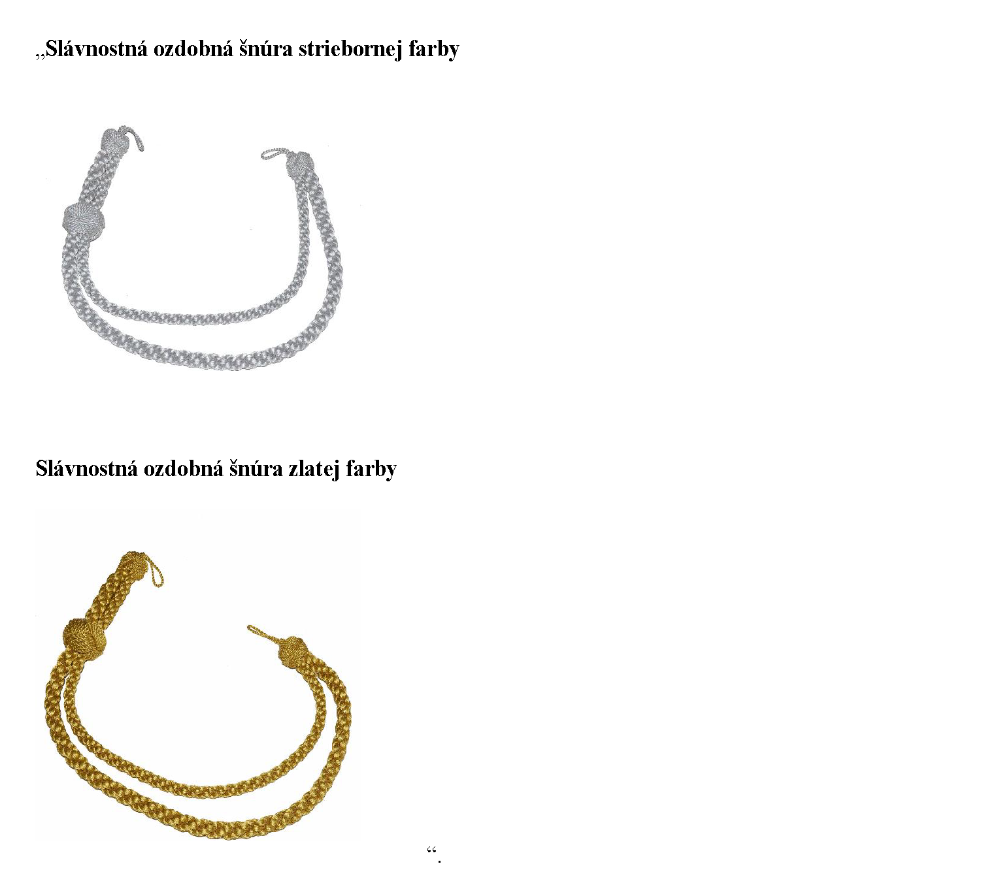

# Čl. I

Vyhláška Ministerstva financií Slovenskej republiky č. 168/2019 Z. z., ktorou sa vykonávajú niektoré ustanovenia zákona č. 35/2019 Z. z. o finančnej správe a o zmene a doplnení niektorých zákonov sa mení a dopĺňa takto:

- 1. V § 5 ods. 1 písm. b), ods. 3 písm. b), ods. 5 písm. b), ods. 7 písm. b), ods. 9 písm. b) a ods. 11 písm. b) sa slovo „svetlozelenej“ nahrádza slovom „olivovozelenej“.

- 2. V § 5 ods. 2, 6, 8 a 12 sa vypúšťajú slová „alebo bunda na prechodné obdobie olivovozelenej farby“.

- 3. V § 5 ods. 5 písm. a) sa za slová „svetlozelenej farby“ vkladajú slová „alebo nohavice vychádzkové zimné svetlozelenej farby“.

- 4. V § 5 ods. 5 písm. b), ods. 11 písm. b) a ods. 14 sa za slová „čiapka so šiltom olivovozelenej farby“ vkladajú slová „alebo čiapka zimná olivovozelenej farby“.

- 5. V § 5 ods. 7 písm. a), ods. 8, ods. 11 písm. a) a ods. 12 sa za slová „sako olivovozelenej farby“ vkladajú slová „alebo rovnošatová vesta olivovozelenej farby“.

- 6. V § 5 ods. 11 písm. a) sa vypúšťajú slová „alebo bunda nepremokavá zimná olivovozelenej farby“.

- 7. V § 5 odsek 13 znie:

- „(13)

- Pri výkone štátnej služby možno namiesto

- a)

- bundy na prechodné obdobie olivovozelenej farby nosiť bundu na prechodné obdobie reflexnej žltej farby,

- b)

- bundy nepremokavej zimnej olivovozelenej farby nosiť bundu nepremokavú zimnú reflexnej žltej farby.“.

- 8. V § 5 sa za odsek 16 vkladá nový odsek 17, ktorý znie:

- „(17)

- Pri slávnostných príležitostiach môže byť súčasťou služobnej rovnošaty aj slávnostná ozdobná šnúra.“.

  - Doterajšie odseky 17 až 23 sa označujú ako odseky 18 až 24.

- 9. V § 5 ods. 19 sa slová „odseku 19“ nahrádzajú slovami „odseku 20“.

- 10. V § 5 ods. 22 druhej vete sa za slovo „štyroch“ vkladajú slová „alebo piatich“.

- 11. V § 5 ods. 24 sa slovo „a“ nahrádza čiarkou a za slovo „absolventa“ sa vkladajú slová „a grafické zobrazenie slávnostnej ozdobnej šnúry“.

- 12. V § 6 ods. 2 sa za slovo „pulóvra,“ vkladá slovo „polokošele,“.

- 13. V § 6 sa odsek 4 dopĺňa písmenom d), ktoré znie:

- „d)

- čiapke zimnej.“.

- 14. § 6 sa dopĺňa odsekmi 24 až 26, ktoré znejú:

- „(24)

- Háčik slávnostnej ozdobnej šnúry, ktorý je bližšie k ozdobnému uzlu, sa pripne na náplecník na pravej strane saka a druhý háčik slávnostnej ozdobnej šnúry sa pripne na prvý gombík saka.

- (25)

- Slávnostná ozdobná šnúra striebornej farby môže byť súčasťou služobnej rovnošaty

- a)

- strážmajstra, nadstrážmajstra, podpráporčíka, práporčíka a nadpráporčíka,

- b)

- neozbrojeného príslušníka finančnej správy, ktorý nemá vysokoškolské vzdelanie.

- (26)

- Slávnostná ozdobná šnúra zlatej farby môže byť súčasťou služobnej rovnošaty

- a)

- podporučíka, poručíka, nadporučíka, kapitána, majora, podplukovníka, plukovníka a generála,

- b)

- neozbrojeného príslušníka finančnej správy, ktorý má vysokoškolské vzdelanie.“.

- 15. Prílohy č. 4 až 7 vrátane nadpisov znejú:

- „Príloha č. 4

- k vyhláške č. 168/2019 Z. z.

- ZOZNAM SÚČASTÍ A DOPLNKOV SLUŽOBNEJ ROVNOŠATY OZBROJENÉHO

- PRÍSLUŠNÍKA FINANČNEJ SPRÁVY

- 1.

- Sako

- 2.

- Nohavice vychádzkové

- 3.

- Nohavice vychádzkové zimné

- 4.

- Nohavice

- 5.

- Nohavice zimné

- 6.

- Bunda na prechodné obdobie

- 7.

- Bunda zimná

- 8.

- Bunda nepremokavá zimná

- 9.

- Pulóver

- 10.

- Košeľa s krátkymi rukávmi svetlobéžovej farby

- 11.

- Košeľa s krátkymi rukávmi bielej farby

- 12.

- Košeľa s dlhými rukávmi svetlobéžovej farby

- 13.

- Košeľa s dlhými rukávmi bielej farby

- 14.

- Náplecníky na sako

- 15.

- Náplecníky na košeľu s krátkymi rukávmi svetlobéžovej farby

- 16.

- Náplecníky na košeľu s krátkymi rukávmi bielej farby

- 17.

- Hodnostné označenie na sako

- 18.

- Hodnostné označenie na pulóver

- 19.

- Hodnostné označenie na košeľu s krátkymi rukávmi svetlobéžovej farby

- 20.

- Hodnostné označenie na košeľu s krátkymi rukávmi bielej farby

- 21.

- Hodnostné označenie na bundu na prechodné obdobie

- 22.

- Hodnostné označenie na bundu zimnú

- 23.

- Hodnostné označenie na bundu nepremokavú zimnú

- 24.

- Hodnostné označenie na tričko s krátkymi rukávmi

- 25.

- Hodnostné označenie na polokošeľu

- 26.

- Hodnostné označenie na bundu vzor 2007

- 27.

- Ponožky

- 28.

- Ponožky zimné

- 29.

- Čiapka

- 30.

- Čiapka so šiltom

- 31.

- Čiapka zimná

- 32.

- Šál

- 33.

- Rukavice kožené čiernej farby

- 34.

- Viazanka

- 35.

- Poltopánky čiernej farby

- 36.

- Topánky nízke čiernej farby

- 37.

- Topánky vysoké čiernej farby

- 38.

- Nohavice vzor 2007

- 39.

- Bunda vzor 2007

- 40.

- Tričko s krátkymi rukávmi

- 41.

- Polokošeľa

- 42.

- Opasok kožený čiernej farby

- 43.

- Slávnostná ozdobná šnúra zlatej alebo striebornej farby

- Príloha č. 5

- k vyhláške č. 168/2019 Z. z.

- ZOZNAM SÚČASTÍ A DOPLNKOV SLUŽOBNEJ ROVNOŠATY OZBROJENEJ

- PRÍSLUŠNÍČKY FINANČNEJ SPRÁVY

- 1.

- Sako

- 2.

- Sukňa alebo nohavice vychádzkové

- 3.

- Nohavice

- 4.

- Nohavice zimné

- 5.

- Bunda na prechodné obdobie

- 6.

- Bunda zimná

- 7.

- Bunda nepremokavá zimná

- 8.

- Pulóver

- 9.

- Košeľa s krátkymi rukávmi svetlobéžovej farby

- 10.

- Košeľa s krátkymi rukávmi bielej farby

- 11.

- Košeľa s dlhými rukávmi svetlobéžovej farby

- 12.

- Košeľa s dlhými rukávmi bielej farby

- 13.

- Rovnošatová vesta

- 14.

- Náplecníky na sako

- 15.

- Náplecníky na košeľu s krátkymi rukávmi svetlobéžovej farby

- 16.

- Náplecníky na košeľu s krátkymi rukávmi bielej farby

- 17.

- Náplecníky na rovnošatovú vestu

- 18.

- Hodnostné označenie na sako

- 19.

- Hodnostné označenie na pulóver

- 20.

- Hodnostné označenie na košeľu s krátkymi rukávmi svetlobéžovej farby

- 21.

- Hodnostné označenie na košeľu s krátkymi rukávmi bielej farby

- 22.

- Hodnostné označenie na rovnošatovú vestu

- 23.

- Hodnostné označenie na bundu na prechodné obdobie

- 24.

- Hodnostné označenie na bundu zimnú

- 25.

- Hodnostné označenie na bundu nepremokavú zimnú

- 26.

- Hodnostné označenie na tričko s krátkymi rukávmi

- 27.

- Hodnostné označenie na polokošeľu

- 28.

- Hodnostné označenie na bundu vzor 2007

- 29.

- Ponožky

- 30.

- Ponožky zimné

- 31.

- Klobúčik

- 32.

- Čiapka so šiltom

- 33.

- Čiapka zimná

- 34.

- Šál

- 35.

- Rukavice kožené čiernej farby

- 36.

- Viazanka

- 37.

- Topánky čiernej farby

- 38.

- Topánky nízke čiernej farby

- 39.

- Topánky vysoké čiernej farby

- 40.

- Nohavice vzor 2007

- 41.

- Bunda vzor 2007

- 42.

- Tričko s krátkymi rukávmi

- 43.

- Polokošeľa

- 44.

- Opasok kožený čiernej farby

- 45.

- Slávnostná ozdobná šnúra zlatej alebo striebornej farby

- Príloha č. 6

- k vyhláške č. 168/2019 Z. z.

- ZOZNAM SÚČASTÍ A DOPLNKOV SLUŽOBNEJ ROVNOŠATY NEOZBROJENÉHO

- PRÍSLUŠNÍKA FINANČNEJ SPRÁVY

- 1.

- Sako

- 2.

- Nohavice vychádzkové

- 3.

- Bunda zimná

- 4.

- Pulóver

- 5.

- Košeľa s krátkymi rukávmi svetlobéžovej farby

- 6.

- Košeľa s krátkymi rukávmi bielej farby

- 7.

- Košeľa s dlhými rukávmi svetlobéžovej farby

- 8.

- Košeľa s dlhými rukávmi bielej farby

- 9.

- Ponožky

- 10.

- Ponožky zimné

- 11.

- Čiapka

- 12.

- Šál

- 13.

- Rukavice kožené čiernej farby

- 14.

- Viazanka

- 15.

- Poltopánky čiernej farby

- 16.

- Topánky zimné čiernej farby

- 17.

- Opasok kožený čiernej farby

- 18.

- Slávnostná ozdobná šnúra zlatej alebo striebornej farby

- Príloha č. 7

- k vyhláške č. 168/2019 Z. z.

- ZOZNAM SÚČASTÍ A DOPLNKOV SLUŽOBNEJ ROVNOŠATY NEOZBROJENEJ

- PRÍSLUŠNÍČKY FINANČNEJ SPRÁVY

- 1.

- Sako

- 2.

- Sukňa alebo nohavice vychádzkové

- 3.

- Bunda zimná

- 4.

- Pulóver

- 5.

- Košeľa s krátkymi rukávmi svetlobéžovej farby

- 6.

- Košeľa s krátkymi rukávmi bielej farby

- 7.

- Košeľa s dlhými rukávmi svetlobéžovej farby

- 8.

- Košeľa s dlhými rukávmi bielej farby

- 9.

- Rovnošatová vesta

- 10.

- Ponožky

- 11.

- Ponožky zimné

- 12.

- Klobúčik

- 13.

- Šál

- 14.

- Rukavice kožené čiernej farby

- 15.

- Viazanka

- 16.

- Topánky čiernej farby

- 17.

- Topánky zimné čiernej farby

- 18.

- Opasok kožený čiernej farby

- 19.

- Slávnostná ozdobná šnúra zlatej alebo striebornej farby“.

- 16. V prílohe č. 8 nadpis znie: „OZNAČENIA PRÍSLUŠNÍKOV FINANČNEJ SPRÁVY“.

- 17. Príloha č. 8 sa dopĺňa zobrazením slávnostnej ozdobnej šnúry, ktoré vrátane názvu znie:

- 
