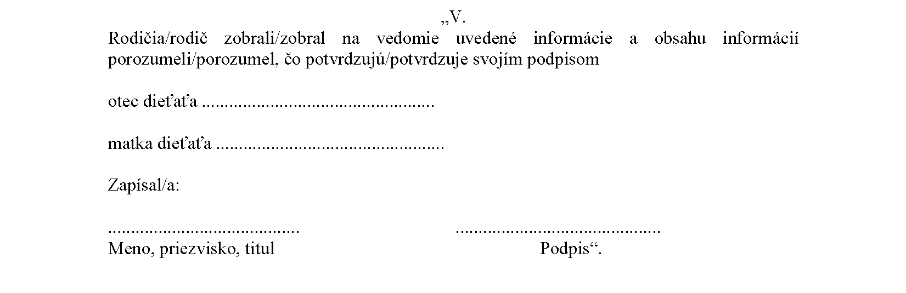

# Čl. I

Vyhláška Ministerstva práce, sociálnych vecí a rodiny Slovenskej republiky č. 103/2018 Z. z., ktorou sa vykonávajú niektoré ustanovenia zákona č. 305/2005 Z. z. o sociálnoprávnej ochrane detí a o sociálnej kuratele a o zmene a doplnení niektorých zákonov v znení neskorších predpisov v znení vyhlášky č. 447/2020 Z. z., vyhlášky č. 152/2022 Z. z., vyhlášky č. 188/2022 Z. z., vyhlášky 386/2022 Z. z. a vyhlášky č. 313/2023 Z. z. sa mení a dopĺňa takto:

- 1. V § 1 písm. l) časť vety za bodkočiarkou znie: „ak centrum vykonáva opatrenia ambulantnou formou alebo terénnou formou, program centra obsahuje aj

- „1.

- minimálny počet hodín a maximálny počet hodín vykonávania jednotlivých opatrení a odborných metód práce priamo s dieťaťom, jeho rodinou a inými plnoletými fyzickými osobami v závislosti od cieľovej skupiny, pre ktorú sú vykonávané,

- 2.

- informáciu o tom, že centrum ponúka vykonávanie opatrení a odborných metód práce s dieťaťom, jeho rodinou a inými plnoletými fyzickými osobami v súvislosti s rozvodom rodičov dieťaťa alebo rozchodom rodičov dieťaťa a spôsob informovania o vyťaženosti centra pre vykonávanie jednotlivých opatrení a odborných metód práce, ak je účelom centra aj vykonávanie takýchto opatrení a odborných metód práce,“.

- 2. V § 1 písm. y) sa za slovami „medzi deťmi“ slovo „a“ nahrádza čiarkou a na konci sa bodka nahrádza čiarkou a pripájajú sa tieto slová: „plnoletými fyzickými osobami alebo medzi plnoletými fyzickými osobami a zamestnancami centra a opisu techník deeskalácie konfliktných situácií a agresívneho správania.“.

- 3. V § 2 písm. u) sa slová „a medzi týmito deťmi a zamestnancami centra“ nahrádzajú slovami „medzi plnoletými fyzickými osobami, pre ktoré sa vykonáva resocializačný program, a medzi týmito deťmi alebo týmito plnoletými fyzickými osobami a zamestnancami centra, a opis techník deeskalácie konfliktných situácií a agresívneho správania“.

- 4. V § 7 ods. 2 písm. a) druhom bode sa slová „vykonávajú sa aj odborné metódy fyzioterapie“ nahrádzajú slovami „poskytuje sa fyzioterapeutická starostlivosť“.

- 5. V § 7 sa odsek 2 dopĺňa písmenom c), ktoré znie:

- „c)

- môžu utvoriť podmienky na poskytovanie zdravotnej starostlivosti v špecializačnom odbore detská psychiatria poskytovateľom zdravotnej starostlivosti, a to vyčlenením priestorov.“.

- 6. § 7 sa dopĺňa odsekom 7, ktorý znie:

- „(7)

- V centre podľa odsekov 1 až 3 a 5 sa vykonáva metóda prípadovej konferencie alebo metóda rodinnej konferencie, alebo iná odborná metóda v spolupráci s rodičmi, ďalšími príbuznými a inými blízkymi osobami dieťaťa a s ďalšími prizvanými osobami, najmä zástupcami obce, školy a poskytovateľa zdravotnej starostlivosti. O vykonaní metódy podľa prvej vety sa informuje orgán sociálnoprávnej ochrany detí a sociálnej kurately.“.

- 7. V § 8 ods. 1 sa vypúšťa prvá veta.

- 8. V § 8 ods. 1 úvodná veta znie: „Strava sa pre dieťa, maloletú matku, dieťa maloletej matky, mladého dospelého a plnoletú fyzickú osobu poskytuje v súlade so zásadami správnej výživy a s prihliadnutím na ich vek a zdravotný stav, a ak odseky 2, 3 a 5 neustanovujú inak, stravná jednotka na deň sa určuje percentom zo sumy životného minima5) pre nezaopatrené dieťa, a to“.

- 9. V § 8 odsek 4 znie:

- „(4)

- V samostatne usporiadanej skupine so samostatným stravovaním sa rozdiely vo výdavkoch na stravnú jednotku na deň počas kalendárneho mesiaca vyrovnajú tak, aby suma výdavkov na stravu za kalendárny mesiac zodpovedala sume určenej ako súčet súčinov stravnej jednotky na deň podľa odsekov 1 až 3 a 5 pre každú osobu a príslušného počtu dní v kalendárnom mesiaci, na ktoré sa vypočítala stravná jednotka podľa odsekov 1 až 3 a 5 pre každú osobu, ktorej sa poskytuje strava v samostatne usporiadanej skupine.“.

- 10. V § 8 sa za odsek 5 vkladá nový odsek 6, ktorý znie:

- „(6)

- Ak je dieťa žiakom strednej školy a stravovanie dieťaťa je zabezpečené v zariadení školského stravovania, na zabezpečenie stravy centrom sa vzťahuje odsek 5 písm. b) druhý bod a tretí bod rovnako.“.

  - Doterajšie odseky 6 až 9 sa označujú ako odseky 7 až 10.

- 11. V § 8 ods. 7 sa slová „odsekov 1 až 5“ nahrádzajú slovami „odsekov 1 až 3 a 5“.

- 12. V § 8 ods. 8 sa za slovo „náklady“ vkladajú slová „podľa odseku 3“.

- 13. V § 9 ods. 2 sa vypúšťa slovo „celkovej“.

- 14. § 12 vrátane nadpisu nad paragrafom znie:

- „Náležitosti odporúčania

- orgánu sociálnoprávnej ochrany detí a sociálnej kurately

- § 12

- (1)

- Súčasťou odporúčania orgánu sociálnoprávnej ochrany detí a sociálnej kurately podľa § 47 ods. 1 zákona sú

- a)

- dôvody, pre ktoré odporúča umiestnenie dieťaťa v centre,

- b)

- miera ohrozenia dieťaťa, ak sa určila,

- c)

- odborná metóda, ktorú odporúča vykonať,

- d)

- odporúčaný začiatok vykonávania opatrení v centre, predpokladaná dĺžka pobytu a

- e)

- kontaktné údaje rodiča alebo inej osoby, ktorá sa osobne stará o dieťa a kontaktné údaje zamestnanca, ktorý vedie prípadovú sociálnu prácu s dieťaťom a jeho rodinou.

- (2)

- Súčasťou odporúčania orgánu sociálnoprávnej ochrany detí a sociálnej kurately podľa § 47 ods. 1 zákona na vykonávanie resocializačného programu podľa § 57 ods. 1 písm. a) a písm. b) prvého bodu zákona sú

- a)

- informácia o vykonaných opatreniach orgánom sociálnoprávnej ochrany detí a sociálnej kurately,

- b)

- náležitosti podľa odseku 1 písm. d), ak sa opatrenia majú vykonávať pre dieťa,

- c)

- kontaktné údaje rodiča alebo inej osoby, ktorá sa osobne stará o dieťa, ak sa opatrenia majú vykonávať pre dieťa a kontaktné údaje zamestnanca, ktorý vedie prípadovú sociálnu prácu

- 1.

- s dieťaťom a jeho rodinou alebo

- 2.

- pre plnoletú fyzickú osobu.

- (3)

- Súčasťou odporúčania orgánu sociálnoprávnej ochrany detí a sociálnej kurately podľa § 59 ods. 3 zákona sú

- a)

- dôvody, pre ktoré odporúča vykonávanie opatrení v centre,

- b)

- pri opatreniach vykonávaných pre dieťa a jeho rodinu miera ohrozenia dieťaťa, ak sa určila,

- c)

- opatrenie alebo odborná metóda, ktoré odporúča vykonávať, forma ich vykonávania a ak je účelom odporúčania spresnenie opatrenia alebo odbornej metódy, ktoré súvisia s povinnosťou uloženou súdom, aj znenie tejto povinnosti,

- d)

- odporúčaný začiatok vykonávania opatrení v centre a

- e)

- kontaktné údaje rodiča alebo inej osoby, ktorá sa osobne stará o dieťa a kontaktné údaje zamestnanca orgánu sociálnoprávnej ochrany detí a sociálnej kurately, ktorý

- 1.

- vedie prípadovú sociálnu prácu s dieťaťom a jeho rodinou alebo

- 2.

- vykonáva opatrenia pre mladého dospelého po ukončení náhradnej starostlivosti.“.

- 15. V § 18 ods. 5 prvej vete sa na konci pripájajú tieto slová: „písm. c) až e)“.

- 16. V § 18 ods. 7 písmeno d) znie:

- „d)

- zvýšením stravnej jednotky podľa § 8 ods. 2 a zabezpečením stravy podľa § 8 ods. 5 písm. b),“.

- 17. V § 20 ods. 1 písm. e) sa na konci pripájajú tieto slová: „a deti s duševnou poruchou na základe lekárskeho posudku podľa osobitného predpisu7) v kombinácii s postihnutím podľa písmena f) prvého bodu až štvrtého bodu“.

- 18. V § 20 ods. 1 sa písmeno f) dopĺňa piatym bodom, ktorý znie:

- „5.

- s kombináciou postihnutia alebo postihnutí podľa prvého bodu až štvrtého bodu a duševnej poruchy.“.

- 19. V § 27 písm. a) sa slová „0,01 %“ nahrádzajú slovami „0,008 %“.

- 20. V § 28 sa za odsek 4 vkladá nový odsek 5, ktorý znie:

- „(5)

- Za odbornú činnosť podľa odseku 2 sa považuje aj odborná činnosť smerujúca k uzavretiu dohody podľa § 59 ods. 1 písm. a) prvého bodu zákona, najviac v rozsahu päť hodín, ak dôjde k uzatvoreniu tejto dohody.“.

  - Doterajšie odseky 5 až 7 sa označujú ako odseky 6 až 8.

- 21. V 28 ods. 8 sa slová „ odsekov 1 až 6“ nahrádzajú slovami „odsekov 1 až 4, 6 a 7“.

- 22. § 29 vrátane nadpisu znie:

- 㤠29

- Zhodnotenie situácie dieťaťa a rodiny a určenie miery ohrozenia dieťaťa

- (1)

- Miera ohrozenia dieťaťa sa určuje na základe zhodnotenia situácie dieťaťa a rodiny, ktorého súčasťou je zhodnotenie možností a záujmu rodičov, ďalších príbuzných a iných blízkych osôb dieťaťa riešiť situáciu dieťaťa a rodiny; § 27 zákona tým nie je dotknutý. Podľa závažnosti situácie dieťaťa sa miera ohrozenia dieťaťa určuje ako

- a)

- situácia bez ohrozenia dieťaťa, ak nie je život, zdravie, priaznivý psychický vývin, fyzický vývin alebo sociálny vývin dieťaťa ohrozený; plán sociálnej práce s dieťaťom a jeho rodičom (ďalej len „plán sociálnej práce s dieťaťom“), sa nevyhotovuje,

- b)

- nízka miera ohrozenia dieťaťa, ak je alebo môže byť priaznivý psychický vývin, fyzický vývin alebo sociálny vývin dieťaťa ohrozený a je potrebné sledovať vývoj situácie dieťaťa a rodiny; prehodnotenie miery ohrozenia dieťaťa sa vykoná podľa vývoja situácie dieťaťa a rodiny,

- c)

- stredná miera ohrozenia dieťaťa, ak je priaznivý psychický vývin, fyzický vývin alebo sociálny vývin dieťaťa ohrozený a je potrebné určiť v pláne sociálnej práce s dieťaťom lehotu na prehodnotenie miery ohrozenia dieťaťa,

- d)

- vysoká miera ohrozenia dieťaťa, ak

- 1.

- je život, zdravie, priaznivý psychický vývin, fyzický vývin alebo sociálny vývin dieťaťa vážne ohrozený a je potrebné sústavne sledovať vývoj situácie dieťaťa a rodiny; určená miera ohrozenia sa zmení v závislosti od výsledkov sústavného sledovania situácie dieťaťa a rodiny,

- 2.

- sa dieťa ocitlo bez akejkoľvek starostlivosti alebo je život, zdravie, priaznivý psychický vývin, fyzický vývin alebo sociálny vývin dieťaťa vážne ohrozený a je potrebné vykonať úkony na zabezpečenie náhradného rodinného prostredia alebo, ak nie je možné zabezpečiť náhradné rodinné prostredie, na zabezpečenie prijatia dieťaťa do centra alebo opatrenia podľa § 27 zákona.

- (2)

- Miera ohrozenia dieťaťa sa určuje pre každé dieťa osobitne vo vzťahu k prirodzenému rodinnému prostrediu dieťaťa alebo náhradnému rodinnému prostrediu dieťaťa.

- (3)

- Pri určení miery ohrozenia dieťaťa v náhradnom rodinnom prostredí sa postupuje podľa odseku 1; § 44a ods. 2 zákona tým nie je dotknutý. Ak je dieťa umiestnené v zariadení na výkon rozhodnutia súdu, miera ohrozenia dieťaťa v tomto zariadení sa neurčuje.

- (4)

- Určená miera ohrozenia dieťaťa, ktoré je umiestnené v zariadení na výkon rozhodnutia súdu vo vzťahu k prirodzenému rodinnému prostrediu podľa odseku 1 alebo vo vzťahu k náhradnému rodinnému prostrediu podľa odseku 3 ostáva nezmenená a opätovne sa prehodnotí v závislosti od vývoja situácie v prirodzenom rodinnom prostredí alebo v náhradnom rodinnom prostredí, z ktorého bolo dieťa vyňaté, ak sa zvažuje opätovné prevzatie dieťaťa do osobnej starostlivosti rodiča alebo osoby, ktorá sa osobne stará o dieťa.

- (5)

- V spisovej dokumentácii dieťaťa sa uvedie

- a)

- miera ohrozenia dieťaťa a jej odôvodnenie,

- b)

- člen rodiny alebo iná blízka osoba a zástupca obce, školy, poskytovateľa zdravotnej starostlivosti, alebo ďalšia prizvaná osoba, ak sa priamo podieľali na zhodnotení situácie dieťaťa a rodiny; oprávnenia zamestnanca orgánu sociálnoprávnej ochrany deti a sociálnej kurately na získanie informácií potrebných na zhodnotenie situácie dieťaťa a rodiny podľa § 93b tým nie sú dotknuté,

- c)

- dôvod, pre ktorý sa dieťa, rodič alebo iná osoba, ktorej bolo dieťa zverené do starostlivosti na základe rozhodnutia súdu, priamo nepodieľali na zhodnotení situácie dieťaťa a rodiny,

- d)

- dátum a podpis zamestnanca orgánu sociálnoprávnej ochrany detí a sociálnej kurately, ktorý určil mieru ohrozenia dieťaťa.“.

- 23. V § 30 ods. 2 písm. c) sa na konci čiarka nahrádza bodkočiarkou a pripájajú sa tieto slová: „ak nie je súčasťou opatrení odporúčanie na výkon opatrení ambulantnou formou alebo terénnou formou v centre, uvedie sa dôvod, pre ktorý nie je takéto opatrenie súčasťou plánu sociálnej práce s dieťaťom,“.

- 24. V § 30 ods. 2 písmeno e) znie:

- „e)

- konkrétne úlohy a termín hodnotenia konkrétnych úloh

- 1.

- orgánu sociálnoprávnej ochrany detí a sociálnej kurately,

- 2.

- dieťaťa, rodičov, inej osoby, ktorej bolo dieťa zverené do starostlivosti na základe rozhodnutia súdu, člena rodiny alebo inej blízkej osoby dieťaťa, ak sa v pláne sociálnej práce s dieťaťom určili,

- 3.

- obce, centra, akreditovaného subjektu alebo ďalších subjektov, ktoré plnia úlohy, ak sa v pláne sociálnej práce s dieťaťom určili,“.

- 25. V § 30 ods. 2 sa vypúšťajú písmená f) až h).

  - Doterajšie písmená i) a j) sa označujú ako písmená f) a g).

- 26. V § 30 odsek 3 znie:

- „(3)

- Plán sociálnej práce s dieťaťom zohľadňuje najlepší záujem dieťaťa podľa § 3 ods. 3 zákona a vychádza zo zhodnotenia situácie dieťaťa a jeho rodiny, z odôvodnenia miery ohrozenia dieťaťa a z vývoja situácie dieťaťa a jeho rodiny. Ak sa úlohy podľa odseku 2 písm. e) nenaplánovali v spolupráci s dieťaťom, jeho rodičmi alebo inou osobou, ktorej je dieťa zverené do starostlivosti na základe rozhodnutia súdu, uvedie sa v pláne sociálnej práce s dieťaťom dôvod, pre ktorý nebolo možné zapojiť dieťa, jeho rodičov alebo inú osobu, ktorej bolo dieťa zverené do starostlivosti na základe rozhodnutia súdu, do tvorby plánu sociálnej práce s dieťaťom. Plán sociálnej práce s dieťaťom sa vypracuje písomne pre každé dieťa, v prípade ktorého sa určila miera ohrozenia dieťaťa, a aktualizuje sa podľa výsledku prehodnotenia plnenia úloh a výsledku prehodnotenia miery ohrozenia dieťaťa. Ak sa určila miera ohrozenia dieťaťa viacerým súrodencom možno pre súrodencov vypracovať spoločný plán sociálnej práce s dieťaťom; konkrétne úlohy podľa odseku 2 písm. e) sú spracované osobitne pre každého súrodenca.“.

- 27. V § 30 ods. 4 písm. e) sa vypúšťajú slová „kritéria alebo kritérií hodnotenia úlohy a“.

- 28. V § 30 ods. 4 sa vypúšťajú písmená f) a g).

  - Doterajšie písmeno h) sa označuje ako písmeno f).

- 29. V § 30 ods. 8 písmeno a) znie:

- „a)

- mieru ohrozenia dieťaťa a ak sa centrum podieľalo na určení miery ohrozenia dieťaťa, opis postupu centra pri určení miery ohrozenia dieťaťa,“.

- 30. V § 30 ods. 8 písm. f) sa vypúšťajú slová „kritérium hodnotenia úlohy a“.

- 31. V § 30 ods. 8 písmeno g) znie:

- „g)

- spôsob úhrady zvýšených výdavkov na zabezpečenie starostlivosti o dieťa s posúdenou potrebou osobitnej starostlivosti podľa osobitného predpisu, ktorému je poskytovaná starostlivosť v profesionálnej náhradnej rodine,“.

- 32. V § 30 ods. 8 sa vypúšťa písmeno h).

  - Doterajšie písmená i) a j) sa označujú ako písmená h) a i).

- 33. V § 30 ods. 9 sa slová „odseku 2 písm. e) druhého bodu“ nahrádzajú slovami „odseku 2 písm. e) prvého bodu“.

- 34. V § 31b ods. 2 písmená a) a b) znejú:

- „a)

- oznámenie, akým spôsobom bude kolízny opatrovník komunikovať s rodičmi,

- b)

- informácia o možných spôsoboch zisťovania názoru dieťaťa,“.

- 35. V § 31c odsek 5 znie:

- „(5)

- Informatívny pohovor sa považuje za uskutočnený, ak

- a)

- do lehoty podľa § 31a ods. 1 spadá termín

- 1.

- prvého pojednávania v konaní vo veciach úpravy rodičovských práv a povinností, v ktorom je ustanovený kolízny opatrovník,

- 2.

- informatívneho výsluchu alebo

- 3.

- predbežného prerokovania sporu,

- b)

- súd vykonal pred prvým pojednávaním informatívny výsluch alebo predbežné prerokovanie sporu za prítomnosti kolízneho opatrovníka, na ktorom kolízny opatrovník poskytol informácie podľa § 31b alebo

- c)

- sa v priebehu dvanástich kalendárnych mesiacov pred dňom doručenia uznesenia súdu o ustanovení kolízneho opatrovníka dieťaťa uskutočnil informatívny pohovor s rodičmi; ak možnosť informatívneho pohovoru využil len jeden z rodičov, u rodiča, ktorý nevyužil možnosť zúčastniť sa informatívneho pohovoru sa postupuje podľa § 31a.“.

- 36. V § 31c ods. 7 sa vypúšťajú slová „a vyjadrenie rodiča k priebehu informatívneho pohovoru alebo k úradnému záznamu z informatívneho pohovoru v prípade, ak má o takéto vyjadrenie záujem“.

- 37. V § 32 sa za odsek 1 vkladá nový odsek 2, ktorý znie:

- „(2)

- Určený počet zamestnancov podľa § 6 je vyjadrením ustanovenej štruktúry, počtu pracovných miest a kvalifikačných predpokladov na zabezpečenie výkonu opatrení v centre pobytovou formou; zamestnanec podľa § 6

- a)

- je zamestnanec zamestnaný na ustanovený týždenný pracovný čas alebo

- b)

- sú zamestnanci zamestnaní na kratší pracovný čas a súčet kratších pracovných časov zodpovedá ustanovenému týždennému pracovnému času.“.

  - Doterajší odsek 2 sa označuje ako odsek 3.

- 38. V § 33 ods. 2 sa slová „31. decembra 2025“ nahrádzajú slovami „31. decembra 2029“.

- 39. Za § 33d sa vkladajú § 33e a 33f, ktoré vrátane nadpisov znejú:

- 㤠33e

- Prechodné ustanovenia k úpravám účinným od 1. novembra 2023

- (1)

- Náležitosti programu centra a špecializovaného programu centra podľa § 1 písm. l) a y) v znení účinnom od 1. novembra 2023 a náležitosť resocializačného programu centra podľa § 2 písm. u) v znení účinnom od 1. novembra 2023 sa upravia do 31. marca 2024; náležitosti programu centra a špecializovaného programu centra podľa § 1 písm. l) a y) v znení účinnom do 31. októbra 2023 a náležitosť resocializačného programu centra podľa § 2 písm. u) v znení účinnom do 31. októbra 2023 sa realizuje do 31. marca 2024. Zmena programu centra, špecializovaného programu centra a resocializačného programu centra podľa prvej vety sa považuje za zmenu rozhodujúcich skutočností podľa § 83 ods. 5 písm. h) zákona.

- (2)

- Na odporúčania orgánu sociálnoprávnej ochrany detí a sociálnej kurately vydané do 31. októbra 2023 sa vzťahuje § 12 v znení účinnom do 31. októbra 2023.

- (3)

- Celkový počet miest na vykonávanie opatrení pobytovou formou v centrách, určený pre rok 2024 podľa § 27 v znení účinnom do 31. októbra 2023 sa od 1. januára 2024 do 31. decembra 2024 plní podľa § 27 v znení účinnom do 31. októbra 2023.

- (4)

- Na náležitosti a podrobnosti plánov podľa § 30 vypracovaných do 31. októbra 2023 sa vzťahuje § 30 v znení účinnom do 31. októbra 2023.

- § 33f

- Prechodné ustanovenie k úprave účinnej od 1. januára 2024

- Miera ohrozenia dieťaťa určená do 31. decembra 2023 podľa § 29 v znení účinnom do 31. decembra 2023 sa od 1. januára 2024 považuje za mieru ohrozenia určenú podľa § 29 v znení účinnom od 1. januára 2024. Ak sa určila stredná miera ohrozenia podľa § 29 v znení účinnom do 31. decembra 2023, lehota na prehodnotenie miery ohrozenia dieťaťa sa určí v pláne sociálnej práce s dieťaťom do 31. marca 2024.“.

- 40. V prílohe č. 6 časť V. znie:

- 
