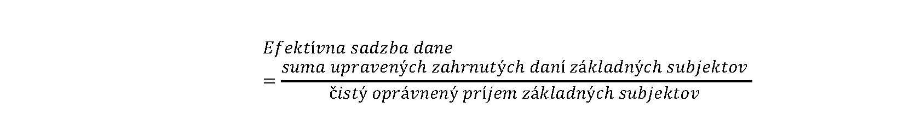

## ŠTVRTÁ ČASŤ

## VÝPOČET EFEKTÍVNEJ SADZBY DANE A DOROVNÁVACEJ DANE

# § 21 Výpočet efektívnej sadzby dane

(1) Efektívna sadzba dane za základné subjekty nadnárodnej skupiny podnikov alebo veľkej vnútroštátnej skupiny sa vypočíta za príslušné účtovné obdobie, ak tieto základné subjekty dosiahli za príslušné účtovné obdobie čistý oprávnený príjem. Efektívna sadzba dane sa vypočíta s presnosťou na štyri desatinné miesta, pričom štvrtá číslica za desatinnou čiarkou sa upraví podľa číslic, ktoré nasledujú po nej, tak, že zaokrúhľovaná číslica, po ktorej nasleduje číslica menšia ako päť, zostáva bez zmeny a zaokrúhľovaná číslica, po ktorej nasleduje číslica päť alebo číslica väčšia ako päť, sa zväčšuje o jednu. Na výpočet efektívnej sadzby dane sa použije tento vzorec:

kde

suma upravených zahrnutých daní základných subjektov je súčet súm upravených zahrnutých daní všetkých základných subjektov vypočítaných za každý základný subjekt podľa § 16 až 20,

čistý oprávnený príjem základných subjektov je kladný rozdiel medzi oprávneným príjmom všetkých základných subjektov vypočítaný podľa § 5 až 15 za každý základný subjekt a oprávnenou stratou všetkých základných subjektov vypočítanou podľa § 5 až 15 za každý základný subjekt.

(2) Upravené zahrnuté dane a oprávnený príjem alebo oprávnená strata členov podskupiny v menšinovom vlastníctve a základného subjektu v menšinovom vlastníctve sú vylúčené z výpočtu efektívnej sadzby dane. Efektívna sadzba dane týchto subjektov sa vypočíta podľa § 25.

(3) Upravené zahrnuté dane a oprávnený príjem alebo oprávnená strata základných subjektov, ktoré sú investičnými subjektmi alebo poisťovacími investičnými subjektmi, sú vylúčené z výpočtu efektívnej sadzby dane. Efektívna sadzba dane týchto subjektov sa vypočíta podľa § 28.

(4) Efektívna sadzba dane základného subjektu bez štátnej príslušnosti sa vypočíta za každé účtovné obdobie, a to oddelene od efektívnej sadzby dane všetkých ostatných základných subjektov.
