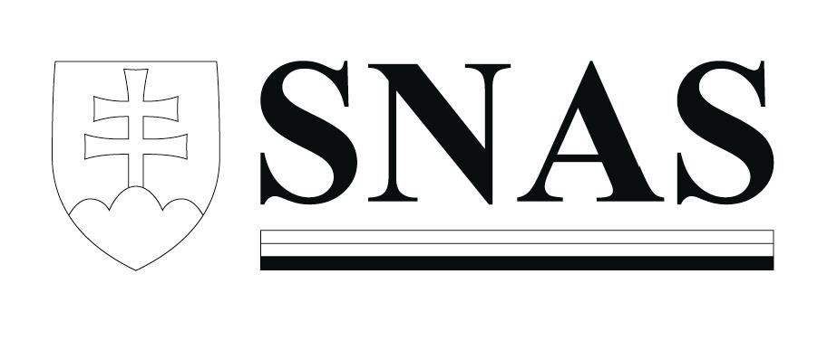

Príloha č. 2 k zákonu č. 53/2023 Z. z.

- Vyobrazenie loga Slovenskej národnej akreditačnej služby:

  - Farebná verzia:

- 

  - Monochromatická verzia:

- 

  - Vysvetlivky:

  - 1. Logo Slovenskej národnej akreditačnej služby sa môže použiť vo farebnej verzii alebo v monochromatickej verzii. Pri použití monochromatickej verzie sa odporúča použiť čiernobiele vyhotovenie.

  - 2. Definovanie povolených farieb:

  - | CMYK | RGB | PANT

  - biela | 0-0-0-0 | 255-255-255 | trans. white

  - červená | 0-100-100-0 | 208-25-16 | 1795 C

  - modrá | 100-80-0-0 | 0-49-131 | 288 C

  - čierna | 100-100-100-100 | 0-0-0 | black C

  - 3. Povolené je použiť embosované, reliéfne a pečiatkové vyhotovenie loga Slovenskej národnej akreditačnej služby.

  - 4. Veľkosť loga Slovenskej národnej akreditačnej služby musí byť taká, aby bola zachovaná jeho čitateľnosť a presnosť jeho reprodukcie.

  - 5. Logo Slovenskej národnej akreditačnej služby je nedeliteľné. Je potrebné ho reprodukovať celé a výhradne v takej podobe a v takých proporciách, ako je uvedené v tejto prílohe.

  - 6. Na všetkých dokumentoch musí byť logo Slovenskej národnej akreditačnej služby umiestnené vo vodorovnej polohe.

  - 7. Použitý podklad alebo okolie loga Slovenskej národnej akreditačnej služby nesmú znižovať jeho čitateľnosť. Použité pozadie musí byť jasne kontrastné.

  - 8. Minimálna voľná ochranná zóna okolo loga Slovenskej národnej akreditačnej služby je 5 mm.
