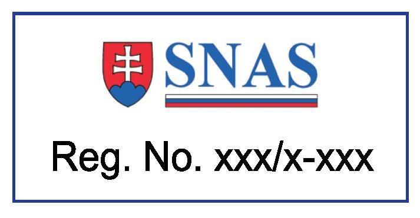
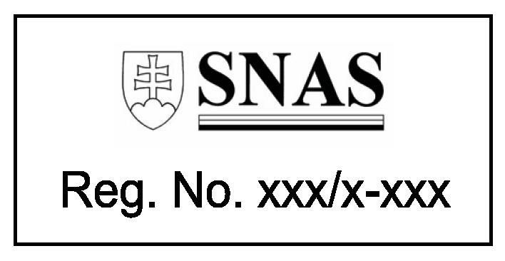

Príloha č. 3 k zákonu č. 53/2023 Z. z.

- Vzor akreditačnej značky Slovenskej národnej akreditačnej služby:

  - Farebná verzia:

- 

  - Monochromatická verzia:

- 

  - Vysvetlivky:

  - 1. Akreditačná značka Slovenskej národnej akreditačnej služby pozostáva z loga, registračného čísla „Reg. No. xxx/x-xxx“, kde prvé trojčíslie xxx je členské číslo registrovaného člena Slovenskej národnej akreditačnej služby a druhé číslo x-xxx je číslo osvedčenia o akreditácii a modrého rámčeka okolo loga Slovenskej národnej akreditačnej služby a registračného čísla.

  - 2. Akreditačná značka Slovenskej národnej akreditačnej služby sa môže použiť vo farebnej verzii alebo v monochromatickej verzii. Pri použití monochromatickej verzie sa odporúča použiť čiernobiele vyhotovenie.

  - 3. Definovanie povolených farieb:

  - | CMYK | RGB | PANT

  - biela | 0-0-0-0 | 255-255-255 | trans. white

  - červená | 0-100-100-0 | 208-25-16 | 1795 C

  - modrá | 100-80-0-0 | 0-49-131 | 288 C

  - čierna | 100-100-100-100 | 0-0-0 | black C

  - 4. Pri reprodukcii akreditačnej značky Slovenskej národnej akreditačnej služby musí byť zabezpečené, aby vnútorné pozadie značky ohraničenej modrým rámčekom bolo bielej farby.

  - 5. So súhlasom Slovenskej národnej akreditačnej služby sa môže použiť embosované a reliéfne vyhotovenie akreditačnej značky Slovenskej národnej akreditačnej služby.

  - 6. Veľkosť akreditačnej značky Slovenskej národnej akreditačnej služby musí byť taká, aby bola zachovaná jej čitateľnosť a presnosť jej reprodukcie.

  - 7. Akreditačná značka Slovenskej národnej akreditačnej služby je nedeliteľná. Je potrebné ju reprodukovať celú a výhradne v takej podobe a v takých proporciách, ako je uvedené v tejto prílohe, čo nevylučuje použitie akreditačnej značky Slovenskej národnej akreditačnej služby podľa § 3 ods. 6 písm. b).

  - 8. Na všetkých dokumentoch musí byť akreditačná značka Slovenskej národnej akreditačnej služby umiestnená vo vodorovnej polohe.

  - 9. Použitý podklad alebo okolie akreditačnej značky Slovenskej národnej akreditačnej služby nesmú znižovať jej čitateľnosť. Použité pozadie musí byť jasne kontrastné.

  - 10. Minimálna voľná ochranná zóna okolo akreditačnej značky Slovenskej národnej akreditačnej služby je 5 mm.
