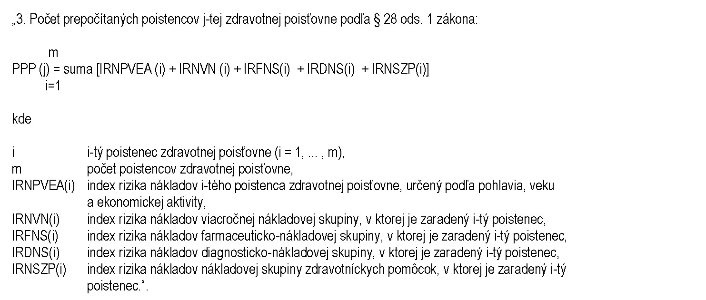
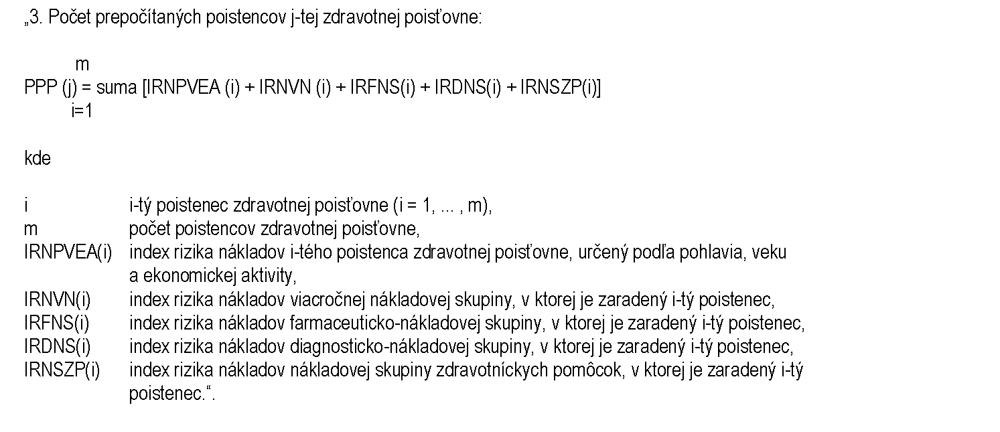

# Čl. I

Vyhláška Ministerstva zdravotníctva Slovenskej republiky č. 67/2018 Z. z., ktorou sa ustanovujú podrobnosti o mesačnom prerozdeľovaní preddavkov na poistné na verejné zdravotné poistenie a o ročnom prerozdeľovaní poistného na verejné zdravotné poistenie v znení vyhlášky č. 47/2019 Z. z. a vyhlášky č. 433/2020 Z. z. sa mení a dopĺňa takto:

- 1. V § 1 ods. 1 sa slovo „tlačive“ nahrádza slovom „formulári“.

- 2. V § 1 odsek 2 znie:

- „(2)

- Údaj o počte poistencov zaradených do jednotlivých farmaceuticko-nákladových skupín, diagnosticko-nákladových skupín a nákladových skupín zdravotníckych pomôcok za kalendárny mesiac, za ktorý sa mesačné prerozdeľovanie vykonáva podľa § 27 ods. 2 písm. d), g) a i) zákona, sa oznamuje na formulári, ktorého vzor je uvedený v prílohe č. 2.“.

- 3. V § 1 sa za odsek 4 vkladajú nové odseky 5 a 6, ktoré znejú:

- „(5)

- Údaje podľa § 27 ods. 2 písm. h) zákona sa zasielajú v elektronickej podobe1) podľa prílohy č. 4a.

- (6)

- Údaje podľa § 27 ods. 2 písm. j) zákona sa zasielajú v elektronickej podobe1) podľa prílohy č. 4b.“.

  - Poznámka pod čiarou k odkazu 1 znie:

  - „1) § 12 a § 13 vyhlášky Úradu podpredsedu vlády Slovenskej republiky pre investície a informatizáciu č. 78/2020 Z. z. o štandardoch pre informačné technológie verejnej správy v znení vyhlášky č. 546/2021 Z. z.“.

  - Doterajšie odseky 5 až 7 sa označujú ako odseky 7 až 9.

- 4. V § 1 ods. 9 a v § 3 ods. 6 sa slová „listinnej podobe a elektronickej podobe“ nahrádzajú slovami „elektronickej podobe1)“.

- 5. V § 3 odsek 2 znie:

- „(2)

- Údaj o počte poistencov zaradených do jednotlivých farmaceuticko-nákladových skupín, diagnosticko-nákladových skupín a nákladových skupín zdravotníckych pomôcok za rozhodujúce obdobie podľa § 27a ods. 2 písm. b), c) a d) zákona, ktorý je vypočítaný ako súčet poistencov nahlásených zdravotnou poisťovňou podľa § 1 ods. 2 za jednotlivé kalendárne mesiace rozhodujúceho obdobia, sa oznamuje do 30. novembra kalendárneho roka nasledujúceho po rozhodujúcom období, za ktoré sa uskutoční ročné prerozdeľovanie, na formulári, ktorého vzor je uvedený v prílohe č. 7.“.

- 6. V § 3 ods.5 sa slová „ods. 6“ nahrádzajú slovami „ods. 8“.

- 7. Za § 5b sa vkladá § 5c, ktorý vrátane nadpisu znie:

- 㤠5c

- Prechodné ustanovenie k úpravám účinným od 1. marca 2023

- Mesačné prerozdeľovanie preddavkov na poistné podľa tejto vyhlášky v znení účinnom od 1. marca 2023 sa vykoná prvýkrát v marci 2023 za január 2023. Ročné prerozdeľovanie poistného podľa tejto vyhlášky v znení účinnom od 1. marca 2023 sa vykoná prvýkrát v roku 2024 za rok 2023.“.

- 8. V prílohe č. 1 druhom riadku tabuľky sa slová „95 %“ nahrádzajú slovami „96 %“.

- 9. V prílohe č. 2 prvej vete sa za slová „písm. d)“ vkladá čiarka a slová „g) a i)“, doterajšia tabuľka sa označuje ako Tabuľka č. 1 a za tabuľku č. 1 sa vkladajú tabuľka č. 2 a tabuľka č. 3, ktoré znejú:

- „Tabuľka č. 2

- Poradové číslo | Kód | Názov diagnosticko-nákladovej skupiny | Počet poistencov zaradených do diagnosticko-nákladovej skupiny

- Počet poistencov spolu | | |

- Tabuľka č. 3

- Poradové číslo | Kód | Názov nákladovej skupiny zdravotníckych pomôcok | Počet poistencov zaradených do nákladovej skupiny zdravotníckych pomôcok

- Počet poistencov spolu | | |

- “.

- 10. Za prílohu č. 4 sa vkladajú prílohy č. 4a a 4b, ktoré znejú:

- „[Príloha č. 4a a 4b k vyhláške č. 67/2018 Z. z.](assets/6a0bd360d8fb7d2aa12909ea653d884e3863fc10e87725a6654ff0548720c7b5.pdf)“.

- 11. V prílohe č. 5 sa slová „95 %“ nahrádzajú slovami „96 %“.

- 12. V prílohe č. 5 tretí bod znie:

- 

- 13. V prílohe č. 6 v 14. riadku tabuľky sa slová „95 %“ nahrádzajú slovami „96 %“ a slová „§ 27a ods. 3“ sa nahrádzajú slovami „§ 27a ods. 2 písm. a)“.

- 14. V prílohe č. 7 prvej vete sa za slová „písm. b)“ vkladá čiarka a slová „c) a d)“, doterajšia tabuľka sa označuje ako Tabuľka č. 1 a za tabuľku č. 1 sa vkladajú tabuľka č. 2 a tabuľka č. 3, ktoré znejú:

- „Tabuľka č. 2

- Poradové číslo | Kód | Názov diagnosticko-nákladovej skupiny | Počet poistencov zaradených do diagnosticko-nákladovej skupiny

- Počet poistencov spolu | | |

- Tabuľka č. 3

- Poradové číslo | Kód | Názov nákladovej skupiny zdravotníckych pomôcok | Počet poistencov zaradených do nákladovej skupiny zdravotníckych pomôcok

- Počet poistencov spolu | | |

- “.

- 15. V prílohe č. 9 sa slová „95 %“ nahrádzajú slovami „96 %“.

- 16. V prílohe č. 9 tretí bod znie:

- 
