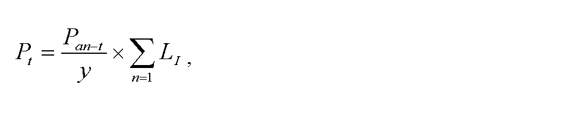
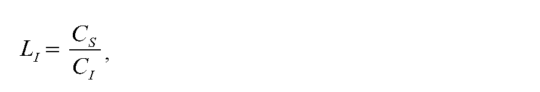

# § 9 Postup a podmienky uplatňovania ceny za prístup do prepravnej siete a prepravu plynu

(1) Ceny za prístup do prepravnej siete a prepravu plynu na rok t sa navrhujú vo forme tarifného systému, ktorý obsahuje osobitné tarify pre vstupné body do prepravnej siete a osobitné tarify pre výstupné body z prepravnej siete.23) Pre vstupné body a výstupné body, ktoré sú prepojovacími bodmi18) a pre vstupné body a výstupné body iné ako prepojovacie body18) sa podáva spoločný návrh ceny.

(2) Tarifný systém sa skladá najmä z

- a) taríf vzťahujúcich sa na objednanú dennú prepravnú kapacitu,

- b) taríf vzťahujúcich sa na množstvo skutočne prepraveného plynu určených podľa osobitného predpisu,19)

- c) ceny za prerušiteľnú kapacitu,

- d) neutralizačného poplatku vrátane určenia metodiky výpočtu uplatňovanej ceny pre určenie denného poplatku za odchýlku,

- e) platby za prekročenie dennej prepravnej kapacity na príslušnom vstupnom bode alebo výstupnom bode.

(3) Ustanovenia odsekov 4 až 9 sa vzťahujú na vstupné body alebo výstupné body iné ako prepojovacie body.18)

(4) Výsledná tarifa na vstupnom bode do prepravnej siete Pen(n)(t)na rok t sa vypočíta podľa vzorca

Pen(n)(t) = Tent × I/m/d ,

kde

- a) Tent je východisková sadzba tarify na vstupnom bode do prepravnej siete na rok t v eurách/(MWh/d)/y,

- b) I/m/d je faktor doby trvania zmluvy o prístupe do prepravnej siete a preprave plynu v /mesiacoch/dňoch.

(5) Pri mesačných zmluvách o prístupe do prepravnej siete a preprave plynu sa Im vypočíta podľa vzorca

I

m

=

0,1

+

0,1

×

D

m

,

kde

Dm je doba vykonávania prepravy plynu podľa zmluvy v mesiacoch.

(6) Pri denných zmluvách o prístupe do prepravnej siete a preprave plynu sa Id vypočíta podľa vzorca

I

d

=

0,001

+

0,0072

×

D

d

,

kde

Dd je doba vykonávania prepravy plynu podľa zmluvy v dňoch.

(7) Faktor doby trvania pri mesačných zmluvách o prístupe do prepravnej siete a preprave plynu sa určuje tak, aby výsledná tarifa pre zmluvu s trvaním jeden mesiac bola najviac vo výške 2,4 násobku mesačnej platby pre zmluvu s trvaním jeden rok. Faktor doby trvania pri denných zmluvách o prístupe do prepravnej siete a preprave plynu sa určuje tak, aby výsledná tarifa pre zmluvu s trvaním jeden deň bola najviac vo výške 2,993 násobku dennej platby pre zmluvu s trvaním jeden rok.

(8) Výsledná tarifa na výstupnom bode z prepravnej siete Pex(n)(t)na rok t sa vypočíta podľa vzorca

P

e

x

n

(

t

)

=

T

e

x

t

×

I

/

m

/

d

,

kde

- a) Text je východisková sadzba tarify na výstupnom bode z prepravnej siete na rok t v eurách/(MWh/d)/y,

- b) I/m/d je faktor doby trvania zmluvy o prístupe do prepravnej siete a preprave plynu v/mesiacoch/dňoch.

(9) Ročná platba Pt za prístup a prepravu plynu vstupným bodom alebo výstupným bodom pri prerušiteľnej kapacite na rok t pri ročnej zmluve za prístup do prepravnej siete a prepravu plynu sa vypočíta podľa vzorca

kde

- a) Pan-t je ročná platba za prepravnú kapacitu bez prerušenia,

- b) y je celkový počet dní v roku t,

- c) LI je faktor odrážajúci mieru prerušenia vypočítaný podľa vzorca

- 

- kde

  - 1. CS je dostupná výška prerušiteľnej prepravnej kapacity pri prerušení alebo obmedzení prepravy plynu prevádzkovateľom prepravnej siete,

  - 2. CI je zmluvná denná prerušiteľná prepravná kapacita.

(10) Na odberateľa plynu, ktorý je pripojený do prepravnej siete a ktorý je výrobcom elektriny a súčasne poskytovateľom podporných služieb v elektroenergetike na základe zmluvy o poskytovaní podporných služieb a dodávke regulačnej elektriny, sa po preukázaní skutočne dodaného množstva regulačnej elektriny a po preukázaní množstva plynu potrebného na výrobu regulačnej elektriny neuplatňuje platba za prekročenie dennej prepravnej kapacity na príslušnom výstupnom bode, pričom platba užívateľa prepravnej siete za prepravu plynu podľa platného cenového rozhodnutia tým nie je dotknutá.

(11) Neutralizačný poplatok pre každý rok regulačného obdobia vyjadrený v eurách na energetickú jednotku pridelenej prepravnej kapacity sa určí ako rozdiel medzi príjmami prevádzkovateľa prepravnej siete a nákladmi na vykonávanie vyvažovacej činnosti a upravuje sa podľa skutočného stavu neutralizačného účtu v roku t-2.

(12) Na neutralizačnom účte vedenom prevádzkovateľom prepravnej siete sú evidované údaje súvisiace s realizáciou vyvažovacích činností najmä

- a) prijaté platby za neutralizačný poplatok od užívateľov prepravnej siete,

- b) ekonomicky oprávnené náklady vynaložené v nevyhnutnom rozsahu na vykonávanie vyváženia prepravnej siete podľa § 4 ods. 1 okrem nákladov podľa § 4 ods. 1 písm. a) a k),

- c) výnosy prevádzkovateľa prepravnej siete z predaja plynu predaného ako výsledok vyvažovania siete,

- d) náklady prevádzkovateľa prepravnej siete na nákup plynu pre zabezpečenie vyváženia siete.

(13) Súčasťou tarifného systému je poplatok pre zvýšenie úrovne bezpečnosti dodávok plynu vrátane určenia výšky a spôsobu účtovania poplatku pre zvýšenie úrovne bezpečnosti dodávok plynu24) prevádzkovateľom prepravnej siete.

(14) Ak dôjde k prekročeniu dohodnutej dennej prepravnej kapacity na príslušnom vstupnom bode alebo výstupnom bode, platba za prekročenie dennej prepravnej kapacity sa vypočíta podľa vzorca

PCE = CE × 5 × k (m) × PO,

kde

- a) PCE je platba za prekročenie dohodnutej dennej prepravnej kapacity v eurách za deň, keď dôjde k prekročeniu dohodnutej dennej kapacity,

- b) CE je najväčšie prekročenie dohodnutej dennej prepravnej kapacity v mesiaci, v ktorom k tomuto prekročeniu dôjde v MWh,

- c) k(m) je faktor kalendárneho mesiaca, v ktorom dôjde k prekročeniu dennej prepravnej kapacity, pričom hodnota k(m) je rovná 0,4 na mesiace január, február a december a 0,2 na mesiace marec a november a 0,1 na mesiace apríl, máj, jún, júl, august, september a október roku t,

- d) PO je východisková ročná sadzba tarify na danom vstupnom bode alebo výstupnom bode za zmluvne dohodnutú dennú prepravnú kapacitu na vstupnom bode alebo výstupnom bode do prepravnej siete v MWh/deň určená úradom pre prevádzkovateľa prepravnej siete za prepravu plynu na príslušný kalendárny rok v eurách za MWh/deň.

(15) Ak užívateľ prepravnej siete prekročí dohodnutú dennú prepravnú kapacitu na príslušnom vstupnom bode alebo výstupnom bode v danom mesiaci opakovane, platba za prekročenie sa účtuje len jedenkrát, a to za najvyššie prekročenie dohodnutej dennej prepravnej kapacity v danom mesiaci.
