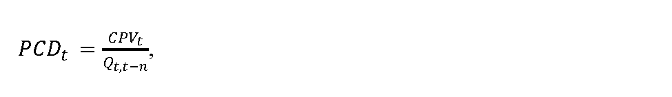
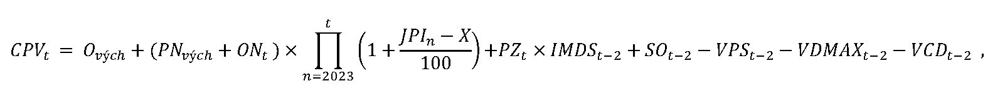
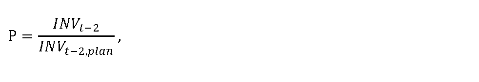
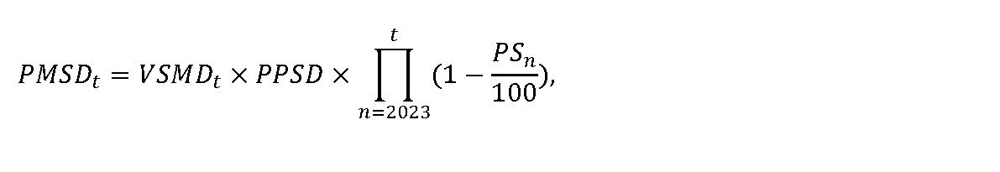
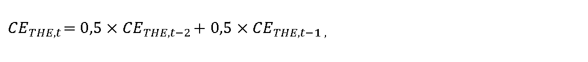

# § 12 Výpočet maximálnej ceny za prístup do distribučnej siete a distribúciu plynu

(1) Maximálna cena za prístup do distribučnej siete a distribúciu plynu PCDt v eurách na jednotku množstva distribuovaného plynu pre jednotlivé roky regulačného obdobia sa vypočíta podľa vzorca

kde

- a) Qt,t-n je celkový objem množstva distribuovaného plynu vypočítaný z priemerného množstva distribuovaného plynu v rokoch t-3, t-2, očakávanej skutočnosti v roku t-1 a plánovaného množstva distribuovaného plynu na rok t,

- b) CPVt sú celkové úradom schválené plánované tržby z taríf za prístup do distribučnej siete a distribúciu plynu v roku t v eurách určené podľa odseku 2.

(2) Celkové úradom schválené plánované tržby z taríf za prístup do distribučnej siete a distribúciu plynu CPVt v roku t v eurách sa vypočítajú podľa vzorca

kde

- a) Ových je schválená alebo určená východisková hodnota odpisov prevádzkovateľa distribučnej siete v eurách, ktorá zodpovedá výške regulačných odpisov prevádzkovateľa distribučnej siete súvisiacich s regulovanou činnosťou v roku 2025 určená podľa prílohy č. 1 z majetku RAB2025,

- b) PNvých sú určené skutočné ročné ekonomicky oprávnené prevádzkové náklady v eurách súvisiace s regulovanou činnosťou určené podľa § 4 ods. 1, okrem nákladov na krytie strát a vlastnej spotreby v distribučnej sieti, určené ako priemerné ročné prevádzkové náklady nevyhnutne vynaložené na regulovanú činnosť za roky t-2, t-3 a t-4, pričom PNvých sú určené na celé regulačné obdobie a výpočet PNvých sa predloží ako súčasť návrhu ceny na prvý rok regulačného obdobia spolu s odôvodnením výpočtu jednotlivých nákladových položiek; pre regulovaný subjekt bez histórie PNvých za predchádzajúce regulačné obdobie sa použijú pri návrhu ceny plánované prevádzkové náklady na rok t,

- c) ONtje určená hodnota osobných nákladov podľa § 4 ods. 1 písm. e) v eurách vo východiskovom roku regulačného obdobia stanovená na základe skutočných osobných nákladov za rok 2023 prevádzkovateľa distribučnej siete súvisiacich s regulovanou činnosťou, v eurách súvisiacich s regulovanou činnosťou,

- d) JPIn je aritmetický priemer zverejnených hodnôt ukazovateľa „jadrová inflácia“ za obdobie 12 mesiacov predchádzajúcich predloženiu návrhu ceny zverejnených na webovom sídle Štatistického úradu Slovenskej republiky – http://datacube.statistics.sk v priečinku „Makroekonomické štatistiky“ v sekcii „Spotrebiteľské ceny a ceny produkčných štatistík“ v časti „Indexy spotrebiteľských cien (inflácia)“ v časti „Jadrová a čistá inflácia“ v priečinku „Jadrová a čistá inflácia – oproti rovnakému obdobiu minulého roku v percentách – mesačne [sp0008ms]“,

- e) X je faktor efektivity pre každý rok regulačného obdobia vo výške 3 %, pričom ak je hodnota rozdielu JPIna X nižšia ako 0, na účely výpočtu maximálnej ceny za prístup do distribučnej siete a distribúciu plynu na rok t sa hodnota rozdielu JPIn a X rovná 0,

- f) SOt-2 je kumulatívna hodnota odpisov v eurách zo skutočne zaradeného nového dlhodobého majetku nevyhnutne potrebného na zabezpečenie prevádzkyschopnosti siete zohľadňujúca technickú dobu životnosti zaradeného majetku od roku t-2 podľa prílohy č. 1,

- g) IMDSt-2 je index miery využitia dosiahnutých disponibilných zdrojov regulovaného subjektu na základe využitia dosiahnutých disponibilných zdrojov regulovaného subjektu za rok t-2 na obnovu a rozvoj siete v intervale 0,8 až 1,0, pričom disponibilné zdroje na účely investícií do distribučnej siete tvorí hodnota odpisov majetku regulovaného subjektu súvisiacich s regulovanou činnosťou a hodnota primeraného zisku v roku t-2; IMDSt-2 sa vypočíta podľa vzorca

- 

- pričom, ak je P

- vyšší alebo sa rovná 1, tak IMDSt-2 = 1,00,

- menší ako 1,0 a zároveň vyšší alebo sa rovná 0,9, tak IMDSt-2 = 0,96,

- menší ako 0,9 a zároveň vyšší alebo sa rovná 0,8, tak IMDSt-2 = 0,92,

- menší ako 0,8 a zároveň vyšší alebo sa rovná 0,7, tak IMDSt-2 = 0,88,

- menší ako 0,7 a zároveň vyšší alebo sa rovná 0,6, tak IMDSt-2= 0,84,

- menší ako 0,6, tak IMDSt-2 = 0,8,

- kde

  - 1. P je podiel využitia investícií do distribučnej siete,

  - 2. INVt-2 je skutočná hodnota investícií do distribučnej siete v eurách vzťahujúca sa k majetku zaradenému do hodnoty regulačnej bázy aktív používanému výhradne na regulovanú činnosť v roku t-2,

  - 3. INVt-2,plan je plánovaná hodnota investícií do distribučnej siete v eurách vzťahujúca sa k majetku zaradeného do hodnoty regulačnej bázy aktív používaného výhradne na regulovanú činnosť ustanovená na roky 2025, 2026 a 2027 na základe plánu investícií predkladaným regulovaným subjektom každoročne podľa § 10 ods. 2 písm. g), pričom na jednotlivé roky 2025 až 2027 regulačného obdobia plánovaná hodnota investícií do distribučnej siete v eurách nie je nižšia ako aritmetický priemer plánovanej hodnoty investícií do distribučnej siete v eurách na roky 2022 až 2024; na roky 2022 až 2024 je ustanovená vo výške:

  - Rok | 2022 | 2023 | 2024

  - INVt-2,planv miliónoch eur | 35 | 40 | 45

- h) VPSt-2 je hodnota skutočných ročných výnosov za pripojenie do distribučnej siete v eurách za rok t-2,

- i) VDMAXt-2 je hodnota skutočných ročných výnosov za prekročenie zmluvne dohodnutej dennej distribučnej kapacity v eurách za rok t-2,

- j) VCDt-2 je hodnota výnosov z uplatnenia cien podľa cenníka externých služieb prevádzkovateľa distribučnej siete za rok t-2 vo výške 50 % na rok 2025 a nasledujúce roky regulačného obdobia,

- k) PZt je hodnota primeraného zisku regulovaného subjektu, ktorá sa vypočíta podľa vzorca

- 

- kde

  - 1. RAB2025 je schválená alebo určená hodnota regulačnej bázy aktív prevádzkovateľa distribučnej siete v eurách nevyhnutne používaných výhradne na regulovanú činnosť, ktorá zodpovedá hodnote majetku prevádzkovateľa distribučnej siete k 31. decembru 2025 určenej na základe znaleckého posudku vypracovaného znalcom zapísaným v zozname znalcov v odbore Ekonomika a riadenie podnikov v súlade s osobitným predpisom22a) vrátane pozemkov v pôvodných obstarávacích cenách bez vplyvu precenenia,

  - 2. WACC je určená miera výnosnosti regulačnej bázy aktív na regulačné obdobie podľa § 6.

(3) Odpisy Ových pre prevádzkovateľa distribučnej siete, ktorý distribuuje plyn distribučnou sieťou, do ktorej je pripojených menej ako 100 000 odberateľov plynu, sú regulačné odpisy hmotného majetku a nehmotného majetku nevyhnutne využívaného na regulovanú činnosť vypočítané ako podiel zostatkovej ceny hmotného majetku a nehmotného majetku a doby technickej životnosti jednotlivých druhov hmotného majetku a nehmotného majetku podľa príloh č. 1 a 15, zníženej o dobu od zaradenia do účtovnej evidencie do 31. decembra 2021. Zostatková cena hmotného majetku a nehmotného majetku je rozdiel obstarávacej ceny hmotného majetku a nehmotného majetku a sumy odpisov v jednotlivých rokoch odo dňa zaradenia majetku do účtovnej evidencie.

(4) Regulačná báza aktív RAB pre prevádzkovateľa distribučnej siete, ktorý distribuuje plyn distribučnou sieťou, do ktorej je pripojených menej ako 100 000 odberateľov, je hodnota aktív slúžiaca výhradne na vykonávanie regulovaných činností, ktorá sa určí ako suma zostatkovej ceny hmotného majetku a nehmotného majetku podľa prílohy č. 14 a nájomného podľa § 4 ods. 1 písm. i), alebo na základe znaleckého posudku vypracovaného znalcom zapísaným v zozname znalcov v odbore Ekonomika a riadenie podnikov v súlade s osobitným predpisom22a) na určenie všeobecnej hodnoty zariadení prevádzkovateľa distribučnej siete slúžiacich výhradne na výkon regulovanej činnosti k 31. decembru 2021.

(5) Hodnoty vstupujúce do výpočtov podľa odseku 1 sa odôvodňujú analýzami, ktoré sa predkladajú s návrhom ceny.

(6) K tarifám podľa § 10 ods. 3 sa pripočítajú tarify na krytie strát plynu a vlastnej spotreby plynu v distribučnej sieti. Tarify na krytie strát plynu a vlastnej spotreby plynu v distribučnej sieti na rok t sa navrhujú tak, že celkové plánované tržby z taríf na krytie strát plynu a vlastnej spotreby plynu v distribučnej sieti v roku t regulačného obdobia v eurách na jednotku množstva plynu neprekročia maximálne náklady na krytie strát plynu a vlastnej spotreby plynu v distribučnej sieti.

(7) Maximálne náklady na krytie strát plynu a vlastnej spotreby plynu v distribučnej sieti sa vypočítajú ako súčin ceny plynu na krytie strát plynu a vlastnej spotreby plynu v distribučnej sieti v eurách na jednotku množstva plynu podľa odseku 9 a povoleného množstva strát v distribučnej sieti PMSDt. V návrhu ceny regulovaného subjektu, ktorý nevykonával regulovanú činnosť v predchádzajúcom regulačnom období, sa uvádza plánované ročné množstvo plynu vstupujúce do distribučnej siete na rok t.

(8) Povolené množstvo strát v distribučnej sieti PMSDt v jednotkách množstva plynu pre potreby výpočtu nákladov na krytie strát plynu a vlastnej spotreby plynu v distribučnej sieti na roky 2025 až 2027 sa vypočíta podľa vzorca

kde

- a) VSMDt je množstvo plynu vstupujúceho do distribučnej siete na rok t v jednotkách množstva plynu,

- b) PPSD je počiatočná percentuálna výška strát v distribučnej sieti z priemerného množstva plynu vstupujúceho do distribučnej siete najviac vo výške 1,9 %,

- c) PSn je faktor efektivity poklesu strát v distribučnej sieti, ustanovuje sa na jednotlivé roky regulačného obdobia vo výške 0,25 %.

(9) Cena plynu na krytie strát a vlastnej spotreby v distribučnej sieti CPSt sa vypočíta podľa vzorca

C

P

S

t

=

C

E

T

H

E

,

t

+

k

s

p

d

,

kde

- a) CETHE,tje aritmetický priemer denných cien s dodaním v roku t burzy EEX (European Energy Exchange) zverejnených na webovom sídle www.eex.com/en/market-data/natural-gas/futures, produktu EEX THE NATURAL GAS FUTURES Cal – t, v časti Settlement Price, v eurách na megawatthodinu, pričom

  - 1. na rok 2025 sa vypočíta podľa vzorca

  - 

  - kde

    - 1a. CETHE,t-2 je aritmetický priemer denných cien s dodaním v roku t burzy EEX (European Energy Exchange) zverejnených na webovom sídle www.eex.com/en/market-data/natural-gas/futures, produktu EEX THE NATURAL GAS FUTURES Cal – t, v časti Settlement Price, v eurách na megawatthodinu za obdobie od

    - 1. septembra t-2 do 31. decembra t-2,

    - 1b. CETHE,t-1 je aritmetický priemer denných cien s dodaním v roku t burzy EEX (European Energy Exchange) zverejnených na webovom sídle www.eex.com/en/market-data/natural-gas/futures, produktu EEX THE NATURAL GAS FUTURES Cal – t, v časti Settlement Price, v eurách na megawatthodinu za obdobie od

    - 1. januára t-1 do 31. mája t-1,

  - 2. pre ďalšie roky regulačného obdobia za obdobie od 1. októbra roku t-2 do 30. júna roku t-1,

- b) kspd je koeficient zohľadňujúci medzinárodnú prepravu plynu na územie Slovenskej republiky; ustanovuje sa vo výške 1,5 eura/MWh.

(10) Na účely prepočtu jednotiek množstva plynu vyjadrených v metroch kubických na jednotky energie sa použije hodnota spaľovacieho tepla objemového vo výške 10,79 kWh/m3.
