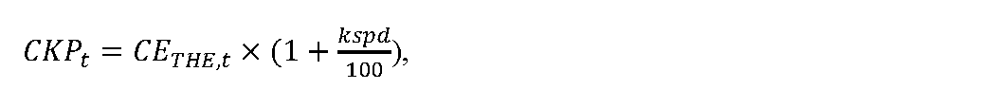
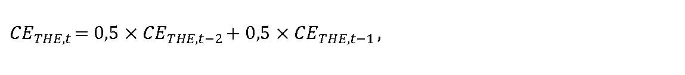
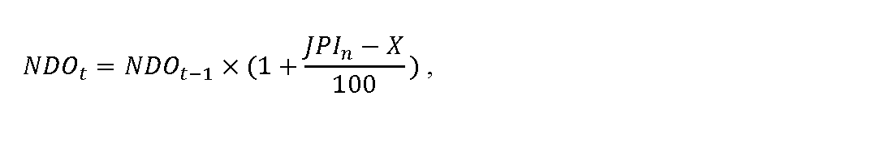

# § 18

(1) Maximálna cena za dodávku plynu odberateľom plynu v domácnosti CDODPt v eurách na jednotku množstva plynu na rok t bez nákladov obchodnej činnosti dodávateľa plynu sa vypočíta podľa vzorca

CDODPt = CKPt + CPZt,

kde

- a) CKPt sú náklady na nákup plynu v eurách na jednotku množstva plynu na rok t, ktoré sa vypočítajú podľa vzorca

- 

  - 1. CETHE,t je aritmetický priemer denných cien s dodaním v roku t burzy EEX (European Energy Exchange) zverejnených na webovom sídle www.eex.com/en/market-data/natural-gas/futures, produktu EEX THE NATURAL GAS FUTURES Cal – t, v časti Settlement Price, v eurách na megawatthodinu

  - 1. na rok 2025 sa vypočíta podľa vzorca

  - 

  - kde

    - 1a. CETHE,t-2je aritmetický priemer denných cien s dodaním v roku t burzy EEX (European Energy Exchange) zverejnených na webovom sídle www.eex.com/en/market-data/natural-gas/futures, produktu EEX THE NATURAL GAS FUTURES Cal – t, v časti Settlement Price, v eurách na megawatthodinu za obdobie od

    - 1. októbra t-2 do 31. marca t-1,

    - 1b. CETHE,t-1je aritmetický priemer denných cien s dodaním v roku t burzy EEX (European Energy Exchange) zverejnených na webovom sídle www.eex.com/en/market-data/natural-gas/futures, produktu EEX THE NATURAL GAS FUTURES Cal – t, v časti Settlement Price, v eurách na megawatthodinu za obdobie od

    - 1. apríla t-1 do 30. júna t-1,

  - 2. na ďalšie roky regulačného obdobia za obdobie od 1. októbra roku t-2 do 30. júna roku t-1,

  - 3. kspd je koeficient korigujúci rozdiel medzi cenou CETHE,t a diagramom dodávky plynu zraniteľným odberateľom plynu podľa § 17 ods. 1 najviac v hodnote 10,

- b) CPZt je najvyššia miera primeraného zisku, ktorý je možné zahrnúť do maximálnej ceny za dodávku plynu odberateľom plynu v domácnosti, jeho hodnota je 10 % z CKPt, maximálne však 3 eurá/MWh.

(2) Cena za dodávku plynu v jednotlivých tarifných skupinách podľa § 17 ods. 3 sa určuje ako maximálna cena. Maximálna cena sa skladá z fixnej maximálnej mesačnej sadzby na jedno odberné miesto za mesiac a maximálnej sadzby za odobratý plyn. Fixná maximálna mesačná sadzba obsahuje náklady obchodnej činnosti dodávateľa plynu v eurách na jedno odberné miesto za mesiac. Maximálna cena za dodávku plynu pre odberateľov plynu v domácnosti na rok t je vážený priemer navrhovaných maximálnych sadzieb za odobratý plyn, ktorý neprekročí maximálnu cenu za dodávku plynu na rok t vypočítanú podľa odseku 1.

(3) Náklady obchodnej činnosti dodávateľa plynu NDOt, ktoré možno zahrnúť do fixnej maximálnej mesačnej sadzby za dodávku plynu pre odberateľov plynu v domácnosti sa vypočítajú podľa vzorca

kde

- a) NDOt-1 sú náklady obchodnej činnosti dodávateľa plynu na dodávku plynu na jedno odberné miesto za mesiac, ktoré možno zahrnúť do fixných maximálnych sadzieb za dodávku plynu pre odberateľov plynu v domácnosti v roku t-1, pričom určená výška NDOt-1 na rok 2024 je najviac 1,50 eura na jedno odberné miesto a mesiac,

- b) JPIn je aritmetický priemer zverejnených hodnôt ukazovateľa „Jadrová inflácia“ za obdobie od

- 1. januára roku t-1 do 30. júna roku t-1 uvedených na webovom sídle Štatistického úradu Slovenskej republiky – http://datacube.statistics.sk v priečinku „Makroekonomické štatistiky“ v sekcii „Spotrebiteľské ceny a ceny produkčných štatistík“ v časti „Indexy spotrebiteľských cien (inflácia)“ v časti „Jadrová a čistá inflácia“ v priečinku „Jadrová a čistá inflácia – oproti rovnakému obdobiu minulého roku v percentách – mesačne [sp0008ms]“,

- c) X je faktor efektivity pre každý rok regulačného obdobia vo výške 3 %; ak je hodnota rozdielu JPIna X nižšia ako 0, na účely výpočtu nákladov obchodnej činnosti dodávateľa plynu NDOt sa hodnota rozdielu JPIn a X rovná 0.

(4) Ak je odberné miesto odberateľa plynu v domácnosti pripojené do distribučnej siete, do ktorej je pripojených viac ako 100 000 odberateľov plynu, k maximálnym cenám sa dodávateľom plynu pripočíta podľa cenového rozhodnutia úradu na rok t cena za prístup do distribučnej siete a distribúciu plynu podľa príslušných taríf za distribúciu plynu. Cena za prístup do distribučnej siete pre odberateľov plynu v domácnosti zohľadňuje výšku ich podielu na celkových nákladoch dodávateľa plynu za prístup do distribučnej siete pre všetkých odberateľov plynu na vymedzenom území, pre ktorých je dodávateľom plynu zabezpečovaná distribúcia plynu do odberného miesta, ktoré sú vypočítané na základe plánovaných denných maximálnych množstiev plynu a plánovaného množstva dodaného plynu. K maximálnym cenám za dodávku plynu sa pripočíta cena za prístup do prepravnej siete a prepravu plynu. Cena za prístup do prepravnej siete a prepravu plynu pre odberateľov plynu v domácnosti CPSt sa vypočíta podľa vzorca

CPSt =[ PNt× (PDPKZO,t/PDPKt) ] / QZO,t,

kde

- 1. PNt sú plánované náklady za prístup do prepravnej siete a prepravu plynu pre koncových odberateľov plynu na vymedzenom území na rok t podľa cenového rozhodnutia úradu,

- 2. PDPKZO,t je plánovaná objednaná denná prepravná kapacita pre odberateľov plynu v domácnosti na vymedzenom území na rok t,

- 3. PDPKtje plánovaná objednaná denná prepravná kapacita pre koncových odberateľov plynu na vymedzenom území na rok t,

- 4. QZO,t je plánované množstvo dodaného plynu odberateľom plynu v domácnosti na rok t.

(5) Ak je odberné miesto odberateľa plynu v domácnosti pripojené do distribučnej siete, do ktorej je pripojených viac ako 100 000 odberateľov plynu a dodávateľ plynu nemá uzatvorenú samostatnú zmluvu o prístupe do prepravnej siete a preprave plynu s prevádzkovateľom prepravnej siete, ktorá by samostatným objednaním prepravnej kapacity zabezpečovala pokrytie požadovanej prepravy plynu na zabezpečenie dodávky plynu pre všetkých odberateľov plynu v domácnosti, a z tohto dôvodu dodávateľ plynu nevie vyčísliť celkové náklady na prístup do prepravnej siete a prepravu plynu na zabezpečenie dodávky plynu odberateľov plynu v domácnosti, a ak v zmluve o nákupe plynu pre týchto odberateľov nie je možné vyčleniť náklady za prístup do prepravnej siete a prepravy plynu, k maximálnym cenám sa dodávateľom plynu pripočíta okrem ceny za prístup do distribučnej siete a distribúciu plynu aj cena za prístup do prepravnej siete a prepravu plynu pre odberateľov plynu v domácnosti, maximálna cena za prístup do prepravnej siete a prepravu plynu pre prvú tarifnú skupinu príslušných distribučných taríf prevádzkovateľa distribučnej siete, do ktorého distribučnej siete je odberné miesto odberateľa plynu v domácnosti pripojené, je 2,48 eura/MWh a pre ostatné tarifné skupiny prevádzkovateľa distribučnej siete do ktorého distribučnej siete je odberné miesto odberateľa plynu v domácnosti pripojené, je 3,15 eura/MWh.

(6) Cena za prístup do prepravnej siete a prepravu plynu CPSt podľa odseku 4 pre odberateľov plynu v domácnosti sa určuje osobitne pre prvú tarifnú skupinu príslušných distribučných taríf prevádzkovateľa distribučnej siete, do ktorého distribučnej siete je odberné miesto odberateľa plynu v domácnosti pripojené, a osobitne pre ostatné tarifné skupiny prevádzkovateľa distribučnej siete, do ktorého distribučnej siete je odberné miesto odberateľa plynu v domácnosti pripojené.

(7) Ak sa zmení cena za dodávku plynu odberateľom plynu v domácnosti v priebehu roka, ustanovenia odsekov 4 až 6 sa pri výpočte ceny za prístup do prepravnej siete a prepravu plynu pre odberateľov plynu v domácnosti použijú primerane.

(8) Ak je dodávka plynu zabezpečovaná prostredníctvom distribúcie plynu cez viacero nadväzujúcich distribučných sietí, k maximálnym cenám sa dodávateľom plynu pripočíta podľa cenového rozhodnutia úradu na rok t cena za prístup do prepravnej siete a prepravu plynu, cena za prístup do distribučnej siete a distribúciu plynu podľa cenových rozhodnutí úradu pre prevádzkovateľov týchto distribučných sietí a podľa uzatvorených zmlúv o prístupe do distribučnej siete a distribúcii plynu a zmlúv o prístupe do prepravnej siete a preprave plynu. Cena za prístup do prepravnej siete a prepravu plynu pre odberateľov plynu v domácnosti sa vypočíta podľa odsekov 4 až 6.

(9) K maximálnym cenám za dodávku plynu sa pripočíta koeficient kxdz zohľadňujúci náklady súvisiace so sezónnym charakterom odberu plynu a pre zaistenie bezpečnosti dodávok plynu a flexibility dodávky pre odberateľov plynu v domácnosti v zimnom vykurovacom období, ak dodávateľ plynu nemá uzatvorenú zmluvu o prístupe do zásobníka a uskladňovaní plynu s prevádzkovateľom zásobníka na vymedzenom území alebo náklady na uskladňovanie plynu CSPDt pre odberateľov plynu v domácnosti, ak dodávateľ plynu má uzatvorenú zmluvu o prístupe do zásobníka a uskladňovaní plynu s prevádzkovateľom zásobníka na vymedzenom území. Výsledná hodnota koeficientu kxdz alebo nákladov na uskladňovanie plynu CSPDt určená na jednotku množstva plynu v eurách na kilowatthodinu sa podľa § 5 ods.1 matematicky zaokrúhľuje na štyri desatinné miesta.

(10) Výška koeficientu kxdz je určená ako aritmetický priemer kladných rozdielov denných hodnôt cien produktu EEX THE NATURAL GAS FUTURES Quarter 1 roku t a Quarter 3 roku t-1, a to za obdobie od 1. októbra roku t-2 do 30. júna roku t-1 vynásobený percentom spotreby v mesiacoch zimnej vykurovacej sezóny od 1. októbra do 31. marca podľa typového diagramu PDS domo3.

(11) Náklady na uskladňovanie plynu CSPDtpotrebného na zabezpečenie dodávky plynu pre odberateľov plynu v domácnosti sa vypočítajú podľa vzorca

kde

- a) kxszt-1 je koeficient skladovania, ktorý sa vypočíta podľa vzorca:

- 

- kde

  - 1. D sú všetky kalendárne dni v zimnej vykurovacej sezóne v roku t-1 v období od

  - 1. januára roku t-1 do 31. marca roku t-1 a v období od 1. októbra roku t-1 do

  - 31. decembra roku t-1,

  - 2. d je konkrétny kalendárny deň zimnej vykurovacej sezóny v období od 1. januára roku t-1 do 31. marca roku t-1 a v období od 1. októbra roku t-1 do 31. decembra roku t-1,

  - 3. TDDd je hodnota spotreby prislúchajúca na kalendárny deň d podľa typového diagramu dodávky PDS domo3 platného v roku t-1, zverejneného na webovom sídle prevádzkovateľa distribučnej siete,

  - 4. Nt-1 je celkový počet kalendárnych dní v kalendárnom roku t-1,

- b) RCSt je maximálna jednotková cena za prístup do zásobníka a uskladňovanie plynu schválená alebo určená podľa cenového rozhodnutia úradu v eurách na megawatthodinu, platná k 30. júnu roku t-1 pre prevádzkovateľa zásobníka s najväčšou uskladňovacou kapacitou na vymedzenom území.
