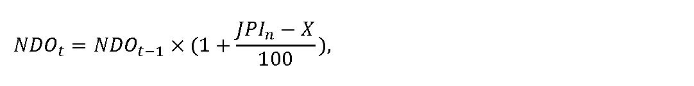

# § 19 Cenová regulácia dodávky plynu zraniteľným odberateľom okrem odberateľov plynu v domácnosti a postup a podmienky uplatňovania ceny

(1) Cenová regulácia dodávky plynu zraniteľným odberateľom podľa § 2 písm. i) okrem odberateľov plynu v domácnosti sa vzťahuje na dodávateľa plynu, ktorý dodáva plyn týmto odberateľom v roku t.

(2) V návrhu ceny pre odberateľov plynu podľa odseku 1 sa uvedú osobitne skupiny zraniteľných odberateľov plynu v členení podľa § 2 písm. k) štvrtého bodu, šiesteho bodu a siedmeho bodu zákona. Súčasťou návrhu ceny za dodávku plynu odberateľom plynu podľa odseku 1 sú

- a) ceny za dodávku plynu podľa odseku 3 vrátane podmienok pridelenia jednotlivého druhu tarify a podmienok finančného vysporiadania záväzkov dodávateľa plynu voči odberateľovi plynu vyplývajúcich z vyúčtovania dodávky plynu,

- b) údaje potrebné na preverenie cien za dodávku plynu, najmä predpokladané množstvo dodaného plynu v jednotlivých druhoch taríf v jednotkách množstva plynu a počet odberných miest,

- c) náklady na preukázanie faktoru ksmd podľa odseku 6 písm. a),

- d) tabuľky podľa príloh č. 15 až 18,

- e) maximálna cena za dodávku plynu vypočítaná podľa odsekov 5 a 6,

- f) ďalšie podklady nevyhnutné na posúdenie návrhu ceny.

(3) Maximálna cena za dodávku plynu sa skladá z dvoch zložiek, a to z fixnej maximálnej mesačnej sadzby na jedno odberné miesto za mesiac a z maximálnej sadzby za odobratý plyn. Fixná maximálna mesačná sadzba obsahuje náklady obchodnej činnosti dodávateľa plynu v eurách na jedno odberné miesto za mesiac. Maximálna cena za dodávku plynu pre odberateľov plynu podľa odseku 1 na rok t je vážený priemer navrhovaných maximálnych sadzieb za odobratý plyn, ktorý neprekročí maximálnu cenu za dodávku plynu na rok t vypočítanú podľa odseku 6.

(4) Odberatelia plynu podľa odseku 1 sa zaradia do tarifných skupín určených na základe odberných pásiem zohľadňujúcich predpokladané ročné množstvo odobratého plynu podľa zaradenia do príslušných distribučných taríf prevádzkovateľa distribučnej siete, do ktorého distribučnej siete je odberné miesto odberateľa podľa odseku 1 pripojené.

(5) Náklady obchodnej činnosti dodávateľa plynu NDOt, ktoré možno zahrnúť do fixnej maximálnej mesačnej sadzby za dodávku plynu pre odberateľov plynu podľa odseku 1 sa vypočítajú podľa vzorca

kde

- a) NDOt-1 sú náklady obchodnej činnosti dodávateľa plynu na dodávku plynu na jedno odberné miesto za mesiac, ktoré možno zahrnúť do fixných maximálnych sadzieb za dodávku plynu pre odberateľov plynu podľa odseku 1 v roku t-1, pričom určená výška NDOt-1 na rok 2024 je najviac 1,50 eura na jedno odberné miesto a mesiac,

- b) JPIn je aritmetický priemer zverejnených hodnôt ukazovateľa „Jadrová inflácia“ za obdobie od 1. januára roku t-1 do 30. júna roku t-1 uvedených na webovom sídle Štatistického úradu Slovenskej republiky – http://datacube.statistics.sk v priečinku „Makroekonomické štatistiky“ v sekcii „Spotrebiteľské ceny a ceny produkčných štatistík“ v časti „Indexy spotrebiteľských cien (inflácia)“ v časti „Jadrová a čistá inflácia“ v priečinku „Jadrová a čistá inflácia – oproti rovnakému obdobiu minulého roku v percentách – mesačne [sp0008ms]“,

- c) X je faktor efektivity pre každý rok regulačného obdobia vo výške 3 %; ak je hodnota rozdielu JPIna X nižšia ako 0, na účely výpočtu nákladov obchodnej činnosti dodávateľa plynu NDOt sa hodnota rozdielu JPIn a X rovná 0.

(6) Maximálna cena za dodávku plynu zraniteľným odberateľom podľa odseku 1 CDOMDt v eurách na jednotku množstva plynu na rok t bez nákladov obchodnej činnosti dodávateľa plynu sa vypočíta podľa vzorca

CDOMDt = CKPt + CPZt ,

kde

- a) CKPtsú náklady na nákup plynu v eurách na jednotku množstva plynu na rok t, ktoré sa vypočítajú podľa vzorca

- 

- kde

  - 1. CETHE,t je aritmetický priemer denných cien s dodaním v roku t burzy EEX (European Energy Exchange) zverejnených na webovom sídle www.eex.com/en/market-data/natural-gas/futures, produktu EEX THE NATURAL GAS FUTURES Cal – t, v časti Settlement Price, v eurách na megawatthodinu

  - 1. na rok 2025 sa vypočíta podľa vzorca

  - 

  - kde

    - 1a. CETHE,t-2 je aritmetický priemer denných cien s dodaním v roku t burzy EEX (European Energy Exchange) zverejnených na webovom sídle www.eex.com/en/market-data/natural-gas/futures, produktu EEX THE NATURAL GAS FUTURES Cal – t, v časti Settlement Price, v eurách na megawatthodinu za obdobie od

    - 1. októbra t-2 do 31. marca t-1,

    - 1b. CETHE,t-1 je aritmetický priemer denných cien s dodaním v roku t burzy EEX (European Energy Exchange) zverejnených na webovom sídle www.eex.com/en/market-data/natural-gas/futures, produktu EEX THE NATURAL GAS FUTURES Cal – t, v časti Settlement Price, v eurách na megawatthodinu za obdobie od

    - 1. apríla t-1 do 30. júna t-1,

  - 2. pre ďalšie roky regulačného obdobia za obdobie od 1. októbra roku t-2 do 30. júna roku t-1,

- b) ksmd je koeficient korigujúci rozdiel medzi cenou CETHE,t a diagramom dodávky plynu zraniteľným odberateľom plynu podľa ods. 1 najviac v hodnote 10,

- c) CPZt je najvyššia miera primeraného zisku, ktorý je možné zahrnúť do maximálnej ceny za dodávku plynu odberateľom plynu podľa odseku 1, jeho hodnota je 10 % z CKPt, maximálne však 3 eurá/MWh.

(7) Návrh ceny sa predkladá v listinnej podobe alebo v elektronickej podobe elektronickým podaním do elektronickej schránky,22) pričom podklady podľa odseku 2 písm. b) až e) sa predkladajú vo formáte, ktorý zachováva úplnú funkčnosť tabuľkového editora.

(8) Ak je odberné miesto zraniteľného odberateľa plynu podľa odseku 1 pripojené do distribučnej siete, do ktorej je pripojených viac ako 100 000 odberateľov plynu, k maximálnej cene vypočítanej podľa odsekov 5 a 6 sa pripočítajú

- a) cena za prístup do prepravnej siete a prepravu plynu pre odberateľov plynu podľa odseku 1 v súlade s uzatvorenou samostatnou zmluvou o prístupe do prepravnej siete a preprave plynu a výškou zmluvne dohodnutej prepravnej kapacity dodávateľa plynu a cenami uvedenými v zmluve o prístupe do prepravnej siete a preprave plynu podľa príslušného cenového rozhodnutia úradu pre prístup do prepravnej siete a prepravu plynu, vypočítaná podľa odseku 9; ak dodávateľ plynu nemá uzatvorenú samostatnú zmluvu o prístupe do prepravnej siete a preprave plynu s prevádzkovateľom prepravnej siete, ktorá by samostatným objednaním prepravnej kapacity zabezpečovala pokrytie požadovanej prepravy plynu pre zabezpečenie dodávky plynu pre všetkých jeho odberateľov podľa odseku 1 a z tohto dôvodu dodávateľ plynu nevie vyčísliť celkové náklady na prístup do prepravnej siete a prepravu plynu pre zabezpečenie dodávky plynu odberateľom plynu podľa odseku 1, a ak v zmluve o nákupe plynu pre týchto odberateľov nie je možné vyčleniť náklady za prístup do prepravnej siete a prepravy plynu, cena za prístup do prepravnej siete a prepravu plynu pre odberateľov plynu podľa odseku 1 sa určí podľa odseku 10,

- b) náklady na prístup do distribučnej siete a distribúciu plynu pre odberateľov plynu podľa odseku 1 v súlade s cenami uvedenými v príslušnom cenovom rozhodnutí úradu pre prístup do distribučnej siete a distribúciu plynu, pričom cena za prístup do distribučnej siete pre odberateľov plynu podľa odseku 1 zohľadňuje výšku ich podielu na celkových nákladoch dodávateľa plynu za prístup do distribučnej siete pre všetkých odberateľov plynu na vymedzenom území, vypočítaných na základe plánovaných denných maximálnych množstiev plynu a plánovaného množstva dodaného plynu,

- c) náklady na uskladňovanie plynu potrebného na zabezpečenie dodávky plynu pre zraniteľných odberateľov podľa odseku 1 v súlade s výškou zmluvne dohodnutej uskladňovacej kapacity a s cenami uvedenými v zmluve o uskladňovaní plynu, pričom cena za uskladňovanie plynu pre odberateľov podľa odseku 1 zohľadňuje výšku ich podielu na celkových nákladoch dodávateľa plynu za uskladňovanie plynu pre všetkých odberateľov plynu so sezónne kolísajúcim odberom plynu vypočítaných na základe plánovaných denných maximálnych množstiev plynu a plánovaného množstva dodaného plynu.

(9) Cena za prístup do prepravnej siete a prepravu plynu pre odberateľov plynu podľa odseku 1 sa vypočíta podľa vzorca

CPSt = [ PNt× (PDPKMP,t/PDPKt) ] / QMP,t,

kde

- 1. PNtsú plánované ročné náklady dodávateľa plynu v eurách za prístup do prepravnej siete a prepravu plynu pre koncových odberateľov plynu na vymedzenom území podľa cenového rozhodnutia úradu na rok t,

- 2. PDPKMP,t je plánovaná objednaná denná prepravná kapacita pre zraniteľných odberateľov plynu podľa odseku 1 na vymedzenom území na rok t,

- 3. PDPKtje plánovaná objednaná denná prepravná kapacita pre koncových odberateľov plynu na vymedzenom území na rok t,

- 4. QMP,t je plánované množstvo dodaného plynu zraniteľným odberateľom podľa odseku 1 na rok t.

(10) Cena za prístup do prepravnej siete a prepravu plynu pre odberateľov plynu podľa odseku 1, ak dodávateľ plynu nemá uzatvorenú samostatnú zmluvu o prístupe do prepravnej siete a preprave plynu s prevádzkovateľom prepravnej siete, ktorá by zabezpečovala pokrytie požadovanej prepravy plynu pre zabezpečenie dodávky plynu pre všetkých jeho odberateľov plynu podľa odseku 1 alebo ak v zmluve o nákupe plynu pre týchto odberateľov nie je možné vyčleniť náklady za prístup do prepravnej siete a prepravy plynu, k maximálnym cenám sa dodávateľom plynu pripočíta cena za prístup do prepravnej siete a prepravu plynu pre odberateľov plynu podľa odseku 1, maximálna cena za prístup do prepravnej siete a prepravu plynu pre prvú tarifnú skupinu príslušných distribučných taríf prevádzkovateľa distribučnej siete, do ktorého distribučnej siete je odberné miesto odberateľa plynu podľa odseku 1 pripojené, je 2,48 eura/MWh a pre ostatné tarifné skupiny prevádzkovateľa distribučnej siete, do ktorého distribučnej siete je odberné miesto odberateľa plynu pripojené, je 3,15 eura/MWh.

(11) Cena za prístup do prepravnej siete a prepravu plynu CPSt podľa odseku 9 pre odberateľov plynu podľa odseku 1 sa určuje osobitne pre prvú tarifnú skupinu príslušných distribučných taríf prevádzkovateľa distribučnej siete, do ktorého distribučnej siete je odberné miesto odberateľa plynu podľa odseku 1 pripojené a osobitne pre ostatné tarifné skupiny prevádzkovateľa distribučnej siete, do ktorého distribučnej siete je odberné miesto odberateľa plynu pripojené.

(12) Ak sa zmení cena za dodávku plynu pre odberateľov plynu podľa odseku 1 v priebehu roka, ustanovenia odsekov 9 a 10 sa pri výpočte ceny za prístup do prepravnej siete a prepravu plynu pre odberateľov plynu podľa odseku 1 použijú primerane.

(13) Ak je dodávka plynu zabezpečovaná prostredníctvom distribúcie plynu cez viacero nadväzujúcich distribučných sietí, k maximálnej cene podľa odsekov 5 a 6 sa dodávateľom plynu pripočíta podľa cenového rozhodnutia úradu na rok t cena za prístup do prepravnej siete a prepravu plynu podľa odseku 8 písm. a), cena za prístup do distribučnej siete a distribúciu plynu podľa cenových rozhodnutí úradu pre prevádzkovateľov týchto distribučných sietí a podľa uzatvorených zmlúv o prístupe do distribučnej siete a distribúcii plynu a ak je to potrebné, aj náklady podľa odseku 8 písm. c) pre odberateľov plynu podľa odseku 1.
