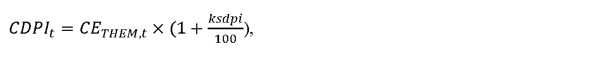

# § 20 Cenová regulácia dodávky plynu dodávateľom poslednej inštancie

(1) Cenová regulácia dodávky plynu dodávateľom poslednej inštancie sa vzťahuje na dodávku plynu uskutočnenú dodávateľom poslednej inštancie podľa osobitného predpisu32) do odberných miest koncových odberateľov plynu.

(2) Súčasťou návrhu ceny za dodávku plynu dodávateľom poslednej inštancie sú podklady a údaje k navrhovanej cene.

(3) Odberatelia plynu sa dodávateľom poslednej inštancie zaradia do tarifných skupín určených na základe odberných pásiem, zohľadňujúcich predpokladané ročné množstvo odobratého plynu určené v zmluve o prístupe do distribučnej siete a distribúcii plynu, ktorú uzavrel pôvodný dodávateľ odberateľa plynu s prevádzkovateľom distribučnej siete podľa zaradenia do príslušných distribučných taríf v cenovom rozhodnutí úradu.

(4) Maximálna cena za dodávku plynu dodávateľom poslednej inštancie pre odberateľov plynu sa skladá z

- a) nákladov na nákup plynu pre odberateľov plynu určených pre obdobie dodávky plynu v režime poslednej inštancie, ktoré sa vypočítajú podľa vzorca

- 

- kde

  - 1. CETHEM,t je aritmetický priemer denných cien s dodaním na tri po sebe nasledujúce mesiace burzy EEX (European Energy Exchange) zverejnených na webovom sídle www.eex.com/en/market-data/natural-gas/futures, v časti Month, Settlement Price, produktu EEX THE NATURAL GAS FUTURES, pričom prvým mesiacom je mesiac, v ktorom sa začala dodávka plynu dodávateľom poslednej inštancie, v eurách na jednotku množstva plynu za obdobie kalendárneho mesiaca predchádzajúceho prvému dňu dodávky plynu dodávateľom poslednej inštancie,

  - 2. ksdpi je koeficient korigujúci rozdiel medzi cenou CETHEM,t a diagramom dodávky plynu odberateľom plynu najviac v hodnote 5,

- b) alikvotnej časti nákladov na prístup do prepravnej siete a prepravu plynu pre odberateľov plynu v režime dodávky poslednej inštancie v súlade s výškou zmluvne dohodnutej prepravnej kapacity dodávateľa plynu a cenami uvedenými v zmluve o prístupe do prepravnej siete a preprave plynu podľa príslušného cenového rozhodnutia úradu pre prístup do prepravnej siete a prepravu plynu,

- c) alikvotnej časti nákladov na prístup do distribučnej siete a distribúciu plynu pre odberateľov plynu v režime dodávky poslednej inštancie v súlade s cenami uvedenými v zmluve o prístupe do distribučnej siete a distribúcii plynu s pôvodným dodávateľom plynu a s príslušným cenovým rozhodnutím úradu pre prístup do distribučnej siete a distribúciu plynu,

- d) alikvotnej časti nákladov na uskladňovanie plynu potrebného na zabezpečenie dodávky plynu pre odberateľov plynu v režime dodávky poslednej inštancie v súlade so zmluvne dohodnutou uskladňovacou kapacitou a s cenami uvedenými v zmluve o uskladňovaní plynu,

- e) nákladov dodávateľa plynu spojených s dodávkou plynu pre odberateľov plynu v režime dodávky poslednej inštancie určených podľa odseku 5,

- f) primeraného zisku z dodávky plynu pre odberateľov plynu v režime dodávky poslednej inštancie najviac vo výške 3 eurá za megawatthodinu.

(5) Náklady dodávateľa plynu spojené s dodávkou plynu pre odberateľov plynu v režime dodávky poslednej inštancie NDODPIt, ktoré možno zahrnúť do fixnej maximálnej mesačnej sadzby za dodávku plynu v režime dodávky poslednej inštancie sa vypočítajú podľa vzorca

kde

- a) NDODPIt-1 sú náklady dodávateľa plynu spojené s dodávkou plynu pre odberateľov plynu v režime dodávky poslednej inštancie na jedno odberné miesto za mesiac, ktoré možno zahrnúť do fixných maximálnych sadzieb za dodávku plynu v režime dodávky poslednej inštancie v roku t-1, pričom určená výška NDODPIt-1 na rok 2024 je najviac 1,50 eura na jedno odberné miesto a mesiac,

- b) JPIn je aritmetický priemer zverejnených hodnôt ukazovateľa „Jadrová inflácia“ za obdobie od

- 1. januára roku t-1 do 30. júna roku t-1 uvedených na webovom sídle Štatistického úradu Slovenskej republiky – http://datacube.statistics.sk v priečinku „Makroekonomické štatistiky“ v sekcii „Spotrebiteľské ceny a ceny produkčných štatistík“ v časti „Indexy spotrebiteľských cien (inflácia)“ v časti „Jadrová a čistá inflácia“ v priečinku „Jadrová a čistá inflácia – oproti rovnakému obdobiu minulého roku v percentách – mesačne [sp0008ms]“,

- c) X je faktor efektivity pre každý rok regulačného obdobia vo výške 3 %; ak je hodnota rozdielu JPIna X nižšia ako 0, na účely výpočtu nákladov dodávateľa plynu spojených s dodávkou plynu pre odberateľov plynu v režime dodávky poslednej inštancie NDODPIt sa hodnota rozdielu JPIn a X rovná 0.

(6) Pri dostatočnej zmluvne dohodnutej prepravnej kapacite dodávateľa plynu poslednej inštancie u prevádzkovateľa prepravnej siete pokrývajúcej dodatočnú požiadavku na prepravnú kapacitu sa náklady na prístup do prepravnej siete a prepravu plynu pre odberateľov plynu v režime dodávky poslednej inštancie určia podľa výšky ich podielu na celkových nákladoch dodávateľa plynu za prístup do prepravnej siete a prepravu plynu pre všetkých odberateľov plynu na vymedzenom území, vypočítaných na základe plánovaných denných maximálnych množstiev plynu a plánovaného množstva dodaného plynu. Pri dostatočnej zmluvne dohodnutej uskladňovacej kapacite dodávateľa plynu poslednej inštancie u prevádzkovateľa zásobníka pokrývajúcej dodatočnú požiadavku na uskladňovaciu kapacitu, sa náklady na uskladňovanie plynu pre odberateľov plynu v režime dodávky poslednej inštancie určia podľa výšky ich podielu na celkových nákladoch dodávateľa poslednej inštancie na uskladňovanie plynu pre všetkých odberateľov plynu na základe plánovaných denných maximálnych množstiev plynu odberateľov plynu v režime poslednej inštancie.

(7) Ak je pre koncového odberateľa plynu v domácnosti uplatňovaná sadzba za odobratý plyn pri dodávke poslednej inštancie vyššia ako maximálna sadzba za odobratý plyn pri druhu tarify, ktorá bola priradená odberateľovi plynu v domácnosti pred začiatkom dodávky poslednej inštancie pôvodným dodávateľom podľa cenníka dodávateľa plynu, ktorý poskytuje dodávku poslednej inštancie, najviac o 30 %, dodávateľom poslednej inštancie sa táto sadzba za odobratý plyn pri dodávke poslednej inštancie uplatní pre odberateľa plynu v domácnosti v celom rozsahu. Ak sadzba za odobratý plyn pri dodávke plynu poslednej inštancie je vyššia od maximálnej sadzby za odobratý plyn pri druhu tarify, ktorá bola priradená odberateľovi plynu v domácnosti pôvodným dodávateľom podľa cenníka dodávateľa plynu, ktorý poskytuje dodávku poslednej inštancie vyššia o viac ako 30 %, dodávateľom poslednej inštancie sa uplatní pre odberateľa plynu v domácnosti sadzba za odobratý plyn pri dodávke plynu poslednej inštancie v hodnote podľa predchádzajúcej vety, pričom vzniknuté náklady spojené so zabezpečením dodávky plynu poslednej inštancie pre odberateľa plynu v domácnosti v rozsahu neuplatnenom pre odberateľa plynu v domácnosti si príslušný dodávateľ poslednej inštancie uplatní v konaní o cenovej regulácii. Ak odberateľ plynu v domácnosti uzatvorí zmluvu o združenej dodávke plynu s dodávateľom poslednej inštancie, odberateľovi plynu v domácnosti sa dodávateľom poslednej inštancie po skončení dodávky poslednej inštancie vráti 50 % z rozdielu medzi skutočne uplatnenou cenou za dodávku poslednej inštancie a cenou zmluvne dohodnutou v zmluve o združenej dodávke plynu platnou po skončení dodávky poslednej inštancie.

(8) Cena za dodávku plynu dodávateľom poslednej inštancie a spôsob jej výpočtu a podmienky uplatnenia ceny na rok t sa uvedie v súlade s odsekmi 4 až 6.
