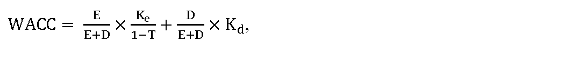
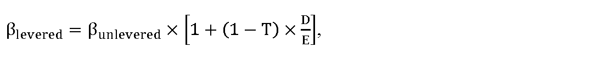

# § 5 Spôsob určenia miery výnosnosti regulačnej bázy aktív

(1) Miera výnosnosti regulačnej bázy aktív sa určuje na regulačné obdobie a zohľadňuje

- a) návratnosť prevádzkových aktív používaných výhradne na zabezpečenie regulovanej činnosti,

- b) rozsah potrebných investícií na zabezpečenie dlhodobo spoľahlivej, bezpečnej a udržateľnej prevádzky aktív používaných pri výkone regulovanej činnosti.

(2) Miera výnosnosti regulačnej bázy aktív pred zdanením na regulačné obdobie sa vyjadruje ako vážený priemer nákladov na kapitál WACC pred zdanením, určený v percentuálnej hodnote, matematicky zaokrúhlenej na dve desatinné miesta, a vypočíta sa podľa vzorca

kde

- a) Kesú náklady na vlastný kapitál v percentách určené podľa odseku 3,

- b) Kd sú náklady na cudzí kapitál v percentách, vo výške 2,77 %,

- c) 

- E

- E

- +

- D

- je podiel vlastného majetku na celkovom majetku, ktorý sa ustanovuje na celé regulačné obdobie vo výške 40 %,

- d) 

- D

- E

- +

- D

- je podiel cudzieho majetku na celkovom majetku, ktorý sa ustanovuje na celé regulačné obdobie vo výške 60 %,

- e) T je sadzba dane z príjmov právnických osôb v roku t v percentách.

(3) Náklady na vlastný kapitál Ke sa vypočítajú podľa vzorca

K

e

=

R

f

+

β

l

e

v

e

r

e

d

×

M

R

P

,

kde

- a) Rf je bezriziková výnosová miera, ktorá sa na regulačné obdobie ustanovuje vo výške 1,11 %,

- b) βlevered je vážený beta koeficient vyjadrujúci systematické riziko, citlivosť konkrétneho odvetvia na zmenu trhu, ktorý sa vypočíta podľa vzorca

- 

kde

- 1. βunlevered je nevážený beta koeficient bez vplyvu sadzby dane z príjmov a podielu cudzích zdrojov; pre regulačné obdobie sa ustanovuje vo výške 0,49,

- 2. D/E je pomer cudzích zdrojov k vlastnému majetku, ktorý sa ustanovuje na celé regulačné obdobie vo výške 1,5,

- c) MRP je trhová riziková prirážka, ktorá sa na regulačné obdobie ustanovuje vo výške 5,84 %.

(4) Hodnota WACC na rok 2025 sa ustanovuje vo výške 5,39 % s platnosťou do konca regulačného obdobia. Ak sa určí nová hodnota WACC na rok t podľa odseku 5, hodnota WACC podľa prvej vety sa na rok t a zvyšok regulačného obdobia nepoužije.

(5) Ak odchýlka medzi rokmi t-2 a t-1 v niektorom z parametrov vstupujúcich do výpočtu WACC, podrobne ustanovených v prílohe č. 2, v priebehu regulačného obdobia bude vyššia ako 20 %, určí sa nová hodnota WACC na rok t a na zvyšok regulačného obdobia, ktorá sa zverejňuje na webovom sídle úradu najneskôr do 30. júna roku t-1. Zmena vyjadrená ako hodnota pomeru medzi aktuálnou číselnou hodnotou WACC a novou číselnou hodnotou WACC nepresiahne 10 %, teda pomer nepresiahne hodnoty uzavretého matematického intervalu <0,9 – 1,1>.
