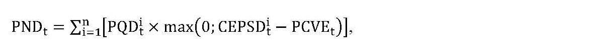
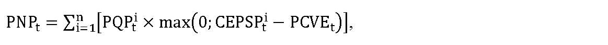
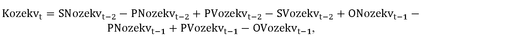
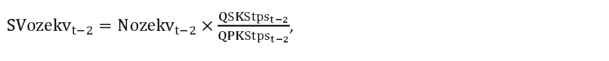
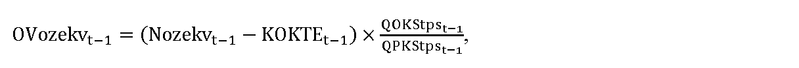
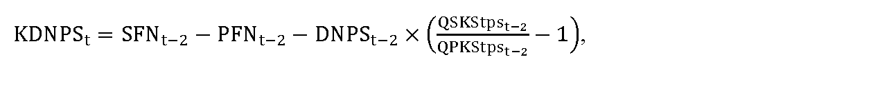

# § 7 Tarifa za prevádzkovanie systému

(1) Tarifa za prevádzkovanie systému sa uplatňuje v eurách na jednotku množstva elektriny na koncovú spotrebu elektriny odobratú zo sústavy koncovými odberateľmi elektriny.

(2) Tarifa za prevádzkovanie systému môže byť diferencovaná na viaceré hodnoty sadzieb TPSi,t, ktoré sa uplatnia individuálne pre jednotlivé skupiny odberných miest koncových odberateľov elektriny, pričom pre priradenie odberného miesta koncového odberateľa elektriny do príslušnej skupiny sa vyhodnocuje očakávaná výška koncovej spotreby elektriny odobratej zo sústavy za rok t-1 na všetkých odberných miestach koncového odberateľa elektriny.

(3) Skupiny odberných miest koncových odberateľov elektriny sú

- a) skupina 1, a to odberné miesta koncových odberateľov elektriny s očakávanou koncovou spotrebou elektriny, na ktorú sa uplatňujú tarify za prevádzkovanie systému za rok t-1 do 1 GWh vrátane, okrem odberných miest koncových odberateľov elektriny zaradených v skupine 4,

- b) skupina 2, a to odberné miesta koncových odberateľov elektriny s očakávanou koncovou spotrebou elektriny, na ktorú sa uplatňujú tarify za prevádzkovanie systému za rok t-1 nad 1 GWh do 100 GWh vrátane, okrem odberných miest koncových odberateľov elektriny zaradených v skupine 4,

- c) skupina 3, a to odberné miesta koncových odberateľov elektriny s očakávanou koncovou spotrebou elektriny, na ktorú sa uplatňujú tarify za prevádzkovanie systému za rok t-1 nad 100 GWh, okrem odberných miest koncových odberateľov elektriny zaradených v skupine 4,

- d) skupina 4, a to odberné miesta koncových odberateľov elektriny, ktorým bola pre rok t určená individuálna sadzba tarify za prevádzkovanie systému podľa § 8.

(4) Pre tarifu za prevádzkovanie systému platí

∑

i

=

1

k

(

T

P

S

i

,

t

×

Q

P

K

S

t

p

s

i

,

t

)

=

N

P

S

t

,

kde

- a) TPSi,t je sadzba tarify za prevádzkovanie systému uplatnená na koncovú spotrebu elektriny odobratej zo sústavy v i-tej skupine odberných miest odberateľov elektriny, na ktorú sa uplatňujú tarify za prevádzkovanie systému v eurách na jednotku množstva elektriny v roku t,

- b) QPKStpsi,t je celkové množstvo plánovanej koncovej spotreby elektriny odobratej zo sústavy v i-tej skupine odberných miest odberateľov elektriny v jednotkách množstva elektriny v roku t, na ktorú sa uplatňujú tarify za prevádzkovanie systému,

- c) k je celkový počet skupín odberných miest odberateľov elektriny v roku t,

- d) NPSt sú plánované náklady na prevádzkovanie systému v eurách v roku t, ktoré sa vypočítajú podľa vzorca

- 

- N

- P

- S

- t

- =

- N

- o

- z

- e

- k

- v

- t

- +

- P

- N

- O

- T

- t

- +

- N

- o

- k

- t

- e

- t

- +

- D

- N

- P

- S

- t

- +

- K

- V

- P

- T

- P

- S

- t

- ,

- kde

  - 1. Nozekvt sú celkové plánované náklady na podporu elektriny vyrobenej z obnoviteľných zdrojov energie a vysoko účinnou kombinovanou výrobou v eurách v roku t, ktoré sa vypočítajú podľa odseku 5,

  - 2. PNOTt sú schválené alebo určené plánované náklady v eurách zohľadňujúce alikvotnú časť nákladov na organizovanie a vyhodnotenie krátkodobého trhu s elektrinou v eurách na rok t,

  - 3. Noktet sú schválené alebo určené náklady na výkon ostatných činností organizátora krátkodobého trhu s elektrinou v eurách v roku t, ktoré sa vypočítajú podľa § 13 ods. 1,

  - 4. DNPSt sú schválené dodatočné náklady na prevádzkovanie systému v eurách na rok t, ktoré sa vypočítajú podľa odseku 8,

  - 5. KVPTPSt je korekcia vplyvu pásmovej tarify za prevádzkovanie systému v eurách na rok t, ktorá sa vypočíta podľa odseku 9.

(5) Celkové plánované náklady na podporu elektriny vyrobenej z obnoviteľných zdrojov energie a vysoko účinnou kombinovanou výrobou v eurách v roku t sa vypočítajú podľa vzorca

Nozekvt = PNDt + PNPt + PNVEt – PFPt – PVzpt – PVzat + Kozekvt ,

kde

- a) PNDt sú plánované náklady organizátora krátkodobého trhu s elektrinou na doplatok pre výrobcov elektriny z obnoviteľných zdrojov energie a vysoko účinnou kombinovanou výrobou v roku t v eurách, ktoré sa vypočítajú podľa vzorca

- 

- kde

  - 1. PQDti je plánované množstvo elektriny, na ktoré je možné uplatniť doplatok, vyrobenej v roku t v i-tom zariadení na výrobu elektriny výrobcov elektriny z obnoviteľných zdrojov energie a vysoko účinnou kombinovanou výrobou, v jednotkách množstva elektriny,

  - 2. CEPSDti je cena elektriny pre stanovenie doplatku pre i-té zariadenie na výrobu elektriny výrobcov elektriny z obnoviteľných zdrojov energie a vysoko účinnou kombinovanou výrobou v eurách na jednotku množstva elektriny na rok t,

  - 3. PCVEt je plánovaná priemerná cena vykupovanej elektriny v eurách na jednotku množstva elektriny na rok t,

  - 4. n je počet zariadení na výrobu elektriny výrobcov elektriny z obnoviteľných zdrojov energie a vysoko účinnou kombinovanou výrobou v roku t,

- b) PNPt sú plánované náklady organizátora krátkodobého trhu s elektrinou na príplatok pre výrobcov elektriny z obnoviteľných zdrojov energie a vysoko účinnou kombinovanou výrobou v roku t v eurách, ktoré sa vypočítajú podľa vzorca

- 

- kde

  - 1. PQPti je plánované množstvo elektriny, na ktoré je možné uplatniť príplatok, vyrobenej v roku t v i-tom zariadení na výrobu elektriny výrobcov elektriny z obnoviteľných zdrojov energie a vysoko účinnou kombinovanou výrobou, v jednotkách množstva elektriny,

  - 2. CEPSPti je cena elektriny pre stanovenie príplatku pre i-té zariadenie na výrobu elektriny výrobcov elektriny z obnoviteľných zdrojov energie a vysoko účinnou kombinovanou výrobou v eurách na jednotku množstva elektriny na rok t,

  - 3. PCVEt je plánovaná priemerná cena vykupovanej elektriny v eurách na jednotku množstva elektriny na rok t,

  - 4. n je počet zariadení na výrobu elektriny výrobcov elektriny z obnoviteľných zdrojov energie a vysoko účinnou kombinovanou výrobou v roku t,

- c) PNVEt sú plánované náklady organizátora krátkodobého trhu s elektrinou na úhradu za činnosť výkupcu elektriny v roku t v eurách, ktoré sa vypočítajú podľa vzorca

- 

- P

- N

- V

- E

- t

- =

- ∑

- i

- =

- 1

- n

- (

- P

- Q

- E

- v

- t

- i

- ×

- P

- U

- C

- V

- E

- t

- i

- )

- ,

- kde

  - 1. PQEvti je plánované množstvo elektriny s nárokom na podporu výkupom elektriny podľa § 3 ods. 1 písm. b) zákona o podpore a prevzatím zodpovednosti za odchýlku podľa § 3 ods. 1 písm. d) zákona o podpore vykúpenej i-tým výkupcom elektriny v režime prenesenej zodpovednosti za odchýlku v jednotkách množstva elektriny v roku t,

  - 2. PUCVEti je plánovaná úhrada za činnosť i-tého výkupcu elektriny v eurách na jednotku množstva elektriny na rok t,

- d) PFPt je plánovaná výška finančných prostriedkov poskytnutých na rok t Ministerstvom hospodárstva Slovenskej republiky (ďalej len „ministerstvo hospodárstva“) na financovanie nákladov vynaložených na zúčtovanie podpory v roku t v eurách,

- e) PVzpt je plánovaný výnos z uplatňovania taríf za vedenie účtu, za vydanie záruk pôvodu elektriny a za prevody záruk pôvodu elektriny v roku t v eurách,

- f) PVzat je plánovaný výnos z predaja záruk pôvodu elektriny vydaných podľa § 8b ods. 3 zákona o podpore v roku t v eurách,

- g) Kozekvt je korekcia nákladov a výnosov organizátora krátkodobého trhu s elektrinou na podporu elektriny vyrobenej z obnoviteľných zdrojov energie a vysoko účinnou kombinovanou výrobou v eurách v roku t, ktorá sa vypočíta podľa odseku 4.

(6) Na účely cenovej regulácie do 30. apríla roku t sa predkladajú organizátorom krátkodobého trhu s elektrinou údaje o skutočných množstvách elektriny v roku t-1, očakávaných množstvách elektriny v roku t a plánovaných množstvách elektriny na rok t+1 odobratej koncovým odberateľom elektriny, ako aj údaje o skutočných nákladoch a skutočných výnosoch za prevádzkovanie systému v roku t-1.

(7) Korekcia nákladov a výnosov organizátora krátkodobého trhu s elektrinou na podporu elektriny vyrobenej z obnoviteľných zdrojov energie a vysoko účinnou kombinovanou výrobou v eurách v roku t Kozekvt sa vypočíta podľa vzorca

kde

- a) SNozekvt-2 sú skutočné náklady organizátora krátkodobého trhu s elektrinou na podporu elektriny vyrobenej z obnoviteľných zdrojov energie a vysoko účinnou kombinovanou výrobou v roku t-2 v eurách, ktoré sa pre výpočet Kozekvt sa vypočítajú podľa vzorca

- SNozekvt–2 = SNDt–2 + SNPt–2 + SNVEt–2 – SFPt–2 – SVzpt–2 – SVzat–2,

- kde

  - 1. SNDt-2 sú skutočné náklady organizátora krátkodobého trhu s elektrinou na doplatok pre výrobcov elektriny z obnoviteľných zdrojov energie a vysoko účinnou kombinovanou výrobou v roku t-2 v eurách,

  - 2. SNPt-2 sú skutočné náklady organizátora krátkodobého trhu s elektrinou na príplatok pre výrobcov elektriny z obnoviteľných zdrojov energie a vysoko účinnou kombinovanou výrobou v roku t-2 v eurách,

  - 3. SNVEt-2 sú skutočné náklady organizátora krátkodobého trhu s elektrinou na úhradu za činnosť výkupcu elektriny v roku t-2 v eurách,

  - 4. SFPt-2 je skutočná výška finančných prostriedkov poskytnutých ministerstvom hospodárstva na financovanie nákladov vynaložených na zúčtovanie podpory v roku t-2 v eurách,

  - 5. SVzpt-2 sú skutočné výnosy z uplatňovania taríf za vedenie účtu, za vydanie záruk pôvodu elektriny a za prevody záruk pôvodu elektriny v roku t-2 v eurách; pre výpočet Kozekvt pre roky 2025 a 2026 sa SVzpt-2 rovná nule,

  - 6. SVzat-2 sú skutočné výnosy z predaja záruk pôvodu elektriny vydaných podľa § 8b ods. 3 zákona o podpore v roku t-2 v eurách; pre výpočet Kozekvt pre roky 2025 a 2026 sa SVzat-2 rovná nule,

- b) PNozekvt-2 sú určené alebo schválené plánované náklady organizátora krátkodobého trhu s elektrinou na podporu elektriny vyrobenej z obnoviteľných zdrojov energie a vysoko účinnou kombinovanou výrobou na rok t-2 v eurách, ktoré sa vypočítajú podľa vzorca

- PNozekvt–2 = PNDt–2 + PNPt–2 + PNVEt–2 – PFPt–2 – PVzpt–2 – PVzat–2,

- kde

  - 1. PNDt-2 sú určené alebo schválené plánované náklady organizátora krátkodobého trhu s elektrinou na doplatok pre výrobcov elektriny z obnoviteľných zdrojov energie a vysoko účinnou kombinovanou výrobou na rok t-2 v eurách,

  - 2. PNPt-2 sú určené alebo schválené plánované náklady organizátora krátkodobého trhu s elektrinou na príplatok pre výrobcov elektriny z obnoviteľných zdrojov energie a vysoko účinnou kombinovanou výrobou na rok t-2 v eurách,

  - 3. PNVEt-2 sú určené alebo schválené plánované náklady organizátora krátkodobého trhu s elektrinou na úhradu za činnosť výkupcu elektriny na rok t-2 v eurách,

  - 4. PFPt-2 je plánovaná výška finančných prostriedkov poskytnutých ministerstvom hospodárstva na financovanie nákladov vynaložených na zúčtovanie podpory na rok t-2 v eurách,

  - 5. PVzpt-2 sú plánované výnosy z uplatňovania taríf za vedenie účtu, za vydanie záruk pôvodu elektriny a za prevody záruk pôvodu elektriny v roku t-2 v eurách; pre výpočet Kozekvt pre roky 2025 a 2026 sa PVzpt-2 rovná nule,

  - 6. PVzat-2 sú plánované výnosy z predaja záruk pôvodu elektriny vydaných podľa § 8b ods. 3 zákona o podpore v roku t-2 v eurách; pre výpočet Kozekvt pre roky 2025 a 2026 sa PVzat-2 rovná nule,

- c) PVozekvt-2 sú určené alebo schválené plánované výnosy organizátora krátkodobého trhu s elektrinou z alikvotnej časti tarify za prevádzkovanie systému určenej na podporu elektriny vyrobenej z obnoviteľných zdrojov energie a vysoko účinnou kombinovanou výrobou na rok t-2 v eurách, ktoré sa vypočítajú podľa vzorca

- PVozekvt–2 = Nozekvt–2,

- kde

- Nozekvt-2 sú celkové určené alebo schválené plánované náklady na podporu elektriny vyrobenej z obnoviteľných zdrojov energie a vysoko účinnou kombinovanou výrobou v eurách v roku t-2,

- d) SVozekvt-2 sú skutočné výnosy organizátora krátkodobého trhu s elektrinou z alikvotnej časti tarify za prevádzkovanie systému určenej na podporu elektriny vyrobenej z obnoviteľných zdrojov energie a vysoko účinnou kombinovanou výrobou v roku t-2 v eurách, ktoré sa vypočítajú podľa vzorca

- 

- kde

  - 1. Nozekvt-2 sú celkové určené alebo schválené plánované náklady na podporu elektriny vyrobenej z obnoviteľných zdrojov energie a vysoko účinnou kombinovanou výrobou v eurách v roku t-2,

  - 2. QSKStpst-2 je celkové množstvo skutočnej koncovej spotreby elektriny odobratej zo sústavy v jednotkách množstva elektriny v roku t-2, na ktorú sa uplatňuje tarifa za prevádzkovanie systému,

  - 3. QPKStpst-2 je celkové množstvo plánovanej koncovej spotreby elektriny odobratej zo sústavy v jednotkách množstva elektriny v roku t-2, na ktorú sa uplatňuje tarifa za prevádzkovanie systému,

- e) ONozekvt-1 sú očakávané náklady organizátora krátkodobého trhu s elektrinou na podporu elektriny vyrobenej z obnoviteľných zdrojov energie a vysoko účinnou kombinovanou výrobou na rok t-1 v eurách, ktoré sa vypočítajú podľa vzorca

- ONozekvt–1 = ONDt–1 + ONPt–1 + ONVEt–1 – OFPt–1 – OVzpt–1 – OVzat–1,

- kde

  - 1. ONDt-1 sú očakávané náklady organizátora krátkodobého trhu s elektrinou na doplatok pre výrobcov elektriny z obnoviteľných zdrojov energie a vysoko účinnou kombinovanou výrobou v roku t-1 v eurách,

  - 2. ONPt-1 sú očakávané náklady organizátora krátkodobého trhu s elektrinou na príplatok pre výrobcov elektriny z obnoviteľných zdrojov energie a vysoko účinnou kombinovanou výrobou v roku t-1 v eurách,

  - 3. ONVEt-1 sú očakávané náklady organizátora krátkodobého trhu s elektrinou na úhradu za činnosť výkupcu elektriny v roku t-1 v eurách,

  - 4. OFPt-1 je očakávaná výška finančných prostriedkov poskytnutých ministerstvom hospodárstva na financovanie nákladov vynaložených na zúčtovanie podpory v roku t-1 v eurách,

  - 5. OVzpt-1 sú očakávané výnosy z uplatňovania taríf za vedenie účtu, za vydanie záruk pôvodu elektriny a za prevody záruk pôvodu elektriny v roku t-1 v eurách; pre výpočet Kozekvt pre roky 2025 a 2026 sa OVzpt-1 rovná nule,

  - 6. OVzat-1 sú očakávané výnosy z predaja záruk pôvodu elektriny vydaných podľa § 8b ods. 3 zákona o podpore v roku t-1 v eurách; pre výpočet Kozekvt pre roky 2025 a 2026 sa OVzat-1 rovná nule,

- f) PNozekvt-1 sú plánované náklady organizátora krátkodobého trhu s elektrinou na podporu elektriny vyrobenej z obnoviteľných zdrojov energie a vysoko účinnou kombinovanou výrobou v roku t-1 v eurách, ktoré sa vypočítajú podľa vzorca

- PNozekvt–1 = PNDt–1 + PNPt–1 + PNVEt–1 – PFPt–1 – PVzpt–1 – PVzat–1,

- kde

  - 1. PNDt-1 sú plánované náklady organizátora krátkodobého trhu s elektrinou na doplatok pre výrobcov elektriny z obnoviteľných zdrojov energie a vysoko účinnou kombinovanou výrobou v roku t-1 v eurách,

  - 2. PNPt-1 sú plánované náklady organizátora krátkodobého trhu s elektrinou na príplatok pre výrobcov elektriny z obnoviteľných zdrojov energie a vysoko účinnou kombinovanou výrobou v roku t-1 v eurách,

  - 3. PNVEt-1 sú plánované náklady organizátora krátkodobého trhu s elektrinou na úhradu za činnosť výkupcu elektriny v roku t-1 v eurách,

  - 4. PFPt-1 je plánovaná výška finančných prostriedkov poskytnutých ministerstvom hospodárstva na financovanie nákladov vynaložených na zúčtovanie podpory v roku t-1 v eurách,

  - 5. PVzpt-1 sú plánované výnosy z uplatňovania taríf za vedenie účtu, za vydanie záruk pôvodu elektriny a za prevody záruk pôvodu elektriny v roku t-1 v eurách; pre výpočet Kozekvt pre roky 2025 a 2026 sa PVzpt-1 rovná nule,

  - 6. PVzat-1 sú plánované výnosy z predaja záruk pôvodu elektriny vydaných podľa § 8b ods. 3 zákona o podpore v roku t-1 v eurách; pre výpočet Kozekvt pre roky 2025 a 2026 sa PVzat-1 rovná nule,

- g) PVozekvt-1 sú plánované výnosy organizátora krátkodobého trhu s elektrinou z alikvotnej časti tarify za prevádzkovanie systému určenej na podporu elektriny vyrobenej z obnoviteľných zdrojov energie a vysoko účinnou kombinovanou výrobou na rok t-1 v eurách, ktoré sa vypočítajú podľa vzorca

- PVozekvt–1 = Nozekvt–1 – KOKTEt–1,

- kde

  - 1. Nozekvt-1 sú celkové plánované náklady na podporu elektriny vyrobenej z obnoviteľných zdrojov energie a vysoko účinnou kombinovanou výrobou v eurách v roku t-1,

  - 2. KOKTEt-1 je korekcia nákladov a výnosov organizátora krátkodobého trhu s elektrinou na podporu elektriny vyrobenej z obnoviteľných zdrojov energie a vysoko účinnou kombinovanou výrobou za piate regulačné obdobie v eurách v roku t-1,

- h) OVozekvt-1 sú očakávané výnosy organizátora krátkodobého trhu s elektrinou z alikvotnej časti tarify za prevádzkovanie systému určenej na podporu elektriny vyrobenej z obnoviteľných zdrojov energie a vysoko účinnou kombinovanou výrobou v roku t-1 v eurách, ktoré sa vypočítajú podľa vzorca

- 

- kde

  - 1. Nozekvt-1 sú celkové plánované náklady na podporu elektriny vyrobenej z obnoviteľných zdrojov energie a vysoko účinnou kombinovanou výrobou v eurách v roku t-1,

  - 2. KOKTEt-1 je korekcia nákladov a výnosov organizátora krátkodobého trhu s elektrinou na podporu elektriny vyrobenej z obnoviteľných zdrojov energie a vysoko účinnou kombinovanou výrobou za piate regulačné obdobie v eurách v roku t-1,

  - 3. QOKStpst-1 je celková očakávaná skutočná koncová spotreba elektriny v jednotkách množstva elektriny na rok t-1, na ktorú sa uplatňujú tarify za prevádzkovanie systému,

  - 4. QPKStpst-1 je celková plánovaná koncová spotreba elektriny v jednotkách množstva elektriny na rok t-1, na ktorú sa uplatňujú tarify za prevádzkovanie systému.

(8) Dodatočné náklady na prevádzkovanie systému v eurách na rok t DNPSt sa vypočítajú podľa vzorca

D

N

P

S

t

=

P

F

N

t

+

K

D

N

P

S

t

,

kde

- a) PFNt sú plánované náklady na úrok na zabezpečenie finančných prostriedkov na prevádzkové náklady v súvislosti s výkonom činností organizátorom krátkodobého trhu s elektrinou v roku t v eurách,

- b) KDNPSt je korekcia dodatočných nákladov na prevádzkovanie systému na rok t v eurách, ktorá sa vypočíta podľa vzorca

- 

- kde

  - 1. SFNt-2 sú skutočné náklady na úrok na zabezpečenie finančných prostriedkov na prevádzkové náklady v súvislosti s výkonom činností organizátorom krátkodobého trhu s elektrinou v roku t-2 v eurách,

  - 2. PFNt-2 sú plánované náklady na úrok na zabezpečenie finančných prostriedkov na prevádzkové náklady v súvislosti s výkonom činností organizátorom krátkodobého trhu s elektrinou v roku t-2 v eurách,

  - 3. DNPSt-2 sú dodatočné náklady na prevádzkovanie systému v eurách na rok t-2,

  - 4. QSKStpst-2 je celková skutočná koncová spotreba elektriny v jednotkách množstva elektriny na rok t-2, na ktorú sa uplatňujú tarify za prevádzkovanie systému,

  - 5. QPKStpst-2 je celková plánovaná koncová spotreba elektriny v jednotkách množstva elektriny na rok t-2, na ktorú sa uplatňujú tarify za prevádzkovanie systému.

(9) Korekcia vplyvu pásmovej tarify za prevádzkovanie systému v eurách na rok t KVPTPSt sa vypočíta podľa vzorca

KVPTPSt = OVPTPSt–2 – SVPTPSt–2 + PVPTPSt–1 – OVPTPSt–1,

kde

- a) OVPTPSt-2 je očakávaný vplyv pásmovej tarify za prevádzkovanie systému v roku t-2 v eurách, ktorý sa vypočíta podľa vzorca

- OVPTPSt–2 = OVTPSt–2 – ONPSt–2,

- kde

  - 1. OVTPSt-2 sú očakávané výnosy z tarify za prevádzkovanie systému v roku t-2 v eurách,

  - 2. ONPSt-2 sú očakávané náklady na prevádzkovanie systému v roku t-2 v eurách,

- b) SVPTPSt-2 je skutočný vplyv pásmovej tarify za prevádzkovanie systému v roku t-2 v eurách, ktorý sa vypočíta podľa vzorca

- SVPTPSt–2 = SVTPSt–2 – SNPSt–2,

- kde

  - 1. SVTPSt-2 sú skutočné výnosy z tarify za prevádzkovanie systému v roku t-2 v eurách,

  - 2. SNPSt-2 sú skutočné náklady na prevádzkovanie systému v roku t-2 v eurách,

- c) PVPTPSt-1 je plánovaný vplyv pásmovej tarify za prevádzkovanie systému v roku t-1 v eurách, ktorý sa vypočíta podľa vzorca

- PVPTPSt–1 = PVTPSt–1 – PNPSt–1,

- kde

  - 1. PVTPSt-1 sú plánované výnosy z tarify za prevádzkovanie systému v roku t-1 v eurách,

  - 2. PNPSt-1 sú plánované náklady na prevádzkovanie systému v roku t-1 v eurách,

- d) OVPTPSt-1 je očakávaný vplyv pásmovej tarify za prevádzkovanie systému v roku t-1 v eurách, ktorý sa vypočíta podľa vzorca

- OVPTPSt–1 = OVTPSt–1 – ONPSt–1,

- kde

  - 1. OVTPSt-1 sú očakávané výnosy z tarify za prevádzkovanie systému v roku t-1 v eurách,

  - 2. ONPSt-1 sú očakávané náklady na prevádzkovanie systému v roku t-1 v eurách.

(10) Tarifa za prevádzkovanie systému sa neuplatňuje za

- a) vlastnú spotrebu elektriny pri výrobe elektriny, ktorá nie je odobratá zo sústavy,

- b) ostatnú vlastnú spotrebu elektriny pri výrobe elektriny, ktorá nebola odobratá zo sústavy,

- c) elektrinu uskladnenú v zariadení na uskladňovanie elektriny, odobratú zo sústavy, ku ktorej je zariadenie na uskladňovanie elektriny pripojené, alebo odobratú od výrobcu elektriny bez použitia sústavy, ktorá je následne po uskladnení dodaná do sústavy,

- d) straty elektriny v sústave,

- e) vlastnú spotrebu elektriny prevádzkovateľa sústavy pri prevádzkovaní sústavy,

- f) elektrinu exportovanú zo sústavy v rámci prevádzky medzinárodne prepojených sústav,

- g) spotrebu elektriny pri skúškach po ukončení výstavby zariadenia na výrobu elektriny alebo zariadenia na uskladňovanie elektriny pred jeho uvedením do prevádzky, ak takéto skúšky sú vykonané prostredníctvom odberu elektriny z prenosovej sústavy,

- h) vlastnú spotrebu elektriny výrobcu elektriny v zariadení na výrobu elektriny alebo prevádzkovateľa zariadení na uskladňovanie elektriny v zariadení na uskladňovanie elektriny, ktorí nepodnikajú v energetike,

- i) spotrebu elektriny vyrobenej v zariadení na výrobu elektriny, ktoré nie je pripojené do sústavy a je trvalo oddelené od sústavy,

- j) elektrinu vyrobenú v zariadení na kombinovanú výrobu a spotrebovanú na výrobu tepla z obnoviteľných zdrojov energie využitého v centralizovanom zásobovaní teplom, podľa § 3 ods. 16 zákona o podpore,

- k) elektrinu vyrobenú v lokálnom zdroji a spotrebovanú v odbernom mieste identickom s odovzdávacím miestom lokálneho zdroja, podľa § 4b ods. 19 zákona o podpore,

- l) elektrinu vyrobenú a spotrebovanú spoločenstvom vlastníkov bytov a nebytových priestorov v bytovom dome bez využitia distribučnej sústavy.

(11) Pre odberateľa elektriny pripojeného do prenosovej sústavy sa uplatňuje tarifa za prevádzkovanie systému len za elektrinu odobratú z prenosovej sústavy.

(12) Pre odberateľa elektriny pripojeného do regionálnej distribučnej sústavy sa uplatňuje tarifa za prevádzkovanie systému len za elektrinu odobratú z distribučnej sústavy.

(13) Pre odberateľa elektriny pripojeného do miestnej distribučnej sústavy sa uplatňuje tarifa za prevádzkovanie systému len za elektrinu odobratú zo sústavy.

(14) Pre odberateľa elektriny, ktorý odoberá elektrinu od výrobcu elektriny bez použitia prenosovej sústavy alebo distribučnej sústavy, sa tarifa za prevádzkovanie systému neuplatňuje.
