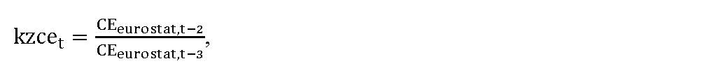

# § 8 Individuálna sadzba tarify za prevádzkovanie systému

(1) Individuálna sadzba tarify za prevádzkovanie systému na rok t v eurách na jednotku množstva elektriny sa uplatňuje vo výške TPS4,t, ktorá sa vypočíta podľa vzorca

TPS4,t = (1 – Kistpst) × TPS1,t,

kde

- a) Kistpstje koeficient individuálnej sadzby tarify za prevádzkovanie systému v roku t najviac vo výške 0,95,

- b) TPS1,t je sadzba tarify za prevádzkovanie systému uplatnená na koncovú spotrebu elektriny odobratú zo sústavy skupiny 1 koncových odberateľov elektriny, na ktorú sa uplatňuje tarifa za prevádzkovanie systému v eurách na jednotku množstva elektriny v roku t.

(2) Individuálna sadzba tarify za prevádzkovanie systému v eurách na jednotku množstva elektriny podľa odseku 1 sa uplatňuje na koncovú spotrebu elektriny, na ktorú sa uplatňuje tarifa za prevádzkovanie systému koncového odberateľa elektriny, ktorý predloží úradu správu podľa § 12 ods. 8 zákona o regulácii a preukáže, že najmenej 80 % jeho koncovej spotreby elektriny zodpovedá niektorému z kódov činnosti podniku alebo ich kombinácii podľa štatistickej klasifikácie ekonomických činností21) uvedených v zozname podľa prílohy č. 3 a zároveň jeho elektroenergetická náročnosť podľa odseku 3 sa rovná alebo je väčšia ako elektroenergetická náročnosť podľa odseku 7.

(3) Elektroenergetická náročnosť podniku v percentách sa vypočíta podľa vzorca

E

E

N

=

E

×

C

H

P

H

×

100

,

kde

- a) E je spotreba elektriny koncového odberateľa elektriny v jednotkách množstva elektriny, ktorá sa určí podľa odseku 4,

- b) C je cena elektriny v eurách na jednotku množstva elektriny, ktorá sa určí podľa odseku 5,

- c) HPH je hrubá pridaná hodnota podniku v eurách, ktorá sa určí ako aritmetický priemer hodnôt hrubej pridanej hodnoty podniku za posledné tri kalendárne roky vypočítaných podľa odseku 6.

(4) Spotreba elektriny koncového odberateľa elektriny E v jednotkách množstva elektriny sa určuje ako aritmetický priemer hodnôt koncovej spotreby elektriny koncového odberateľa elektriny za posledné tri kalendárne roky.

(5) Cena elektriny C v eurách na jednotkách množstva elektriny sa určuje ako aritmetický priemer maloobchodných cien elektrickej energie pre odberateľov elektriny mimo domácnosti v kategórii spotreby od 500 MWh do 1 999 MWh v roku t-2 v eurách na jednotku množstva elektriny, bez dane z pridanej hodnoty zverejnených Štatistickým úradom Európskej únie (ďalej len „Eurostat“) pre Slovenskú republiku.

(6) Hrubá pridaná hodnota podniku v kalendárnom roku HPH sa vypočíta podľa vzorca

HPH = TVVT + AHNIM + OPV + ZSZ – NTS – CDV,

kde

- a) TVVT sú tržby za vlastné výkony a tovar v eurách za kalendárny rok,

- b) AHNIM je aktivácia hmotného a nehmotného investičného majetku v eurách za kalendárny rok,

- c) OPV sú ostatné prevádzkové výnosy bez výnosov z odpísaných pohľadávok, výnosov z predaja pohľadávok, výnosov z postúpených pohľadávok a výnosov z faktoringu v eurách za kalendárny rok,

- d) ZSZ je zmena stavu zásob v eurách za kalendárny rok,

- e) NTS sú náklady na nákup tovaru, materiálu, energie a služieb bez nákladov na personálny lízing a nákladov na operatívny lízing v eurách za kalendárny rok,

- f) CDV sú clá a dane súvisiace s výrobou a iné dane z výrobkov, ktoré súvisia s tržbami, ale nie sú odpočítateľné v eurách za kalendárny rok.

(7) Minimálna požadovaná elektroenergetická náročnosť podniku na určenie individuálnej sadzby tarify za prevádzkovanie systému EENpt v percentách, ktorá sa pre rok 2020 určuje vo výške 100 % a pre nasledujúce roky sa vypočíta podľa vzorca

EENpt = EENpt–1 × kzcet,

kde

- a) EENpt-1 je minimálna požadovaná elektroenergetická náročnosť podniku na určenie individuálnej sadzby tarify za prevádzkovanie systému v roku t-1 v percentách,

- b) kzcet je koeficient zmeny cien elektriny pre rok t, ktorý sa vypočíta podľa vzorca

- 

- kde

  - 1. CEeurostat,t-2 je aritmetický priemer maloobchodných cien elektrickej energie pre odberateľov elektriny mimo domácnosti v kategórii spotreby od 500 MWh do 1 999 MWh v roku t-2 v eurách na jednotku množstva elektriny, bez dane z pridanej hodnoty zverejnených Eurostatom pre Slovenskú republiku,

  - 2. CEeurostat,t-3 je aritmetický priemer maloobchodných cien elektrickej energie pre odberateľov elektriny mimo domácnosti v kategórii spotreby od 500 MWh do 1 999 MWh v roku t-3 v eurách na jednotku množstva elektriny, bez dane z pridanej hodnoty zverejnených Eurostatom pre Slovenskú republiku.

(8) Na výpočty podľa odsekov 2 až 6 sa použijú aritmetické priemery údajov koncového odberateľa elektriny za obdobie posledných troch kalendárnych rokov v štruktúre podľa prílohy č. 4. Ak koncový odberateľ elektriny vykonáva činnosť menej ako tri kalendárne roky, alebo v priebehu posledných troch kalendárnych rokov bola jeho činnosť prerušená dlhšie ako jeden kalendárny rok, použijú sa aritmetické priemery údajov za dva kalendárne roky predchádzajúce roku, v ktorom došlo k prerušeniu činnosti, za ktoré sú údaje k dispozícii. Ak koncový odberateľ elektriny vykonáva činnosť menej ako dva kalendárne roky, použijú sa údaje za kalendárny rok, za ktorý sú údaje k dispozícii.

(9) Správa, ktorú vypracúva koncový odberateľ elektriny na účely priznania individuálnej tarify za prevádzkovanie systému obsahuje

- a) pri právnickej osobe obchodné meno, sídlo a identifikačné číslo organizácie, ak je pridelené, a pri fyzickej osobe – podnikateľovi meno a priezvisko, miesto podnikania a identifikačné číslo organizácie, ak je pridelené,

- b) potvrdenie alebo vyhlásenie o koncovej spotrebe elektriny koncového odberateľa elektriny v jednotkách množstva elektriny, pričom ak koncový odberateľ elektriny

  - 1. je subjektom zúčtovania, potvrdenie o koncovej spotrebe elektriny vyhotovené organizátorom krátkodobého trhu s elektrinou,

  - 2. nie je subjektom zúčtovania, potvrdenie o koncovej spotrebe elektriny vystavené dodávateľom elektriny, ktorý za odberné miesta koncového odberateľa elektriny prevzal zodpovednosť za odchýlku,

  - 3. je výrobcom elektriny a vyrobenú elektrinu spotrebúva pre vlastnú spotrebu, vyhlásenie o koncovej spotrebe elektriny vypracované koncovým spotrebiteľom,

  - 4. spĺňa viacero kritérií uvedených v prvom až treťom bode a na preukázanie splnenia podmienky podľa § 12 ods. 7 písm. a) zákona o regulácii nepostačuje jedno potvrdenie alebo vyhlásenie, súčasťou správy sú aj príslušné potvrdenia alebo vyhlásenia podľa prvého až tretieho bodu,

- c) elektroenergetickú náročnosť podniku v percentách vypočítanú podľa odseku 3,

- d) údaje nevyhnutné na výpočet elektroenergetickej náročnosti podniku podľa prílohy č. 4 tabuľky č. 3, a to

  - 1. hrubú pridanú hodnotu podniku,

  - 2. aritmetický priemer maloobchodných cien elektrickej energie pre odberateľov elektriny okrem odberateľov elektriny v domácnosti v kategórii spotreby od 500 MWh do 1 999 MWh v roku t-2 v eurách na jednotku množstva elektriny, bez dane z pridanej hodnoty zverejnených Eurostatom pre Slovenskú republiku,

  - 3. koncovú spotrebu elektriny podniku v jednotkách množstva elektriny,

- e) údaje nevyhnutné na výpočet hrubej pridanej hodnoty podniku vypočítanej podľa odseku 6 a prílohy č. 4 tabuľky č. 1, a to

  - 1. tržby za vlastné výkony a tovar v eurách,

  - 2. aktiváciu hmotného investičného majetku a nehmotného investičného majetku v eurách,

  - 3. ostatné prevádzkové výnosy v eurách,

  - 4. výnosy z odpísaných pohľadávok, výnosy z predaja pohľadávok, výnosy z postúpených pohľadávok, výnosy z faktoringu a ďalšie výnosy súvisiace s postúpením pohľadávok v eurách,

  - 5. zmenu stavu zásob v eurách,

  - 6. náklady na nákup tovaru, materiálu, energie a služieb, vrátane nákladov na personálny lízing a operatívny lízing v eurách,

  - 7. náklady na personálny lízing v eurách,

  - 8. náklady na operatívny lízing v eurách,

  - 9. clá a dane súvisiace s výrobou a iné dane z výrobkov, ktoré súvisia s tržbami, ale nie sú odpočítateľné v eurách,

  - 10. hrubú pridanú hodnotu podniku v eurách,

- f) ostatné údaje na posúdenie nároku na určenie individuálnej sadzby tarify za prevádzkovanie systému podľa prílohy č. 4 tabuľky č. 2, a to

  - 1. koncovú spotrebu elektriny zodpovedajúcu jednotlivým kódom činnosti podniku podľa štatistickej klasifikácie ekonomických činností uvedených v prílohe č. 3 v jednotkách množstva elektriny,

  - 2. podiel súčtu koncovej spotreby elektriny podniku podľa prvého bodu a koncovej spotreby elektriny podniku podľa písmena d) tretieho bodu v percentách,

- g) potvrdenie preukazujúce správnosť výpočtu podľa písmena f) druhého bodu vyhotovené znalcom v odbore Elektrotechnika – Elektroenergetické stroje a zariadenia alebo Energetika – Regulácia a riadenie sieťových odvetví.
