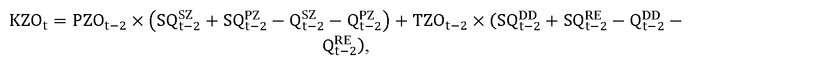

# § 11

(1) Pre subjekt zúčtovania sa uplatňuje tarifa za zúčtovanie, vyhodnotenie a vysporiadanie odchýlok v štvrťhodinovom rozlíšení, kde najväčší výnos PPZOt z týchto platieb v eurách v roku t sa vypočíta podľa vzorca

PPOt = PNZOt + POZOt + ZIt × WACC × kZIt + INVZOt – KZOt,

kde

- a) PNZOt sú schválené alebo určené plánované ročné prevádzkové náklady súvisiace so zúčtovaním, vyhodnotením a vysporiadaním odchýlok zúčtovateľa odchýlok v eurách v roku t,

- b) POZOt sú schválené alebo určené plánované odpisy v eurách na rok t súvisiace s regulovanou činnosťou z plánovanej hodnoty regulačnej bázy aktív nevyhnutne využívanej pre regulovanú činnosť v roku t,

- c) ZIt je hodnota základného imania organizátora krátkodobého trhu s elektrinou k dátumu podania cenového návrhu v eurách, ktorá sa zohľadní pre rok t,

- d) WACC je miera výnosnosti regulačnej bázy aktív na 6. regulačné obdobie určená podľa § 5,

- e) kZIt je koeficient zahrnutia hodnoty základného imania organizátora krátkodobého trhu s elektrinou určený úradom vo výške 0 až 1 pre rok t,

- f) INVZOt je faktor investícií v eurách v roku t, ktorého hodnota sa vypočíta podľa vzorca

- INVZOt = SOzot–2 – POzot–2,

- kde

  - 1. SOzot-2 sú skutočné odpisy v eurách z investícií zaradených do hodnoty regulačnej bázy aktív v eurách nevyhnutne využívaných na zúčtovanie, vyhodnotenie a vysporiadanie odchýlok v roku t-2,

  - 2. POzot-2 sú schválené alebo určené plánované odpisy z investícií, plánovaných zaradiť do hodnoty regulačnej bázy aktív v eurách nevyhnutne využívaných na zúčtovanie, vyhodnotenie a vysporiadanie odchýlok v roku t-2,

- g) KZOt je faktor vyrovnania v eurách na rok t, ktorý sa vypočíta podľa vzorca

kde

- 1. PZOt-2 je ročná fixná platba za prístup do systému zúčtovania, vyhodnotenia a vysporiadania odchýlok v roku t-2 v eurách určená pre subjekt zúčtovania odchýlok, ktorý si zvolí režim vlastnej zodpovednosti za odchýlku a ktorý má uzavretú zmluvu o zúčtovaní, vyhodnotení a vysporiadaní odchýlok, a pre subjekt, ktorý poskytuje podporné služby, ale má prenesenú zodpovednosť za odchýlku na inú bilančnú skupinu,

- 2. SQt-2SZ je skutočný počet subjektov zúčtovania odchýlok v roku t-2, ktoré si zvolia režim vlastnej zodpovednosti za odchýlku, a ktoré majú uzavretú zmluvu o zúčtovaní, vyhodnotení a vysporiadaní odchýlok,

- 3. SQt-2PZ je skutočný počet subjektov v roku t-2, ktoré poskytujú podporné služby, a zároveň majú prenesenú zodpovednosť za odchýlku na inú bilančnú skupinu,

- 4. Qt-2SZ je plánovaný počet subjektov zúčtovania odchýlok v roku t-2, ktoré si mali zvoliť režim vlastnej zodpovednosti za odchýlku, a ktoré mali mať uzavretú zmluvu o zúčtovaní, vyhodnotení a vysporiadaní odchýlok,

- 5. Qt-2PZ je plánovaný počet subjektov v roku t-2, ktoré mali poskytovať podporné služby, a zároveň mali mať prenesenú zodpovednosť za odchýlku na inú bilančnú skupinu,

- 6. TZOt-2 je tarifa za zúčtovanie, vyhodnotenie a vysporiadanie odchýlok v roku t-2 v eurách za jednotku množstva elektriny určená pre subjekt zúčtovania odchýlok, ktorý si zvolí režim vlastnej zodpovednosti za odchýlku, a ktorý má uzavretú zmluvu o zúčtovaní, vyhodnotení a vysporiadaní odchýlok, a pre subjekt, ktorý poskytuje podporné služby, ale má prenesenú zodpovednosť za odchýlku na inú bilančnú skupinu,

- 7. SQt-2DD je celkový skutočný objem dohodnutého množstva elektriny, ktorý sa vypočíta ako suma zmluvnej dodávky a zmluvného odberu vrátane plánovaných cezhraničných prenosov, bilančných skupín subjektov zúčtovania odchýlok, ktoré si zvolili režim vlastnej zodpovednosti za odchýlku, a ktoré mali uzavretú zmluvu o zúčtovaní, vyhodnotení a vysporiadaní odchýlok, podľa denných diagramov v jednotkách množstva elektriny v roku t-2,

- 8. SQt-2RE je celkový skutočný objem poskytnutej regulačnej elektriny subjektami, ktoré poskytovali podporné služby, a zároveň mali prenesenú zodpovednosť za odchýlku na inú bilančnú skupinu, v jednotkách množstva elektriny v roku t-2,

- 9. Qt-2DD je celkový plánovaný objem dohodnutého množstva elektriny, ktorý sa vypočíta ako suma zmluvnej dodávky a zmluvného odberu vrátane plánovaných cezhraničných prenosov, bilančných skupín subjektov zúčtovania odchýlok, ktoré si mali zvoliť režim vlastnej zodpovednosti za odchýlku, a ktoré mali mať uzavretú zmluvu o zúčtovaní, vyhodnotení a vysporiadaní odchýlok, podľa denných diagramov v jednotkách množstva elektriny v roku t-2,

- 10. Qt-2RE je celkový plánovaný objem poskytnutej regulačnej elektriny subjektami, ktoré mali poskytovať podporné služby, a zároveň mali prenesenú zodpovednosť za odchýlku na inú bilančnú skupinu, v jednotkách množstva elektriny v roku t-2.

(2) Ročná fixná platba za prístup do systému zúčtovania, vyhodnotenia a vysporiadania odchýlok PZOt v eurách v roku t určená pre subjekt zúčtovania odchýlok, ktorý si zvolil režim vlastnej zodpovednosti za odchýlku, má uzavretú zmluvu o zúčtovaní, vyhodnotení a vysporiadaní odchýlok, a pre subjekt, ktorý poskytuje podporné služby, a zároveň má prenesenú zodpovednosť za odchýlku na inú bilančnú skupinu, sa vypočíta podľa vzorca

P

Z

O

t

=

0,5

×

P

P

Z

O

t

Q

t

S

Z

+

Q

t

P

Z

,

kde

- a) PPZOt je maximálny povolený výnos za zúčtovanie, vyhodnotenie a vysporiadanie odchýlok v roku t v eurách,

- b) QtSZ je plánovaný počet subjektov zúčtovania v roku t, ktoré si zvolili režim vlastnej zodpovednosti za odchýlku, majú uzavretú zmluvu o zúčtovaní, vyhodnotení a vysporiadaní odchýlok,

- c) QtPZ je plánovaný počet subjektov v roku t, ktoré poskytujú podporné služby, majú prenesenú zodpovednosť za odchýlku na inú bilančnú skupinu.

(3) Tarifa za zúčtovanie, vyhodnotenie a vysporiadanie odchýlok TZOt v eurách na jednotku množstva elektriny v roku t určená pre subjekt zúčtovania odchýlok, ktorý si zvolil režim vlastnej zodpovednosti za odchýlku, má uzavretú zmluvu o zúčtovaní, vyhodnotení a vysporiadaní odchýlok, a pre subjekt, ktorý poskytuje podporné služby, a zároveň má prenesenú zodpovednosť za odchýlku na inú bilančnú skupinu, sa vypočíta podľa vzorca

T

Z

O

t

=

0,5

×

P

P

Z

O

t

Q

t

D

D

+

Q

t

R

E

,

kde

- a) PPZOt je maximálny povolený výnos za zúčtovanie, vyhodnotenie a vysporiadanie odchýlok v roku t v eurách,

- b) QtDD je celkový plánovaný objem dohodnutého množstva elektriny, ktorý sa vypočíta ako suma zmluvnej dodávky a zmluvného odberu vrátane plánovaných cezhraničných prenosov elektriny, bilančných skupín subjektov zúčtovania odchýlok, ktoré si zvolili režim vlastnej zodpovednosti za odchýlku, majú uzavretú zmluvu o zúčtovaní, vyhodnotení a vysporiadaní odchýlok, podľa denných diagramov v jednotkách množstva elektriny v roku t,

- c) QtRE je celkový plánovaný objem poskytnutej regulačnej elektriny subjektami, ktoré poskytujú podporné služby, majú prenesenú zodpovednosť za odchýlku na inú bilančnú skupinu, v jednotkách množstva elektriny v roku t.

(4) Pre subjekty zúčtovania, ktoré si zvolili režim vlastnej zodpovednosti za odchýlku, majú uzavretú zmluvu o zúčtovaní, vyhodnotení a vysporiadaní odchýlok, a pre subjekty, ktoré poskytujú podporné služby, a zároveň majú prenesenú zodpovednosť za odchýlku na inú bilančnú skupinu, sa uplatňuje ročná fixná platba za prístup do systému zúčtovania, vyhodnotenia a vysporiadania odchýlok PZOt podľa odseku 2 v roku t v eurách.

(5) Pre subjekty zúčtovania, ktoré si zvolili režim vlastnej zodpovednosti za odchýlku, majú uzavretú zmluvu o zúčtovaní, vyhodnotení a vysporiadaní odchýlok, sa uplatňuje tarifa za zúčtovanie, vyhodnotenie a vysporiadanie odchýlok TZOt v eurách na jednotku množstva elektriny, vypočítaná podľa odseku 3, na dohodnuté množstvo elektriny ich bilančných skupín podľa denných diagramov v roku t.

(6) Pre subjekty, ktoré poskytujú podporné služby, majú prenesenú zodpovednosť za odchýlku na inú bilančnú skupinu, sa uplatňuje tarifa za zúčtovanie, vyhodnotenie a vysporiadanie odchýlok TZOt v eurách na jednotku množstva elektriny, vypočítaná podľa odseku 3 na objem poskytnutej regulačnej elektriny v jednotkách množstva elektriny určeného prevádzkovateľom prenosovej sústavy v roku t.
