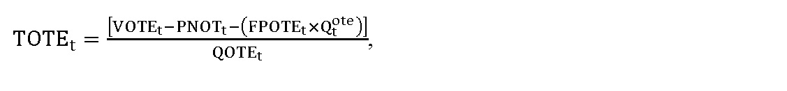
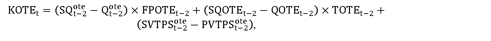

# § 12

(1) Pre subjekty zúčtovania, ktoré majú s organizátorom krátkodobého trhu s elektrinou uzatvorenú zmluvu o prístupe a podmienkach účasti na organizovanom krátkodobom trhu s elektrinou, sa uplatňujú tarify za organizovanie a vyhodnotenie krátkodobého trhu s elektrinou a schválený alebo určený maximálny výnos VOTEt z týchto platieb a z alikvotnej časti výnosu z tarify za prevádzkovanie systému v roku t v eurách sa vypočíta podľa vzorca

VOTEt = PNOTEt + POOTEt + ZIt × WACC × kZIt + INVOTEt – KOTEt,

kde

- a) PNOTEt sú schválené alebo určené plánované ročné prevádzkové náklady súvisiace s organizovaním a vyhodnotením krátkodobého trhu s elektrinou na rok t v eurách,

- b) POOTEt sú schválené alebo určené plánované odpisy na rok t v eurách súvisiace s regulovanou činnosťou z plánovanej hodnoty regulačnej bázy aktív nevyhnutne využívanej pre regulovanú činnosť v roku t,

- c) ZIt je hodnota základného imania organizátora krátkodobého trhu s elektrinou k dátumu podania cenového návrhu v eurách, ktorá sa zohľadní pre rok t,

- d) WACC je miera výnosnosti regulačnej bázy aktív na 6. regulačné obdobie určená podľa § 5,

- e) kZIt je koeficient zahrnutia hodnoty základného imania organizátora krátkodobého trhu s elektrinou určený úradom vo výške 0 až 1 pre rok t,

- f) INVOTEt je faktor investícií v roku t v eurách, ktorého hodnota sa vypočíta podľa vzorca

- INVOTEt = SOotet–2 – POotet–2,

- kde

  - 1. SOotet-2 sú skutočné odpisy v eurách z investícií zaradených do hodnoty regulačnej bázy aktív nevyhnutne využívaných na organizovanie a vyhodnotenie krátkodobého trhu s elektrinou v roku t-2,

  - 2. POotet-2 sú schválené alebo určené plánované odpisy z investícií, plánovaných zaradiť do hodnoty regulačnej bázy aktív nevyhnutne využívaných na organizovanie a vyhodnotenie krátkodobého trhu s elektrinou v roku t-2,

- g) KOTEt je faktor vyrovnania v roku t v eurách vypočítaný podľa odseku 3.

(2) Tarifa za organizovanie a vyhodnotenie krátkodobého trhu s elektrinou TOTEt schválená alebo určená cenovým rozhodnutím na rok t v eurách na jednotku množstva elektriny nakúpenej a predanej účastníkom krátkodobého trhu s elektrinou sa vypočíta podľa vzorca

kde

- a) VOTEt je schválený alebo určený maximálny výnos v eurách na rok t, určený podľa odseku 1,

- b) Tarifa za prevádzkovanie systému a alikvotná časť tarify za prevádzkovanie systému na organizovanie a vyhodnotenie krátkodobého trhu s elektrinou organizátora krátkodobého trhu s elektrinou TPSotet v roku t v eurách sa vypočíta podľa vzorca

- 

- T

- P

- S

- t

- o

- t

- e

- =

- P

- N

- O

- T

- t

- Q

- P

- K

- S

- t

- p

- s

- t

- ,

- kde

  - 1. PNOTt sú schválené alebo určené plánované náklady zohľadňujúce alikvotnú časť nákladov na organizovanie a vyhodnotenie krátkodobého trhu s elektrinou na rok t v eurách,

  - 2. QPKStpst je celkové množstvo plánovanej koncovej spotreby elektriny odobratej zo sústavy v jednotkách množstva elektriny v roku t, na ktorú sa uplatňujú tarify za prevádzkovanie systému,

- c) FPOTEt je ročná fixná platba na rok t v eurách schválená alebo určená cenovým rozhodnutím pre subjekt zúčtovania, ktorý je účastníkom organizovaného krátkodobého trhu s elektrinou,

- d) Qtote je plánovaný počet účastníkov organizovaného krátkodobého trhu s elektrinou v roku t,

- e) QOTEt je plánované množstvo elektriny v jednotkách množstva elektriny na rok t nakúpenej a predanej účastníkmi krátkodobého trhu s elektrinou.

(3) Faktor vyrovnania KOTEt v roku t v eurách sa vypočíta podľa vzorca

kde

- a) SQt-2ote je skutočný počet účastníkov organizovaného krátkodobého trhu s elektrinou v roku t-2,

- b) Qt-2ote je plánovaný počet účastníkov organizovaného krátkodobého trhu s elektrinou v roku t-2,

- c) FPOTEt-2 je ročná fixná platba na rok t-2 v eurách schválená alebo určená cenovým rozhodnutím pre subjekt zúčtovania, ktorý bol účastníkom organizovaného krátkodobého trhu s elektrinou,

- d) SQOTEt-2 je skutočné množstvo elektriny v jednotkách množstva elektriny v roku t-2 nakúpenej a predanej na krátkodobom trhu s elektrinou,

- e) QOTEt-2 je schválené plánované množstvo elektriny v jednotkách množstva elektriny na rok t-2 nakúpenej a predanej na krátkodobom trhu s elektrinou,

- f) TOTEt-2 je tarifa za organizovanie a vyhodnotenie krátkodobého trhu s elektrinou schválená alebo určená cenovým rozhodnutím na rok t-2 v eurách na jednotku množstva elektriny nakúpenej na krátkodobom trhu s elektrinou,

- g) SVTPSt-2ote sú skutočné výnosy z uplatňovania alikvotnej časti tarify za prevádzkovanie systému na organizovanie a vyhodnotenie krátkodobého trhu s elektrinou organizátora krátkodobého trhu s elektrinou v roku t-2 v eurách,

- h) PVTPSt-2ote sú plánované výnosy z uplatňovania alikvotnej časti tarify za prevádzkovanie systému na organizovanie a vyhodnotenie krátkodobého trhu s elektrinou organizátora krátkodobého trhu s elektrinou v roku t-2 v eurách.
