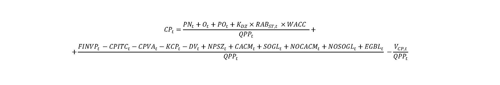
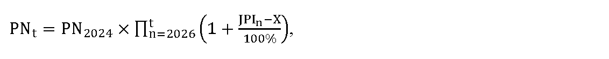
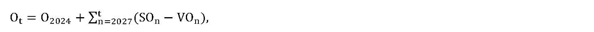
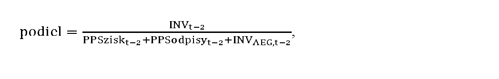
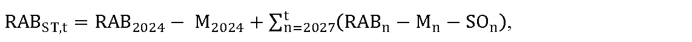

# § 16

(1) Maximálna cena za prístup do prenosovej sústavy a prenos elektriny CPt okrem strát elektriny pri prenose elektriny na rok t v eurách na jednotku množstva elektriny sa vypočíta podľa vzorca

kde

- a) PNt sú schválené alebo určené prevádzkové náklady v eurách na rok t súvisiace s regulovanou činnosťou okrem odpisov súvisiacich s regulovanou činnosťou, nákladov a odpisov na dispečerskú činnosť prevádzkovateľa prenosovej sústavy na zabezpečenie systémových služieb, ktorých hodnota

  - 1. pre rok t = 2025 zodpovedá hodnote schválených alebo určených prevádzkových nákladov v eurách na rok 2024 súvisiacich s regulovanou činnosťou okrem odpisov, nákladov a odpisov na dispečerskú činnosť prevádzkovateľa prenosovej sústavy na zabezpečenie systémových služieb,

  - 2. pre rok t = 2026 a nasledujúce roky sa vypočíta podľa vzorca

  - 

  - kde

    - 2a. PN2024 sú schválené alebo určené prevádzkové náklady v eurách na rok 2024 súvisiace s regulovanou činnosťou okrem odpisov, nákladov a odpisov na dispečerskú činnosť prevádzkovateľa prenosovej sústavy na zabezpečenie systémových služieb,

    - 2b. JPIn je aritmetický priemer indexov jadrovej inflácie v percentách zverejnených štatistickým úradom za obdobie od júla roku n-2 vrátane do júna roku n-1 vrátane, uvedených na webovom sídle Štatistického úradu Slovenskej republiky – http://datacube.statistics.sk v priečinku „Makroekonomické štatistiky“ v sekcii „Spotrebiteľské ceny a ceny produkčných štatistík“ v časti „Indexy spotrebiteľských cien (inflácia)“ v časti „Jadrová a čistá inflácia“ v priečinku „Jadrová a čistá inflácia – oproti rovnakému obdobiu minulého roku v percentách – mesačne [sp0008ms]“,

    - 2c. X je faktor efektivity, ktorého hodnota v každom roku regulačného obdobia je 3,0 % a, pričom ak je hodnota rozdielu JPIn a X nižšia ako 0 %, na výpočet maximálnej ceny za prístup do prenosovej sústavy a prenos elektriny na rok t sa hodnota rozdielu JPIn a X rovná 0 %,

- b) Ot je schválená alebo určená hodnota odpisov prevádzkovateľa prenosovej sústavy v eurách na rok t, ktorá

  - 1. pre rok t = 2025 zodpovedá výške účtovných odpisov prevádzkovateľa prenosovej sústavy v roku 2023 z majetku uvažovaného v RAB2023, podľa písmena e) prvého bodu podbodu 1a.,

  - 2. pre rok t = 2026 zodpovedá výške regulačných odpisov prevádzkovateľa prenosovej sústavy z majetku uvažovaného v RAB2024, podľa písmena e) druhého bodu podbodu 2a., určená na základe prílohy č. 1,

  - 3. pre rok t = 2027 a nasledujúce roky sa vypočíta podľa vzorca

  - 

  - kde

    - 3a. O2024 je schválená alebo určená hodnota odpisov prevádzkovateľa prenosovej sústavy v eurách, ktorá zodpovedá výške regulačných odpisov prevádzkovateľa prenosovej sústavy v roku 2024 z majetku uvažovaného v RAB2024, podľa písmena e) tretieho bodu podbodu 3a., určená na základe prílohy č. 1,

    - 3b. SOn je schválená alebo určená hodnota odpisov prevádzkovateľa prenosovej sústavy v eurách, ktorá zodpovedá výške regulačných odpisov prevádzkovateľa prenosovej sústavy v roku n-1 z majetku zaradeného do užívania na regulovanú činnosť v roku n-2 bez dispečerskej činnosti, určená na základe prílohy č. 1,

    - 3c. VOn je schválená alebo určená hodnota odpisov prevádzkovateľa prenosovej sústavy v eurách, ktorá zodpovedá výške regulačných odpisov prevádzkovateľa prenosovej sústavy v roku n-2 z majetku vyradeného z užívania na regulovanú činnosť v roku n-2 bez dispečerskej činnosti, určená na základe prílohy č. 1,

- c) POt je schválená alebo určená plánovaná hodnota odpisov prevádzkovateľa prenosovej sústavy v eurách, ktorá zodpovedá výške plánovaných regulačných odpisov prevádzkovateľa prenosovej sústavy v roku t z majetku s plánovaným zaradením do užívania na regulovanú činnosť v roku t-1 bez dispečerskej činnosti, určená na základe prílohy č. 1,

- d) KDZ je koeficient miery využitia disponibilných zdrojov do investícií súvisiacich s regulovanou činnosťou, ktorý sa určuje v intervale od 0,80 do 1,00 a vypočíta sa podľa vzorca

- 

- kde

- ak je výsledok podielu

- vyšší alebo sa rovná 0,7, tak KDZ = 1,00,

- menší ako 0,7 a zároveň vyšší alebo sa rovná 0,6, tak KDZ = 0,97,

- menší ako 0,6 a zároveň vyšší alebo sa rovná 0,5, tak KDZ = 0,94,

- menší ako 0,5 a zároveň vyšší alebo sa rovná 0,4, tak KDZ = 0,91,

- menší ako 0,4 a zároveň vyšší alebo sa rovná 0,3, tak KDZ = 0,88,

- menší ako 0,3 a zároveň vyšší alebo sa rovná 0,2, tak KDZ = 0,85,

- menší ako 0,2 a zároveň vyšší alebo sa rovná 0,1, tak KDZ = 0,82,

- menší ako 0,1, tak KDZ = 0,80,

- kde

  - 1. INVt-2 je skutočná hodnota investičných výdavkov na regulovanú činnosť prevádzkovateľa prenosovej sústavy bez dispečerskej činnosti v roku t-2 v eurách,

  - 2. PPSziskt-2 je regulovaný zisk prevádzkovateľa prenosovej sústavy po zdanení v roku t-2 v eurách, ktorý sa vypočíta podľa vzorca

  - PPSziskt–2 = (RABST,t–2 × WACCt–2) × (1 – SOOPROt–2) × (1 – daň z príjmovt–2)

  - kde

    - 2a. RABST,t-2 je schválená alebo určená hodnota regulačnej bázy aktív v eurách na rok t-2,

    - 2b. WACCt-2 je miera výnosnosti regulačnej bázy aktív na 6. regulačné obdobie určená na rok t-2 podľa § 5,

    - 2c. SOOPROt-2 je 12-násobok hodnoty mesačnej sadzby osobitného odvodu z podnikania v regulovaných odvetviach v roku t-2, ustanovenej podľa osobitného predpisu,24)

    - 2d. daň z príjmovt-2 je hodnota sadzby dane z príjmov právnických osôb v roku t-2,

  - 3. PPSodpisyt-2 je hodnota regulovaných odpisov prevádzkovateľa prenosovej sústavy v roku t-2 v eurách, ktorá sa vypočíta podľa vzorca

  - PPSodpisyt–2 = Ot–2 + POt–2 + FINVPt–2 – DVt–2,

  - kde

    - 3a. Ot-2 je schválená alebo určená hodnota odpisov regulovaného subjektu za regulovanú činnosť bez dispečerskej činnosti v eurách na rok t-2,

    - 3b. POt-2 je schválená alebo určená plánovaná hodnota odpisov prevádzkovateľa prenosovej sústavy v eurách v roku t-2 z majetku s plánovaným zaradením do užívania na regulovanú činnosť bez dispečerskej činnosti v roku t-3,

    - 3c. FINVPt-2 je faktor investícií v eurách na rok t-2,

    - 3d. DVt-2 sú skutočné výnosy v roku t-4 v eurách z uplatnenia úhrad nákladov užívateľov prenosovej sústavy za pripojenie do sústavy,

  - 4. INVAEG,t-2 je skutočná hodnota investičných výdavkov na regulovanú činnosť prevádzkovateľa prenosovej sústavy bez dispečerskej činnosti v roku t-2 v eurách, ktoré boli financované z výnosov z aukcií prenosovej kapacity na cezhraničných profiloch prenosovej sústavy, zo zdrojov Európskej únie alebo iných grantov a štátnych podpôr,

- e) RABST,t, je schválená alebo určená hodnota regulačnej bázy aktív prevádzkovateľa prenosovej sústavy v eurách na rok t, ktorá je rovná hodnote majetku využívaného na regulovanú činnosť bez dispečerskej činnosti a vypočíta sa

  - 1. pre rok t = 2025 podľa vzorca

  - RABST,t = RAB2023 – M2023,

  - kde

    - 1a. RAB2023 je schválená alebo určená hodnota regulačnej bázy aktív prevádzkovateľa prenosovej sústavy v eurách, ktorá zodpovedá zostatkovej účtovnej hodnote majetku prevádzkovateľa prenosovej sústavy k 31. decembru 2023 využívaného na regulovanú činnosť bez dispečerskej činnosti, vrátane pozemkov v pôvodných obstarávacích hodnotách bez vplyvu precenenia,

    - 1b. M2023 je hodnota tej časti regulačnej bázy aktív RAB2023 v eurách, ktorá bola financovaná zo zdrojov Európskej únie, alebo iných grantov a štátnych podpôr, alebo z investícií do aktív financovaných z výnosov z aukcií prenosovej kapacity na cezhraničných profiloch prenosovej sústavy,

  - 2. pre rok t = 2026 podľa vzorca,

  - RABST,t = RAB2024 – M2024,

  - kde

    - 2a. RAB2024 je schválená alebo určená hodnota regulačnej bázy aktív prevádzkovateľa prenosovej sústavy v eurách, ktorá zodpovedá zostatkovej účtovnej hodnote majetku prevádzkovateľa prenosovej sústavy k 31. decembru 2024 využívaného na regulovanú činnosť bez dispečerskej činnosti, určenej na základe znaleckého posudku vypracovaného znalcom zapísaným v zozname znalcov v odbore Ekonomika a riadenie podnikov v súlade s osobitným predpisom,25) vrátane pozemkov v pôvodných obstarávacích hodnotách bez vplyvu precenenia,

    - 2b. M2024 je hodnota tej časti regulačnej bázy aktív RAB2024 v eurách, ktorá bola financovaná zo zdrojov Európskej únie, alebo iných grantov a štátnych podpôr, alebo z investícií do aktív financovaných z výnosov z aukcií prenosovej kapacity na cezhraničných profiloch prenosovej sústavy,

  - 3. pre rok t = 2027 a nasledujúce roky sa vypočíta podľa vzorca

  - 

  - kde

    - 3a. RAB2024 je schválená alebo určená hodnota regulačnej bázy aktív prevádzkovateľa prenosovej sústavy v eurách, ktorá zodpovedá hodnote majetku prevádzkovateľa prenosovej sústavy k 31. decembru 2024, využívaného na regulovanú činnosť bez dispečerskej činnosti určenej na základe znaleckého posudku vypracovaného znalcom zapísaným v zozname znalcov v odbore Ekonomika a riadenie podnikov v súlade s osobitným predpisom,25) vrátane pozemkov v pôvodných obstarávacích hodnotách bez vplyvu precenenia,

    - 3b. M2024 je hodnota tej časti regulačnej bázy aktív RABn v eurách, ktorá bola financovaná zo zdrojov Európskej únie alebo iných grantov a štátnych podpôr, a z investícií do aktív financovaných z výnosov z aukcií prenosovej kapacity na cezhraničných profiloch prenosovej sústavy,

    - 3c. RABn je schválená alebo určená hodnota regulačnej bázy aktív prevádzkovateľa prenosovej sústavy v eurách, ktorá zodpovedá hodnote majetku prevádzkovateľa prenosovej sústavy využívaného na regulovanú činnosť bez dispečerskej činnosti zaradeného do užívania v roku n-2, vrátane pozemkov v pôvodných obstarávacích hodnotách bez vplyvu precenenia,

    - 3d. Mn je hodnota tej časti regulačnej bázy aktív RABn v eurách, ktorá je financovaná zo zdrojov Európskej únie alebo iných grantov a štátnych podpôr, a z investícií do aktív financovaných z výnosov z aukcií prenosovej kapacity na cezhraničných profiloch prenosovej sústavy,

    - 3e. SOn je schválená alebo určená hodnota odpisov prevádzkovateľa prenosovej sústavy v eurách, ktorá zodpovedá výške regulačných odpisov prevádzkovateľa prenosovej sústavy v roku n-1 z majetku zaradeného do užívania na regulovanú činnosť v roku n-2 bez dispečerskej činnosti, určená na základe prílohy č. 1,

- f) WACC je miera výnosnosti regulačnej bázy aktív na 6. regulačné obdobie určená podľa § 5,

- g) FINVPt je faktor investícií v eurách na rok t a vypočíta sa

- FINVPt = SOt–1 – POt–2,

- kde

  - 1. SOt-1 je schválená alebo určená hodnota odpisov prevádzkovateľa prenosovej sústavy v eurách, ktorá zodpovedá výške regulačných odpisov prevádzkovateľa prenosovej sústavy v roku t-2 z majetku zaradeného do užívania na regulovanú činnosť v roku t-3 bez dispečerskej činnosti, určená na základe prílohy č. 1,

  - 2. POt-2 je schválená alebo určená plánovaná hodnota odpisov prevádzkovateľa prenosovej sústavy v eurách, ktorá zodpovedá výške plánovaných regulačných odpisov prevádzkovateľa prenosovej sústavy v roku t-2 z majetku s plánovaným zaradením do užívania na regulovanú činnosť v roku t-3 bez dispečerskej činnosti, určená na základe prílohy č. 1,

- h) CPITCt je alikvotná časť čistých výnosov alebo nákladov z ITC mechanizmu v eurách zahrnutá do ceny za prístup do prenosovej sústavy a prenos elektriny na rok t a vypočíta sa podľa vzorca

- CPITCt = ITCplt–1 × mt × (1 – mstrt),

- kde

  - 1. ITCplt-1 je celkový rozdiel očakávaných výnosov a nákladov prevádzkovateľa prenosovej sústavy v eurách fakturovaných v rámci ITC mechanizmu v roku t-1, ktorý sa určí ako súčet

    - 1a. celkového rozdielu skutočných výnosov a nákladov prevádzkovateľa prenosovej sústavy v eurách fakturovaných v rámci ITC mechanizmu za všetky účtovne uzavreté mesiace roku t-1 v dobe vypracovania cenového návrhu a

    - 1b. celkového rozdielu očakávaných výnosov a nákladov prevádzkovateľa prenosovej sústavy v eurách fakturovaných v rámci ITC mechanizmu za tie mesiace roku t-1, ktoré v dobe vypracovania cenového návrhu nie sú účtovne uzavreté,

  - 2. mt je koeficient zahrnutia ITC mechanizmu do taríf na rok t určený úradom do 31. decembra roku t-1 v rozsahu 0 až 1,

  - 3. mstrt je koeficient zahrnutia ITC mechanizmu do tarify za straty elektriny pri prenose elektriny určený úradom do 31. decembra roku t-1 v rozsahu 0 až 1,

- i) CPVAt je alikvotná časť čistých výnosov alebo nákladov z aukcií prenosovej kapacity na cezhraničných profiloch prenosovej sústavy v eurách zahrnutá do ceny za prístup do prenosovej sústavy a prenos elektriny na rok t, a vypočíta sa podľa vzorca

- CPVAt = VAplt–1 × nt × (1 – nstrt – ntsst),

- kde

  - 1. VAplt-1 je celkový rozdiel očakávaných výnosov a nákladov prevádzkovateľa prenosovej sústavy v eurách fakturovaných v rámci aukcií prenosovej kapacity na cezhraničných profiloch prenosovej sústavy v roku t-1, ktorý sa určí ako súčet

    - 1a. celkového rozdielu skutočných výnosov a nákladov prevádzkovateľa prenosovej sústavy v eurách fakturovaných v rámci aukcií prenosovej kapacity na cezhraničných profiloch prenosovej sústavy za všetky účtovne uzavreté mesiace roku t-1 v dobe vypracovania cenového návrhu a

    - 1b. celkového rozdielu očakávaných výnosov a nákladov prevádzkovateľa prenosovej sústavy v eurách fakturovaných v rámci aukcií prenosovej kapacity na cezhraničných profiloch prenosovej sústavy za tie mesiace roku t-1, ktoré v dobe vypracovania cenového návrhu nie sú účtovne uzavreté,

  - 2. nt je koeficient zahrnutia aukcií prenosovej kapacity na cezhraničných profiloch prenosovej sústavy do taríf na rok t určený úradom do 31. decembra roku t-1 v rozsahu 0 až 1,

  - 3. nstrt je koeficient zahrnutia aukcií prenosovej kapacity na cezhraničných profiloch prenosovej sústavy do tarify za straty elektriny pri prenose elektriny určený úradom do 31. decembra roku t-1 v rozsahu 0 až 1,

  - 4. ntsst je koeficient zahrnutia aukcií prenosovej kapacity na cezhraničných profiloch prenosovej sústavy do tarify za systémové služby určený úradom do 31. decembra roku t-1 v rozsahu 0 až 1,

- j) KCPt je faktor ITC a aukcií prenosovej kapacity v eurách, ktorý sa vypočíta podľa vzorca

- KCPt = ITCskt–2 – ITCplt–2 + VAskt–2 – VAplt–2,

- kde

  - 1. ITCskt-2 je celkový rozdiel skutočných výnosov a nákladov prevádzkovateľa prenosovej sústavy v eurách fakturovaných v rámci ITC mechanizmu v roku t-2,

  - 2. ITCplt-2 je celkový rozdiel očakávaných výnosov a nákladov prevádzkovateľa prenosovej sústavy v eurách fakturovaných v rámci ITC mechanizmu v roku t-2,

  - 3. VAskt-2 je celkový rozdiel skutočných výnosov a nákladov prevádzkovateľa prenosovej sústavy v eurách fakturovaných v rámci aukcií prenosovej kapacity na cezhraničných profiloch prenosovej sústavy v roku t-2,

  - 4. VAplt-2 je celkový rozdiel očakávaných výnosov a nákladov prevádzkovateľa prenosovej sústavy v eurách fakturovaných v rámci aukcií prenosovej kapacity na cezhraničných profiloch prenosovej sústavy v roku t-2,

- k) DVt sú skutočné výnosy v roku t-2 v eurách z uplatnenia úhrad nákladov užívateľov prenosovej sústavy za pripojenie do sústavy,

- l) QPPt je plánované priemerné množstvo elektriny odobratej z prenosovej sústavy koncovými odberateľmi elektriny, ktorí sú priamo pripojení do prenosovej sústavy, výrobcami elektriny, ktorí sú priamo pripojení do prenosovej sústavy, a prevádzkovateľmi distribučnej sústavy v jednotkách množstva elektriny na rok t vypočítané ako priemer ročných hodnôt skutočného príslušného množstva elektriny za roky t-3 a t-2, očakávaného príslušného množstva za rok t-1 a plánovaného príslušného množstva na rok t,

- m) NPSZt sú náklady na projekty spoločného záujmu na rok t v eurách,

- n) CACMt sú schválené náklady na projekty prideľovania kapacity a riadenia preťaženia sústavy, ktoré nie sú evidované v majetku prevádzkovateľa prenosovej sústavy na rok t v eurách,

- o) SOGLt sú schválené náklady na projekty súvisiace s implementáciou povinností prevádzkovateľa prenosovej sústavy podľa osobitného predpisu26) na rok t v eurách,

- p) NOCACMt sú schválené náklady na nápravné opatrenia použité v procese prideľovania prenosových kapacít podľa osobitného predpisu27) na rok t v eurách,

- q) NOSOGLt sú schválené náklady na nápravné opatrenia použité v procese riadenia prevádzky prenosovej sústavy na zabezpečenie spoľahlivosti a bezpečnosti dodávok elektriny podľa osobitného predpisu28) na rok t v eurách,

- r) EBGLt sú schválené náklady na zriadenie, zmenu a prevádzkovanie európskych platforiem podľa osobitného predpisu29) na rok t v eurách,

- s) VCP,t sú výnosy z platieb za rezervovanú kapacitu a prenos elektriny za dodávku jalovej kapacitnej elektriny do prenosovej sústavy v roku t-2 podľa § 17a ods. 1 písm. a) a b).

(2) Súčet koeficientov nstrt a ntsst, ktoré sú ustanovené v odseku 1 písm. i) v treťom a štvrtom bode, je menší alebo sa rovná 1.

(3) Na účely platby za prístup do prenosovej sústavy sa dohodnutá rezervovaná kapacita v MW v roku t v každom odbernom mieste určuje kumulatívne za všetky odberné miesta odberateľa elektriny ako aritmetický priemer ročných hodnôt skutočného ročného maxima štvrťhodinového výkonu za roky t-2 až t-4. Hodnoty výkonov sa určujú v MW s rozlíšením na tri desatinné miesta. Do celkového objemu rezervovanej kapacity sa započíta aj rezervovaná kapacita pre každého výrobcu elektriny a prevádzkovateľa zariadenia na uskladňovanie elektriny určená podľa § 15 ods. 8 až 10 a 15.

(4) Ak nie je do odberných miest užívateľa prenosovej sústavy vykonávaný prenos elektriny v roku t-4, použije sa aritmetický priemer z rokov t-2 a t-3. Ak nie je do odberných miest užívateľa prenosovej sústavy vykonávaný prenos elektriny v rokoch t-4 a t-3, použije sa hodnota skutočného ročného maxima štvrťhodinového výkonu za rok t-2. Ak nie je do odberných miest užívateľa prenosovej sústavy vykonávaný prenos elektriny v rokoch t-4, t-3 a t-2, rezervovaná kapacita pre odber elektriny zo sústavy užívateľa prenosovej sústavy a výrobcu elektriny, ktorého zariadenie na výrobu elektriny je pripojené do prenosovej sústavy výlučne na odber elektriny a prevádzkovateľa zariadenia na uskladňovanie elektriny, ktorého zariadenie na uskladňovanie elektriny je pripojené do prenosovej sústavy výlučne na odber elektriny sa určuje prevádzkovateľom prenosovej sústavy mesačne na základe nameraného mesačného maxima štvrťhodinového činného výkonu. Rovnaký postup sa použije, ak hodnota skutočne nameraného mesačného maxima štvrťhodinového činného výkonu koncového odberateľa elektriny priamo pripojeného do prenosovej sústavy alebo prevádzkovateľa miestnej distribučnej sústavy priamo pripojenej do prenosovej sústavy v príslušnom mesiaci počas roku t presiahne 1,10-násobok alebo nedosiahne 0,50-násobok hodnoty dohodnutej rezervovanej kapacity určenej podľa odseku 2. Hodnoty výkonov sa určujú v MW s rozlíšením na tri desatinné miesta. Takto určená rezervovaná kapacita nesmie byť vyššia ako kapacita pripojenia uvedená v zmluve o pripojení do prenosovej sústavy.

(5) Podiel výnosov z platieb za rezervovanú kapacitu sa z celkových výnosov z platieb za rezervovanú kapacitu a z platieb za prenesenú elektrinu určuje koeficientom do 0,7. Podiel výnosov z platieb za prenesenú elektrinu sa z celkových výnosov z platieb za rezerváciu kapacity a z platieb za prenesenú elektrinu určuje koeficientom 0,3.

(6) Spolu s návrhom ceny na rok t sa predkladá spôsob výpočtu navrhovaných zložiek taríf za rezervovanú kapacitu v MW a za elektrinu odobratú z prenosovej sústavy. Navrhované tarify zohľadňujú plánované výnosy v roku t v eurách z platieb za rezervovanú kapacitu pri výrobe elektriny od výrobcov elektriny pripojených do prenosovej sústavy, prevádzkovateľov zariadení na uskladňovanie elektriny a charakter odberu elektriny koncových odberateľov elektriny priamo pripojených do prenosovej sústavy, ich spotrebu elektriny a rezervovanú kapacitu pripojených užívateľov prenosovej sústavy, a to ak

- a) rezervovaná kapacita na rok t v odbernom mieste koncového odberateľa elektriny priamo pripojeného do prenosovej sústavy je viac ako 130 MW a zároveň prenos elektriny pre koncového odberateľa elektriny priamo pripojeného do prenosovej sústavy v roku t-2, alebo na základe plánovaných údajov v roku t je viac ako 1,1 TWh, koncovým odberateľom elektriny priamo pripojeným do prenosovej sústavy v roku t sa uhrádzajú prevádzkovateľovi prenosovej sústavy platby za prístup do prenosovej sústavy a prenos elektriny, ktoré sa vypočítajú ako súčin hodnoty rezervovanej kapacity a 40 % z tarify za rezervovanú kapacitu a súčin hodnoty prenesenej elektriny a 40 % z tarify za prenesenú elektrinu,

- b) rezervovaná kapacita na rok t v odbernom mieste koncového odberateľa elektriny priamo pripojeného do prenosovej sústavy je viac ako 200 MW a zároveň prenos elektriny pre koncového odberateľa elektriny priamo pripojeného do prenosovej sústavy v roku t-2, alebo na základe plánovaných údajov v roku t je viac ako 1,7 TWh, koncovým odberateľom elektriny priamo pripojeným do prenosovej sústavy v roku t sa uhrádzajú prevádzkovateľovi prenosovej sústavy platby za prístup do prenosovej sústavy a prenos elektriny, ktoré sa vypočítajú ako súčin hodnoty rezervovanej kapacity a 20 % z tarify za rezervovanú kapacitu a súčin hodnoty prenesenej elektriny a 20 % z tarify za prenesenú elektrinu,

- c) rezervovaná kapacita na rok t v odbernom mieste koncového odberateľa elektriny priamo pripojeného do prenosovej sústavy je viac ako 350 MW a zároveň prenos elektriny pre koncového odberateľa elektriny priamo pripojeného do prenosovej sústavy v roku t-2 je viac ako 2,5 TWh, koncovým odberateľom elektriny priamo pripojeným do prenosovej sústavy v roku t sa uhrádzajú prevádzkovateľovi prenosovej sústavy platby za prístup do prenosovej sústavy a prenos elektriny, ktoré sa vypočítajú ako súčin hodnoty rezervovanej kapacity a 25 % z tarify za rezervovanú kapacitu a súčin hodnoty prenesenej elektriny a 25 % z tarify za prenesenú elektrinu.
