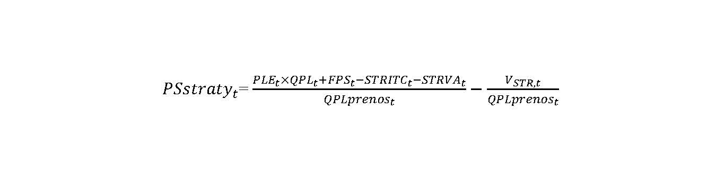
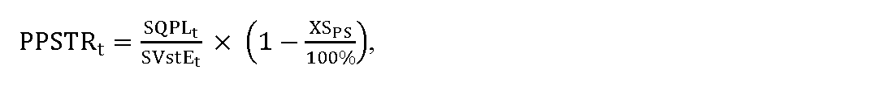

# § 17

(1) Užívateľom prenosovej sústavy sa uplatňuje tarifa za straty elektriny pri prenose elektriny PSstratyt, pričom výnos z týchto platieb sa nezahŕňa do výnosu za prístup do prenosovej sústavy a prenos elektriny. Výška tarify za straty elektriny pri prenose elektriny PSstratyt na jednotku množstva elektriny odobratej z prenosovej sústavy v roku t v eurách sa vypočíta podľa vzorca

kde

- a) PLEt je určená cena elektriny na pokrytie strát elektriny pri prenose elektriny na jednotku množstva elektriny na rok t v eurách, a vypočíta sa podľa vzorca

- 

- P

- L

- E

- t

- =

- C

- E

- P

- X

- E

- ,

- t

- ×

- 1

- +

- k

- t

- 100

- %

- +

- O

- t

- ,

- kde

  - 1. CEPXE,t je aritmetický priemer denných cien oficiálneho kurzového lístka zverejneného burzou PXE (POWER EXCHANGE CENTRAL EUROPE) na jej webovom sídle, produktu EEX-PXE Slovakian Power Futures Cal-t v eurách na jednotku množstva elektriny, pre rok t = 2025 za obdobie od 1. júla roku t-2 do 30. júna roku t-1 a pre rok t = 2026 a nasledujúce roky je toto obdobie od 1. januára roku t-1 do 30. júna roku t-1,

  - 2. kt je koeficient na rok t v percentách určený cenovým rozhodnutím v rozsahu najviac 6 % v závislosti od plánovaného diagramu strát elektriny pri prenose elektriny na rok t,

  - 3. Ot sú určené plánované náklady prevádzkovateľa prenosovej sústavy na odchýlku súvisiace s diagramom strát elektriny na jednotku množstva elektriny na rok t v eurách podľa metodiky výpočtu nákladov na odchýlku, ktorá je uvedená v prílohe č. 7,

- b) QPLt je plánované množstvo strát elektriny pri prenose elektriny v jednotkách množstva elektriny na rok t určené podľa odseku 2,

- c) FPSt je faktor strát pri prenose elektriny na jednotku množstva elektriny na rok t v eurách, ktorý sa vypočíta podľa vzorca

- FPSt = PSstratyt–2 × (QPLprenost–2 – QSKprenost–2) + PLEt–2 × (QSKt–2 – QPLt–2),

- kde

  - 1. PSstratyt-2 je tarifa za straty elektriny pri prenose elektriny na jednotku množstva elektriny odobratej z prenosovej sústavy v roku t-2 v eurách,

  - 2. QPLprenost-2 je plánované množstvo elektriny odobratej z prenosovej sústavy v jednotkách množstva elektriny na rok t-2,

  - 3. QSKprenost-2 je skutočné množstvo elektriny odobratej z prenosovej sústavy v jednotkách množstva elektriny na rok t-2,

  - 4. PLEt-2 je schválená alebo určená cena elektriny na pokrytie strát elektriny pri prenose elektriny na jednotku množstva elektriny na rok t-2 v eurách,

  - 5. QSKt-2 je skutočné čisté množstvo elektriny obstaranej na krytie strát elektriny pri prenose elektriny v roku t-2, po odpočítaní množstva predanej prebytočnej elektriny v jednotkách množstva elektriny,

  - 6. QPLt-2 je povolené plánované množstvo strát elektriny pri prenose elektriny na rok t-2 v jednotkách množstva elektriny.

- d) QPLprenost je plánované množstvo elektriny odobratej z prenosovej sústavy v jednotkách množstva elektriny na rok t,

- e) STRITCt je alikvotná časť čistých výnosov alebo nákladov z ITC mechanizmu v eurách zahrnutá do tarify za straty elektriny pri prenose elektriny na rok t a vypočíta sa podľa vzorca

- STRITCt = ITCplt–1× mt × mstrt,

- kde

  - 1. ITCplt-1 je celkový rozdiel očakávaných výnosov a nákladov prevádzkovateľa prenosovej sústavy v eurách fakturovaných v rámci ITC mechanizmu v roku t-1, ktorý sa určí ako súčet

    - 1a. celkového rozdielu skutočných výnosov a nákladov prevádzkovateľa prenosovej sústavy v eurách fakturovaných v rámci ITC mechanizmu za všetky účtovne uzavreté mesiace roku t-1 v dobe vypracovania cenového návrhu a

    - 1b. celkového rozdielu očakávaných výnosov a nákladov prevádzkovateľa prenosovej sústavy v eurách fakturovaných v rámci ITC mechanizmu za tie mesiace roku t-1, ktoré v dobe vypracovania cenového návrhu nie sú účtovne uzavreté,

  - 2. mt je koeficient zahrnutia ITC mechanizmu do taríf na rok t určený úradom do 31. decembra roku t-1 v rozsahu 0 až 1,

  - 3. mstrt je koeficient zahrnutia ITC mechanizmu do tarify za straty elektriny pri prenose elektriny určený úradom do 31. decembra roku t-1 v rozsahu 0 až 1,

- f) STRVAt je alikvotná časť čistých výnosov alebo nákladov z aukcií prenosovej kapacity na cezhraničných profiloch prenosovej sústavy v eurách zahrnutá do tarify za straty elektriny pri prenose elektriny na rok t a vypočíta sa podľa vzorca

- STRVAt = VAplt–1 × nt × nstrt,

- kde

  - 1. VAplt-1 je celkový rozdiel očakávaných výnosov a nákladov prevádzkovateľa prenosovej sústavy v eurách fakturovaných v rámci aukcií prenosovej kapacity na cezhraničných profiloch prenosovej sústavy v roku t-1, ktorý sa určí ako súčet

    - 1a. celkového rozdielu skutočných výnosov a nákladov prevádzkovateľa prenosovej sústavy v eurách fakturovaných v rámci aukcií prenosovej kapacity na cezhraničných profiloch prenosovej sústavy za všetky účtovne uzavreté mesiace roku t-1 v dobe vypracovania cenového návrhu a

    - 1b. celkového rozdielu očakávaných výnosov a nákladov prevádzkovateľa prenosovej sústavy v eurách fakturovaných v rámci aukcií prenosovej kapacity na cezhraničných profiloch prenosovej sústavy za tie mesiace roku t-1, ktoré v dobe vypracovania cenového návrhu nie sú účtovne uzavreté,

  - 2. nt je koeficient zahrnutia aukcií prenosovej kapacity na cezhraničných profiloch prenosovej sústavy do taríf na rok t určený úradom do 31. decembra roku t-1 v rozsahu 0 až 1,

  - 3. nstrt je koeficient zahrnutia aukcií prenosovej kapacity na cezhraničných profiloch prenosovej sústavy do tarify za straty elektriny pri prenose elektriny určený úradom do 31. decembra roku t-1 v rozsahu 0 až 1,

- g) VSTR,t sú platby za straty za dodávku jalovej kapacitnej elektriny v roku t-2 podľa § 17a ods. 1 písm. c).

(2) Plánované množstvo strát elektriny pri prenose elektriny QPLt v jednotkách množstva elektriny na rok t sa vypočíta podľa vzorca

QPLt = VstEt × PPSTRt,

kde

- a) VstEt je plánované množstvo elektriny v jednotkách množstva elektriny na rok t vstupujúce do prenosovej sústavy vrátane tokov zo zahraničia,

- b) PPSTRt je percento plánovaných strát elektriny pri prenose elektriny prenosovou sústavou v percentách na rok t a vypočíta sa podľa vzorca

- 

- kde

  - 1. SQPLt je súčet skutočného množstva strát elektriny pri prenose elektriny v jednotkách množstva elektriny v rokoch t-3 a t-2, očakávaného množstva strát elektriny pri prenose elektriny v jednotkách množstva elektriny v roku t-1 a plánovaného množstva strát elektriny pri prenose elektriny v jednotkách množstva elektriny na rok t,

  - 2. SVstEt je súčet skutočného množstva elektriny v jednotkách množstva elektriny v rokoch t-3 a t-2 vstupujúceho do prenosovej sústavy vrátane tokov zo zahraničia, očakávaného množstva elektriny v jednotkách množstva elektriny v roku t-1 vstupujúceho do prenosovej sústavy vrátane tokov zo zahraničia a plánovaného množstva elektriny v jednotkách množstva elektriny na rok t vstupujúceho do prenosovej sústavy vrátane tokov zo zahraničia,

  - 3. XSPS je faktor strát elektriny pri prenose elektriny v percentách, ktorý je určený vo výške 2 %.
