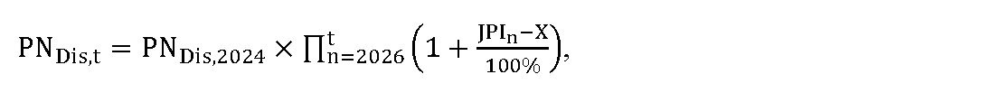
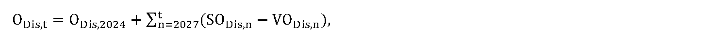
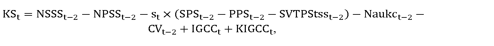
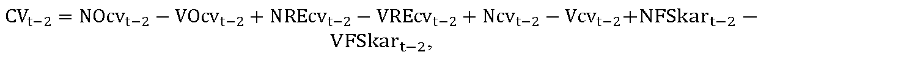
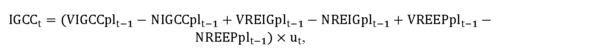
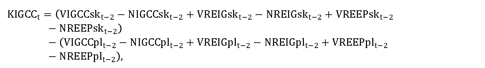

# § 19

(1) Tarifa za systémové služby na rok t v eurách na jednotku množstva elektriny sa uplatňuje na koncovú spotrebu elektriny odobratú zo sústavy koncovými odberateľmi elektriny.

(2) Tarifa za systémové služby môže byť diferencovaná na viaceré hodnoty sadzieb TSSi,t, ktoré sa uplatnia individuálne pre jednotlivé skupiny odberných miest koncových odberateľov elektriny, pričom pre priradenie odberného miesta koncového odberateľa elektriny do príslušnej skupiny sa vyhodnocuje očakávaná výška koncovej spotreby elektriny odobratej zo sústavy za rok t-1 na všetkých odberných miestach koncového odberateľa elektriny.

(3) Skupiny odberných miest koncových odberateľov elektriny sú

- a) skupina 1, a to odberné miesta koncových odberateľov elektriny s očakávanou koncovou spotrebou elektriny, na ktorú sa uplatňujú tarify za systémové služby za rok t-1 do 1 GWh vrátane, okrem odberných miest koncových odberateľov elektriny zaradených v skupine 4,

- b) skupina 2, a to odberné miesta koncových odberateľov elektriny s očakávanou koncovou spotrebou elektriny, na ktorú sa uplatňujú tarify za systémové služby za rok t-1 nad 1 GWh do 100 GWh vrátane, okrem odberných miest koncových odberateľov elektriny zaradených v skupine 4,

- c) skupina 3, a to odberné miesta koncových odberateľov elektriny s očakávanou koncovou spotrebou elektriny, na ktorú sa uplatňujú tarify za systémové služby za rok t-1 nad 100 GWh, okrem odberných miest koncových odberateľov elektriny zaradených v skupine 4,

- d) skupina 4, a to odberné miesta koncových odberateľov elektriny priamo pripojených do prenosovej sústavy, ktorých priemerná spotreba elektriny za posledné tri roky alebo plánovaná spotreba elektriny na rok t je najmenej 1 GWh, podiel nákladov na elektrickú energiu presahuje 10 % výrobných nákladov všetkých vyrobených výrobkov a pomerná odchýlka je podiel hodnoty priemeru absolútnych hodnôt odchýlky subjektu zúčtovania po zúčtovacích periódach a vyššej hodnoty z priemeru absolútnych hodnôt dohodnutých odberov a priemeru absolútnych hodnôt dohodnutých dodávok z registrovaného denného diagramu za obdobie roku t-1 s presnosťou na tri desatinné miesta alebo plánovaná pomerná odchýlka na rok t, pričom pomerná odchýlka alebo plánovaná pomerná odchýlka musí byť menšia ako 0,025; ak bola činnosť koncového odberateľa v priebehu posledných troch kalendárnych rokov prerušená dlhšie ako jeden kalendárny rok, použijú sa údaje o priemernej spotrebe elektriny, podielu nákladov na elektrickú energiu v konečnej cene výrobku a pomernej odchýlke za jeden z dvoch kalendárnych rokov predchádzajúcich kalendárnemu roku, v ktorom došlo k prerušeniu činnosti koncového odberateľa elektriny.

(4) Pre tarifu za systémové služby platí

∑

i

=

1

k

T

S

S

i

,

t

×

Q

P

K

S

t

s

s

i

,

t

=

N

P

S

S

t

,

kde

- a) TSSi,t je sadzba tarify za systémové služby uplatnená na koncovú spotrebu elektriny odobratú zo sústavy v i-tej skupine odberných miest koncových odberateľov elektriny v eurách na jednotku množstva elektriny v roku t,

- b) QPKStssi,t je celkové plánované množstvo koncovej spotreby elektriny odobratej zo sústavy v i-tej skupine odberných miest koncových odberateľov elektriny v jednotkách množstva elektriny v roku t, na ktorú sa uplatňujú tarify za systémové služby,

- c) k je celkový počet skupín odberných miest odberateľov elektriny v roku t,

- d) NPSSt sú plánované maximálne oprávnené náklady na poskytovanie systémových služieb so zahrnutím primeraného zisku na rok t, ktoré sa vypočítajú podľa odseku 5,

(5) Plánované maximálne oprávnené náklady na poskytovanie systémových služieb so zahrnutím primeraného zisku NPSSt v eurách na rok t sa vypočítajú podľa vzorca

NPSSt= PPSt+ PNDis,t+ ODis,t+ PODis,t+ RABDis,ST,t × WACC + FINVDis,t – DVPpS,t – TSSVAt– KSt– VTSS,t

kde

- a) PPSt sú celkové schválené alebo určené plánované maximálne oprávnené náklady prevádzkovateľa prenosovej sústavy na nákup podporných služieb v eurách v roku t od poskytovateľov podporných služieb podľa osobitného predpisu,33)

- b) PNDis,t sú schválené alebo určené prevádzkové náklady v eurách na rok t na dispečerskú činnosť prevádzkovateľa prenosovej sústavy na zabezpečenie poskytovania systémových služieb okrem odpisov, ktorých hodnota

  - 1. pre rok t = 2025 zodpovedá hodnote schválených alebo určených prevádzkových nákladov v eurách na rok 2024 na dispečerskú činnosť prevádzkovateľa prenosovej sústavy na zabezpečenie poskytovania systémových služieb okrem odpisov,

  - 2. pre rok t = 2026 a nasledujúce roky sa vypočíta podľa vzorca

- 

- kde

  - 2a. PNDis,2024 sú schválené alebo určené prevádzkové náklady v eurách na rok 2024 na dispečerskú činnosť prevádzkovateľa prenosovej sústavy na zabezpečenie poskytovania systémových služieb okrem odpisov,

  - 2b. JPIn je aritmetický priemer indexov jadrovej inflácie v percentách zverejnených štatistickým úradom za obdobie od júla roku n-2 do júna roku n-1, uvedených na webovom sídle Štatistického úradu Slovenskej republiky – http://datacube.statistics.sk v priečinku „Makroekonomické štatistiky“ v sekcii „Spotrebiteľské ceny a ceny produkčných štatistík“ v časti „Indexy spotrebiteľských cien (inflácia)“ v časti „Jadrová a čistá inflácia“ v priečinku „Jadrová a čistá inflácia – oproti rovnakému obdobiu minulého roku v percentách – mesačne [sp0008ms]“,

  - 2c. X je faktor efektivity, ktorého hodnota v každom roku regulačného obdobia je 3,0 %, pričom ak je hodnota rozdielu JPIn a X nižšia ako 0 %, na výpočet plánovaných nákladov na systémové služby s primeraným ziskom na rok t sa hodnota rozdielu JPIn a X rovná 0 %,

- c) ODis,t je schválená alebo určená hodnota odpisov prevádzkovateľa prenosovej sústavy v eurách na rok t, ktorá

  - 1. pre rok t = 2025 zodpovedá výške účtovných odpisov prevádzkovateľa prenosovej sústavy v roku 2023 z majetku uvažovaného v RABDis,2023 podľa písmena e) prvého bodu podbodu 1a.,

  - 2. pre rok t = 2026 zodpovedá výške regulačných odpisov prevádzkovateľa prenosovej sústavy z majetku uvažovaného v RABDis,2024, podľa písmena e) druhého bodu podbodu 2a., určená na základe prílohy č. 1,

  - 3. pre rok t = 2027 a nasledujúce roky sa vypočíta podľa vzorca

- 

- kde

  - 3a. ODis,2024 je schválená alebo určená hodnota odpisov prevádzkovateľa prenosovej sústavy v eurách, ktorá zodpovedá výške regulačných odpisov prevádzkovateľa prenosovej sústavy v roku 2024 z majetku uvažovaného v RABDis,2024, podľa písmena e) tretieho bodu podbodu 3a., určená na základe prílohy č. 1,

  - 3b. SODis,n je schválená alebo určená hodnota odpisov prevádzkovateľa prenosovej sústavy v eurách, ktorá zodpovedá výške regulačných odpisov prevádzkovateľa prenosovej sústavy v roku n-1 z majetku, zaradeného do užívania na dispečerskú činnosť v roku n-2, určená na základe prílohy č. 1,

  - 3c. VODis,n je schválená alebo určená hodnota odpisov prevádzkovateľa prenosovej sústavy v eurách, ktorá zodpovedá výške regulačných odpisov prevádzkovateľa prenosovej sústavy v roku n-2 z majetku, vyradeného z užívania na dispečerskú činnosť v roku n-2, určená na základe prílohy č. 1,

- d) PODis,t je schválená alebo určená plánovaná hodnota odpisov prevádzkovateľa prenosovej sústavy v eurách, ktorá zodpovedá výške plánovaných regulačných odpisov prevádzkovateľa prenosovej sústavy v roku t z majetku, s plánovaným zaradením do užívania na dispečerskú činnosť v roku t-1, a určená na základe prílohy č. 1,

- e) RABDis,ST,t je schválená alebo určená hodnota regulačnej bázy aktív na rok t v eurách, ktorá je rovná hodnote majetku využívaného na dispečerskú činnosť prevádzkovateľa prenosovej sústavy a vypočíta sa

  - 1. pre rok t = 2025 podľa vzorca

  - RABDis,ST,t = RABDis,2023 – MDis,2023,

  - kde

    - 1a. RABDis,2023 je schválená alebo určená hodnota regulačnej bázy aktív prevádzkovateľa prenosovej sústavy, ktorá zodpovedá zostatkovej účtovnej hodnote majetku prevádzkovateľa prenosovej sústavy k 31. decembru 2023, využívaného na dispečerskú činnosť, vrátane pozemkov v pôvodných obstarávacích hodnotách bez vplyvu precenenia,

    - 1b. MDis,2023 je hodnota tej časti regulačnej bázy aktív RABDis,2023 v eurách, ktorá bola financovaná zo zdrojov Európskej únie, alebo iných grantov a štátnych podpôr, alebo z investícií do aktív financovaných z výnosov z aukcií prenosovej kapacity na cezhraničných profiloch prenosovej sústavy,

    - 2. pre rok t = 2026 podľa vzorca

  - RABDis,ST,t = RABDis,2024 – MDis,2024,

  - kde

    - 2a. RABDis,2024 je schválená alebo určená hodnota regulačnej bázy aktív prevádzkovateľa prenosovej sústavy, ktorá zodpovedá zostatkovej hodnote majetku prevádzkovateľa prenosovej sústavy k 31. decembru 2024, využívaného na dispečerskú činnosť, určenej na základe znaleckého posudku vypracovaného znalcom zapísaným v zozname znalcov v odbore Ekonomika a riadenie podnikov v súlade s osobitným predpisom,25) vrátane pozemkov v pôvodných obstarávacích hodnotách bez vplyvu precenenia,

    - 2b. MDis,2024 je hodnota tej časti regulačnej bázy aktív RABDis,2024 v eurách, ktorá bola financovaná zo zdrojov Európskej únie, alebo iných grantov a štátnych podpôr, alebo z investícií do aktív financovaných z výnosov z aukcií prenosovej kapacity na cezhraničných profiloch prenosovej sústavy,

    - 3. pre rok t = 2027 a nasledujúce roky podľa vzorca

  - 

  - kde

    - 3a. RABDis,2024 je schválená alebo určená hodnota regulačnej bázy aktív prevádzkovateľa prenosovej sústavy v eurách, ktorá zodpovedá zostatkovej hodnote majetku prevádzkovateľa prenosovej sústavy k 31. decembru 2024, využívaného na dispečerskú činnosť, určenej na základe znaleckého posudku vypracovaného znalcom zapísaným v zozname znalcov v odbore Ekonomika a riadenie podnikov v súlade s osobitným predpisom,25) vrátane pozemkov v pôvodných obstarávacích hodnotách bez vplyvu precenenia,

    - 3b. MDis,2024 je schválená alebo určená hodnota tej časti regulačnej bázy aktív RABDis,2024 v eurách, ktorá bola financovaná zo zdrojov Európskej únie, alebo iných grantov a štátnych podpôr alebo z investícií do aktív financovaných z výnosov z aukcií prenosovej kapacity na cezhraničných profiloch prenosovej sústavy,

    - 3c. RABDis,n je schválená alebo určená hodnota regulačnej bázy aktív prevádzkovateľa prenosovej sústavy v eurách, ktorá zodpovedá hodnote majetku prevádzkovateľa prenosovej sústavy využívaného na dispečerskú činnosť zaradeného do užívania v roku n-2, vrátane pozemkov v pôvodných obstarávacích hodnotách bez vplyvu precenenia,

    - 3d. MDis,n je hodnota tej časti regulačnej bázy aktív RABDis,n v eurách, ktorá bola financovaná zo zdrojov Európskej únie, alebo iných grantov a štátnych podpôr, alebo z investícií do aktív financovaných z výnosov z aukcií prenosovej kapacity na cezhraničných profiloch prenosovej sústavy,

    - 3e. SODis,n je schválená alebo určená hodnota odpisov prevádzkovateľa prenosovej sústavy v eurách, zodpovedajúca výške regulačných odpisov prevádzkovateľa prenosovej sústavy v roku n-1 z majetku RABDis,n, zaradeného do užívania na dispečerskú činnosť v roku n-2, určená na základe prílohy č. 1,

- f) WACC je miera výnosnosti regulačnej bázy aktív na regulačné obdobie určená podľa § 5,

- g) FINVDis,t je faktor investícií súvisiacich s dispečerskou činnosťou na rok t v eurách, ktorý sa vypočíta podľa vzorca

- FINVDis,t = SODis,t–1 – PODis,t–2,

- kde

  - 1. SODis,t-1 je schválená alebo určená hodnota odpisov prevádzkovateľa prenosovej sústavy v eurách, zodpovedajúca výške regulačných odpisov prevádzkovateľa prenosovej sústavy v roku t-2 z majetku zaradeného do užívania na dispečerskú činnosť v roku t-3, určená na základe prílohy č. 1,

  - 2. PODis,t-2je schválená alebo určená plánovaná hodnota odpisov prevádzkovateľa prenosovej sústavy v eurách, ktorá zodpovedá výške plánovaných regulačných odpisov prevádzkovateľa prenosovej sústavy v roku t-2 z majetku s plánovaným zaradením do užívania na dispečerskú činnosť v roku t-3, určená na základe prílohy č. 1,

- h) DVPpS,t sú skutočné dodatočné výnosy prevádzkovateľa prenosovej sústavy v roku t-2 v eurách zo sankcií uplatnených prevádzkovateľom prenosovej sústavy voči poskytovateľom podporných služieb za neplnenie zmluvných podmienok v príslušnej zmluve o poskytovaní podporných služieb,

- i) TSSVAt je alikvotná časť čistých výnosov alebo nákladov z aukcií prenosovej kapacity na cezhraničných profiloch prenosovej sústavy v eurách zahrnutá do tarify za systémové služby na rok t a vypočíta sa podľa vzorca

- TSSVAt = VAplt–1 × nt × ntsst,

- kde

  - 1. VAplt-1 je celkový rozdiel očakávaných výnosov a nákladov prevádzkovateľa prenosovej sústavy v eurách fakturovaných v rámci aukcií prenosovej kapacity na cezhraničných profiloch prenosovej sústavy v roku t-1, ktorý sa určí ako súčet

    - 1a. celkového rozdielu skutočných výnosov a nákladov prevádzkovateľa prenosovej sústavy v eurách fakturovaných v rámci aukcií prenosovej kapacity na cezhraničných profiloch prenosovej sústavy za všetky účtovne uzavreté mesiace roku t-1 v dobe vypracovania cenového návrhu a

    - 1b. celkového rozdielu očakávaných výnosov a nákladov prevádzkovateľa prenosovej sústavy v eurách fakturovaných v rámci aukcií prenosovej kapacity na cezhraničných profiloch prenosovej sústavy za tie mesiace roku t-1, ktoré v dobe vypracovania cenového návrhu nie sú účtovne uzavreté,

  - 2. nt je koeficient zahrnutia aukcií prenosovej kapacity na cezhraničných profiloch prenosovej sústavy do taríf určený úradom do 31. decembra roku t-1 v rozsahu 0 až 1,

  - 3. ntsst je koeficient zahrnutia aukcií prenosovej kapacity na cezhraničných profiloch prenosovej sústavy do tarify za systémové služby určený úradom do 31. decembra roku t-1 v rozsahu 0 až 1,

- j) KSt je faktor vyrovnania v roku t v eurách vypočítaný podľa odseku 3,

- k) VTSS,t sú výnosy z platieb za jalovú kapacitnú elektrinu podľa § 17b za rok t-2.

(6) Faktor vyrovnania KSt na rok t v eurách sa vypočíta podľa vzorca

kde

- a) NSSSt-2 sú skutočné výnosy z poskytovania systémových služieb vyúčtované prevádzkovateľom prenosovej sústavy v eurách v roku t-2,

- b) NPSSt-2 sú plánované výnosy z poskytovania systémových služieb v eurách na rok t-2 so zohľadnením primeraného zisku,

- c) st je koeficient zahrnutia rozdielu medzi skutočnými a plánovanými nákladmi na nákup podporných služieb určený cenovým rozhodnutím úradu na rok t v rozsahu 0 až 1,

- d) SPSt-2 sú celkové skutočné náklady prevádzkovateľa prenosovej sústavy na nákup podporných služieb od poskytovateľov podporných služieb v eurách v roku t-2,

- e) PPSt-2 sú celkové schválené alebo určené plánované maximálne oprávnené náklady prevádzkovateľa prenosovej sústavy na nákup podporných služieb od poskytovateľov podporných služieb v eurách v roku t-2 uplatnené v tarife za systémové služby,

- f) SVTPStsst-2 sú skutočné výnosy prevádzkovateľa prenosovej sústavy v eurách v roku t-2 z tarify za prevádzkovanie systému, v ktorej bola prevádzkovateľovi prenosovej sústavy zohľadnená pomerná časť nákladov na nákup podporných služieb, ktoré sa pre rok t = 2027 a nasledujúce roky rovnajú nule,

- g) Naukct-2 sú skutočné náklady prevádzkovateľa prenosovej sústavy na aukcie potrebné na dovoz podporných služieb zo zahraničia v eurách v roku t-2,

- h) CVt-2 je skutočný dopad z cezhraničnej výpomoci v roku t-2 v eurách, ktorý sa vypočíta podľa vzorca

- 

- kde

  - 1. NOcvt-2sú skutočné náklady prevádzkovateľa prenosovej sústavy ako subjektu zúčtovania odchýlok za spôsobenú odchýlku súvisiace s cezhraničným saldom a havarijnou výpomocou v eurách v roku t-2,

  - 2. VOcvt-2 sú skutočné výnosy prevádzkovateľa prenosovej sústavy ako subjektu zúčtovania odchýlok za spôsobenú odchýlku súvisiace s cezhraničným saldom a havarijnou výpomocou v eurách v roku t-2,

  - 3. NREcvt-2 sú skutočné náklady prevádzkovateľa prenosovej sústavy ako dodávateľa regulačnej elektriny z havarijnej výpomoci v eurách v roku t-2,

  - 4. VREcvt-2 sú skutočné výnosy prevádzkovateľa prenosovej sústavy ako dodávateľa regulačnej elektriny z havarijnej výpomoci v eurách v roku t-2,

  - 5. Ncvt-2 sú skutočné náklady prevádzkovateľa prenosovej sústavy za havarijnú výpomoc a dodávku elektriny v rámci cezhraničného redispečingu a protiobchodu poskytnutého ostatnými prevádzkovateľmi prenosových sústav v eurách v roku t-2,

  - 6. Vcvt-2 sú skutočné výnosy prevádzkovateľa prenosovej sústavy za havarijnú výpomoc a dodávku elektriny v rámci cezhraničného redispečingu a protiobchodu poskytnutého ostatným prevádzkovateľom prenosových sústav v eurách v roku t-2,

  - 7. NFSkart-2 sú skutočné náklady prevádzkovateľa prenosovej sústavy zo systému FSkar v eurách v roku t-2,

  - 8. VFSkart-2 sú skutočné výnosy prevádzkovateľa prenosovej sústavy zo systému FSkar v eurách v roku t-2,

- i) IGCCt je alikvotná časť čistých výnosov alebo nákladov prevádzkovateľa prenosovej sústavy na regulačnú elektrinu obstaranú v rámci systému IGCC a na regulačnú elektrinu z európskych platforiem na výmenu štandardných produktov pre regulačnú elektrinu v eurách zahrnutá do tarify za systémové služby na rok t, o ktorej úrad rozhodne do 31. decembra roku t-1 a vypočíta sa podľa vzorca

- 

- kde

  - 1. VIGCCplt-1 sú očakávané výnosy prevádzkovateľa prenosovej sústavy za predaj regulačnej elektriny obstaranej automatickou aktiváciu regulačnej elektriny prostredníctvom riadiaceho informačného systému dispečingu prevádzkovateľa prenosovej sústavy v spolupráci so susednými prevádzkovateľmi prenosových sústav v rámci systému IGCC v roku t-1 v eurách,

  - 2. NIGCCplt-1 sú očakávané náklady prevádzkovateľa prenosovej sústavy na nákup regulačnej elektriny obstaranej automatickou aktiváciu regulačnej elektriny prostredníctvom riadiaceho informačného systému dispečingu prevádzkovateľa prenosovej sústavy v spolupráci so susednými prevádzkovateľmi prenosových sústav v rámci systému IGCC v roku t-1 v eurách,

  - 3. VREIGplt-1 sú očakávané výnosy prevádzkovateľa prenosovej sústavy ako dodávateľa regulačnej elektriny obstaranej prevádzkovateľom prenosovej sústavy v systéme IGCC v roku t-1 v eurách,

  - 4. NREIGplt-1 sú očakávané náklady prevádzkovateľa prenosovej sústavy ako dodávateľa regulačnej elektriny obstaranej prevádzkovateľom prenosovej sústavy v systéme IGCC v roku t-1 v eurách,

  - 5. VREEPplt-1 sú očakávané výnosy prevádzkovateľa prenosovej sústavy za regulačnú elektrinu z európskych platforiem na výmenu štandardných produktov pre regulačnú elektrinu v roku t-1 v eurách,

  - 6. NREEPplt-1 sú očakávané náklady prevádzkovateľa prenosovej sústavy na regulačnú elektrinu z európskych platforiem na výmenu štandardných produktov pre regulačnú elektrinu v roku t-1 v eurách,

  - 7. ut je koeficient zahrnutia IGCC do tarify za systémové služby určený úradom vo výške 0,8,

- j) KIGCCt je korekcia plánovaných a skutočných čistých výnosov a nákladov prevádzkovateľa prenosovej sústavy na regulačnú elektrinu obstaranú v rámci systému IGCC a plánovaných a skutočných čistých výnosov a nákladov prevádzkovateľa prenosovej sústavy na regulačnú elektrinu z európskych platforiem na výmenu štandardných produktov pre regulačnú elektrinu v eurách na rok t, ktorá sa vypočíta podľa vzorca

kde

- 1. VIGCCskt-2 sú skutočné výnosy prevádzkovateľa prenosovej sústavy za predaj regulačnej elektriny obstaranej automatickou aktiváciou regulačnej elektriny prostredníctvom riadiaceho informačného systému dispečingu prevádzkovateľa prenosovej sústavy v spolupráci so susednými prevádzkovateľmi prenosových sústav v rámci systému IGCC v roku t-2 v eurách,

- 2. NIGCCskt-2 sú skutočné náklady prevádzkovateľa prenosovej sústavy na nákup regulačnej elektriny obstaranej automatickou aktiváciou regulačnej elektriny prostredníctvom riadiaceho informačného systému dispečingu prevádzkovateľa prenosovej sústavy v spolupráci so susednými prevádzkovateľmi prenosových sústav v rámci systému IGCC v roku t-2 v eurách,

- 3. VREIGskt-2 sú skutočné výnosy prevádzkovateľa prenosovej sústavy ako dodávateľa regulačnej elektriny obstaranej prevádzkovateľom prenosovej sústavy v systéme IGCC v roku t-2 v eurách,

- 4. NREIGskt-2 sú skutočné náklady prevádzkovateľa prenosovej sústavy ako dodávateľa regulačnej elektriny obstaranej prevádzkovateľom prenosovej sústavy v systéme IGCC v roku t-2 v eurách,

- 5. NREEPskt-2 sú skutočné náklady prevádzkovateľa prenosovej sústavy na regulačnú elektrinu z európskych platforiem na výmenu štandardných produktov pre regulačnú elektrinu v roku t-2 v eurách,

- 6. VREEPskt-2 sú skutočné výnosy prevádzkovateľa prenosovej sústavy za regulačnú elektrinu z európskych platforiem na výmenu štandardných produktov pre regulačnú elektrinu v roku t-2 v eurách,

- 7. VIGCCplt-2 sú očakávané výnosy prevádzkovateľa prenosovej sústavy za predaj regulačnej elektriny obstaranej automatickou aktiváciou regulačnej elektriny prostredníctvom riadiaceho informačného systému dispečingu prevádzkovateľa prenosovej sústavy v spolupráci so susednými prevádzkovateľmi prenosových sústav v rámci systému IGCC v roku t-2 v eurách,

- 8. NIGCCplt-2 sú očakávané náklady prevádzkovateľa prenosovej sústavy na nákup regulačnej elektriny obstaranej automatickou aktiváciou regulačnej elektriny prostredníctvom riadiaceho informačného systému dispečingu prevádzkovateľa prenosovej sústavy v spolupráci so susednými prevádzkovateľmi prenosových sústav v rámci systému IGCC v roku t-2 v eurách,

- 9. VREIGplt-2 sú očakávané výnosy prevádzkovateľa prenosovej sústavy ako dodávateľa regulačnej elektriny obstaranej prevádzkovateľom prenosovej sústavy v systéme IGCC v roku t-2 v eurách,

- 10. NREIGplt-2 sú očakávané náklady prevádzkovateľa prenosovej sústavy ako dodávateľa regulačnej elektriny obstaranej prevádzkovateľom prenosovej sústavy v systéme IGCC v roku t-2 v eurách,

- 11. NREEPplt-2 sú očakávané náklady prevádzkovateľa prenosovej sústavy na regulačnú elektrinu z európskych platforiem na výmenu štandardných produktov pre regulačnú elektrinu v roku t-2 v eurách,

- 12. VREEPplt-2 sú očakávané výnosy prevádzkovateľa prenosovej sústavy za regulačnú elektrinu z európskych platforiem na výmenu štandardných produktov pre regulačnú elektrinu v roku t-2 v eurách.

(7) Pre odberateľa elektriny priamo pripojeného do prenosovej sústavy sa uplatňuje tarifa za systémové služby TSSt len za elektrinu odobratú z prenosovej sústavy.

(8) Pre odberateľa elektriny pripojeného do regionálnej distribučnej sústavy sa uplatňuje tarifa za systémové služby TSSt len za elektrinu odobratú z distribučnej sústavy.

(9) Pre odberateľa elektriny pripojeného do miestnej distribučnej sústavy sa uplatňuje tarifa za systémové služby TSSt len za všetku elektrinu odobratú zo sústavy.

(10) Pre odberateľa elektriny, ktorý odoberá elektrinu od výrobcu elektriny bez použitia prenosovej sústavy alebo distribučnej sústavy, sa tarifa za systémové služby TSSt neuplatňuje.

(11) Tarifa za systémové služby sa neuplatňuje za

- a) vlastnú spotrebu elektriny pri výrobe elektriny, ktorá nie je odobratá z nadradenej sústavy,

- b) ostatnú vlastnú spotrebu elektriny pri výrobe elektriny, ktorá nebola odobratá zo sústavy,

- c) elektrinu uskladnenú v zariadení na uskladňovanie elektriny, odobratú zo sústavy, ku ktorej je zariadenie na uskladňovanie elektriny pripojené, alebo odobratú od výrobcu elektriny bez použitia sústavy, ktorá je následne po uskladnení dodaná do sústavy,

- d) straty elektriny v sústave,

- e) vlastnú spotrebu elektriny prevádzkovateľa sústavy pri prevádzkovaní sústavy,

- f) elektrinu exportovanú zo sústavy v rámci prevádzky medzinárodne prepojených sústav,

- g) spotrebu elektriny pri skúškach po ukončení výstavby zariadenia na výrobu elektriny alebo zariadenia na uskladňovanie elektriny pred jeho uvedením do prevádzky, ak takéto skúšky sú vykonané prostredníctvom odberu elektriny z prenosovej sústavy,

- h) spotrebovanú elektrinu vyrobenú v zariadení na výrobu elektriny, ktoré nie je pripojené do sústavy a je trvalo oddelené od sústavy.

(12) Individuálna sadzba tarify za systémové služby na rok t v eurách na jednotku množstva elektriny, v súlade s § 12 ods. 6 zákona o regulácii, sa uplatňuje vo výške TSS4,t, ktorá sa vypočíta podľa vzorca

TSS4,t = (1 – Kistsst) × TSS1,t,

kde

- a) TSS4,t je sadzba tarify za systémové služby uplatnená na koncovú spotrebu elektriny odobratú zo sústavy, na ktorú sa uplatňuje tarifa za systémové služby v skupine 4 odberných miest koncových odberateľov elektriny podľa odseku 3 písm. d) v eurách na jednotku množstva elektriny v roku t,

- b) Kistsstje koeficient individuálnej sadzby tarify za systémové služby v roku t najviac vo výške 0,95,

- c) TSS1,t je sadzba tarify za systémové služby uplatnená na koncovú spotrebu elektriny odobratú zo sústavy, na ktorú sa uplatňuje tarifa za systémové služby v skupine 1 odberných miest koncových odberateľov elektriny podľa odseku 3 písm. d) v eurách na jednotku množstva elektriny v roku t.
