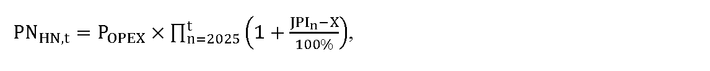
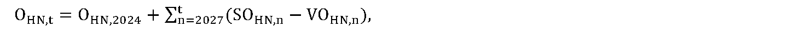
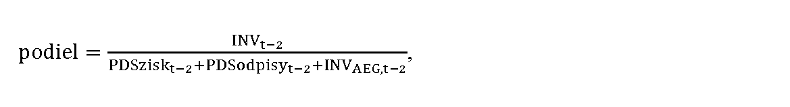
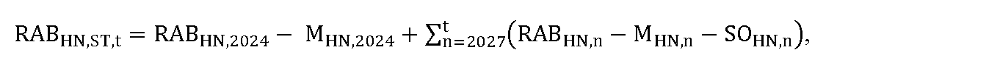
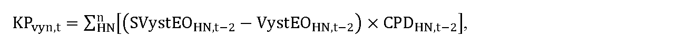

# § 25

(1) Maximálna cena za prístup do distribučnej sústavy a distribúciu elektriny na príslušnej napäťovej úrovni CDHN,t zohľadňuje vlastnú distribúciu elektriny a prenos elektriny vrátane strát pri prenose elektriny v eurách na jednotku množstva elektriny distribuovanej koncovým odberateľom elektriny v roku a vypočíta sa podľa vzorca

CDHN,t = CDEHN,t + CPDHN,t,

kde

- a) CDEHN,t je schválená alebo určená zložka maximálnej ceny za prístup do distribučnej sústavy a distribúciu elektriny na príslušnej napäťovej úrovni na rok t v eurách na jednotku množstva elektriny zohľadňujúca náklady a primeraný zisk vlastnej distribúcie elektriny podľa odseku 2,

- b) CPDHN,t je priemerná zložka ceny za prístup do prenosovej sústavy a prenos elektriny vrátane strát pri prenose elektriny v eurách na jednotku množstva elektriny na príslušnej napäťovej úrovni podľa odseku 4.

(2) Schválená alebo určená zložka maximálnej ceny za prístup do distribučnej sústavy a distribúciu elektriny na príslušnej napäťovej úrovni CDEHN,t na rok t v eurách na jednotku množstva elektriny zohľadňujúca náklady a primeraný zisk vlastnej distribúcie elektriny sa vypočíta podľa vzorca

C

D

E

H

N

,

t

=

V

V

D

H

N

+

1

,

t

+

V

V

D

H

N

,

t

V

y

s

t

E

H

N

,

t

,

kde

- a) VystEHN,t je plánované množstvo distribuovanej elektriny v jednotkách množstva elektriny na rok t vystupujúce z príslušnej napäťovej úrovne vypočítané podľa vzorca

- VystEHN,t = VystEOHN,t + VystETRHN,t,

- kde

  - 1. VystEOHN,t je plánované množstvo elektriny v jednotkách množstva elektriny na rok t distribuované na príslušnej napäťovej úrovni koncovým odberateľom elektriny a prevádzkovateľom miestnej distribučnej sústavy vypočítané ako ročný priemer zo súčtu skutočného príslušného množstva elektriny za roky t-3 a t-2, očakávaného príslušného množstva za rok t-1 a plánovaného príslušného množstva za roky t a t+1,

  - 2. VystETRHN,t je plánované množstvo elektriny v jednotkách množstva elektriny na rok t vystupujúce z príslušnej napäťovej úrovne do transformácie na nižšiu napäťovú úroveň vypočítané ako ročný priemer zo súčtu skutočného príslušného množstva elektriny za roky t-3 a t-2, očakávaného príslušného množstva za rok t-1 a plánovaného príslušného množstva za roky t a t+1,

- b) VVDHN+1,t je alikvotná časť povolených nákladov a zisku za distribúciu elektriny na rok t v eurách priradených z vyššej napäťovej úrovne a vypočíta sa podľa vzorca

- VVDHN+1,t = CDEHN+1,t × VystETRHN+1,t,

- kde

  - 1. CDEHN+1,t je zložka maximálnej ceny za prístup do distribučnej sústavy a distribúciu elektriny na vyššej napäťovej úrovni na rok t v eurách na jednotku množstva elektriny; pri napäťovej úrovni veľmi vysokého napätia sa CDEHN+1,t na vstupe do napäťovej úrovne veľmi vysokého napätia rovná 0,

  - 2. VystETRHN+1,t je plánované množstvo elektriny v jednotkách množstva elektriny na rok t vystupujúce z vyššej napäťovej úrovne HN+1 do transformácie na napäťovú úroveň HN vypočítané ako ročný priemer zo súčtu skutočného príslušného množstva elektriny za roky t-3 a t-2, očakávaného príslušného množstva za rok t-1 a plánovaného príslušného množstva za roky t a t+1,

- c) VVDHN,t sú schválené alebo určené náklady a zisk za prístup do distribučnej sústavy a distribúciu elektriny na rok t v eurách na príslušnej napäťovej úrovni okrem alikvotnej časti povolených nákladov a zisku za distribúciu elektriny priradených z vyššej napäťovej úrovne, vypočítané podľa odseku 3.

(3) Schválené alebo určené náklady a zisk za prístup do distribučnej sústavy a distribúciu elektriny na rok t v eurách na príslušnej napäťovej úrovni okrem alikvotnej časti povolených nákladov a zisku za distribúciu elektriny priradených z vyššej napäťovej úrovne VVDHN,t sa vypočítajú podľa vzorca

kde

- a) PNHN,t sú schválené alebo určené prevádzkové náklady pre rok t v eurách na príslušnej napäťovej úrovni súvisiace s regulovanou činnosťou a vypočítajú sa podľa vzorca

- 

- kde

  - 1. POPEX sú schválené alebo určené priemerné ročné prevádzkové náklady v eurách, vypočítané ako súčet skutočných osobných nákladov prevádzkovateľa regionálnej distribučnej sústavy v roku 2023 súvisiacich s regulovanou činnosťou a priemeru skutočných prevádzkových nákladov prevádzkovateľa regionálnej distribučnej sústavy za roky 2021, 2022 a 2023 na príslušnej napäťovej úrovni súvisiace s regulovanou činnosťou okrem odpisov,

  - 2. JPIn je aritmetický priemer indexov jadrovej inflácie v percentách zverejnených štatistickým úradom za obdobie od júla roku n-2 do júna roku n-1, uvedených na webovom sídle Štatistického úradu Slovenskej republiky – http://datacube.statistics.sk v priečinku „Makroekonomické štatistiky“ v sekcii „Spotrebiteľské ceny a ceny produkčných štatistík“ v časti „Indexy spotrebiteľských cien (inflácia)“ v časti „Jadrová a čistá inflácia“ v priečinku „Jadrová a čistá inflácia – oproti rovnakému obdobiu minulého roku v percentách – mesačne [sp0008ms]“,

  - 3. X je faktor efektivity, ktorého hodnota v každom roku regulačného obdobia je 3,0 %, pričom ak je hodnota rozdielu JPIn a X nižšia ako 0, na výpočet maximálnej ceny za prístup do distribučnej sústavy a distribúciu elektriny na rok t sa hodnota daného rozdielu rovná 0 %,

- b) OHN,t je schválená alebo určená hodnota odpisov prevádzkovateľa regionálnej distribučnej sústavy na rok t v eurách, ktorá

  - 1. pre rok t = 2025 zodpovedá výške účtovných odpisov prevádzkovateľa regionálnej distribučnej sústavy v roku 2023 z majetku uvažovaného v RABHN,2023, podľa § 25 písmena e) prvého bodu podbodu 1a., najmenej však na úrovni účtovných odpisov prevádzkovateľa regionálnej distribučnej sústavy v roku 2021,

  - 2. pre rok t = 2026 zodpovedá výške regulačných odpisov prevádzkovateľa regionálnej distribučnej sústavy z majetku uvažovaného v RABHN,2024, podľa písmena e) druhého bodu podbodu 2a., určená na základe prílohy č. 1,

  - 3. pre rok t = 2027 a nasledujúce roky sa vypočíta podľa vzorca

  - 

  - kde

    - 3a. OHN,2024 je schválená alebo určená hodnota odpisov prevádzkovateľa regionálnej distribučnej sústavy v eurách, ktorá zodpovedá výške regulačných odpisov prevádzkovateľa regionálnej distribučnej sústavy v roku 2024 z majetku uvažovaného v RABHN,2024, podľa písmena e) tretieho bodu podbodu 3a., určená na základe prílohy č. 1,

    - 3b. SOHN,n je schválená alebo určená hodnota odpisov prevádzkovateľa regionálnej distribučnej sústavy v eurách, ktorá zodpovedá výške regulačných odpisov prevádzkovateľa regionálnej distribučnej sústavy v roku n-1 z majetku zaradeného do užívania na regulovanú činnosť v roku n-2 na príslušnej napäťovej úrovni, určená na základe prílohy č. 1,

    - 3c. VOHN,n je schválená alebo určená hodnota odpisov prevádzkovateľa regionálnej distribučnej sústavy v eurách, zodpovedajúca výške regulačných odpisov prevádzkovateľa regionálnej distribučnej sústavy v roku n-2 z majetku vyradeného z užívania na regulovanú činnosť v roku n-2 na príslušnej napäťovej úrovni, určená na základe prílohy č. 1,

- c) POHN,t je schválená alebo určená plánovaná hodnota odpisov prevádzkovateľa regionálnej distribučnej sústavy v eurách, ktorá zodpovedá plánovaným regulačným odpisom prevádzkovateľa regionálnej distribučnej sústavy na príslušnej napäťovej úrovni v roku t z majetku s plánovaným zaradením do užívania na regulovanú činnosť v roku t-1, určená na základe prílohy č. 1,

- d) KDZ je koeficient miery využitia disponibilných zdrojov do investícií súvisiacich s regulovanou činnosťou, ktorý sa určuje v intervale od 0,80 do 1,00 a vypočíta sa podľa vzorca

- 

- kde

- ak je výsledok podielu

- vyšší alebo sa rovná 0,7, tak KDZ = 1,00,

- menší ako 0,7 a zároveň vyšší alebo sa rovná 0,6, tak KDZ = 0,97,

- menší ako 0,6 a zároveň vyšší alebo sa rovná 0,5, tak KDZ = 0,94,

- menší ako 0,5 a zároveň vyšší alebo sa rovná 0,4, tak KDZ = 0,91,

- menší ako 0,4 a zároveň vyšší alebo sa rovná 0,3, tak KDZ = 0,88,

- menší ako 0,3 a zároveň vyšší alebo sa rovná 0,2, tak KDZ = 0,85,

- menší ako 0,2 a zároveň vyšší alebo sa rovná 0,1, tak KDZ = 0,82,

- menší ako 0,1, tak KDZ = 0,80,

- kde

  - 1. INVt-2 je skutočná hodnota investičných výdavkov na regulovanú činnosť prevádzkovateľa regionálnej distribučnej sústavy v roku t-2 v eurách,

  - 2. PDSziskt-2 je regulovaný zisk prevádzkovateľa regionálnej distribučnej sústavy po zdanení v roku t-2 v eurách, ktorý sa vypočíta podľa vzorca

- PDSziskt–2 = (RABST,t–2 × WACCt–2) × (1 – SOOPROt–2) × (1 – daň z príjmovt–2),

- kde

  - 2a. RABST,t-2 je schválená alebo určená hodnota regulačnej bázy aktív v eurách na rok t-2,

  - 2b. WACCt-2 je miera výnosnosti regulačnej bázy aktív na 6. regulačné obdobie určená na rok t-2 podľa § 5,

  - 2c. SOOPROt-2 je 12-násobok hodnoty mesačnej sadzby osobitného odvodu z podnikania v regulovaných odvetviach v roku t-2, ustanovenej podľa osobitného predpisu,24)

  - 2d. daň z príjmovt-2 je hodnota sadzby dane z príjmov právnických osôb v roku t-2,

  - 3. PDSodpisyt-2 je hodnota regulovaných odpisov prevádzkovateľa regionálnej distribučnej sústavy v roku t-2 v eurách, ktorá sa vypočíta podľa vzorca

  - PDSodpisyt–2 = Ot–2 + POt–2 + FINVPt–2 – DVt–2,

  - kde

    - 3a. Ot-2 je schválená alebo určená hodnota odpisov regulovaného subjektu za regulovanú činnosť v eurách na rok t-2,

    - 3b. POt-2 je schválená alebo určená plánovaná hodnota odpisov prevádzkovateľa regionálnej distribučnej sústavy v eurách v roku t-2 z majetku s plánovaným zaradením do užívania na regulovanú činnosť v roku t-3,

    - 3c. FINVPt-2 je faktor investícií v eurách na rok t-2,

    - 3d. DVt-2 sú skutočné dodatočné výnosy v roku t-4 v eurách, ktoré sú zložené z celkových skutočných výnosov,

  - 4. INVAEG,t-2 je skutočná hodnota investičných výdavkov na regulovanú činnosť prevádzkovateľa regionálnej distribučnej sústavy v roku t-2 v eurách, ktoré boli financované zo zdrojov Európskej únie alebo iných grantov a štátnych podpôr,

- e) RABHN,ST,t je schválená alebo určená hodnota regulačnej bázy aktív prevádzkovateľa regionálnej distribučnej sústavy na príslušnej napäťovej úrovni v eurách a rovná sa hodnote majetku využívaného nevyhnutne na výkon regulovaných činností na rok t a vypočíta sa

  - 1. pre rok t = 2025 podľa vzorca

  - RABHN,ST,t = RABHN,2023 – MHN,2023,

  - kde

    - 1a. RABHN,2023 je schválená alebo určená hodnota regulačnej bázy aktív prevádzkovateľa regionálnej distribučnej sústavy v eurách, ktorá zodpovedá zostatkovej účtovnej hodnote majetku prevádzkovateľa regionálnej distribučnej sústavy k 31. decembru 2023 na príslušnej napäťovej úrovni využívaného na regulovanú činnosť, vrátane pozemkov v pôvodných obstarávacích hodnotách bez vplyvu precenenia,

    - 1b. MHN,2023 je hodnota tej časti regulačnej bázy aktív na príslušnej napäťovej úrovni RABHN,2023 v eurách, ktorá bola financovaná zo zdrojov Európskej únie alebo iných grantov a štátnych podpôr,

  - 2. pre rok t = 2026 podľa vzorca,

  - RABHN,ST,t = RABHN,2024 – MHN,2024,

  - kde

    - 2a. RABHN,2024 je schválená alebo určená hodnota regulačnej bázy aktív prevádzkovateľa regionálnej distribučnej sústavy v eurách, ktorá zodpovedá hodnote majetku prevádzkovateľa regionálnej distribučnej sústavy k 31. decembru 2024 na príslušnej napäťovej úrovni využívaného na regulovanú činnosť, určenej na základe znaleckého posudku vypracovaného znalcom zapísaným v zozname znalcov v odbore Ekonomika a riadenie podnikov v súlade s osobitným predpisom,25) vrátane pozemkov v pôvodných obstarávacích hodnotách bez vplyvu precenenia; pri predčasnom trvalom vypnutí dátovej siete pred uplynutím technickej doby životnosti inteligentných meracích systémov určených pre príslušnú dátovú sieť podľa prílohy č. 1, sa táto skutočnosť zohľadní pri vykonávaní cenovej regulácie,

    - 2b. MHN,2024 je hodnota tej časti regulačnej bázy aktív na príslušnej napäťovej úrovni RABHN,2024 v eurách, ktorá bola financovaná zo zdrojov Európskej únie alebo iných grantov a štátnych podpôr,

  - 3. pre rok t = 2027 a nasledujúce roky podľa vzorca

  - 

  - kde

    - 3a. RABHN,2024 je schválená alebo určená hodnota regulačnej bázy aktív prevádzkovateľa regionálnej distribučnej sústavy v eurách, ktorá zodpovedá hodnote majetku prevádzkovateľa regionálnej distribučnej sústavy k 31. decembru 2024 na príslušnej napäťovej úrovni využívaného na regulovanú činnosť, určenej na základe znaleckého posudku vypracovaného znalcom zapísaným v zozname znalcov v odbore Ekonomika a riadenie podnikov v súlade s osobitným predpisom,25) vrátane pozemkov v pôvodných obstarávacích hodnotách bez vplyvu precenenia; pri predčasnom trvalom vypnutí dátovej siete pred uplynutím technickej doby životnosti inteligentných meracích systémov určených pre príslušnú dátovú sieť podľa prílohy č. 1, sa táto skutočnosť zohľadní pri vykonávaní cenovej regulácie,

    - 3b. MHN,2024 je hodnota tej časti regulačnej bázy aktív na príslušnej napäťovej úrovni RABHN,2024 v eurách, ktorá bola financovaná zo zdrojov Európskej únie alebo iných grantov a štátnych podpôr, nevyhnutne využívaná na regulovanú činnosť,

    - 3c. RABHN,n je schválená alebo určená hodnota regulačnej bázy aktív prevádzkovateľa regionálnej distribučnej sústavy v eurách, ktorá zodpovedá hodnote majetku prevádzkovateľa regionálnej distribučnej sústavy na príslušnej napäťovej úrovni využívaného na regulovanú činnosť zaradeného do užívania v roku n-2, vrátane pozemkov v pôvodných obstarávacích hodnotách bez vplyvu precenenia,

    - 3d. MHN,n je hodnota tej časti regulačnej bázy aktív na príslušnej napäťovej úrovni RABHN,n v eurách, ktorá bola financovaná zo zdrojov Európskej únie alebo iných grantov a štátnych podpôr, nevyhnutne využívaná na regulovanú činnosť,

    - 3e. SOHN,n je schválená alebo určená hodnota odpisov prevádzkovateľa regionálnej distribučnej sústavy v eurách, ktorá zodpovedá výške regulačných odpisov prevádzkovateľa regionálnej distribučnej sústavy v roku n-1 z majetku na príslušnej napäťovej úrovni zaradeného do užívania na regulovanú činnosť v roku n-2, určená na základe prílohy č. 1,

- f) WACC je miera výnosnosti regulačnej bázy aktív na regulačné obdobie určená podľa § 5,

- g) FINVPHN,t je faktor investícií na napäťovej úrovni v eurách na rok t a vypočíta sa podľa vzorca

- FINVPHN,t = SOHN,t–1 – POHN,t–1,

- kde

  - 1. SOHN,t-1 je schválená alebo určená hodnota odpisov prevádzkovateľa regionálnej distribučnej sústavy na príslušnej napäťovej úrovni v eurách, ktorá zodpovedá výške regulačných odpisov prevádzkovateľa regionálnej distribučnej sústavy v roku t-2 z majetku zaradeného na regulovanú činnosť v roku t-3 na príslušnej napäťovej úrovni, určená na základe prílohy č. 1,

  - 2. POHN,t-1 je schválená alebo určená plánovaná hodnota odpisov prevádzkovateľa regionálnej distribučnej sústavy v eurách na príslušnej napäťovej úrovni, ktorá zodpovedá výške plánovaných regulačných odpisov prevádzkovateľa regionálnej distribučnej sústavy v roku t-2 z majetku s plánovaným zaradením do užívania na regulovanú činnosť v roku t-3, určená na základe prílohy č. 1,

- h) DVHN,t sú skutočné dodatočné výnosy na príslušnej napäťovej úrovni v roku t-2 v eurách, ktoré sú zložené z celkových skutočných výnosov

  - 1. z uplatnenia ceny za pripojenie do distribučnej sústavy zohľadnia sa vo výške 100 %; to neplatí pre cenu za pripojenie, ktorá bola prevádzkovateľom distribučnej sústavy vrátená žiadateľovi o pripojenie podľa § 31 ods. 17 a 18 a časť ceny za pripojenie, ktorá bola prevádzkovateľom distribučnej sústavy vrátená žiadateľovi o pripojenie podľa § 31 ods. 19, zároveň sa výnos z uplatnenia ceny za pripojenie do distribučnej sústavy zníži o hodnotu majetku zaradeného do používania v roku t-2, ktorý presahuje výšku regulačných odpisov za rok t-2,

  - 2. zo sankcií za prekročenie rezervovanej kapacity sa zohľadnia vo výške 100 %,

  - 3. z platieb za rezervovanú kapacitu a distribúciu jalovej elektriny za nedodržanie účinníka na príslušnej napäťovej úrovni účtované užívateľom sústavy na základe cenového rozhodnutia úradu sa zohľadnia vo výške, ktoré sa znížia o preukázateľne vynaložené náklady na nefrekvenčné podporné služby za rok t-2 a tento rozdiel sa zohľadní vo výške 100 %,

  - 4. z výnosov cenníka služieb za distribúciu elektriny, podľa prílohy č. 9, sa zohľadnia vo výške 50 % pre roky t = 2026 a nasledujúce roky,

  - 5. 50 % výnosov z uplatnenia cien prístupu do distribučnej sústavy a distribúcie elektriny, v súlade s platným rozhodnutím úradu, z prepravy elektriny príslušnému susednému prevádzkovateľovi sústavy na území Európskej únie alebo na území tretích štátov, v súlade s podmienkami prepravy schválených úradom,

  - 6. z výnosov za komerčné využívanie technickej infraštruktúry slúžiacej na regulovanú činnosť tretími stranami.

(4) Zložka maximálnej ceny za prístup do distribučnej sústavy a distribúciu elektriny v eurách na jednotku množstva elektriny CPDHN,t súvisiaca s nákladmi za prístup do prenosovej sústavy a prenos elektriny vrátane strát pri prenose elektriny na príslušnej napäťovej úrovni sa rovná priemernej zložke ceny za prístup do prenosovej sústavy a prenos elektriny vrátane nákladov na straty elektriny pri prenose elektriny v eurách na jednotku množstva elektriny na príslušnej napäťovej úrovni CPEHN,t, ktorá sa vypočíta podľa vzorca

C

P

E

H

N

,

t

=

V

V

P

H

N

,

t

V

y

s

t

E

H

N

,

t

,

kde

- a) VVPHN,t sú vstupujúce náklady za prístup do prenosovej sústavy a prenos elektriny vrátane nákladov na straty pri prenose elektriny na príslušnej napäťovej úrovni v eurách v roku t vypočítané podľa vzorca

- VVPHN,t = CPEHN+1,t × VystETRHN+1,t,

- kde

  - 1. CPEHN+1,t je cena za prístup do prenosovej sústavy a prenos elektriny vrátane strát pri prenose elektriny v eurách na jednotku množstva elektriny na vyššej napäťovej úrovni distribúcie elektriny v roku t, z ktorej sa transformuje elektrina do príslušnej napäťovej úrovne,

  - 2. VystETRHN+1,t je plánované množstvo elektriny v jednotkách množstva elektriny vstupujúce do príslušnej napäťovej úrovne cez transformáciu z vyššej napäťovej úrovne v roku t, vypočítané ako ročný priemer zo súčtu skutočného príslušného množstva elektriny za roky t-3 a t-2, očakávaného príslušného množstva za rok t-1 a plánovaného príslušného množstva za rok t,

- b) VystEHN,t je celkové plánované množstvo elektriny v jednotkách množstva elektriny vystupujúce z príslušnej napäťovej úrovne v roku t vypočítané podľa vzorca

- VystEHN,t = VystEOHN,t + VystETRHN,t,

- kde

  - 1. VystEOHN,t je plánované množstvo elektriny v jednotkách množstva elektriny distribuované na príslušnej napäťovej úrovni ku koncovým odberateľom elektriny v roku t,

  - 2. VystETRHN,t je plánované množstvo elektriny v jednotkách množstva elektriny vystupujúce z príslušnej napäťovej úrovne do transformácie na nižšiu napäťovú úroveň v roku t, vypočítané ako ročný priemer zo súčtu skutočného príslušného množstva elektriny za roky t-3 a t-2, očakávaného príslušného množstva za rok t-1 a plánovaného príslušného množstva za rok t.

(5) Priemerná cena za prenos elektriny i-tého prevádzkovateľa regionálnej distribučnej sústavy na rok t v eurách na jednotku množstva CPit sa uplatňuje na jednotku množstva elektriny odobratej z distribučnej sústavy i-tého prevádzkovateľa regionálnej distribučnej sústavy iným prevádzkovateľom regionálnej distribučnej sústavy za mesiac na všetkých napäťových úrovniach a vypočíta sa podľa vzorca

C

P

t

i

=

R

K

P

t

x

C

R

K

t

V

y

s

t

E

T

R

V

V

N

+

1

,

t

+

P

E

t

+

P

S

s

t

r

a

t

y

t

,

kde

- a) RKPt je rezervovaná kapacita v MW na rok t uplatňovaná pre príslušného prevádzkovateľa regionálnej distribučnej sústavy prevádzkovateľom prenosovej sústavy,

- b) CRKt je cena za rezervovanú kapacitu v roku t v eurách na MW na rok t uplatňovaná pre príslušného prevádzkovateľa regionálnej distribučnej sústavy prevádzkovateľom prenosovej sústavy,

- c) VystETRVVN+1,t je plánované množstvo elektriny v jednotkách množstva elektriny na rok t vstupujúce do napäťovej úrovne veľmi vysokého napätia regulovaného subjektu z prenosovej sústavy,

- d) PEt je cena za prenesenú elektrinu v eurách na jednotku množstva elektriny na rok t uplatňovaná pre príslušného prevádzkovateľa regionálnej distribučnej sústavy prevádzkovateľom prenosovej sústavy,

- e) PSstratyt je tarifa za straty elektriny pri prenose elektriny v eurách na jednotku množstva elektriny na rok t uplatňovaná pre príslušného prevádzkovateľa regionálnej distribučnej sústavy prevádzkovateľom prenosovej sústavy.

(6) Cena za prístup do prenosovej sústavy a prenos elektriny v eurách na jednotku množstva elektriny CPEVVN+1,t na vstupe do napäťovej úrovne veľmi vysokého napätia distribučnej sústavy je jednozložková cena zahŕňajúca náklady regulovaného subjektu na rezervovaný výkon a prenesenú elektrinu v roku t, určené na základe schváleného návrhu ceny za prístup do prenosovej sústavy a prenos elektriny na rok t, vypočítaná podľa vzorca

C

P

E

V

V

N

+

1

,

t

=

R

K

P

t

×

C

R

K

t

+

K

P

t

+

O

P

N

P

t

V

y

s

t

E

T

R

V

V

N

+

1

,

t

+

P

E

t

+

P

S

s

t

r

a

t

y

t

,

kde

- a) RKPt je rezervovaná kapacita v MW na rok t uplatňovaná pre príslušného prevádzkovateľa regionálnej distribučnej sústavy prevádzkovateľom prenosovej sústavy,

- b) CRKtje cena za rezervovanú kapacitu v roku t v eurách na MW na rok t uplatňovaná pre príslušného prevádzkovateľa regionálnej distribučnej sústavy prevádzkovateľom prenosovej sústavy,

- c) VystETRVVN+1,t je plánované množstvo elektriny v jednotkách množstva elektriny na rok t vstupujúce do napäťovej úrovne veľmi vysokého napätia regulovaného subjektu z prenosovej sústavy,

- d) PEt je cena za prenesenú elektrinu v eurách na jednotku množstva elektriny na rok t uplatňovaná pre príslušného prevádzkovateľa regionálnej distribučnej sústavy prevádzkovateľom prenosovej sústavy,

- e) OPNPtsú ostatné plánované náklady prenosu súvisiace s odberom elektriny zo susednej regionálnej distribučnej sústavy v eurách na rok t,

- f) PSstratyt je tarifa za straty elektriny pri prenose elektriny v eurách na jednotku množstva elektriny na rok t uplatňovaná pre príslušného prevádzkovateľa regionálnej distribučnej sústavy prevádzkovateľom prenosovej sústavy,

- g) KPt je faktor vyrovnania ceny za prístup do prenosovej sústavy a prenos elektriny v eurách pre rok t, ktorý sa vypočíta podľa vzorca

- KPt = KPnak,t – KPvyn,t,

- kde

  - 1. KPnak,t je korekcia nákladov za prístup do prenosovej sústavy a prenos elektriny v eurách, ktorá sa vypočíta podľa vzorca

- KPnak,t = (SVystETRVVN+1 – VystETRVVN+1,t–2) × (PEt–2 + PSstratyt–2) + OSNPt–2,

- kde

  - 1a. SVystETRVVN+1 je skutočné množstvo elektriny v jednotkách množstva elektriny vstupujúce do príslušnej napäťovej úrovne cez transformáciu z vyššej napäťovej úrovne v roku t-2,

  - 1b. VystETRVVN+1,t-2 je plánované množstvo elektriny v jednotkách množstva elektriny vstupujúce do príslušnej napäťovej úrovne cez transformáciu z vyššej napäťovej úrovne v roku t-2,

  - 1c. PEt-2 je cena za prenesenú elektrinu v eurách na jednotku množstva elektriny v roku t-2 uplatňovaná pre príslušného prevádzkovateľa regionálnej distribučnej sústavy prevádzkovateľom prenosovej sústavy,

  - 1d. PSstratyt-2 je tarifa za straty elektriny pri prenose elektriny v eurách na jednotku množstva elektriny v roku t-2 uplatňovaná pre príslušného prevádzkovateľa regionálnej distribučnej sústavy prevádzkovateľom prenosovej sústavy,

  - 1e. OSNPt-2 sú ostatné skutočné náklady na prenos elektriny za rok t-2, ktoré predstavujú platbu za odber elektriny z inej regionálnej distribučnej sústavy v roku t-2, ktoré sa vypočítajú podľa vzorca

  - 

  - kde

    - 1ea. CPi,t-2 je priemerná cena za prenos i-tého prevádzkovateľa regionálnej distribučnej sústavy na rok t-2 v eurách na jednotku množstva elektriny,

    - 1eb. SVstEPDSi,t-2je skutočné množstvo elektriny v jednotkách množstva elektriny na rok t-2 vstupujúce do distribučnej sústavy regulovaného subjektu zo susednej regionálnej distribučnej sústavy i-tého prevádzkovateľa regionálnej distribučnej sústavy,

    - 1ec. OPNPtsú ostatné plánované náklady prenosu súvisiace s odberom elektriny zo susednej regionálnej distribučnej sústavy v eurách na rok t,

  - 2. KPvyn,t je korekcia výnosov z účtovania ceny CPDHN,t-2, ktorá sa vypočíta podľa vzorca

- 

- kde

  - 2a. SVystEOHN,t-2 je skutočné množstvo elektriny v jednotkách množstva elektriny distribuované na príslušnej napäťovej úrovni ku koncovým odberateľom elektriny v roku t-2,

  - 2b. VystEOHN,t-2je plánované množstvo elektriny v jednotkách množstva elektriny distribuované na príslušnej napäťovej úrovni koncovým odberateľom elektriny v roku t-2,

  - 2c. CPDHN,t-2 je priemerná zložka ceny za prístup do prenosovej sústavy a prenos elektriny bez strát pri prenose elektriny v eurách na jednotku množstva elektriny na príslušnej napäťovej úrovni v roku t-2, vypočítaná ako aritmetický priemer ceny za prístup do prenosovej sústavy a prenos elektriny bez strát pri prenose v roku t-2.
