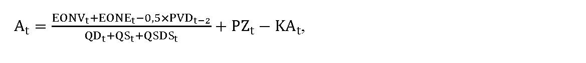
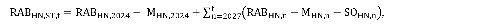
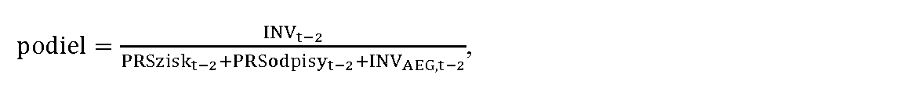
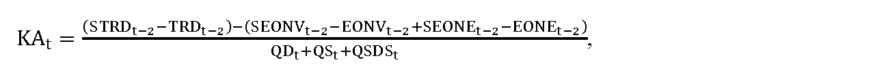
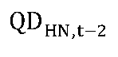
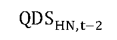

# § 28

(1) Maximálna cena za prístup do miestnej distribučnej sústavy a distribúciu elektriny At v eurách na jednotku množstva elektriny na rok t okrem strát elektriny pri distribúcii elektriny sa pre regulovaný subjekt, ktorý predkladá vlastný návrh ceny, vypočíta podľa vzorca

kde

- a) EONVt sú schválené alebo určené plánované ekonomicky oprávnené náklady na distribúciu elektriny v roku t v eurách okrem nákladov na obstaranie elektriny na krytie strát elektriny pri distribúcii elektriny a plánovaných nákladov na distribúciu elektriny od prevádzkovateľa sústavy, do ktorého sústavy je regulovaný subjekt pripojený,

- b) EONEt sú schválené alebo určené plánované ekonomicky oprávnené náklady na distribúciu elektriny v roku t v eurách, ktoré zahŕňajú náklady na distribúciu elektriny vrátane strát elektriny pri distribúcii elektriny od prevádzkovateľa sústavy, do ktorého sústavy je regulovaný subjekt pripojený,

- c) PVDt-2 je celkový skutočný objem výnosov v roku t-2 v eurách nesúvisiacich s vykonávaním regulovanej činnosti využívaním prevádzkových aktív nevyhnutne využívaných na distribúciu elektriny, ktoré sa zohľadnia pri návrhu ceny za prístup do distribučnej sústavy a distribúciu elektriny v roku t,

- d) QDt je plánované množstvo elektriny v jednotkách množstva elektriny v roku t, odobratej z distribučnej sústavy regulovaného subjektu koncovými odberateľmi elektriny,

- e) QSt je plánované množstvo elektriny spotrebované regulovaným subjektom okrem vlastnej spotreby pri distribúcii elektriny a vlastnej spotreby elektriny pri výrobe elektriny vo vlastnom zariadení na výrobu elektriny v jednotkách množstva elektriny v roku t,

- f) QSDSt je plánované množstvo elektriny spotrebované regulovaným subjektom, ktoré zahŕňa vlastnú spotrebu pri distribúcii elektriny regulovaného subjektu v jednotkách množstva elektriny v roku t,

- g) PZt je plánovaný maximálny primeraný zisk na rok t v eurách vo výške najviac 3,00 eura na jednotku množstva distribuovanej elektriny vypočítaný podľa vzorca

- 

- P

- Z

- t

- =

- R

- A

- B

- H

- N

- ,

- S

- T

- ,

- t

- ×

- W

- A

- C

- C

- ×

- K

- D

- Z

- Q

- D

- t

- +

- Q

- S

- t

- +

- Q

- S

- D

- S

- t

- ,

- kde

  - 1. RABHN,ST,t je schválená alebo určená hodnota regulačnej bázy aktív na príslušnej napäťovej úrovni v eurách a sa rovná hodnote majetku regulačnej bázy aktív nevyhnutne súvisiacej s regulovanou činnosťou na rok t a vypočíta sa

    - 1a. pre rok t = 2025 podľa vzorca

    - RABHN,ST,t = RABHN,2023 – MHN,2023,

    - kde

      - 1aa. RABHN,2023 je schválená alebo určená hodnota regulačnej bázy aktív regulovaného subjektu v eurách, ktorá zodpovedá zostatkovej účtovnej hodnote vlastného majetku alebo prenajatého majetku regulovaného subjektu k 31. decembru 2023 na príslušnej napäťovej úrovni využívaného na regulovanú činnosť, vrátane pozemkov v pôvodných obstarávacích hodnotách,

      - 1ab. MHN,2023 je hodnota tej časti regulačnej bázy aktív na príslušnej napäťovej úrovni RABHN,2023 v eurách, ktorá bola financovaná zo zdrojov Európskej únie, alebo iných grantov a štátnych podpôr,

    - 1b. pre rok t = 2026 podľa vzorca,

  - RABHN,ST,t = RABHN,2024 – MHN,2024,

  - kde

    - 1ba. RABHN,2024 je schválená alebo určená hodnota regulačnej bázy aktív regulovaného subjektu v eurách, ktorá zodpovedá hodnote majetku regulovaného subjektu k 31. decembru 2024 na príslušnej napäťovej úrovni využívaného na regulovanú činnosť, určenej na základe znaleckého posudku vypracovaného znalcom zapísaným v zozname znalcov v odbore Ekonomika a riadenie podnikov v súlade s osobitným predpisom,25) vrátane pozemkov v pôvodných obstarávacích hodnotách,

    - 1bb. MHN,2024 je hodnota tej časti regulačnej bázy aktív na príslušnej napäťovej úrovni RABHN,2024 v eurách, ktorá bola financovaná zo zdrojov Európskej únie, alebo iných grantov a štátnych podpôr,

    - 1c. pre rok t = 2027 a nasledujúce roky podľa vzorca

    - 

    - kde

      - 1ca. RABHN,2024 je schválená alebo určená hodnota regulačnej bázy aktív regulovaného subjektu v eurách, ktorá zodpovedá hodnote majetku regulovaného subjektu k 31. decembru 2024 na príslušnej napäťovej úrovni využívaného na regulovanú činnosť, určenej na základe znaleckého posudku vypracovaného znalcom zapísaným v zozname znalcov v odbore Ekonomika a riadenie podnikov v súlade s osobitným predpisom,25) vrátane pozemkov v pôvodných obstarávacích hodnotách bez vplyvu precenenia,

      - 1cb. MHN,2024 je hodnota tej časti regulačnej bázy aktív na príslušnej napäťovej úrovni RABHN,2024 v eurách, ktorá bola financovaná zo zdrojov Európskej únie, alebo iných grantov a štátnych podpôr, nevyhnutne využívaná na regulovanú činnosť,

      - 1cc. RABHN,n je schválená alebo určená hodnota regulačnej bázy aktív regulovaného subjektu, ktorá zodpovedá hodnote majetku, na príslušnej napäťovej úrovni v eurách, zaradená do užívania na regulovanú činnosť v roku n-2, vrátane pozemkov v pôvodných obstarávacích hodnotách bez vplyvu precenenia,

      - 1cd. MHN,n je hodnota tej časti regulačnej bázy aktív na príslušnej napäťovej úrovni RABHN,n v eurách, ktorá bola financovaná zo zdrojov Európskej únie, alebo iných grantov a štátnych podpôr, nevyhnutne využívaná na regulovanú činnosť,

      - 1ce. SOHN,n je schválená alebo určená hodnota odpisov regulovaného subjektu v eurách, ktorá zodpovedá výške regulačných odpisov regulovaného subjektu v roku n-1 z majetku na príslušnej napäťovej úrovni zaradeného do užívania na regulovanú činnosť v roku n-2, určená na základe prílohy č. 1,

  - 2. WACC je miera výnosnosti regulačnej bázy aktív na regulačné obdobie určená podľa § 5,

  - 3. KDZ je koeficient miery využitia disponibilných zdrojov do investícií súvisiacich s regulovanou činnosťou, ktorý sa určuje v intervale od 0,80 do 1,00 a vypočíta sa podľa vzorca

  - 

  - kde

  - ak je výsledok podielu

  - vyšší alebo sa rovná 0,7, tak KDZ = 1,00,

  - menší ako 0,7 a zároveň vyšší alebo sa rovná 0,6, tak KDZ = 0,97,

  - menší ako 0,6 a zároveň vyšší alebo sa rovná 0,5, tak KDZ = 0,94,

  - menší ako 0,5 a zároveň vyšší alebo sa rovná 0,4, tak KDZ = 0,91,

  - menší ako 0,4 a zároveň vyšší alebo sa rovná 0,3, tak KDZ = 0,88,

  - menší ako 0,3 a zároveň vyšší alebo sa rovná 0,2, tak KDZ = 0,85,

  - menší ako 0,2 a zároveň vyšší alebo sa rovná 0,1, tak KDZ = 0,82,

  - menší ako 0,1, tak KDZ = 0,80,

  - kde

    - 3a. INVt-2 je skutočná hodnota investičných výdavkov na regulovanú činnosť regulovaného subjektu v roku t-2 v eurách,

    - 3b. PRSziskt-2 je regulovaný zisk regulovaného subjektu po zdanení v roku t-2 v eurách, ktorý sa vypočíta podľa vzorca

  - PRSziskt–2 = (RABST,t–2 × WACCt–2) × (1 – SOOPROt–2) × (1 – daň z príjmovt–2),

  - kde

    - 3ba. RABST,t-2 je schválená alebo určená hodnota regulačnej bázy aktív v eurách na rok t-2,

    - 3bb. WACCt-2 je miera výnosnosti regulačnej bázy aktív na 6. regulačné obdobie určená na rok t-2 podľa § 5,

    - 3bc. SOOPROt-2 je 12-násobok hodnoty mesačnej sadzby osobitného odvodu z podnikania v regulovaných odvetviach v roku t-2, ustanovenej podľa osobitného predpisu,24)

    - 3bd. daň z príjmovt-2 je hodnota sadzby dane z príjmov právnických osôb v roku t-2,

    - 3c. PRSodpisyt-2 je hodnota regulovaných odpisov regulovaného subjektu v roku t-2 v eurách, ktorá sa vypočíta podľa vzorca

    - PRSodpisyt–2 = Ot–2 + POt–2 + FINVPt–2,

    - kde

      - 3ca. Ot-2 je schválená alebo určená hodnota odpisov regulovaného subjektu za regulovanú činnosť v eurách na rok t-2,

      - 3cb. POt-2 je schválená alebo určená plánovaná hodnota odpisov regulovaného subjektu v eurách v roku t-2 z majetku s plánovaným zaradením do užívania na regulovanú činnosť v roku t-3,

      - 3cc. FINVPt-2 je faktor investícií v eurách na rok t-2,

      - 3d. INVAEG,t-2 je skutočná hodnota investičných výdavkov na regulovanú činnosť regulovaného subjektu v roku t-2 v eurách, ktoré boli financované zo zdrojov Európskej únie alebo iných grantov a štátnych podpôr,

  - 4. QDt je plánované množstvo elektriny v jednotkách množstva elektriny v roku t, odobratej z distribučnej sústavy regulovaného subjektu koncovými odberateľmi elektriny,

  - 5. QSt je plánované množstvo elektriny spotrebované regulovaným subjektom okrem vlastnej spotreby pri distribúcii elektriny a vlastnej spotreby elektriny pri výrobe elektriny vo vlastnom zariadení na výrobu elektriny v jednotkách množstva elektriny v roku t,

  - 6. QSDSt je plánované množstvo elektriny spotrebované regulovaným subjektom, ktoré zahŕňa vlastnú spotrebu pri distribúcii elektriny regulovaného subjektu v jednotkách množstva elektriny v roku t,

- h) KAt je faktor vyrovnania maximálnej ceny za prístup do miestnej distribučnej sústavy a distribúciu elektriny v eurách na jednotku množstva elektriny na rok t zohľadňujúci skutočnosť za rok t-2 a vypočíta sa podľa vzorca

- 

- kde

  - 1. STRDt-2 sú skutočné výnosy za distribúciu elektriny v roku t-2 v eurách okrem nákladov na obstaranie elektriny na krytie strát elektriny pri distribúcii elektriny,

  - 2. TRDt-2 sú schválené výnosy za distribúciu elektriny v roku t-2 v eurách okrem nákladov na obstaranie elektriny na krytie strát elektriny pri distribúcii elektriny,

  - 3. SEONVt-2 sú skutočné ekonomicky oprávnené náklady v eurách na distribúciu elektriny v roku t-2 okrem nákladov na obstaranie elektriny na krytie strát elektriny pri distribúcii elektriny a ekonomicky oprávnených nákladov na distribúciu elektriny od prevádzkovateľa sústavy, do ktorého sústavy je regulovaný subjekt pripojený,

  - 4. EONVt-2 sú schválené ekonomicky oprávnené náklady na distribúciu elektriny v roku t-2 v eurách okrem nákladov na obstaranie elektriny na krytie strát elektriny pri distribúcii elektriny a ekonomicky oprávnených nákladov na distribúciu elektriny od prevádzkovateľa sústavy, do ktorého sústavy je regulovaný subjekt pripojený,

  - 5. SEONEt-2 sú skutočné ekonomicky oprávnené náklady na distribúciu elektriny v roku t-2 v eurách, ktoré zahŕňajú náklady na distribúciu elektriny a straty elektriny pri distribúcii od prevádzkovateľa sústavy, do ktorého sústavy je regulovaný subjekt pripojený,

  - 6. EONEt-2 sú schválené ekonomicky oprávnené náklady na distribúciu elektriny v roku t-2 v eurách, ktoré zahŕňajú náklady na distribúciu elektriny a straty elektriny pri distribúcii od prevádzkovateľa sústavy, do ktorého sústavy je regulovaný subjekt pripojený,

  - 7. QDt je plánované množstvo elektriny v jednotkách množstva elektriny v roku t, odobratej z distribučnej sústavy regulovaného subjektu koncovými odberateľmi elektriny,

  - 8. QSt je plánované množstvo elektriny spotrebované regulovaným subjektom okrem vlastnej spotreby pri distribúcii elektriny a vlastnej spotreby elektriny pri výrobe elektriny vo vlastnom zariadení na výrobu elektriny v jednotkách množstva elektriny v roku t,

  - 9. QSDSt je plánované množstvo elektriny spotrebované regulovaným subjektom, ktoré zahŕňa vlastnú spotrebu pri distribúcii elektriny regulovaného subjektu v jednotkách množstva elektriny v roku t.

(2) Maximálna cena At určená podľa odseku 1 sa rozpočíta do taríf jednotlivých sadzieb za prístup do distribučnej sústavy a distribúciu elektriny tak, že vážený priemer taríf týchto sadzieb neprekročí maximálnu cenu At. Sadzba za prístup do distribučnej sústavy a distribúciu elektriny sa skladá z tarify za rezervovanú kapacitu a z tarify za distribuovanú elektrinu. V návrhu taríf týchto sadzieb sa zohľadní napäťová úroveň sadzby.

(3) Tarifa za straty elektriny pri distribúcii elektriny CSDHN,t v eurách na jednotku množstva elektriny sa v roku t vypočíta postupným výpočtom na jednotlivých napäťových úrovniach začínajúcim od napäťovej úrovne, do ktorej je distribučná sústava regulovaného subjektu pripojená, podľa vzorca

C

S

D

H

N

,

t

=

V

V

S

D

H

N

,

t

V

y

s

t

E

H

N

,

t

,

kde

- a) VVSDHN,t sú náklady za straty elektriny pri distribúcii elektriny v eurách priradené príslušnej napäťovej úrovni vypočítané podľa odseku 3,

- b) VystEHN,t je celkové plánované množstvo elektriny v jednotkách množstva elektriny vystupujúce z príslušnej napäťovej úrovne v roku t vypočítané podľa vzorca

- 

- V

- y

- s

- t

- E

- H

- N

- ,

- t

- =

- V

- y

- s

- t

- E

- O

- H

- N

- ,

- t

- +

- V

- y

- s

- t

- E

- T

- R

- H

- N

- ,

- t

- ,

- kde

  - 1. VystEOHN,tje plánované množstvo elektriny v jednotkách množstva elektriny na rok t distribuované na príslušnej napäťovej úrovni koncovým odberateľom elektriny, pre vlastnú spotrebu elektriny prevádzkovateľa sústavy regulovaného subjektu a ostatnú spotrebu elektriny prevádzkovateľa sústavy regulovaného subjektu,

  - 2. VystETRHN,t je plánované množstvo elektriny v jednotkách množstva elektriny na rok t vystupujúce z príslušnej napäťovej úrovne do transformácie na nižšiu napäťovú úroveň.

(4) Náklady za straty elektriny pri distribúcii elektriny priradené príslušnej napäťovej úrovni VVSDHN,t v roku t v eurách zložené z alikvotnej časti nákladov za straty elektriny pri distribúcii elektriny priradených z vyššej napäťovej úrovne a nákladov za straty elektriny pri distribúcii vlastnej napäťovej úrovne sa vypočítajú podľa vzorca

VVSDHN,t = CSDHN+1,t × VystETRHN+1,t + CSHDHN,t × VystEHN,t,

kde

- a) CSDHN+1,t je tarifa za straty elektriny pri distribúcii elektriny v eurách na jednotku množstva elektriny na vyššej napäťovej úrovni, z ktorej sa transformuje elektrina do príslušnej napäťovej úrovne; na distribučnej napäťovej úrovni, do ktorej je miestna distribučná sústava pripojená, sa tarifa za straty elektriny na vyššej napäťovej úrovni v eurách na jednotku množstva elektriny v roku t CSDHN+1,trovná 0,

- b) VystETRHN+1,t je plánované množstvo elektriny v jednotkách množstva elektriny na rok t vystupujúce z príslušnej napäťovej úrovne do transformácie na nižšiu napäťovú úroveň,

- c) CSHDHN,t je cena za straty elektriny pri distribúcii elektriny v eurách na jednotku množstva elektriny príslušnej napäťovej úrovne v roku t podľa odseku 4.

(5) Cena za straty elektriny pri distribúcii elektriny na príslušnej napäťovej úrovni CSHDHN,t v eurách na jednotku množstva elektriny v roku t sa vypočíta podľa vzorca

C

S

H

D

H

N

,

t

=

P

C

S

E

S

t

×

P

M

S

E

H

N

,

t

+

F

D

S

H

N

,

t

V

y

s

t

E

H

N

,

t

,

kde

- a) PCSESt je určená cena elektriny na pokrytie strát elektriny pri distribúcii elektriny v eurách na jednotku množstva elektriny na rok t vypočítaná podľa vzorca

- 

- P

- C

- S

- E

- S

- t

- =

- C

- E

- P

- X

- E

- ,

- t

- ×

- 1

- +

- k

- t

- 100

- %

- +

- O

- t

- ,

- kde

  - 1. CEPXE,t je aritmetický priemer denných cien oficiálneho kurzového lístka zverejneného burzou PXE (POWER EXCHANGE CENTRAL EUROPE) na jej webovom sídle, produktu EEX-PXE Slovakian Power Futures Cal-t v eurách na jednotku množstva elektriny, pre roky t = 2025 za obdobie od 1. júla roku t-2 do 30. júna roku t-1 a pre rok t = 2026 a nasledujúce roky za obdobie od 1. januára roku t-1 do 30. júna roku t-1,

  - 2. kt je koeficient na rok t v percentách určený cenovým rozhodnutím v rozsahu najviac 6 % v závislosti od plánovaného diagramu strát elektriny pri distribúcii elektriny na rok t,

  - 3. Ot sú určené plánované náklady regulovaného subjektu na odchýlku súvisiace s diagramom strát elektriny v eurách na jednotku množstva elektriny na rok t, určené ako aritmetický priemer určených plánovaných nákladov na odchýlku súvisiace s diagramom strát elektriny na rok t prevádzkovateľov regionálnych distribučných sústav, v eurách na jednotku množstva elektriny,

- b) PMSEHN,t je povolené množstvo strát elektriny v jednotkách množstva elektriny na príslušnej napäťovej úrovni v roku t a vypočíta sa podľa vzorca

- 

- P

- M

- S

- E

- H

- N

- ,

- t

- =

- V

- s

- t

- E

- H

- N

- ,

- t

- ×

- P

- P

- S

- C

- H

- N

- 100

- %

- ,

- kde

  - 1. VstEHN,t je celkové plánované množstvo elektriny v jednotkách množstva elektriny vstupujúce do príslušnej napäťovej úrovne v roku t z nadradenej distribučnej sústavy, cez transformáciu z vyššej napäťovej úrovne, zo všetkých zdrojov elektriny pripojených na danú napäťovú úroveň, z prítokov elektriny z iných miestnych distribučných sústav,

  - 2. PPSCHN je hodnota percenta strát pri distribúcii elektriny na príslušnej napäťovej úrovni v závislosti od napäťovej úrovne pripojenia miestnej distribučnej sústavy, pričom,

    - 2a. ak je sústava pripojená na úrovni veľmi vysokého napätia, je najviac

      - 2aa. 0,1 % na napäťovej úrovni veľmi vysokého napätia,

      - 2ab. 2,2 % na napäťovej úrovni vysokého napätia,

      - 2ac. 5 % na napäťovej úrovni nízkeho napätia,

    - 2b. ak je sústava pripojená na napäťovej úrovni vysokého napätia, je

      - 2ba. vo výške skutočného množstva strát elektriny v roku t-2, najviac 2 % na napäťovej úrovni vysokého napätia,

      - 2bb. vo výške skutočného množstva strát elektriny v roku t-2, najviac 5 % na napäťovej úrovni nízkeho napätia,

    - 2c. ak je sústava pripojená na napäťovej úrovni nízkeho napätia, je najviac 1 % na napäťovej úrovni nízkeho napätia.

- c) FDSHN,t je faktor strát pri distribúcii elektriny na jednotku množstva elektriny na príslušnej napäťovej úrovni na rok t v eurách, ktorý sa prvýkrát uplatní v roku t = 2026 a vypočíta podľa vzorca

- 

- kde

  - 1. CSDHN,t–2 je tarifa za straty elektriny pri distribúcii elektriny CSDHN,t–2 v eurách na jednotku množstva elektriny príslušnej napäťovej úrovne v roku t-2,

  - 2.  je plánované množstvo elektriny v jednotkách množstva elektriny v roku t-2, odobratej z distribučnej sústavy regulovaného subjektu koncovými odberateľmi elektriny,

  - 3.  je skutočné množstvo elektriny v jednotkách množstva elektriny v roku t-2, odobratej z distribučnej sústavy regulovaného subjektu koncovými odberateľmi elektriny,

  - 4. PCSESt–2 je určená cena elektriny na krytie strát elektriny pri distribúcii elektriny v eurách na jednotku množstva elektriny na rok t-2,

  - 5. PMSEHN,t–2 je povolené množstvo strát elektriny pri distribúcií elektriny v jednotkách množstva elektriny na príslušnej napäťovej úrovni v roku t-2,

  - 6. PMSESHN,t–2 je skutočné množstvo strát elektriny pri distribúcií elektriny v jednotkách množstva elektriny na príslušnej napäťovej úrovni v roku t-2.

(6) Hodnota percenta strát elektriny pri distribúcii elektriny na príslušnej napäťovej úrovni PPSCHN sa pre miestnu distribučnú sústavu, ktorá je z pohľadu množstva strát elektriny pri distribúcii elektriny na príslušnej napäťovej úrovni alebo z pohľadu množstva distribuovanej elektriny na príslušnej napäťovej úrovni porovnateľná s regionálnou distribučnou sústavou, určí individuálne.

(7) Ak regulovaný subjekt nemá schválenú alebo určenú maximálnu cenu za prístup do miestnej distribučnej sústavy a distribúciu elektriny At v eurách na jednotku množstva elektriny na rok t podľa odseku 1, faktor vyrovnania maximálnej ceny za prístup do miestnej distribučnej sústavy a distribúciu elektriny KAt v eurách na jednotku množstva elektriny na rok t zohľadňujúci skutočnosť za rok t-2 sa rovná nule.
