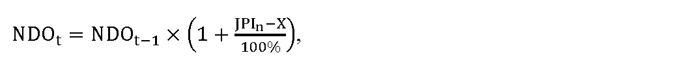

# § 38

(1) Maximálna cena za elektrinu CEtna účely dodávky elektriny pre zraniteľných odberateľov elektriny v domácnosti na jednotku množstva elektriny na rok t sa vypočíta podľa vzorca

C

E

t

=

C

K

t

×

1

+

k

t

100

%

+

O

t

,

kde

- a) CKt je referenčná cena elektriny na rok t, pričom

  - 1. na rok t = 2025 sa určuje vo výške 61 eur/MWh,

  - 2. na rok t = 2026 a nasledujúce roky sa vypočíta podľa vzorca

  - CKt = CK2025 × kckt,

  - kde

    - 2a. CK2025 je referenčná cena elektriny určená pre rok 2025 vo výške 72,70 eura/MWh,

    - 2b. kckt je koeficient zmeny ceny elektriny určený úradom, ktorý

      - 2ba. na rok 2026 je 1,429719,

      - 2bb. na rok 2027 a nasledujúce roky sa zverejní na webovom sídle úradu do 31. júla roku t-1, ak absolútna hodnota percentuálnej zmeny ceny elektriny CPXE za obdobie od 1. januára do 30. júna v rokoch t-2 a t-1 vypočítaných ako aritmetický priemer denných cien zverejnených burzou PXE (POWER EXCHANGE CENTRAL EUROPE) na jej webovom sídle, v časti EEX – PXE Slovakian Power Futures, produktu Baseload, Year, Settlement Price Cal-t v eurách na jednotku množstva elektriny, presiahne rozdiel 20 %; hodnota kckt sa uplatní na rok t, ak je absolútna hodnota percentuálnej zmeny ceny elektriny CPXE za obdobie od 1. januára do 30. júna v rokoch t-2 a t-1 vypočítaných ako aritmetický priemer denných cien zverejnených burzou PXE (POWER EXCHANGE CENTRAL EUROPE) na jej webovom sídle, v časti EEX – PXE Slovakian Power Futures, produktu Baseload, Year, Settlement Price Cal-t v eurách na jednotku množstva elektriny od poslednej uplatnenej korekcie koeficientu kckt kumulatívne väčšia ako 20 %; ak absolútna hodnota percentuálnej zmeny ceny elektriny CPXE nepresiahne 20 % alebo kumulatívne 20 % pre rok t, kckt sa rovná hodnote koeficientu kckt naposledy zverejnenej úradom na webovom sídle úradu, alebo 1, ak dovtedy koeficient nebol zverejnený,

- b) kt je koeficient na rok t v percentách zohľadňujúci diagram dodávky elektriny pre zraniteľných odberateľov elektriny v domácnosti v rozsahu najviac 8 %,

- c) Ot sú určené náklady na odchýlku súvisiace s dodávkou elektriny zraniteľným odberateľom elektriny v domácnostiach v eurách na jednotku množstva elektriny v roku t vo výške 80 % z priemeru nákladov na odchýlku prevádzkovateľov regionálnych distribučných sústav vypočítanej podľa prílohy č. 7, najviac však 5,21 eura/MWh.

(2) Jednopásmové sadzby podľa § 37 ods. 4 sú zložené z

- a) mesačnej platby za jedno odberné miesto NDOtpodľa odseku 7,

- b) ceny za elektrinu CEDi v eurách na jednotku množstva elektriny, ktorá sa vypočíta podľa vzorca

- CEDi = KJPDi × CEt + PZt,

- kde

  - 1. KJPDi je koeficient ceny jednopásmového odberu elektriny určený podľa odseku 4,

  - 2. CEtje cena elektriny určená podľa odseku 1,

  - 3. PZt je primeraný zisk v roku t v eurách na jednotku množstva elektriny určený podľa odseku 6, ktorý je možné zahrnúť do ceny,

  - 4. i je číselný znak jednopásmovej sadzby.

(3) Dvojpásmové sadzby podľa § 37 ods. 4 sú zložené z

- a) mesačnej platby za jedno odberné miesto NDOt podľa odseku 7,

- b) ceny za elektrinu CEVTDi v eurách na jednotku množstva elektriny odobranej vo vysokom pásme, ktorá sa vypočíta podľa vzorca

- CEVTDi = KVTDi × CEt + PZt,

- kde

  - 1. KVTDi je koeficient ceny odberu elektriny vo vysokom pásme určený podľa odseku 4,

  - 2. CEt je cena elektriny určená podľa odseku 1,

  - 3. PZt je primeraný zisk v roku t v eurách na jednotku množstva elektriny určený podľa odseku 6, ktorý je možné zahrnúť do ceny,

  - 4. i je číselný znak dvojpásmovej sadzby,

- c) ceny za elektrinu CENTDi v eurách na jednotku množstva elektriny odobranej v nízkom pásme, ktorá sa vypočíta podľa vzorca

- CENTDi = KNTDi × CEt + PZt,

- kde

  - 1. KNTDi je koeficient ceny odberu elektriny v nízkom pásme určený podľa odseku 4,

  - 2. CEt je cena elektriny určená podľa odseku 1,

  - 3. PZtje primeraný zisk v roku t v eurách na jednotku množstva elektriny určený podľa odseku 6, ktorý je možné zahrnúť do ceny,

  - 4. i je číselný znak dvojpásmovej sadzby.

(4) Koeficienty ceny jednopásmového odberu elektriny KJPDi, koeficienty ceny odberu elektriny vo vysokom pásme KVTDia koeficienty ceny odberu elektriny v nízkom pásme KNTDi sa uvedú v návrhu ceny regulovaného subjektu tak, aby vážený priemer cien elektriny bez primeraného zisku PZtvšetkých sadzieb bol najviac vo výške rovnajúcej sa CEt podľa odseku 1, pričom pre koeficienty KVTDi a KNTDi platí, že hodnota koeficientu KVTDi je vyššia o viac ako 20 % v porovnaní s hodnotou koeficientu KNTDi.

(5) K sadzbám za dodávku elektriny pre zraniteľných odberateľov elektriny v domácnosti sa dodávateľom elektriny pripočíta cena za distribúciu elektriny vrátane prenosu elektriny a strát elektriny pri prenose a cena za straty elektriny pri distribúcii elektriny podľa cenového rozhodnutia, ktorým boli schválené alebo určené ceny za prístup do distribučnej sústavy a distribúciu elektriny pre prevádzkovateľa distribučnej sústavy, do ktorej je odberné miesto zraniteľného odberateľa elektriny v domácnosti pripojené, tarifa za systémové služby a tarifa za prevádzkovanie systému.

(6) Na určenie primeraného zisku pri dodávke elektriny pre zraniteľných odberateľov elektriny v domácnosti, ktorý je možné zahrnúť do ceny za dodávku elektriny pre zraniteľných odberateľov elektriny v domácnosti, sa použije nižšia z hodnôt 3 eurá/MWh alebo 8 % z ceny elektriny CEt určenej podľa odseku 1.

(7) Náklady na dodávku elektriny na jedno odberné miesto za mesiac NDOt, ktoré možno zahrnúť do sadzieb za dodávku elektriny pre zraniteľných odberateľov elektriny v domácnosti sa vypočítajú podľa vzorca

kde

- a) NDOt-1 sú náklady na dodávku elektriny na jedno odberné miesto za mesiac, ktoré možno zahrnúť do sadzieb za dodávku elektriny pre zraniteľných odberateľov elektriny v domácnosti v roku t-1, najviac vo výške 1,50 eura na jedno odberné miesto a mesiac,

- b) JPIn je aritmetický priemer zverejnených hodnôt ukazovateľa „Jadrová inflácia“ za obdobie od 1.januára roka t-1 do 30. júna roka t-1 uvedených na webovom sídle Štatistického úradu Slovenskej republiky – http://datacube.statistics.sk v priečinku „Makroekonomické štatistiky“ v sekcii „Spotrebiteľské ceny a ceny produkčných štatistík“ v časti „Indexy spotrebiteľských cien (inflácia)“ v časti „Jadrová a čistá inflácia“ v priečinku „Jadrová a čistá inflácia – oproti rovnakému obdobiu minulého roku v percentách – mesačne [sp0008ms]“,

- c) X je faktor efektivity, ktorého hodnota v každom roku regulačného obdobia je 3,0 %, pričom ak je hodnota rozdielu JPIna X nižšia ako 0, na účely výpočtu maximálnej ceny za dodávku elektriny zraniteľným odberateľom v domácnosti na rok t sa hodnota rozdielu JPIn a X rovná 0.
