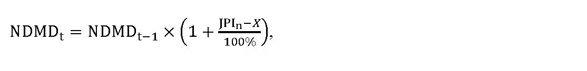

# § 40

(1) Maximálna cena za elektrinu CEMDt na účely dodávky elektriny zraniteľným odberateľom elektriny okrem zraniteľných odberateľov elektriny v domácnosti na jednotku množstva elektriny na rok t sa vypočíta podľa vzorca

C

E

M

D

t

=

C

E

P

X

E

,

t

1

+

k

t

100

%

+

O

t

,

kde

- a) CEPXE,tje aritmetický priemer denných cien zverejnených burzou PXE (POWER EXCHANGE CENTRAL EUROPE) na jej webovom sídle, v časti EEX – PXE Slovakian Power Futures, produktu Baseload, Year Settlement Price Cal-t v eurách na jednotku množstva elektriny a

  - 1. na rok 2025 sa vypočíta podľa vzorca,

  - CEPXE,t = 0,5 × CEPXE,t–2 + 0,5 × CEPXEt–1,

  - kde

    - 1a. CEPXE,t-2 je aritmetický priemer denných cien zverejnených burzou PXE (POWER EXCHANGE CENTRAL EUROPE) na jej webovom sídle, v časti EEX – PXE Slovakian Power Futures, produktu Baseload, Year, Settlement Price Cal-t v eurách na jednotku množstva elektriny za obdobie od 1. októbra roku t-2 do 31. marca roku t-1 okrem posledných dvoch dní roku t-2, v ktorých sa obchoduje na burze,

    - 1b. CEPXE,t-1 je aritmetický priemer denných cien zverejnených burzou PXE (POWER EXCHANGE CENTRAL EUROPE) na jej webovom sídle, v časti EEX – PXE Slovakian Power Futures, produktu Baseload, Year, Settlement Price Cal-t v eurách na jednotku množstva elektriny za obdobie od 1. apríla roku t-1 do 30. júna roku t-1,

  - 2. na rok 2026 a nasledujúce roky za obdobie od 1. januára roku t-1 do 30. júna roku t-1,

- b) kt je koeficient na rok t v percentách zohľadňujúci diagram dodávky elektriny pre zraniteľných odberateľov elektriny okrem zraniteľných odberateľov elektriny v domácnosti v rozsahu najviac 8 %,

- c) Ot sú určené náklady regulovaného subjektu na odchýlku súvisiace s dodávkou elektriny zraniteľným odberateľom elektriny okrem zraniteľných odberateľov elektriny v domácnosti v eurách na jednotku množstva elektriny v roku t vo výške 80 % z priemeru nákladov na odchýlku prevádzkovateľov regionálnych distribučných sústav vypočítanej podľa prílohy č. 7, najviac však 5,21 eura/MWh.

(2) Jednopásmové sadzby podľa § 39 ods. 5 sú zložené z

- a) mesačnej platby za jedno odberné miesto NDMDt podľa odseku 8,

- b) ceny za elektrinu CEMDi v eurách na jednotku množstva elektriny, ktorá sa vypočíta podľa vzorca

- 

- C

- E

- M

- D

- i

- =

- K

- J

- P

- M

- D

- i

- ×

- C

- E

- M

- D

- t

- +

- P

- Z

- t

- ,

- kde

  - 1. KJPMDije koeficient ceny jednopásmového odberu elektriny určený podľa odseku 4,

  - 2. CEMDt je cena elektriny určená podľa odseku 1,

  - 3. PZtje primeraný zisk v roku t v eurách na jednotku množstva elektriny dodanej zraniteľnému odberateľovi elektriny okrem zraniteľného odberateľa elektriny v domácnosti určený podľa odseku 5,

  - 4. i je číselný znak jednopásmovej sadzby.

(3) Dvojpásmové sadzby podľa § 39 ods. 5 sú zložené z

- a) mesačnej platby za jedno odberné miesto NDMDt podľa odseku 8,

- b) ceny za elektrinu CEVTMDi v eurách na jednotku množstva elektriny odobranej vo vysokom pásme, ktorá sa vypočíta podľa vzorca

- 

- C

- E

- V

- T

- M

- D

- i

- =

- K

- V

- T

- M

- D

- i

- ×

- C

- E

- M

- D

- t

- +

- P

- Z

- t

- ,

- kde

  - 1. KVTMDi je koeficient ceny odberu elektriny vo vysokom pásme určený podľa odseku 4,

  - 2. CEMDt je cena elektriny určená podľa odseku 1,

  - 3. PZt je primeraný zisk v roku t v eurách na jednotku množstva elektriny dodanej zraniteľnému odberateľovi elektriny okrem zraniteľného odberateľa elektriny v domácnosti určený podľa odseku 5,

  - 4. i je číselný znak dvojpásmovej sadzby,

- c) ceny za elektrinu CENTMDi v eurách na jednotku množstva elektriny odobranej v nízkom pásme, ktorá sa vypočíta podľa vzorca

- 

- C

- E

- N

- T

- M

- D

- i

- =

- K

- N

- T

- M

- D

- i

- ×

- C

- E

- M

- D

- t

- +

- P

- Z

- t

- ,

- kde

  - 1. KNTMDi je koeficient ceny odberu elektriny v nízkom pásme určený podľa odseku 4,

  - 2. CEMDtje cena elektriny určená podľa odseku 1,

  - 3. PZt je primeraný zisk v roku t v eurách na jednotku množstva elektriny dodanej zraniteľnému odberateľovi elektriny okrem zraniteľného odberateľa elektriny v domácnosti určený podľa odseku 5,

  - 4. i je číselný znak dvojpásmovej sadzby.

(4) Koeficienty ceny jednopásmového odberu elektriny KJPMDi, koeficienty ceny odberu elektriny vo vysokom pásme KVTMDi a koeficienty ceny odberu elektriny v nízkom pásme KNTMDi sa určia v návrhu ceny regulovaného subjektu tak, aby vážený priemer cien elektriny bez primeraného zisku PZt všetkých sadzieb bol najviac vo výške rovnajúcej sa CEMDt podľa odseku 1, pričom pre koeficienty KVTMDi a KNTMDi platí, že hodnota koeficientu KVTMDi je vyššia o viac ako 20 % v porovnaní s hodnotou koeficientu KNTMDi.

(5) Na určenie najvyššej miery primeraného zisku pri dodávke elektriny pre zraniteľných odberateľov elektriny okrem zraniteľných odberateľov elektriny v domácnosti, ktorý je možné zahrnúť do ceny za dodávku elektriny pre zraniteľných odberateľov elektriny okrem zraniteľných odberateľov elektriny v domácnosti, sa použije nižšia z hodnôt 8 eur/MWh alebo 16 % z ceny elektriny CEMDt určenej podľa odseku 1.

(6) K sadzbám za dodávku elektriny zraniteľným odberateľom elektriny okrem zraniteľných odberateľov elektriny v domácnosti sa dodávateľom elektriny pripočíta cena za distribúciu elektriny vrátane prenosu elektriny a strát elektriny pri prenose a cena za straty elektriny pri distribúcii elektriny podľa cenového rozhodnutia, ktorým boli schválené alebo určené ceny za prístup do distribučnej sústavy a distribúciu elektriny pre prevádzkovateľa distribučnej sústavy, do ktorej je odberné miesto zraniteľného odberateľa elektriny okrem zraniteľného odberateľa elektriny v domácnosti pripojené, tarifa za systémové služby a tarifa za prevádzkovanie systému.

(7) Ak sa preukáže neočakávaný výrazný nárast zraniteľných odberateľov elektriny okrem zraniteľných odberateľov elektriny v domácnosti, ktorým dodáva elektrinu dodávateľ elektriny, v poslednom štvrťroku roku t-1, v cenovom konaní o dodávke elektriny na rok t sa primeraným spôsobom zohľadní rozdiel nákladov na nákup elektriny prislúchajúcich k cene CEPXE,tpodľa odseku 1 a preukázanými nákladmi vynaloženými dodávateľom elektriny na nákup elektriny na zabezpečenie dodávky elektriny pre nových zraniteľných odberateľov elektriny okrem zraniteľných odberateľov elektriny v domácnosti.

(8) Náklady na dodávku elektriny na jedno odberné miesto za mesiac NDMDt, ktoré možno zahrnúť do sadzieb za dodávku elektriny pre zraniteľných odberateľov elektriny okrem zraniteľných odberateľov elektriny v domácnosti sa vypočítajú podľa vzorca

kde

- a) NDMDt-1 sú náklady na dodávku elektriny na jedno odberné miesto za mesiac, ktoré možno zahrnúť do sadzieb za dodávku elektriny pre zraniteľných odberateľov elektriny okrem zraniteľných odberateľov elektriny v domácnosti v roku t-1, pričom určená výška NDMDt-1 na rok 2024 je najviac 1,50 eura na jedno odberné miesto a mesiac,

- b) JPIn je aritmetický priemer zverejnených hodnôt ukazovateľa „Jadrová inflácia“ za obdobie od 1. januára roka t-1 do 30. júna roka t-1 uvedených na webovom sídle Štatistického úradu Slovenskej republiky – http://datacube.statistics.sk v priečinku „Makroekonomické štatistiky“ v sekcii „Spotrebiteľské ceny a ceny produkčných štatistík“ v časti „Indexy spotrebiteľských cien (inflácia)“ v časti „Jadrová a čistá inflácia“ v priečinku „Jadrová a čistá inflácia – oproti rovnakému obdobiu minulého roku v percentách – mesačne [sp0008ms]“,

- c) X je faktor efektivity, ktorého hodnota v každom roku regulačného obdobia je 3,0 %, pričom ak je hodnota rozdielu JPIna X nižšia ako 0, na účely výpočtu maximálnej ceny za dodávku elektriny zraniteľným odberateľom v domácnosti na rok t sa hodnota rozdielu JPIn a X rovná 0.
