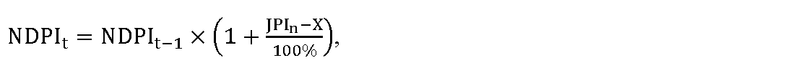

# § 42

(1) Maximálna cena za dodávku elektriny dodávateľom poslednej inštancie v eurách na jednotku množstva elektriny CEDPIm,t sa vypočíta podľa vzorca

C

E

D

P

I

m

,

t

=

C

E

P

X

E

m

,

t

×

1

+

k

1

t

+

k

2

t

100

%

,

kde

- a) CEPXEm,t je aritmetický priemer denných cien oficiálneho kurzového lístka zverejneného burzou PXE (POWER EXCHANGE CENTRAL EUROPE) na jej webovom sídle, v časti EEX – PXE Slovakian Power Futures, produktu Baseload, Month, Settlement Price Cal-t v eurách na jednotku množstva elektriny na tri po sebe nasledujúce mesiace, pričom prvým mesiacom je mesiac, v ktorom sa začne dodávka elektriny dodávateľom poslednej inštancie, v eurách na jednotku množstva elektriny za obdobie kalendárneho mesiaca predchádzajúceho prvému dňu dodávky elektriny dodávateľom poslednej inštancie,

- b) k1t je koeficient na rok t v percentách zohľadňujúci diagram dodávky elektriny dodávateľom poslednej inštancie pre odberateľov elektriny podľa osobitného predpisu39) v rozsahu najviac 10 %,

- c) k2t je koeficient na rok t v percentách zohľadňujúci obmedzenia rizika súvisiaceho s dodávkou poslednej inštancie, ktorého výška je v rozsahu najviac 10 %.

(2) V cenovom rozhodnutí pre dodávateľa poslednej inštancie sa určí cena za dodávku elektriny dodávateľom poslednej inštancie alebo spôsob jej výpočtu a podmienky uplatnenia ceny na rok t. Ceny za dodávku elektriny dodávateľom poslednej inštancie v jednotlivých zložkách sadzieb sú maximálnymi cenami. Sadzby za dodávku elektriny dodávateľom poslednej inštancie sa dodávateľom poslednej inštancie ustanovia podľa cenového rozhodnutia pre zraniteľných odberateľov elektriny v domácnosti a odberateľov elektriny okrem zraniteľných odberateľov elektriny v domácnosti.

(3) Sadzba za dodávku elektriny dodávateľom poslednej inštancie je zložená z

- a) mesačnej platby za jedno odberné miesto NDPIt podľa odseku 6,

- b) maximálnej ceny za elektrinu CEDPIt v eurách na jednotku množstva elektriny, ktorá sa vypočíta podľa vzorca

- 

- C

- E

- D

- P

- I

- ,

- t

- =

- C

- E

- D

- P

- I

- m

- ,

- t

- +

- O

- t

- +

- P

- Z

- t

- ,

- kde

  - 1. CEDPIm,t je cena elektriny určená podľa odseku 1,

  - 2. Ot sú určené náklady na odchýlku súvisiace s dodávkou elektriny dodávateľom poslednej inštancie v eurách na jednotku množstva elektriny v roku t vo výške najviac 5,21 eur,

  - 3. PZt je primeraný zisk v roku t v eurách na jednotku množstva elektriny, ktorý je možné zahrnúť do ceny za dodávku elektriny dodávateľom poslednej inštancie, maximálne 10 % z ceny elektriny určenej spôsobom podľa odseku 1, najviac však 5 eur/MWh.

(4) K sadzbám podľa odseku 3 sa dodávateľom elektriny poslednej inštancie pripočíta cena za distribúciu elektriny vrátane prenosu elektriny a strát elektriny pri prenose elektriny, straty elektriny pri distribúcii elektriny, tarifa za systémové služby a tarifa za prevádzkovanie systému podľa cenového rozhodnutia, ktorým boli schválené alebo určené ceny za prístup do distribučnej sústavy a distribúciu elektriny pre prevádzkovateľa distribučnej sústavy, do ktorej je príslušné odberné miesto pripojené.

(5) Ak je pre zraniteľného odberateľa elektriny v domácnosti uplatňovaná cena elektriny za dodávku elektriny pri dodávke poslednej inštancie vyššia od maximálnej ceny elektriny pri najdrahšej sadzbe regulovanej ceny za štandardnú dodávku elektriny pre zraniteľných odberateľov elektriny v domácnosti podľa cenníka dodávateľa elektriny, ktorý poskytuje dodávku poslednej inštancie najviac o 30 %, dodávateľ poslednej inštancie túto cenu za dodávku poslednej inštancie uplatní pre zraniteľného odberateľa elektriny v domácnosti v celom rozsahu.

(6) Náklady na dodávku elektriny dodávateľom poslednej inštancie na jedno odberné miesto za mesiac NDPIt, ktoré možno zahrnúť do sadzieb za dodávku elektriny dodávateľom poslednej inštancie sa vypočítajú podľa vzorca

kde

- a) NDPIt-1 sú náklady na dodávku elektriny na jedno odberné miesto za mesiac, ktoré možno zahrnúť do sadzieb za dodávku elektriny dodávateľom poslednej inštancie v roku t-1, pričom určená výška NDPIt-1 na rok 2024 je najviac 1,50 eura na jedno odberné miesto a mesiac,

- b) JPIn je aritmetický priemer zverejnených hodnôt ukazovateľa „Jadrová inflácia“ za obdobie od 1. januára roka t-1 do 30. júna roka t-1 uvedených na webovom sídle Štatistického úradu Slovenskej republiky – http://datacube.statistics.sk v priečinku „Makroekonomické štatistiky“ v sekcii „Spotrebiteľské ceny a ceny produkčných štatistík“ v časti „Indexy spotrebiteľských cien (inflácia)“ v časti „Jadrová a čistá inflácia“ v priečinku „Jadrová a čistá inflácia – oproti rovnakému obdobiu minulého roku v percentách – mesačne [sp0008ms]“,

- c) X je faktor efektivity, ktorého hodnota v každom roku regulačného obdobia je 3,0 %, pričom ak je hodnota rozdielu JPIna X nižšia ako 0, na účely výpočtu maximálnej ceny za dodávku elektriny zraniteľným odberateľom v domácnosti na rok t sa hodnota rozdielu JPIn a X rovná 0.
