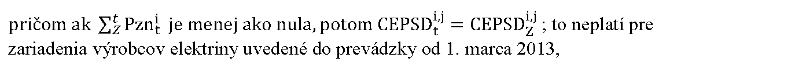
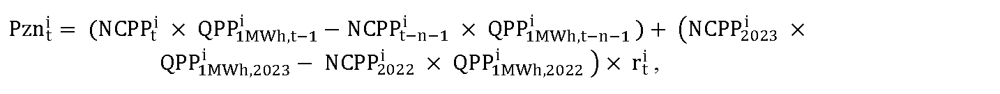
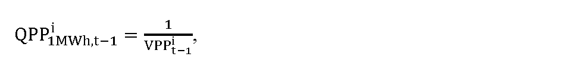
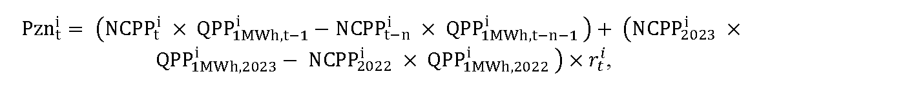

# § 44 Určenie korekcie zohľadňujúcej vývoj ceny primárneho paliva

(1) Cena elektriny podľa § 6 ods. 1 písm. a) zákona o podpore na rok t v eurách na jednotku množstva elektriny za elektrinu vyrobenú i-tou technológiou j-tého zariadenia výrobcu elektriny 

C

E

P

S

D

t

i

,

j

sa pre výrobcu elektriny vypočíta podľa vzorca

C

E

P

S

D

t

i

,

j

=

C

E

P

S

D

Z

i

,

j

+

∑

Z

t

P

z

n

t

i

,

kde

- a) 

- C

- E

- P

- S

- D

- Z

- i

- ,

- j

- je určená alebo schválená cena elektriny podľa § 6 ods. 1 písm. a) zákona o podpore na rok Z vyrobenej i-tou technológiou j-tého zariadenia výrobcu elektriny na základe roku uvedenia zariadenia výrobcu elektriny do prevádzky alebo poslednej uplatnenej rekonštrukcie alebo modernizácie technologickej časti zariadenia na výrobu elektriny v eurách na jednotku množstva elektriny,

- b) Pznit je korekcia v eurách na jednotku množstva elektriny na rok t uplatňovaná na základe výpočtu podľa odseku 3,

- c) rok Z je rok uvedenia zariadenia výrobcu elektriny do prevádzky alebo rok poslednej uplatnenej rekonštrukcie alebo modernizácie technologickej časti zariadenia na výrobu elektriny.

(2) Cena elektriny podľa § 6 ods. 1 písm. d) zákona o podpore na rok t v eurách na jednotku množstva elektriny za elektrinu vyrobenú i-tou technológiou j-tého zariadenia výrobcu elektriny sa pre výrobcu elektriny vypočíta podľa vzorca

kde

- a) CEPSPzi.j je cena elektriny pre určenie príplatku na rok Z vyrobenej i-tou technológiou j-tého zariadenia výrobcu elektriny na základe roku uvedenia zariadenia výrobcu elektriny do prevádzky alebo poslednej uplatnenej rekonštrukcie alebo modernizácie technologickej časti zariadenia na výrobu elektriny alebo cena elektriny ponúknutá v roku vyhlásenia výberového konania v eurách na jednotku množstva elektriny,

- b) Pznit je korekcia v eurách na jednotku množstva elektriny na rok t uplatňovaná v hodnote na základe výpočtu podľa odseku 3,

- c) rok Z je rok uvedenia zariadenia výrobcu elektriny do prevádzky alebo rok poslednej uplatnenej rekonštrukcie alebo modernizácie technologickej časti zariadenia na výrobu elektriny alebo rok vyhlásenia výberového konania.

(3) Korekcia Pznitv eurách na jednotku množstva elektriny na rok t pre i-té technológie výroby elektriny s primárnymi palivami podľa odseku 5 zohľadňujúca zvýšenie alebo zníženie ceny vstupných surovín, ktoré sa použili na výrobu elektriny i-tou technológiou na výrobu elektriny z obnoviteľných zdrojov energie alebo zvýšenie alebo zníženie ceny vstupných surovín, ktoré sa použili na výrobu elektriny z neobnoviteľných zdrojov energie i-tou technológiou na výrobu elektriny vysoko účinnou kombinovanou výrobou a zohľadňujúca zvýšenie alebo zníženie ceny emisných kvót, ktoré sa použili na plnenie povinnosti podľa osobitného predpisu,44a) sa vypočíta podľa vzorca

- a) pre rok t = 2025

- 

- kde

  - 1. 

  - N

  - C

  - P

  - P

  - t

  - i

  - je určená nákupná cena primárneho paliva pre i-tú technológiu výroby elektriny v eurách na jednotku množstva v roku t; pri výpočte sa primerane zohľadní využiteľnosť primárneho paliva použiteľného pri výrobe elektriny v i-tej technológii,

  - 2. 

  - Q

  - P

  - P

  - 1

  - M

  - W

  - h

  - ,

  - t

  - -

  - 1

  - i

  - je množstvo primárneho paliva v jednotkách množstva zodpovedajúceho 1 MWh i-tej technológie výroby elektriny v roku t-1, ktoré sa vypočíta podľa vzorca

  - 

  - kde

  - 

  - V

  - P

  - P

  - t

  - -

  - 1

  - i

  - je určená výhrevnosť primárneho paliva pre i-tú technológiu výroby elektriny v megawatthodinách na jednotku množstva v roku t-1,

  - 3. 

  - N

  - C

  - P

  - P

  - t

  - -

  - n

  - -

  - 1

  - i

  - je určená nákupná cena primárneho paliva pre i-tu technológiu výroby elektriny v eurách na jednotku množstva v roku t-n-1; pri výpočte sa primerane zohľadní využiteľnosť primárneho paliva použiteľného pri výrobe elektriny v i-tej technológii,

  - 4. 

  - Q

  - P

  - P

  - 1

  - M

  - W

  - h

  - ,

  - t

  - -

  - n

  - -

  - 1

  - i

  - je množstvo primárneho paliva v jednotkách množstva zodpovedajúceho 1 MWh i-tej technológie výroby elektriny v roku t-n-1, ktoré sa vypočíta podľa vzorca

  - 

  - Q

  - P

  - P

  - 1

  - M

  - W

  - h

  - ,

  - t

  - -

  - n

  - -

  - 1

  - i

  - =

  - 1

  - V

  - P

  - P

  - t

  - -

  - n

  - -

  - 1

  - i

  - ,

  - kde

  - 

  - V

  - P

  - P

  - t

  - -

  - n

  - -

  - 1

  - i

  - je určená výhrevnosť primárneho paliva pre i-tú technológiu výroby elektriny v megawatthodinách na jednotku množstva v roku t-n-1,

  - 5. 

  - N

  - C

  - P

  - P

  - 2023

  - i

  - je určená nákupná cena primárneho paliva pre i-tú technológiu výroby elektriny v eurách na jednotku množstva v roku t = 2023; pri výpočte sa primerane zohľadní využiteľnosť primárneho paliva použiteľného pri výrobe elektriny v i-tej technológii,

  - 6. 

  - Q

  - P

  - P

  - 1

  - M

  - W

  - h

  - ,

  - 2023

  - i

  - je množstvo primárneho paliva v jednotkách množstva zodpovedajúceho 1 MWh i-tej technológie výroby elektriny v roku t = 2023, ktoré sa vypočíta podľa vzorca

  - 

  - Q

  - P

  - P

  - 1

  - M

  - W

  - h

  - ,

  - 2023

  - i

  - =

  - 1

  - V

  - P

  - P

  - 2023

  - i

  - ,

  - kde

  - 

  - V

  - P

  - P

  - 2023

  - i

  - je určená výhrevnosť primárneho paliva pre i-tú technológiu výroby elektriny v megawatthodinách na jednotku množstva v roku 2023,

  - 7. 

  - N

  - C

  - P

  - P

  - 2022

  - i

  - je určená nákupná cena primárneho paliva pre i-tú technológiu výroby elektriny v eurách na jednotku množstva v roku t = 2022; pri výpočte sa primerane zohľadní využiteľnosť primárneho paliva použiteľného pri výrobe elektriny v i-tej technológii,

  - 8. 

  - Q

  - P

  - P

  - 1

  - M

  - W

  - h

  - ,

  - 2022

  - i

  - je množstvo primárneho paliva v jednotkách množstva zodpovedajúceho 1 MWh i-tej technológie výroby elektriny v roku t = 2022, ktoré sa vypočíta podľa vzorca

  - 

  - Q

  - P

  - P

  - 1

  - M

  - W

  - h

  - ,

  - 2022

  - i

  - =

  - 1

  - V

  - P

  - P

  - 2022

  - i

  - ,

  - kde

  - 

  - V

  - P

  - P

  - 2022

  - i

  - je určená výhrevnosť primárneho paliva pre i-tú technológiu výroby elektriny v megawatthodinách na jednotku množstva v roku 2022,

  - 9. n je počet rokov medzi rokom t a rokom, na ktorý bola naposledy uplatnená korekcia Pznit,

  - 10. 

  - r

  - t

  - i

  - je koeficient, ktorý zohľadňuje rozloženie hodnoty nákladov na primárne palivo i-tej technológie od poslednej uplatnenej korekcie, ktorý sa uplatní počas obdobia rokov 2024 až 2026,

- b) pre rok t = 2026

- 

- kde

- 

- N

- C

- P

- P

- t

- -

- n

- i

- je určená nákupná cena primárneho paliva pre i-tú technológiu výroby elektriny v eurách na jednotku množstva v roku t-n; pri výpočte sa primerane zohľadní využiteľnosť primárneho paliva použiteľného pri výrobe elektriny v i-tej technológii,

- c) pre rok 2027 a nasledujúce roky pre výrobcov, ktorí nie sú účastníkmi systému obchodovania s emisnými kvótami skleníkových plynov z dôvodu, že nevykonávajú činnosť podľa osobitného predpisu44b)

- Pznit = NCPPit × QPPi1MWh,t–1 – NCPPit–n × QPPi1MWh,t–n–1,

- d) pre rok 2027 a nasledujúce roky pre výrobcov, ktorí sú účastníkmi systému obchodovania s emisnými kvótami skleníkových plynov a vykonávajú činnosť podľa osobitného predpisu,44b)

kde

- a) EPCELK, t–2 je energia v palive za rok t-2 v MWh,

- b) ACELK, t–2 je výroba elektriny za rok t-2 meraná na svorkách generátora zariadenia v MWh,

- c) EF je priemerný emisný faktor na rok 2024 v tonách CO2 na jednotku množstva energie pre palivá spaľované v zariadeniach zohľadňujúci priemerné hodnoty emisných faktorov a výhrevnosti vybraných palív za Slovenskú republiku použitých pri energetickej bilancii emisií skleníkových plynov určené metodikou zhora nadol, ktorý je zverejnený na webovom sídle Ministerstva životného prostredia Slovenskej republiky; emisný faktor sa na účely tejto vyhlášky prepočíta z hodnoty uvádzanej v tCO2/TJ na hodnotu v tCO2/MWh,

- d) QEB je aritmetický priemer objemu emisných kvót pridelených pre konkrétnu prevádzku na roky t-2 až t-6 bezplatne v tonách CO2,

- e) Et je cena povoleniek v eurách na tonu CO2 na rok t určená ako aritmetický priemer denných uzatváracích cien (settlement price) oficiálneho kurzového lístka zverejneného burzou EEX (European Energy Exchange) na jej webovom sídle za produkt EUA Future – December t v eurách na tonu CO2 za obdobie od 1. januára do 30. júna roku t-1,

- f) Et-n je cena povoleniek v eurách na tonu CO2 na rok t-n určená ako aritmetický priemer denných uzatváracích cien (settlement price) oficiálneho kurzového lístka zverejneného burzou EEX (European Energy Exchange) na jej webovom sídle za produkt EUA Future – December t-n v eurách na tonu CO2za obdobie od 1. januára do 30. júna roku t-n,

- g) k je koeficient celkovej účinnosti výroby elektriny, ktorý sa vypočíta podľa vzorca

k = (ACELK, t-2/EPCELK , t-2)≤0,3.

(4) Hodnota korekcie Pznit v eurách na jednotku množstva elektriny vypočítaná podľa odseku 3 písm. b) a c) pre i-té technológie výroby elektriny sa zverejňuje každoročne na webovom sídle úradu najneskôr do 31. júla roku t-1.

(5) Ak má výrobca elektriny na rok t-1 určenú alebo schválenú cenu elektriny CEPSDi,jz a zároveň si uplatňuje na rok t cenu elektriny podľa § 6 ods. 1 písm. a) zákona o podpore na základe rekonštrukcie alebo modernizácie technologickej časti zariadenia na výrobu elektriny, táto cena elektriny sa na rok t určí podľa § 6 ods. 11 zákona o podpore.

(6) Výrobcovi elektriny, ktorému uplynie doba podpory doplatkom podľa § 3 ods. 1 písm. c) zákona o podpore pred rokom 2026, sa korekcia Pznit vypočíta v cenovom konaní primerane podľa § 44 ods. 3 tak, aby zohľadňovala zostávajúcu dobu trvania podpory a jej vplyv na určenie korekcie Pznit.
