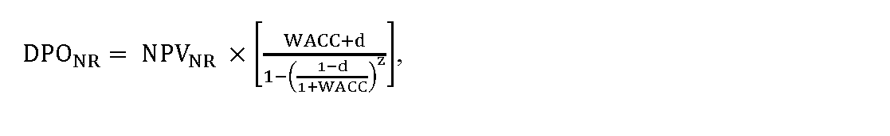
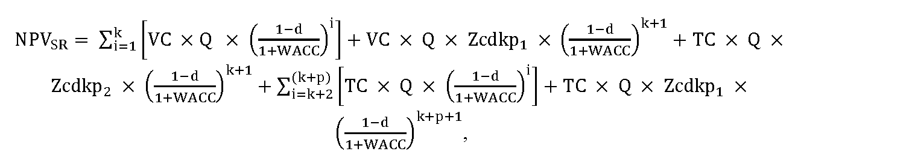

# § 45 Výpočet predĺženej podpory so zníženou cenou elektriny

(1) Cena elektriny pre stanovenie hodnoty podpory v eurách na jednotku množstva elektriny za elektrinu vyrobenú z obnoviteľných zdrojov energie pri predĺžení podpory doplatkom podľa § 3d zákona o podpore sa vypočíta podľa vzorca

V

C

N

R

=

D

P

O

N

R

Q

E

S

R

,

kde

- a) VCNRje výkupná cena elektriny pre zariadenie výrobcu elektriny s predĺženou podporou podľa § 3d zákona o podpore v eurách na jednotku množstva elektriny,

- b) DPONR je plánovaný objem podpory pre zariadenie výrobcu elektriny v eurách počas prvého roka trvania predĺženej podpory podľa § 3d zákona o podpore; DPONR sa vypočíta podľa odseku 2,

- c) QESR je množstvo vyrobenej elektriny s nárokom na podporu doplatkom a prevzatím zodpovednosti za odchýlku v jednotkách množstva elektriny za rok, ktoré sa vypočíta ako aritmetický priemer za posledných päť ucelených rokov prevádzky zariadenia na výrobu elektriny pred rokom vstupu do predĺženej podpory podľa § 3d zákona o podpore.

(2) Plánovaný objem podpory doplatkom podľa § 3 ods. 1 písm. c) zákona o podpore pre zariadenie výrobcu elektriny v eurách počas prvého roku trvania predĺženej podpory doplatkom podľa § 3d zákona o podpore DPONR sa vypočíta podľa vzorca

kde

- a) NPVNR je čistá súčasná hodnota podpory doplatkom podľa § 3 ods. 1 písm. c) zákona o podpore v eurách za elektrinu vyrobenú z obnoviteľných zdrojov energie s predĺžením podpory podľa § 3d zákona o podpore; NPVNR sa vypočíta podľa odseku 3,

- b) WACC je miera výnosnosti regulačnej bázy aktív vyjadrená v percentách, a vypočíta sa podľa § 5,

- c) d je koeficient ročnej degradácie technológie zariadenia na výrobu elektriny; pre zariadenie na výrobu elektriny zo slnečnej energie je maximálna hodnota koeficientu 0,5 % a pre zariadenia na výrobu elektriny z vodnej energie, biomasy, bioplynu, skládkového plynu alebo plynu z čističiek odpadových vôd je hodnota koeficientu 0 %,

- d) z je zostávajúca doba predĺženej podpory podľa § 3d zákona o podpore, zaokrúhlená na šesť desatinných miest, pričom

- 

- z

- =

- n

- +

- p

- ,

- kde

  - 1. n je zostávajúca doba trvania súčasného režimu podpory doplatkom podľa § 3 ods. 1 písm. c) zákona o podpore pre zariadenie výrobcu elektriny z obnoviteľných zdrojov energie, vyjadrená v rokoch zaokrúhlená na tri desatinné miesta, ktorá začína prvým dňom kalendárneho roka nasledujúceho po kalendárnom roku, v ktorom sa rozhoduje o znížení ceny elektriny a končí dňom dátumu uplatnenia nároku na podporu u zúčtovateľa podpory navýšenej o 15 rokov, najneskôr však do 31. decembra 2033,

  - 2. p je doba predĺženia podpory podľa § 3d zákona o podpore rovnajúca sa piatim rokom, ak je podporu možné predĺžiť najneskôr do 31. decembra 2033.

(3) Čistá súčasná hodnota podpory doplatkom podľa § 3 ods. 1 písm. c) zákona o podpore v eurách za elektrinu vyrobenú z obnoviteľných zdrojov energie s predĺžením podpory podľa § 3d zákona o podpore NPVNR sa vypočíta podľa vzorca

N

P

V

N

R

=

N

P

V

S

R

×

k

+

N

A

K

L

,

kde

- a) NPVSRje čistá súčasná hodnota podpory doplatkom podľa § 3 ods. 1 písm. c) zákona o podpore v eurách za elektrinu vyrobenú z obnoviteľných zdrojov energie v súčasnom režime podpory, ktorá sa vypočíta podľa odseku 4,

- b) k je koeficient zohľadňujúci rok vstupu zariadenia výrobcu elektriny do predĺženej podpory podľa § 3d zákona o podpore, ktorý pre roky 2021 a 2022 je vo výške 1,02, na rok 2023 a nasledujúce roky do roku 2026 je vo výške 1,00, na rok 2026 a nasledujúce roky je vo výške 0,00,

- c) NAKL je suma ekonomicky oprávnených nákladov na opravu alebo úpravu technologickej časti zariadenia výrobcu elektriny na účel predĺženia jeho prevádzkyschopnosti v eurách vynaložených najneskôr v prvých piatich rokoch po roku vstupu do predĺženej podpory podľa § 3d zákona o podpore, ktorá sa vypočíta podľa vzorca

- 

- N

- A

- K

- L

- =

- ∑

- i

- =

- 1

- p

- N

- A

- K

- L

- U

- P

- R

- i

- ,

- kde

  - 1. 

  - NAKL

  - UPR

  - i

  - sú ekonomicky oprávnené náklady na nevyhnutnú opravu alebo úpravu technologickej časti zariadenia výrobcu elektriny v eurách na účel predĺženia jeho prevádzkyschopnosti počas zostávajúcej a predĺženej doby podpory vynaložené v i-tom roku nasledujúcom po roku vstupu do predĺženej podpory podľa § 3d zákona o podpore, pričom

  - 

  - N

  - A

  - K

  - L

  - U

  - P

  - R

  - i

  - ≤

  - S

  - ×

  - I

  - N

  - V

  - ,

  - kde

    - 1a. S je hodnota vyjadrujúca percentuálny podiel investičných nákladov na obstaranie novej porovnateľnej technologickej časti zariadenia výrobcu elektriny vo výške každoročne zverejnenej na webovom sídle úradu do 20. augusta na nasledujúci kalendárny rok ,

    - 1b. INV je hodnota investičných nákladov novej porovnateľnej technológie časti zariadenia výrobcu elektriny v eurách zverejnená pre nasledujúci rok na webovom sídle úradu a aktualizovaná najneskôr do 20. augusta kalendárneho roka.

(4) Čistá súčasná hodnota podpory doplatkom podľa § 3 ods. 1 písm. c) zákona o podpore v eurách za elektrinu vyrobenú z obnoviteľných zdrojov energie v zostávajúcej časti súčasného režimu podpory doplatkom podľa § 3 ods. 1 písm. c) zákona o podpore a v dobe predĺženia podpory podľa § 3d zákona o podpore NPVSR sa vypočíta podľa vzorca

kde

- a) VC je cena elektriny vyrobenej z obnoviteľných zdrojov energie, ktorá je určená alebo schválená úradom v súčasnom režime podpory doplatkom podľa § 3 ods. 1 písm. c) zákona o podpore v eurách na jednotku množstva elektriny,

- b) Q je množstvo vyrobenej elektriny s nárokom na podporu výkupom elektriny podľa § 3 ods. 1 písm. b) zákona o podpore a prevzatím zodpovednosti za odchýlku podľa § 3 ods. 1 písm. d) zákona o podpore v režime prenesenej zodpovednosti za odchýlku v jednotkách množstva elektriny za rok, ktoré sa vypočíta ako aritmetický priemer za posledných päť ucelených rokov prevádzky zariadenia výrobcu elektriny pred rokom vstupu do predĺženej podpory podľa § 3d zákona o podpore,

- c) TC je trhová cena elektriny v eurách na jednotku množstva elektriny vypočítaná ako aritmetický priemer cien ročných forwardov elektriny F PXE SK BL na najbližšie tri ucelené kalendárne roky predĺženej podpory podľa § 3d zákona o podpore, zobchodovaných na burze PXE (POWER EXCHANGE CENTRAL EUROPE) za obdobie posledných 12 kalendárnych mesiacov pred začatím konania o cenovej regulácii, ktorá sa každoročne zverejňuje pre nasledujúci kalendárny rok na webovom sídle úradu do 20. augusta kalendárneho roka,

- d) k je počet zostávajúcich rokov trvania súčasného režimu podpory doplatkom podľa § 3 ods. 1 písm. c) zákona o podpore pre zariadenie výrobcu elektriny z obnoviteľných zdrojov energie, ktorý začína kalendárnym rokom nasledujúcim po kalendárnom roku, v ktorom sa rozhoduje o znížení ceny elektriny, zaokrúhlený na celé čísla nadol,

- e) WACC je miera výnosnosti regulačnej bázy vyjadrená v percentách, a vypočíta sa podľa § 5,

- f) Zcdkp1je pomerná časť kalendárného roka, v ktorom končí súčasný režim podpory doplatkom podľa § 3 ods. 1 písm. c) zákona o podpore, začínajúca prvým dňom tohto kalendárneho roka a končiaca dňom skončenia súčasnej doby podpory, v pomere oproti celému kalendárnému roku, v ktorom končí súčasný režim podpory,

- g) Zcdkp2 je pomerná časť kalendárného roka, v ktorom končí súčasný režim podpory doplatkom podľa § 3 ods. 1 písm. c) zákona o podpore, začínajúca dňom nasledujúcom po dni skončenia súčasnej doby podpory a končiaca 31. decembra tohto roka, v pomere oproti celému kalendárnému roku, v ktorom končí súčasný režim podpory, ktorá sa vypočíta podľa vzorca

- Zcdkp2 = 1 – Zcdkp1.

(5) Ak pri preverení skutočne vynaložených nákladov na nevyhnutnú opravu alebo úpravu technologickej časti zariadenia výrobcu elektriny v eurách na účel predĺženia jeho prevádzkyschopnosti počas zostávajúcej podpory doplatkom podľa § 3 ods. 1 písm. c) zákona o podpore a predĺženej doby podpory podľa § 3d zákona o podpore, ktoré mali byť vynaložené najneskôr v prvých piatich rokoch po roku vstupu do predĺženej podpory podľa § 3d zákona o podpore, nedôjde k ich investovaniu vo výške podľa cenového rozhodnutia, na základe kontrolných zistení sa určí výška nákladov, ktoré sa vracajú zúčtovateľovi podpory; oprávnenosť nákladov podľa § 4 ods. 3 a ich výška na nevyhnutnú opravu alebo úpravu technologickej časti zariadenia výrobcu elektriny v eurách na účel predĺženia jeho prevádzkyschopnosti počas zostávajúcej podpory doplatkom sa preukazuje znaleckým posudkom vypracovaným znalcom v odbore Elektrotechnika a Energetika zapísaným v zozname znalcov v súlade s osobitným predpisom.25)

(6) Pri určení ceny elektriny podľa § 6 ods. 1 písm. a) zákona o podpore pri predĺžení podpory doplatkom so zníženou cenou elektriny podľa § 3d zákona o podpore na kalendárny rok nasledujúci po kalendárnom roku, v ktorom sa rozhoduje o znížení ceny elektriny, sa zohľadnia hodnoty podľa odsekov 3 a 4 zverejnené na webovom sídle úradu v roku t-1.

(7) Pri určení ceny elektriny podľa § 6 ods. 1 písm. a) zákona o podpore pre výrobcu elektriny, ktorému sa skončí podpora výkupom elektriny výkupcom elektriny za cenu vykupovanej elektriny § 3 ods. 1 písm. b) zákona o podpore a podpora prevzatím zodpovednosti za odchýlku výkupcom elektriny § 3 ods. 1 písm. d) zákona o podpore pred uplynutím predĺženej podpory doplatkom so zníženou cenou elektriny podľa § 3d zákona o podpore sa odseky 1 až 6 použijú primerane.

(8) Cena elektriny podľa § 6 ods. 1 písm. a) zákona o podpore pri predĺžení podpory doplatkom podľa § 3d zákona o podpore určená alebo schválená úradom pre zariadenie výrobcu elektriny podľa odsekov 1 až 6 je nižšia ako pôvodná cena elektriny.

(9) Ak výrobca elektriny z obnoviteľných zdrojov energie žiada o predĺženie podpory doplatkom podľa § 3d zákona o podpore, súčasťou návrhu ceny alebo návrhu na zmenu cenového rozhodnutia sú aj

- a) údaje podľa prílohy č. 15,

- b) výpočet ceny elektriny podľa výpočtového nástroja na určenie zníženia ceny elektriny na účel predĺženia podpory so zníženou cenou elektriny zverejneného na webovom sídle úradu,

- c) znalecký posudok preukazujúci oprávnenosť a výšku vynaložených nákladov v súlade s § 4 ods. 3, vypracovaný znalcom v odbore Elektrotechnika a Energetika zapísaným v zozname znalcov v súlade s osobitným predpisom.25)
