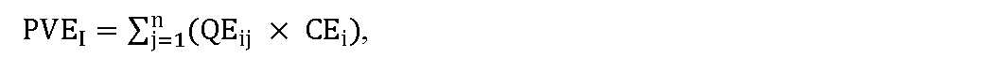

# § 48 Spôsob výpočtu ceny vykupovanej elektriny, postup a podmienky uplatňovania cien

(1) Cenová regulácia podľa odsekov 2 až 7 a § 49 sa vzťahuje na výkup elektriny a činnosť výkupcu elektriny.

(2) Cena vykupovanej elektriny v j-tej hodine roku t v eurách na jednotku množstva elektriny CVEj,t sa vypočíta podľa vzorca

CVEj,t = ZCVEj,t – k,

kde

- a) ZCVEj,t je základ pre výpočet ceny vykupovanej elektriny v j-tej hodine roku t v eurách na jednotku množstva elektriny vypočítaný podľa odseku 3,

- b) k je koeficient podľa odsekov 4 a 5 v eurách na jednotku množstva elektriny.

(3) Základ pre výpočet ceny vykupovanej elektriny podľa § 6 ods. 1 písm. b) zákona o podpore v j-tej hodine roku t v eurách na jednotku množstva elektriny sa vypočíta podľa vzorca

Z

C

V

E

j

,

t

=

C

D

T

j

,

t

+

k

,

kde

- a) CDTj,t je cena elektriny slovenskej obchodnej oblasti na dennom trhu organizovanom organizátorom krátkodobého trhu s elektrinou v j-tej hodine roku t v eurách na jednotku množstva elektriny,

- b) k je koeficient podľa odsekov 4 a 5 v eurách na jednotku množstva elektriny a rovná sa výške úhrady za činnosť výkupcu elektriny, určenej podľa § 49 ods. 2 alebo ods. 3.

(4) Po uplynutí základného časového úseku podľa § 9 ods. 1 zákona o podpore sa pre i-té zariadenie výrobcu elektriny, ktorý využil právo na podporu výkupom elektriny podľa § 3 ods. 1 písm. b) zákona o podpore a prevzatím zodpovednosti za odchýlku podľa § 3 ods. 1 písm. d) zákona o podpore, vypočíta vážený priemer cien vykupovanej elektriny VPCVEvi v eurách na jednotku množstva elektriny za základný časový úsek podľa vzorca

V

P

C

V

E

v

i

=

∑

j

=

1

n

(

Q

E

i

,

j

×

C

V

E

j

,

t

)

∑

j

=

1

n

Q

E

i

,

j

,

kde

- a) QEi,j je množstvo elektriny s nárokom na podporu výkupom elektriny podľa § 3 ods. 1 písm. b) zákona o podpore a prevzatím zodpovednosti za odchýlku podľa § 3 ods. 1 písm. d) zákona o podpore vyrobenej v i-tom zariadení výrobcu elektriny a vykúpenej výkupcom elektriny v režime prenesenej zodpovednosti za odchýlku v j-tej hodine základného časového úseku v jednotkách množstva elektriny,

- b) CVEj,tje cena vykupovanej elektriny v j-tej hodine základného časového úseku v eurách na jednotku množstva elektriny vypočítaná podľa odseku 2,

- c) n je počet hodín základného časového úseku.

(5) Ak je vážený priemer cien vykupovanej elektriny VPCVEvi nižší alebo sa rovná cene elektriny podľa § 6 ods. 1 písm. a) zákona o podpore, výška platby za vykúpenú elektrinu vyrobenú v i-tom zariadení výrobcu elektriny, ktorý využil právo na podporu výkupom elektriny podľa § 3 ods. 1 písm. b) zákona o podpore a prevzatím zodpovednosti za odchýlku podľa § 3 ods. 1 písm. d) zákona o podpore, za základný časový úsek PVEiv eurách sa vypočíta podľa vzorca

P

V

E

i

=

∑

j

=

1

n

(

Q

E

i

,

j

×

C

V

E

j

,

t

)

,

kde

- a) QEi,jje množstvo elektriny s nárokom na podporu výkupom elektriny podľa § 3 ods. 1 písm. b) zákona o podpore a prevzatím zodpovednosti za odchýlku podľa § 3 ods. 1 písm. d) zákona o podpore vyrobenej v i-tom zariadení výrobcu elektriny a vykúpenej výkupcom elektriny v režime prenesenej zodpovednosti za odchýlku v j-tej hodine základného časového úseku v jednotkách množstva elektriny,

- b) CVEj,tje cena vykupovanej elektriny v j-tej hodine základného časového úseku v eurách na jednotku množstva elektriny vypočítaná podľa odseku 2,

- c) n je počet hodín základného časového úseku.

(6) Ak je vážený priemer cien vykupovanej elektriny VPCVEvivyšší ako cena elektriny podľa § 6 ods. 1 písm. a) zákona o podpore, výška platby za vykúpenú elektrinu vyrobenú v i-tom zariadení výrobcu elektriny, ktorý využil právo na podporu výkupom elektriny podľa § 3 ods. 1 písm. b) zákona o podpore a prevzatím zodpovednosti za odchýlku podľa § 3 ods. 1 písm. d) zákona o podpore, za základný časový úsek PVEi v eurách sa vypočíta podľa vzorca

kde

- a) QEij je množstvo elektriny s nárokom na podporu výkupom elektriny podľa § 3 ods. 1 písm. b) zákona o podpore a prevzatím zodpovednosti za odchýlku podľa § 3 ods. 1 písm. d) zákona o podpore, vyrobenej v i-tom zariadení výrobcu elektriny a vykúpenej výkupcom elektriny v režime prenesenej zodpovednosti za odchýlku v j-tej hodine základného časového úseku v jednotkách množstva elektriny,

- b) CEi je cena elektriny podľa § 6 ods. 1 písm. a) zákona o podpore,

- c) n je počet hodín základného časového úseku.

(7) Ak výrobca elektriny využil pre i-té zariadenie výrobcu elektriny právo na podporu výkupom elektriny podľa § 3 ods. 1 písm. b) zákona o podpore, a zároveň si neuplatňuje právo na podporu prevzatím zodpovednosti za odchýlku podľa § 3 ods. 1 písm. d) zákona o podpore, výška platby za vykúpenú elektrinu vyrobenú v i-tom zariadení výrobcu elektriny, ktorý využil právo na podporu výkupom elektriny podľa § 3 ods. 1 písm. b) zákona o podpore, za základný časový úsek PVEi v eurách sa vypočíta podľa vzorca

P

V

E

i

=

∑

j

=

1

n

(

Q

E

i

,

j

×

C

V

E

j

,

t

)

,

kde

- a) QEij je množstvo elektriny s nárokom na podporu výkupom elektriny podľa § 3 ods. 1 písm. b) zákona o podpore, vyrobenej v i-tom zariadení výrobcu elektriny a vykúpenej výkupcom elektriny v j-tej hodine základného časového úseku v jednotkách množstva elektriny,

- b) CVEj,tje cena vykupovanej elektriny v j-tej hodine základného časového úseku v eurách na jednotku množstva elektriny vypočítaná podľa odseku 2,

- c) n je počet hodín základného časového úseku.
